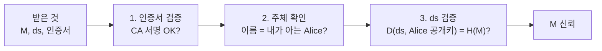

# 2026-11-03

> **목차**
>
> **[정보보안](#정보보안)**
> 1. [전자서명](#1-전자서명) — 해시에 개인키로 서명, 공개키로 검증
> 2. [전자인증서](#2-전자인증서) — 공개키가 그 사람 것임을 CA가 보증
> 3. [인증서 발급과 검증 순서](#3-인증서-발급과-검증-순서) — 인증서 → 주체 → ds 순으로 확인
> 4. [PKI와 인증서 체인](#4-pki와-인증서-체인) — 루트(신뢰 앵커)까지 이어 확인
> 5. [CA 개인키 보호 (HSM)](#5-ca-개인키-보호-hsm) — HSM · M-of-N · 직무 분리

## 정보보안

> **흐름**: 서명으로 출처를 확인하려면 **공개키를 믿을 수 있어야** 하고, 그 믿음을 만드는 구조(인증서 → 체인 → CA 키 보호)를 차례로 파고들었다.


### 1. 전자서명

> **한 줄 결론**: 메시지의 **해시**를 **내 개인키로 서명**해 M과 같이 보낸다. 받는 쪽은 **공개키**로 풀어, 직접 계산한 해시와 비교한다.

정식 표현: 메시지 다이제스트 md를 송신자 개인키로 암호화한 값 ds. 무결성 · 출처 인증 · 부인방지를 준다.

#### 왜 해시를 쓰나

| M 전체를 서명하면 | 해시 md만 서명하면 |
|---|---|
| M↑ → 공개키 연산 횟수↑ → 속도↓ | M이 얼마나 커도 서명 길이 **고정** |
| 블록별 서명 → 순서 변경·삭제 공격 가능 | M 전체가 하나의 값에 묶임 |

#### 동작

```text
서명  md = H(M)      ds = E(md, A_pr)      전송: M ‖ ds
검증  H(M) == D(ds, A_pu)      합격 → 무결성 + 출처 인증 + 부인방지
```

#### 헷갈린 점

> [!WARNING]
> 검증은 개인키가 아니라 **공개키**로 한다. 개인키는 A만 가진다 → 공개키로 풀린다 = A가 만든 값.

- 해시 = M의 지문, 서명 = 지문 보호. "해시 = 무결성, 공개키 = 출처 인증"으로 나눠 외우면 부정확

| 표기 | 기준 |
|---|---|
| Sign / Verify | DSA · ECDSA까지 포함하는 일반 표기 |
| E / D | RSA 기준 |

### 2. 전자인증서

> **한 줄 결론**: 이 공개키가 **이 사람 것**이고 **아직 믿어도 된다**는 것을 **CA가 서명으로 보증**한 문서.

정식 표현: 공개키 인증서(X.509). CA가 소유자–공개키 결속(binding)에 한 전자서명.

#### 왜 필요한가

공개키는 공개 → 누구나 자기 키를 "A의 것"이라 주장할 수 있다.

| 전자서명 | 전자인증서 |
|---|---|
| **누가 보냈나** | **검증용 공개키가 그 사람 것인가** |

검증키 바꿔치기 공격은 이렇게 통한다:

```text
"키가 바뀌었으니 교체해 주세요" → 공격자 키 등록 → 공격자 서명이 A의 서명으로 통과
```

- 키 변경에는 정당한 이유가 있다(개인키 유출, 알고리즘 약화, 주기적 갱신) → 요청 자체를 의심하기 어려워 공격이 통한다

#### 동작

- 신뢰하는 CA의 공개키로 인증서 서명 검증 → 안의 공개키 신뢰
- 유효기간은 공개키가 아니라 **인증서**에 있다
- 만료 전 사고(개인키 유출 등) → **폐지**(CRL · OCSP)
- 유효 = **기간 안** + **폐지 안 됨**

> [!WARNING]
> 보증 범위는 **공개키–신원 연결**까지다. 그 사람이 믿을 만한지는 보증하지 않는다.

### 3. 인증서 발급과 검증 순서

> **한 줄 결론**: 인증서 발급 = **CA가 자기 개인키로 하는 전자서명**. Bob은 **인증서 → 주체 → ds** 순서로 확인해야 M을 믿는다.

정식 표현: 인증서 검증, X.509(공개키 인증서 표준 서식).

#### 발급

서명하는 쪽만 CA일 뿐, 전자서명 구조 그대로다.

```text
서명값 = E( H(tbsCertificate), CA_pr )

X.509 인증서
├─ tbsCertificate : 발급자 · 유효기간 · 주체 · 공개키 · 확장
├─ 서명 알고리즘
└─ 서명값
```

#### Bob의 검증 순서

Alice가 M, ds, 인증서를 보냈을 때:



- M은 믿음의 **출발점이 아니라 마지막에 얻는 결과**
- 출발점은 미리 내장된 **CA 공개키**

#### 헷갈린 점

> [!WARNING]
> **2번을 빼면 뚫린다.** M이 자기 정상 인증서로 서명하고 "Alice입니다"라고 하면 통과해 버린다. 누구 서명을 받을지는 M의 말이 아니라 **내가 아는 것**으로 정한다.

M이 어떤 인증서를 붙여도 하나에서 걸린다:

| 공격 | 걸리는 단계 |
|---|---|
| 인증서 위조 | 1번 (CA 서명 불일치) |
| M 자신의 정상 인증서 | 2번 (주체가 Alice가 아님) |
| Alice의 진짜 인증서 훔침 | 3번 (개인키가 없어 ds 불일치) |

### 4. PKI와 인증서 체인

> **한 줄 결론**: PKI = 공개키를 믿고 쓰게 해 주는 **인프라 전체**, 체인 = 그 안에서 **루트까지 이어 확인하는 길**.

정식 표현: 공개키 기반구조(PKI), 인증서 체인(인증 경로), 신뢰 앵커(trust anchor).

#### PKI 구성

| 구성 요소 | 하는 일 |
|---|---|
| CA | 인증서 발급 |
| RA | 신원 확인 |
| 저장소 | 인증서 · 폐지 정보 보관 |
| 폐지 | CRL · OCSP로 폐지 여부 확인 |
| 정책 | CPS (운영 규칙) |

> [!NOTE]
> 옛 한국 체계는 KISA 루트 아래 공인인증기관이었다. 2020-12 공인인증제도가 폐지되고 전자서명인증사업자 평가·인정으로 바뀌었다.

#### 체인

```text
Alice 인증서  ←  중간 CA  ←  …  ←  루트 CA
   아래 인증서의 발급자 = 위 인증서의 주체
```

- 검증: 한 칸씩 올라가며 서명 확인 → 내 저장소의 루트를 만나면 **멈춤**, 못 만나면 **실패**
- 루트 = **자체 서명**(발급자 = 주체) + OS · 브라우저에 미리 저장 = **신뢰 앵커**

#### 헷갈린 점

> [!WARNING]
> **자체 서명 ≠ 신뢰.** 누구나 자체 서명 루트를 만들 수 있다(가짜 "KISA Root CA"도 서명 검증은 통과). 신뢰는 OS · 브라우저 회사가 감사한 뒤 내장했다는 **사실**에서 나온다.

- 출처 불명 루트를 설치하라는 요구 → 위험 (설치하면 신뢰됨)
- 계층을 두는 이유 = 루트 키 오프라인 보호 + 사고 범위 제한

### 5. CA 개인키 보호 (HSM)

> **한 줄 결론**: CA 개인키는 **HSM 안에서만** 쓰고, **여러 명이 있어야** 쓰고, 일하는 사람도 **역할로 나눠** 한 사람이 독식하지 못하게 한다.

정식 표현: HSM(하드웨어 보안 모듈), M-of-N 통제, 직무 분리(separation of duties).

#### 어떻게 지키나

| 장치 | 방법 | 막는 것 |
|---|---|---|
| **HSM** | 키가 장비 밖으로 나가지 않음. 서명 요청만 받아 내부에서 처리 | 키 탈취 |
| **M-of-N** | 카드 · 비밀번호를 여러 명이 나눠 가짐 | 혼자 사용 |
| **직무 분리** | 설정 변경 / 키 사용 / 감사를 서로 다른 사람이 맡음 | 권한 독점 |

- 루트는 오프라인 금고에 두고, 일상 발급은 온라인 중간 CA(HSM)가 한다 → 발급 속도와는 무관

#### 헷갈린 점

> [!WARNING]
> HSM은 키를 **못 가져가게**, M-of-N은 혼자 **못 쓰게** 막는다. 막는 위험이 다르다.

> [!NOTE]
> 구조는 공개되고 **키가 비밀**이다(케르크호프스 원리). 인증 · 감사로 검증한다.
