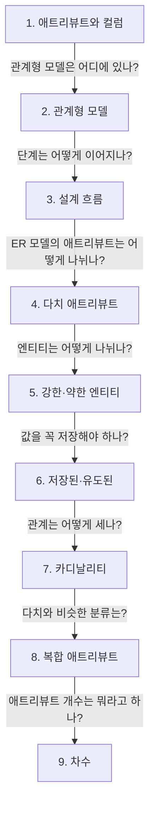

> **2026-11-04 목차**
>
> **[데이터베이스](#데이터베이스)**
> 1. [애트리뷰트와 컬럼](#1-애트리뷰트와-컬럼) — 같은 대상, 관점에 따라 다른 이름
> 2. [관계형 모델은 어디에 있나](#2-관계형-모델은-어디에-있나) — 저장물이 아니라 표와 규칙의 이론
> 3. [데이터베이스 설계 흐름](#3-데이터베이스-설계-흐름) — 개념적 → 논리적 → 물리적 → 구현
> 4. [다치 애트리뷰트](#4-다치-애트리뷰트) — 애트리뷰트 하나에 값이 여러 개
> 5. [강한 엔티티와 약한 엔티티](#5-강한-엔티티와-약한-엔티티) — 혼자 구별되는가
> 6. [저장된 애트리뷰트와 유도된 애트리뷰트](#6-저장된-애트리뷰트와-유도된-애트리뷰트) — 직접 저장 vs 계산
> 7. [카디날리티](#7-카디날리티) — 공통은 개수, 세는 대상은 상황마다 다름
> 8. [복합 애트리뷰트](#8-복합-애트리뷰트) — 값 하나가 여러 부분으로 나뉨
> 9. [차수](#9-차수) — 릴레이션의 애트리뷰트 개수

# 데이터베이스

> **흐름**: 애트리뷰트와 컬럼의 차이에서 출발해 설계 단계를 잡고, ER 모델의 애트리뷰트·엔티티 분류와 카디날리티로 이어졌다.



## 1. 애트리뷰트와 컬럼

> **한 줄 결론**: 공부하는 관점에 따라 같은 대상의 이름이 달라진다. 애트리뷰트는 ER 모델과 관계형 모델의 말이고, 컬럼은 실제 RDB의 말이다.

정식 표현: 애트리뷰트는 개체나 릴레이션의 속성, 컬럼은 이를 RDBMS 테이블에 구현한 열이다.

### 관점별 용어

| 관점 | 묶음 | 한 건 | 속성 하나 |
|---|---|---|---|
| ER 모델 | 개체 집합 | 개체 | 애트리뷰트 |
| 관계형 모델 | 릴레이션 | 튜플 | 애트리뷰트 |
| SQL·RDBMS | 테이블 | 행 | 컬럼 |

### 헷갈린 점

> [!WARNING]
> **애트리뷰트는 ER 모델만의 말이 아니다.** 관계형 모델에서도 쓴다.

- 릴레이션(표) ≠ 관계(relationship, 개체끼리의 연결). ER 모델은 관계선으로 잇는 구조라 릴레이션이라고 부르기 부적합
- 동의어로만 보면 안 됨: ER의 복합·다중값 애트리뷰트 → 컬럼 여러 개 또는 별도 테이블

## 2. 관계형 모델은 어디에 있나

> **한 줄 결론**: 관계형 모델은 어딘가에 저장된 물건이 아니라 표와 규칙으로 데이터를 다루는 이론이다. 표끼리는 선이 아니라 **같은 값**으로 연결한다.

정식 표현: 데이터를 릴레이션으로 표현하고, 키와 무결성 제약 같은 규칙을 정의하는 논리적 데이터 모델.

### 어디에 어떤 형태로 있나

| 층 | 위치 | 형태 |
|---|---|---|
| 관계형 모델 | 교과서, 설계자의 머리 | 표와 키로 다루는 규칙 |
| 릴레이션 스키마 | 설계 문서 | `학생(학번 PK, 이름, 학과)` |
| SQL 정의 | `schema.sql` | `CREATE TABLE` |
| 실제 테이블 | DBMS 안 | 테이블과 데이터 |

### 표를 잇는 방법

```text
학생(학번 PK, 이름, 학과)
수강(학번 PK·FK, 과목코드 PK, 성적)
```

- 수강의 학번 값 = 학생의 학번 값 → 연결(외래키)
- 표를 선으로 이은 그림 = 구조를 보기 좋게 그린 다이어그램

### 헷갈린 점

> [!WARNING]
> **"개념적"이라고 부르면 시험에서 틀린다.** 개념적 데이터 모델은 ER 모델이고, 관계형 모델은 논리적 데이터 모델이다.

## 3. 데이터베이스 설계 흐름

> **한 줄 결론**: ER 모델로 개념적 설계를 하고, 이를 바탕으로 관계형 모델을 만들고, `schema.sql` 같은 설계서로 물리적 설계까지 한 뒤, 실제 데이터를 저장할 구현물을 만든다.

정식 표현: 요구사항 분석 → 개념적 설계 → 논리적 설계 → 물리적 설계 → 구현.

### 단계별 결과물

| 단계 | 정하는 것 | 결과물 |
|---|---|---|
| 요구사항 분석 | 필요한 데이터 | 요구사항 명세 |
| 개념적 설계 | 개체, 애트리뷰트, 관계 | ER 모델 |
| 논리적 설계 | 릴레이션과 키 | 관계형 모델 |
| 물리적 설계 | 타입, 인덱스, 저장 방식 | 물리적 데이터 모델 (DDL로 표현) |
| 구현 | DDL 실행 | 실제 테이블 |

### 헷갈린 점

> [!WARNING]
> **물리적 데이터 모델은 DBMS에 들어간 결과물이 아니라 들어가기 직전의 설계다.** `schema.sql`은 이를 DDL로 표현한 파일이고, 실행해야 테이블이 생긴다.

- `schema.sql` 안의 PK·FK = 논리적 설계에서 온 것 / `VARCHAR`·`INDEX` = 물리적 결정

## 4. 다치 애트리뷰트

> **한 줄 결론**: 개체 안의 애트리뷰트 하나에 값 자체가 여러 개일 수 있는 것. ER 다이어그램에서는 그 애트리뷰트를 이중으로 그린다.

정식 표현: 다치 애트리뷰트(multivalued attribute). 한 개체가 하나의 애트리뷰트에 대해 여러 값을 가질 수 있는 애트리뷰트.

### 왜 필요한가

- 학번은 1개, 전화번호는 여러 개일 수 있음
- 한 칸에 번호 여러 개 → 번호 하나만 찾거나 고치기 어려움

### 어떻게 옮기나

```text
ER 모델     [학생] — ((전화번호))   이중 타원
관계형 모델  학생(학번 PK, 이름)
            학생전화(학번 PK·FK, 전화번호 PK)
```

### 헷갈린 점

> [!WARNING]
> **세는 대상은 애트리뷰트가 아니라 값이다.** 개체는 원래 애트리뷰트를 여러 개 가질 수 있다. 다치는 그중 애트리뷰트 하나의 값이 여러 개라는 뜻이고, 표시도 개체가 아니라 그 애트리뷰트에 한다.

| 질문 | 학생의 예 | 다치와 관계 |
|---|---|---|
| 애트리뷰트가 몇 개인가 | 학번, 이름, 전화번호 → 3개 | 없음 |
| 전화번호의 값이 몇 개인가 | 번호 2개 | 이 경우가 다치 |

## 5. 강한 엔티티와 약한 엔티티

> **한 줄 결론**: 기준은 자기 애트리뷰트만으로 각 개체를 구별할 수 있는가이다. 부양가족은 이름만으로 구별되지 않아 직원의 사번이 필요하다.

정식 표현: 약한 엔티티 타입은 자체 키가 없어 소유 엔티티의 키와 자신의 부분 키를 합쳐 식별한다.

### 두 표로 보기

**직원 (강한 엔티티 타입)**: 사번 하나로 행이 정해짐

| 사번 (PK) | 이름 | 부서 |
|---|---|---|
| 1001 | 박민수 | 개발 |
| 1002 | 최지영 | 영업 |

**부양가족 (약한 엔티티 타입)**: 사번 + 가족 이름이어야 행이 정해짐

| 사번 (PK·FK) | 가족 이름 (PK) | 관계 |
|---|---|---|
| 1001 | 김하나 | 자녀 |
| 1001 | 박두리 | 배우자 |
| 1002 | 김하나 | 배우자 |

- 소유 엔티티 = 직원 / 부분 키 = 가족 이름
- ER 표기: 약한 엔티티 이중 네모, 식별 관계 이중 마름모, 부분 키 점선 밑줄
- 사번 칸은 릴레이션으로 옮길 때 추가됨. ER 모델에서는 식별 관계로 표현

### 헷갈린 점

> [!WARNING]
> **외래키가 있다고 약한 엔티티는 아니다.** 주문이 고객 번호를 외래키로 가져도 주문번호만으로 구별되면 강한 엔티티다.

## 6. 저장된 애트리뷰트와 유도된 애트리뷰트

> **한 줄 결론**: 저장된 애트리뷰트는 값을 직접 저장하고, 유도된 애트리뷰트는 다른 값으로 계산한다. 이거 아니면 저거인 상호 배타적 개념이다.

정식 표현: 저장된 애트리뷰트(stored attribute), 유도된 애트리뷰트(derived attribute).

### 왜 나누나

| 구분 | 예 | 특징 |
|---|---|---|
| 저장된 | 생년월일 | 값을 직접 저장 |
| 유도된 | 나이 | 필요할 때 계산, ER에서 점선 타원 |

- 나이를 저장 → 해가 바뀌면 전부 수정 필요, 안 고치면 틀린 값
- 계산이 무겁고 자주 조회 → 성능 때문에 저장하기도 함, 대신 값을 함께 맞춰야 함

### 헷갈린 점

> [!WARNING]
> **상호 보완이 아니라 상호 배타다.** 상호 배타적 = 하나에 해당하면 다른 하나에 해당할 수 없음. 다만 기준이 다른 분류는 함께 해당할 수 있다(전화번호 = 다치 + 저장된).

## 7. 카디날리티

> **한 줄 결론**: ER 모델에서는 1:1이냐 1:N이냐를 말하고, 관계형 모델 릴레이션에서는 튜플의 개수를 말한다. 어떤 상황에서 말하느냐에 따라 세는 대상이 달라진다.

정식 표현: 카디날리티(cardinality).

### 상황별 뜻

| 상황 | 세는 것 | 표현 |
|---|---|---|
| 집합 (자료구조) | 서로 다른 원소 | `\|{1, 2, 3}\| = 3` |
| 릴레이션 | 튜플 | 튜플 3개 → 카디날리티 3 |
| ER 모델의 관계 | 연결될 수 있는 상대 개체 | 1:1, 1:N, M:N |

- 릴레이션 = 튜플의 집합 → 릴레이션의 카디날리티 = 집합의 카디날리티
- 학과–학생 1:N / 학생–과목 M:N

### 헷갈린 점

> [!WARNING]
> **카디날리티는 애트리뷰트 개수가 아니다.** 애트리뷰트 개수는 차수(degree)다.

## 8. 복합 애트리뷰트

> **한 줄 결론**: 값 하나가 여러 부분으로 나뉘는 애트리뷰트. 주소를 시, 구, 도로명으로 나누는 경우다.

정식 표현: 복합 애트리뷰트(composite attribute).

### 어떻게 옮기나

```text
ER 모델     주소 → 시, 구, 도로명
테이블      시, 구, 도로명 컬럼 (보통 여러 개)
```

### 헷갈린 점

> [!WARNING]
> **다치와 다르다.** 복합은 값 하나가 여러 부분으로 나뉘는 것이고, 다치는 같은 종류의 값이 여러 개인 것이다.

| 구분 | 예 | 나뉘는 것 |
|---|---|---|
| 복합 | 주소 → 시, 구, 도로명 | 값 하나의 부분 |
| 다치 | 전화번호 2개 | 같은 종류의 값 여러 개 |

## 9. 차수

> **한 줄 결론**: 릴레이션의 차수는 애트리뷰트 개수다. 튜플이 늘면 카디날리티는 늘지만 차수는 그대로다.

정식 표현: 차수(degree).

### 카디날리티와 비교

| 학번 | 이름 | 학과 |
|---|---|---|
| 2023001 | 김원광 | 컴퓨터공학 |
| 2023002 | 이익산 | 경영학 |
| 2023003 | 최지영 | 컴퓨터공학 |

| 구분 | 세는 것 | 이 표 | 학생 1명 추가 |
|---|---|---|---|
| 차수 | 애트리뷰트 | 3 | 3 |
| 카디날리티 | 튜플 | 3 | 4 |

### 자료구조의 차수

| 구조 | 차수의 뜻 |
|---|---|
| 트리 | 노드의 자식 수 |
| 그래프 | 정점에 연결된 간선 수 |
