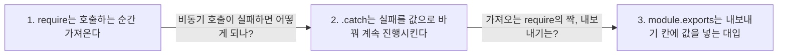

> **2026-11-05 목차**
>
> **[ONE Student](#one-student)**
> 1. [라우터 만들고 도구 가져오기](#1-라우터-만들고-도구-가져오기) — 1~5줄: 라우터를 만들고 쓸 파일을 가져옴
> 2. [요청이 라우터를 지나는 순서](#2-요청이-라우터를-지나는-순서) — 로그인 확인 → 방식+주소로 함수 선택
> 3. [졸업 현황 조회 함수](#3-졸업-현황-조회-함수) — 졸업 현황에 변경 알림을 붙여 200 응답
> 4. [응답 형식과 code 이름표](#4-응답-형식과-code-이름표) — 4칸 응답, code는 구분용 이름표
> 5. [에러가 공통 처리기까지 가는 길](#5-에러가-공통-처리기까지-가는-길) — 400은 직접, 나머지는 next(err)로 500
> 6. [알림 확인 처리 함수](#6-알림-확인-처리-함수) — true · false 둘 다 200, 실패는 그대로 에러
>
> **[JavaScript](#javascript)**
> 1. [require는 호출하는 순간 가져온다](#1-require는-호출하는-순간-가져온다) — 서버 켜질 때 실행, 쓰는 건 요청 때
> 2. [.catch는 실패를 값으로 바꿔 계속 진행시킨다](#2-catch는-실패를-값으로-바꿔-계속-진행시킨다) — 실패 시에만 실행, 반환값이 결과 자리에
> 3. [module.exports는 내보내기 칸에 값을 넣는 대입](#3-moduleexports는-내보내기-칸에-값을-넣는-대입) — require의 짝, 함수 호출 아님

# ONE Student

> **흐름**: 파일 첫머리(1~5줄)를 줄 단위로 읽은 뒤, 라우터에 등록된 줄들이 요청을 어떤 순서로 처리하는지 이어서 봤다. 그다음 GET 핸들러 안쪽(응답 · 에러)과 POST 핸들러까지 읽었다.


## 1. 라우터 만들고 도구 가져오기

> **지도에서 위치**: [ONE Student 지도](../../projects/one-student.md) › 졸업요건 진단 › `routes/graduation.js` (1~5줄)
> **한 줄 결론**: 1~5줄은 주소를 처리하는 줄이 아니라 **이 파일이 쓸 도구를 갖추는 준비**다. 1줄은 express를 **가져오고**, 2줄은 거기서 이 파일 전용 라우터를 **만든다**.

### 한 줄씩

| 줄 | 코드 | 하는 일 |
|---|---|---|
| 1 | `const express = require('express')` | 설치된 express를 가져와 `express`에 담음 |
| 2 | `const router = express.Router()` | **비어 있는** 새 라우터를 만들어 `router`에 담음 |
| 3 | `const { requireAuth } = require('../middleware/auth')` | auth.js가 공개한 것 중 `requireAuth`**만** 꺼냄 |
| 4 | `const graduationService = require('../services/graduationService')` | 공개한 것 **전부**를 한 이름에 담음 |
| 5 | `const changeNoticeService = require('../services/changeNoticeService')` | 4줄과 같은 방식 |

- 2줄 끝 `()` = 호출 → 라우터를 **만든다**. 파일마다 자기 라우터를 하나씩 가짐
- 만든 라우터는 비어 있고, 11·14·32줄이 `use`·`get`·`post`로 채움 → 41줄 `module.exports = router`로 내보냄
- 3줄만 `{ }`가 있는 이유: auth.js에 `requireAuth`, `requireAdmin` 둘이 있는데 이 파일은 하나만 필요
- 4·5줄은 `{ }`가 없어 묶음 통째로 담김 → `graduationService.getGraduationStatus(…)`처럼 점으로 꺼내 씀

### 헷갈린 점

> [!WARNING]
> **3~5줄은 "이름 줄이기"가 아니라 파일을 열어 공개 목록을 가져오는 일이다.** `const 이름 = …`은 별명 붙이기처럼 보이지만, 왼쪽은 가져온 것을 담는 그릇일 뿐이다.

이전 기록: [11-03 graduation.js 읽기](11-03.md#5-graduationjs-읽기)
다음 기록: [요청이 라우터를 지나는 순서](#2-요청이-라우터를-지나는-순서)

## 2. 요청이 라우터를 지나는 순서

> **지도에서 위치**: [ONE Student 지도](../../projects/one-student.md) › 졸업요건 진단 › `routes/graduation.js` (11~14줄, 32줄)
> **한 줄 결론**: 서버가 켜질 때 `use`·`get`·`post`가 라우터에 **등록**되고, 요청이 오면 **로그인 확인(`use`)을 먼저 통과해야** 방식+주소가 맞는 줄로 간다.

정식 표현: 미들웨어 → 라우트 핸들러 순서 실행

### 등록 시점과 실행 시점

| 시점 | 일어나는 일 |
|---|---|
| 서버가 켜질 때 | 파일이 위에서 아래로 읽히며 11·14·32줄이 라우터에 등록됨 |
| 요청이 올 때 | 등록된 목록을 보고 길을 찾아 실행 |

### 요청 하나의 길

```text
GET /api/graduation/status
  ↓
router.use(requireAuth)        11줄. 방식·주소와 상관없이 항상 먼저
  ├─ 세션에 userId ○ → next() → 다음 줄로
  └─ 세션에 userId ✗ → 401 응답 → 여기서 끝 (get까지 안 감)
  ↓
router.get('/status', …)       14줄. GET이고 주소가 /status일 때만
```

- 로그인 안 한 사람은 `/status`뿐 아니라 이 파일의 **모든 주소**에서 401
- 길을 고르는 기준 = **방식 + 주소 둘 다**: `POST /status`는 등록된 줄이 없어 실행할 게 없음

### 헷갈린 점

> [!WARNING]
> **`get`·`post`는 상태가 아니라 요청 방식(method)이다.** 상태 코드(200, 401)는 반대로 **응답**에 붙는 결과 숫자다.

| | 방식 (method) | 상태 코드 (status code) |
|---|---|---|
| 의미 | 요청이 하려는 일 | 응답에 붙는 결과 숫자 |
| 예 | GET(조회), POST(저장·실행) | 200 성공, 401 로그인 안 됨 |
| 붙는 곳 | 들어오는 요청 | 나가는 응답 |

### 면접에서 설명한다면

라우터 파일은 서버가 켜질 때 미들웨어와 핸들러를 순서대로 등록하고, 요청이 오면 먼저 로그인 확인 미들웨어를 실행합니다. 통과하면 요청의 메서드와 경로가 모두 맞는 핸들러가 실행되고, 통과하지 못하면 401로 응답하고 끝납니다.

이전 기록: [라우터 만들고 도구 가져오기](#1-라우터-만들고-도구-가져오기)
다음 기록: [졸업 현황 조회 함수](#3-졸업-현황-조회-함수)

## 3. 졸업 현황 조회 함수

> **지도에서 위치**: [ONE Student 지도](../../projects/one-student.md) › 졸업요건 진단 › `routes/graduation.js` (`GET /api/graduation/status`)
> **한 줄 결론**: 서비스에서 받은 졸업 현황(`data`)에 **바뀐 자료 알림**(`data.changeNotice`)을 붙여 200으로 응답한다. 알림 비교가 실패해도 `null`만 달고 응답은 계속 간다.

정식 표현: 라우트 핸들러(route handler)

### 이름 풀이

| 이름 | 종류 | 역할 |
|---|---|---|
| `getGraduationStatus` | 함수 | get + Graduation + Status. 학생의 졸업 현황을 만들어 돌려줌 |
| `changeNotice` | 값(칸) | change + Notice. 바뀐 자료 알림을 담는 칸 |
| `observe` | 함수 | 지켜보다. DB에 저장해 둔 지난번 졸업 현황 요약과 이번 결과를 견줌 |

- 함수는 동사(`get`, `observe`), 칸·묶음은 명사(`changeNotice`, `graduationService`)

### 요청 하나의 길

```text
GET /api/graduation/status            (로그인 확인 통과 후)
  ↓
data = getGraduationStatus(userId)    졸업 현황
  ↓
data.changeNotice = observe(userId, data)    지난번 요약과 비교
  ├─ 달라짐       → 알림 객체
  ├─ 같음 · 처음  → null
  └─ 비교 실패    → .catch가 로그만 찍고 null
  ↓
200 + { status, code, message, data }
```

- `observe`가 어느 쪽이든 `data.changeNotice`에 값(또는 `null`)이 붙어 **200 줄까지 계속 간다**
- 그 밖의 에러가 터지면 200 줄은 건너뛰고 `catch`로 → [5번](#5-에러가-공통-처리기까지-가는-길)

### 헷갈린 점

> [!WARNING]
> **`.catch` 안은 평소엔 실행되지 않는다.** `observe`가 실패했을 때만 실행되고, 성공하면 결과(알림 객체나 `null`)가 그대로 `data.changeNotice`에 들어간다. → [JavaScript 2번](#2-catch는-실패를-값으로-바꿔-계속-진행시킨다)

### 면접에서 설명한다면

졸업 현황 조회 핸들러는 서비스에서 결과를 받아 변경 알림을 붙여 200으로 응답합니다. 알림 비교가 실패해도 `.catch`로 `null`을 돌려줘 졸업 현황 응답이 500으로 죽지 않게 했고, 그 밖의 에러는 `next`로 공통 에러 처리기에 넘깁니다.

이전 기록: [요청이 라우터를 지나는 순서](#2-요청이-라우터를-지나는-순서)
다음 기록: [응답 형식과 code 이름표](#4-응답-형식과-code-이름표)

## 4. 응답 형식과 code 이름표

> **지도에서 위치**: [ONE Student 지도](../../projects/one-student.md) › 졸업요건 진단 › `routes/graduation.js` (`res.status(200).json({ … })`)
> **한 줄 결론**: 응답은 `{ status, code, message, data }` 네 칸으로 통일돼 있고, **`code`는 응답에 다는 이름표**다. 에러일 때 라우터와 React가 이 이름표로 `if` 구분을 한다.

정식 표현: 에러 코드(응답 본문의 `code` 필드)

### 네 칸

| 칸 | 담는 것 | 이 파일의 예 |
|---|---|---|
| `status` | HTTP 상태 코드와 같은 숫자 | 200, 400 |
| `code` | 프로젝트가 정한 응답 이름표 | `GRADUATION_STATUS_SUCCESS`, `ONBOARDING_REQUIRED` |
| `message` | 설명 문구 | 이 파일에서는 전부 `null` |
| `data` | 실제 결과 | 졸업 현황, 에러면 `null` |

### code가 실제로 쓰이는 길 (에러)

```text
서비스                         err.code = 'ONBOARDING_REQUIRED' 를 붙여 throw
  ↓
라우터 catch                   err.code로 if 구분 → 400 응답 본문에 같은 code를 실음
  ↓
client/src/api/chatApi.js      err.code = body.code  (응답의 code를 에러로 옮김)
  ↓
client/src/pages/GraduationStatus.jsx    code로 분기해 화면을 정함
```

### 헷갈린 점

> [!WARNING]
> **성공 `code`(`GRADUATION_STATUS_SUCCESS`)는 React에서 읽는 곳이 없다.** 그래도 `code` 칸의 목적은 구분용 이름표이고, 에러에서는 실제로 쓰인다. 성공 `code`는 응답 형식을 맞춰 둔 칸으로 보인다(추정).

이전 기록: [졸업 현황 조회 함수](#3-졸업-현황-조회-함수)
다음 기록: [에러가 공통 처리기까지 가는 길](#5-에러가-공통-처리기까지-가는-길)

## 5. 에러가 공통 처리기까지 가는 길

> **지도에서 위치**: [ONE Student 지도](../../projects/one-student.md) › 졸업요건 진단 › `routes/graduation.js` (`router.get('/status')`의 `catch`)
> **한 줄 결론**: `catch`에서 에러의 `code`가 `ONBOARDING_REQUIRED`면 400으로 **직접 응답**하고, 그 외 에러는 `next(err)`로 **공통 에러 처리기(`app.js`)에 넘겨** 500으로 응답한다.

정식 표현: 에러 처리 미들웨어(error-handling middleware)

### 두 갈래

| `err.code` | 처리 | 응답 |
|---|---|---|
| `ONBOARDING_REQUIRED` (학생 정보나 학과가 아직 없음) | 라우터가 `return`으로 직접 응답 | 400 + 같은 `code` |
| 그 외 | `next(err)`로 넘김 → `app.js`의 공통 에러 처리기 | 500 `INTERNAL_SERVER_ERROR` |

```text
try 안에서 에러 발생
  ↓
catch (err)
  ├─ err.code === 'ONBOARDING_REQUIRED' → return res.status(400).json(…)    여기서 끝
  └─ 그 외 → next(err) → app.js 공통 에러 처리기 → console.error(err.stack) + 500 응답
```

- `ONBOARDING_REQUIRED`는 서비스가 던진다: 학생 정보나 `department_id`가 없을 때(`graduationService.js`의 `getGraduationStatus`)
- 공통 처리기는 `app.js` 아래쪽에 있고 매개변수가 `(err, req, res, next)` 4개

### 헷갈린 점

> [!WARNING]
> **`next(err)`는 응답을 보내는 게 아니라 에러를 넘기는 것이다.** 500 응답은 라우터가 아니라 `app.js`의 공통 에러 처리기가 만든다.

### 면접에서 설명한다면

라우터에서는 에러의 `code`로 처리 방식을 가릅니다. 온보딩이 필요한 경우는 400으로 직접 응답하고, 나머지 에러는 `next(err)`로 넘겨 `app.js`의 공통 에러 처리기가 500으로 응답합니다.

이전 기록: [응답 형식과 code 이름표](#4-응답-형식과-code-이름표)
다음 기록: [알림 확인 처리 함수](#6-알림-확인-처리-함수)

## 6. 알림 확인 처리 함수

> **지도에서 위치**: [ONE Student 지도](../../projects/one-student.md) › 졸업요건 진단 › `routes/graduation.js` (`POST /api/graduation/change-notice/acknowledge`)
> **한 줄 결론**: GET에서 배운 구조를 그대로 쓴다. `acknowledge`는 알림을 확인하면 **알림을 띄울 때 저장해 둔 결과를 다음 비교의 기준으로 옮기**고, 결과가 `true`든 `false`든 둘 다 정상이라 200으로 응답한다.

정식 표현: 라우트 핸들러(route handler)

### acknowledged 값

| 값 | 상황 | DB |
|---|---|---|
| `true` | 알림이 떠 있던 학생 | 저장해 둔 결과(`pending_summary`)를 새 기준으로 옮김 |
| `false` | 확인할 알림이 원래 없던 학생 | 저장 없음. 실패가 아니라 정상 결과 |

### GET과 견주기

| | GET `/status` | POST `/change-notice/acknowledge` |
|---|---|---|
| 호출하는 함수 | `getGraduationStatus`, `observe` | `acknowledge` |
| 하는 일 | 졸업 현황 + 알림 조회 | 알림 확인 → 저장해 둔 결과를 새 기준으로 옮김 |
| 실패 | `observe` 실패는 `.catch`로 삼키고 `null` | 삼키지 않음(이 요청의 목적이 `acknowledge`) → `next(err)` |
| `ONBOARDING_REQUIRED` 분기 | 있음 | 없음, `next(err)`만 |
| 응답 `data` | 졸업 현황 | `{ acknowledged }` |

### 헷갈린 점

> [!WARNING]
> **"저장"이 두 군데에서 일어난다.** 결과를 변수 `acknowledged`에 담는 건 에러가 없으면 항상이고, DB에 새 기준을 저장하는 건 `true`일 때만이다.

이전 기록: [에러가 공통 처리기까지 가는 길](#5-에러가-공통-처리기까지-가는-길)

<br>
<br>
<br>
<br>
<br>
<br>
<br>
<br>
<br>
<br>

# JavaScript

> **흐름**: `require`로 가져오는 때를 본 뒤, 실패를 값으로 바꾸는 `.catch`와 가져오기의 짝인 `module.exports`를 이어서 봤다.



## 1. require는 호출하는 순간 가져온다

> **한 줄 결론**: `require(…)`는 괄호가 있어 **그 줄이 실행되는 순간** 파일을 열어 공개 목록을 가져온다. 변수를 나중에 쓸 때 가져오는 게 아니다.

정식 표현: CommonJS 모듈, 인자(argument)
어디서 마주쳤나: ONE Student `routes/graduation.js` 3~5줄

### 호출이 두 번, 시점이 다르다

| 호출 | 실행 시점 | 하는 일 |
|---|---|---|
| `require('../services/graduationService')` | 파일이 처음 읽힐 때(서버가 켜질 때) | 파일을 열어 공개 목록을 받아 옴 |
| `graduationService.getGraduationStatus(…)` | 요청이 올 때마다 | 담아 둔 함수를 실행 |

- 괄호 = "지금 실행". `router.use(requireAuth)`의 `requireAuth`는 괄호가 없어 지금 실행하지 않고 **등록만** 함
- `require('express')`의 `'express'`처럼 호출할 때 넘기는 값 = **인자**, 함수를 만들 때 받으려고 적어 둔 이름(`req`, `res`, `next`) = **매개변수**

### 경로 표기

| 표기 | 뜻 | 예 |
|---|---|---|
| `./` | 지금 파일과 같은 폴더 | `app.js`(server/)에서 `./routes/auth` |
| `../` | 한 단계 위 폴더 | `graduation.js`(routes/)에서 `../middleware/auth` |
| 표시 없음 | 설치된 패키지 | `'express'` |

- `../middleware/auth`는 URL 주소가 아니라 **내 컴퓨터 안의 파일 경로**(라우터가 보는 `/status`와 다름)

### 헷갈린 점

> [!WARNING]
> **`require`의 괄호 안은 "나중에 부를 이름"이 아니라 "지금 가져올 파일"이다.** 가져오기는 서버가 켜질 때 끝나고, 요청이 오면 이미 담아 둔 함수만 실행한다.

이전 기록: [11-03 require와 module.exports](11-03.md#1-require와-moduleexports)
다음 기록: [.catch는 실패를 값으로 바꿔 계속 진행시킨다](#2-catch는-실패를-값으로-바꿔-계속-진행시킨다)

## 2. .catch는 실패를 값으로 바꿔 계속 진행시킨다

> **한 줄 결론**: `await 함수().catch(…)`는 함수가 **실패했을 때만** `.catch` 안을 실행하고, 거기서 돌려준 값(`null`)이 **성공 결과 자리에 대신 들어간다.** 그래서 실패해도 다음 줄로 계속 간다.

정식 표현: Promise 에러 처리(`Promise.prototype.catch`)
어디서 마주쳤나: ONE Student `routes/graduation.js`의 `observe` 호출

### 성공과 실패의 갈림

| `observe` 결과 | `.catch` 안 실행 | `data.changeNotice`에 들어가는 값 |
|---|---|---|
| 성공 (달라짐) | ✗ | 알림 객체 |
| 성공 (같음 · 처음) | ✗ | `null` |
| 실패 | ○ (로그 찍고 `return null`) | `null` |

### `.catch`가 있을 때와 없을 때

```text
.catch 없음   observe 실패 → 에러 → 바깥 catch → next(err) → 500   (졸업 현황까지 못 받음)
.catch 있음   observe 실패 → 로그 + null → 다음 줄 계속 → 200     (알림만 비어 있음)
```

### 헷갈린 점

> [!WARNING]
> **`.catch` 안의 `return null`은 핸들러를 끝내는 return이 아니다.** `await`의 결과 자리에 `null`을 넣어 줄 뿐이라, 그다음 줄(200 응답)로 계속 간다.

이전 기록: [require는 호출하는 순간 가져온다](#1-require는-호출하는-순간-가져온다)
다음 기록: [module.exports는 내보내기 칸에 값을 넣는 대입](#3-moduleexports는-내보내기-칸에-값을-넣는-대입)

## 3. module.exports는 내보내기 칸에 값을 넣는 대입

> **한 줄 결론**: `module.exports = router`는 이 파일에서 선언한 상수 `router`를 다른 파일에서도 쓸 수 있게 **내보내는** 줄이다. 함수 호출이 아니라 **내보내기 칸에 값을 넣는 대입**이다.

정식 표현: CommonJS 내보내기(`module.exports`)
어디서 마주쳤나: ONE Student `routes/graduation.js` 마지막 줄, `app.js`의 `require('./routes/graduation')`

### require와 짝

| | 어디에서 | 하는 일 |
|---|---|---|
| `module.exports = X` | 내보내는 파일 | X를 내보내기 칸에 넣음 |
| `require('./그파일')` | 가져오는 파일 | 그 칸에 든 것을 받아 옴 |

- 무엇을 넣었는지에 따라 받는 쪽이 달라진다

| 파일 | 넣은 것 | 받는 쪽 |
|---|---|---|
| `auth.js` | `{ requireAuth, requireAdmin }` 묶음 | `{ requireAuth }`로 하나만 꺼냄 |
| `graduation.js` | `router` 하나 | 받은 것이 곧 `router` (`app.js`의 `graduationRoutes`) |

- `app.js`가 받은 `router`에 `/api/graduation` 접두사를 붙여 연결함

### 헷갈린 점

> [!WARNING]
> **`module.exports`는 내장 라이브러리 함수가 아니다.** 괄호 호출이 없고, 파일마다 Node가 기본으로 만들어 주는 `module` 객체의 `exports` 칸에 `=`로 값을 넣는 것이다. 그래서 `require` 없이 바로 쓴다.

이전 기록: [11-03 require와 module.exports](11-03.md#1-require와-moduleexports)
