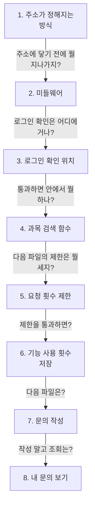
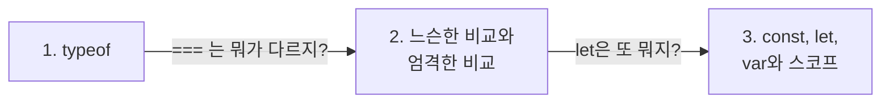

> **2026-11-06 목차**
>
> **[ONE Student](#one-student)**
> 1. [주소가 정해지는 방식](#1-주소가-정해지는-방식) — app.js + 라우터 파일에 적은 글자
> 2. [핸들러 전에 지나가는 미들웨어](#2-핸들러-전에-지나가는-미들웨어) — 핸들러 전 공통 처리 함수
> 3. [로그인 확인을 거는 위치](#3-로그인-확인을-거는-위치) — 파일 전체 또는 주소 하나
> 4. [과목 검색 함수](#4-과목-검색-함수) — 결과 없음은 200, 실패는 에러
> 5. [요청 횟수 제한](#5-요청-횟수-제한) — 클릭이 아니라 서버 요청을 셈
> 6. [기능 사용 횟수 저장 함수](#6-기능-사용-횟수-저장-함수) — 값을 걸러 저장, 204 응답
> 7. [문의 작성 함수](#7-문의-작성-함수) — 저장만 기다리고 부가 작업은 안 기다림
> 8. [내 문의 보기 함수](#8-내-문의-보기-함수) — 세션의 사용자 번호로 조회
>
> **[JavaScript](#javascript)**
> 1. [typeof는 값의 종류를 알려 준다](#1-typeof는-값의-종류를-알려-준다) — 결과가 글자라 문자열과 비교
> 2. [느슨한 비교와 엄격한 비교](#2-느슨한-비교와-엄격한-비교) — 기본은 `===`
> 3. [const, let, var와 스코프](#3-const-let-var와-스코프) — 기본 const, 바꿀 때만 let

# ONE Student

> **흐름**: `courses.js`를 읽다 주소와 로그인 확인 위치가 헷갈려 짚은 뒤, `uiEvents.js`와 `inquiries.js`로 라우터 순회를 이어 갔다.



## 1. 주소가 정해지는 방식

> **지도에서 위치**: [ONE Student 지도](../../projects/one-student.md) › 요청 흐름 › 주소
> **한 줄 결론**: 주소는 폴더 구조가 아니라 **`app.js`와 라우터 파일에 적은 글자를 이어 붙여** 정해진다. 그래서 `app.js`를 먼저 보고 라우터로 간다.

정식 표현: 경로(path), 쿼리 스트링(query string), 마운트 경로 + 라우트 경로

### 주소의 구조

```text
https://서비스주소/api/courses/catalog?year=2026&semester=1
                  └── 경로 ─────────┘ └── 값 ───────────┘
```

- 서비스 주소 다음부터 `?` 앞까지 = 경로, `?` 뒤 = 값(`&`로 구분)
- 함수를 고르는 기준 = 메서드 + 경로. `?` 뒤 값이 달라도 같은 함수

### 경로는 코드 두 곳을 이어 붙인 것

| `app.js`(마운트 경로) | 라우터 파일(라우트 경로) | 합친 경로 |
|---|---|---|
| `/api/courses` | `/catalog` | `/api/courses/catalog` |
| `/api/ui-events` | `/` | `/api/ui-events` |

- `/`는 모든 주소가 아니라 **덧붙일 게 없다**는 뜻

### 헷갈린 점

> [!WARNING]
> **주소는 파일 위치와 상관없다.** `server/routes/uiEvents.js`인데 주소에 `api`가 나오는 건 `app.use('/api/ui-events', …)`에 그렇게 적었기 때문이다.

이전 기록: [11-03 요청 하나가 지나가는 길](11-03.md#1-요청-하나가-지나가는-길)
다음 기록: [핸들러 전에 지나가는 미들웨어](#2-핸들러-전에-지나가는-미들웨어)

## 2. 핸들러 전에 지나가는 미들웨어

> **지도에서 위치**: [ONE Student 지도](../../projects/one-student.md) › 요청 흐름 › 미들웨어
> **한 줄 결론**: 미들웨어는 특정 위치에 고정된 게 아니라, 요청이 **핸들러에 도착하기 전에 지나가는 함수**다. 통과시키거나 응답으로 끝낸다.

정식 표현: 미들웨어(middleware)

### 쓸 수 있는 곳

```text
app.js → 라우터 파일 전체 → 주소 하나 → [핸들러] → 서비스
└────── 미들웨어 구간 ───────┘
```

| 위치 | 예 |
|---|---|
| `app.js` | `express.json`, `trackActivity` |
| 파일 전체 | `router.use(requireAuth)` |
| 주소 하나 | `router.post('/', uiEventLimiter, …)` |

### 하는 일

| 경우 | 코드 | 결과 |
|---|---|---|
| 통과 | `next()` | 다음 함수로 |
| 차단 | `res.status(401).json(…)` | 응답하고 끝 |

- Express가 강제하는 건 아니라 없어도 동작함. 대신 `requireAuth`가 빠지면 누구나 접근 가능
- 서비스에서는 안 씀. 서비스는 `req`, `res`, `next`를 모름

이전 기록: [주소가 정해지는 방식](#1-주소가-정해지는-방식)
다음 기록: [로그인 확인을 거는 위치](#3-로그인-확인을-거는-위치)

## 3. 로그인 확인을 거는 위치

> **지도에서 위치**: [ONE Student 지도](../../projects/one-student.md) › 요청 흐름 › 미들웨어
> **한 줄 결론**: 파일 전체에 필요하면 `router.use`, 일부 주소에만 필요하면 주소마다 넣는다. 순서가 아니라 **적용 범위**의 차이다.

정식 표현: 라우터 레벨 미들웨어, 라우트별 미들웨어

| | `router.use(requireAuth)` | `router.get('/catalog', requireAuth, …)` |
|---|---|---|
| 적용 범위 | 그 뒤에 등록한 모든 주소 | 이 주소 하나 |
| 느낌 | 이 파일에 들어오려면 로그인부터 | `GET /catalog`로 왔네? 로그인했어? |

- `router.get`에 넘긴 함수는 왼쪽부터 실행. 로그인 확인을 통과해야 오른쪽 함수로 감
- `onboarding.js`처럼 로그인 없이 쓰는 주소가 섞이면 주소마다 넣음

이전 기록: [11-05 요청이 라우터를 지나는 순서](11-05.md#2-요청이-라우터를-지나는-순서)
다음 기록: [과목 검색 함수](#4-과목-검색-함수)

## 4. 과목 검색 함수

> **지도에서 위치**: [ONE Student 지도](../../projects/one-student.md) › 과목 검색 › `routes/courses.js`
> **한 줄 결론**: 요청의 질의를 풀어서 연도와 학기를 검사하고 검색한다. 검색 과정 자체가 실패하면 공통 에러 함수로 가고, 결과만 없으면 빈 배열과 함께 200이다.

정식 표현: 쿼리 파라미터(`req.query`), 입력값 검증

### 이름 풀이

| 이름 | 뜻 |
|---|---|
| `req.query` | 주소의 `?` 뒤 값 묶음 |
| `semester` | 학기 |
| `scope` | 범위. 학생의 소속 학과, 내 학과 과목을 앞에 두는 데 씀 |

### 요청 하나의 길

```text
GET /api/courses/catalog?year=2026&semester=1
  ↓
로그인 확인
  ↓
연도 없음 · 학기 없음 → 400 (값이 맞는지는 안 봄, 없는지만 봄)
  ↓
student, scope 준비
  ↓
검색 → 200 + 결과
```

### 실패 처리가 다른 이유

| | `.catch` | 실패하면 |
|---|---|---|
| `student`, `scope` | 있음 | `null`, 정렬만 빠지고 계속 |
| `data` | 없음 | `catch` → `next(err)` |

### 헷갈린 점

> [!WARNING]
> **결과가 없는 것과 검색이 실패한 것은 다르다.** 검색이 정상으로 끝나고 결과만 0개면 `[]`와 200이다. `next(err)`는 검색 과정 자체가 실패할 때다.

이전 기록: [로그인 확인을 거는 위치](#3-로그인-확인을-거는-위치)
다음 기록: [요청 횟수 제한](#5-요청-횟수-제한)

## 5. 요청 횟수 제한

> **지도에서 위치**: [ONE Student 지도](../../projects/one-student.md) › 기능 사용 횟수 › `routes/uiEvents.js`
> **한 줄 결론**: 클릭이 아니라 **서버로 가는 요청**을 사람마다 센다. 서버 과부하와 통계 부풀리기를 막는 여유 있는 상한이다.

정식 표현: 요청 횟수 제한(rate limiting), HTTP 429

### 코드

```js
const uiEventLimiter = perUserLimiter({ windowMs: 60 * 1000, max: 12 });
```

- 1분에 최대 12번 → 넘으면 429
- 호출해서 미들웨어를 만들어 저장. 파일마다 숫자만 바꿔 씀(문의 작성은 1시간 20번)
- 만들기만 한 것. 적용은 `router.post('/', uiEventLimiter, …)`에서

### 클릭과 요청

```text
클릭 30번 → 브라우저에 쌓임 → 15초마다 요청 1번 → 서버
                                 └ 여기를 셈
```

- 사람이 빨리 눌러도 안 걸림. 프로그램으로 서버에 직접 계속 보내면 걸림
- 사용자 번호로 셈 → 한 IP를 여럿이 쓰는 기숙사에서 서로 막히지 않음

이전 기록: [과목 검색 함수](#4-과목-검색-함수)
다음 기록: [기능 사용 횟수 저장 함수](#6-기능-사용-횟수-저장-함수)

## 6. 기능 사용 횟수 저장 함수

> **지도에서 위치**: [ONE Student 지도](../../projects/one-student.md) › 기능 사용 횟수 › `routes/uiEvents.js`
> **한 줄 결론**: 화면과 버튼이 몇 번 쓰였는지 받아, 요청의 body를 그대로 쓰지 않고 **규칙에 맞는 값만 골라** 저장한 뒤 204로 응답한다.

정식 표현: `req.body`(요청 본문), HTTP 204 No Content

```text
req.body → normalizeEvents(값 걸러내기) → recordEvents(오늘 합계에 더함) → 204
```

- 괄호는 안쪽부터 실행
- 누가 썼는지는 저장하지 않고 기능별 합계만 남김

| | `courses.js` | `uiEvents.js` |
|---|---|---|
| 코드 | `res.status(200).json({ … })` | `res.status(204).end()` |
| 보내는 것 | 코드 + 내용 | 코드만 |

이전 기록: [요청 횟수 제한](#5-요청-횟수-제한)
다음 기록: [문의 작성 함수](#7-문의-작성-함수)

## 7. 문의 작성 함수

> **지도에서 위치**: [ONE Student 지도](../../projects/one-student.md) › 문의하기 › `routes/inquiries.js`
> **한 줄 결론**: 제목과 본문을 검사하고 문의를 저장한 뒤 201로 응답한다. 저장은 이 요청의 목적이라 기다리고, 관리자 알림과 AI 분류는 **부가 기능이라 기다리지 않는다.**

정식 표현: 입력값 검증, HTTP 201 Created, 비동기 작업을 기다리지 않는 호출

### 요청 하나의 길

```text
횟수 제한 통과
  ↓
문자열이면 공백 제거(삼항 연산자)
  ↓
제목 · 본문이 올바르지 않으면 400
  ↓
문의 저장 (await)
  ├─ 관리자 알림 (안 기다림)
  ├─ AI 분류 (안 기다림)
  ↓
201 + 문의 번호
```

### 검사 함수

```js
typeof title === 'string' && title.trim().length > 0 && title.trim().length <= TITLE_MAX_LENGTH
```

- 조건에 따라 `true` 또는 `false`를 **항상 반환**
- 문자열 검사가 맨 앞 → 숫자에 `.trim()`을 호출해 500이 나는 걸 막고 400으로 답함

### await를 뺀 이유

| | await 있음 | await 없음 |
|---|---|---|
| 응답 시점 | 알림 · 분류가 끝난 뒤 | 저장이 끝나면 바로 |
| 부가 작업 실패 | 문의 작성까지 실패할 수 있음 | 문의 작성은 성공 |

### 헷갈린 점

> [!WARNING]
> **`!isValidTitle(title)`이 `true`일 때 400이다.** `if`는 괄호 안이 `true`일 때 실행된다. "제목이 올바르지 않으면 400"으로 읽는다.

### 면접에서 설명한다면

문의 저장은 요청의 목적이라 `await`로 기다리고, 관리자 알림과 AI 분류는 기다리지 않습니다. 부가 작업 때문에 학생의 응답이 늦어지거나 문의 작성이 실패하지 않게 하려는 것이고, 각 함수가 안에서 에러를 처리합니다.

이전 기록: [기능 사용 횟수 저장 함수](#6-기능-사용-횟수-저장-함수)
다음 기록: [내 문의 보기 함수](#8-내-문의-보기-함수)

## 8. 내 문의 보기 함수

> **지도에서 위치**: [ONE Student 지도](../../projects/one-student.md) › 문의하기 › `routes/inquiries.js`
> **한 줄 결론**: `GET /api/inquiries/mine`으로 세션의 사용자 번호를 넘겨 내 문의 목록을 조회하고, 200으로 응답한다.

정식 표현: 라우트 핸들러(route handler)

- 사용자 번호를 주소가 아니라 **세션**에서 가져옴 → 요청하는 사람이 바꿔 보낼 수 없어 남의 문의를 볼 수 없음
- 작성과 달리 횟수 제한 없음

### 헷갈린 점

> [!WARNING]
> **`const`가 보인다고 DB 저장 여부를 알 수는 없다.** `const`는 돌아온 결과를 담는 그릇이다. 저장인지 조회인지는 호출하는 함수(`create`, `list`)가 정한다.

이전 기록: [문의 작성 함수](#7-문의-작성-함수)

<br>
<br>
<br>
<br>
<br>
<br>
<br>
<br>
<br>
<br>

# JavaScript

> **흐름**: `typeof`로 시작해 비교 기호가 헷갈려 정리한 뒤, 변수 선언의 차이를 봤다.



## 1. typeof는 값의 종류를 알려 준다

> **한 줄 결론**: `typeof`는 값의 종류를 **글자로** 알려 준다. 그래서 `typeof title === 'string'`처럼 문자열과 비교한다.

정식 표현: `typeof` 연산자
어디서 마주쳤나: ONE Student `routes/inquiries.js`의 제목 검사

| 코드 | 결과 |
|---|---|
| `typeof '수강 문의'` | `'string'` |
| `typeof 123` | `'number'` |
| `typeof true` | `'boolean'` |
| `typeof undefined` | `'undefined'` |
| `typeof null`, `typeof ['a']` | `'object'` |

- 요청 본문은 조작해서 보낼 수 있어 문자열이라고 믿으면 안 됨 → 먼저 확인

다음 기록: [느슨한 비교와 엄격한 비교](#2-느슨한-비교와-엄격한-비교)

## 2. 느슨한 비교와 엄격한 비교

> **한 줄 결론**: `=`는 대입, `==`는 타입을 변환한 뒤 비교, `===`는 변환 없이 타입과 값을 함께 비교한다. 기본은 `===`다.

정식 표현: 동등 비교(`==`), 일치 비교(`===`), 타입 변환(type coercion)
어디서 마주쳤나: ONE Student `routes/inquiries.js`의 `typeof title === 'string'`

| 코드 | 결과 | 이유 |
|---|---|---|
| `1 == '1'` | `true` | 문자열을 숫자로 변환한 뒤 비교 |
| `1 === '1'` | `false` | 타입이 달라 바로 거짓 |

### 언제 무엇을 쓰나

| 상황 | 쓰는 방법 |
|---|---|
| 보통의 비교 | `===` |
| 타입이 다를 수 있는 값 | 직접 변환 후 `===` (`Number(year) === 2026`) |
| 값이 없는지 검사 | `== null` (`null`, `undefined` 둘 다) |

### 헷갈린 점

> [!WARNING]
> **`==`도 타입이 다른 건 안다.** 다르면 한쪽을 변환한 뒤 비교해서 `true`가 나온다. 사라진 문법은 아니지만 새 코드에는 거의 쓰지 않는다.

이전 기록: [typeof는 값의 종류를 알려 준다](#1-typeof는-값의-종류를-알려-준다)
다음 기록: [const, let, var와 스코프](#3-const-let-var와-스코프)

## 3. const, let, var와 스코프

> **한 줄 결론**: 일단 `const`로 쓰고, 값을 다시 넣어야 할 때만 `let`을 쓴다. `var`는 `{ }`를 무시하는 옛 문법이라 새 코드에는 잘 쓰지 않는다.

정식 표현: 블록 스코프(`const`, `let`), 함수 스코프(`var`)
어디서 마주쳤나: ONE Student `routes/emailRelay.js`의 `let event`

| 선언 | 값 다시 넣기 | 보이는 범위 |
|---|---|---|
| `const` | 안 됨 | 선언한 `{ }` 안 |
| `let` | 가능 | 선언한 `{ }` 안 |
| `var` | 가능 | 선언한 함수 안 |

- `try` 안에서 `const`로 선언하면 `{ }` 밖에서 못 씀 → 밖에 `let`을 두고 안에서 값을 넣음

### 헷갈린 점

> [!WARNING]
> **`var`가 곧 전역 변수는 아니다.** 함수 안에서 선언하면 함수 밖에서는 안 보인다. Node.js에서는 파일 맨 위에 선언해도 그 파일 안에서만 보인다.

이전 기록: [느슨한 비교와 엄격한 비교](#2-느슨한-비교와-엄격한-비교)
