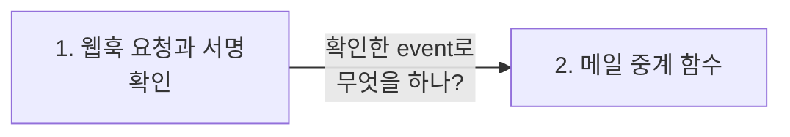
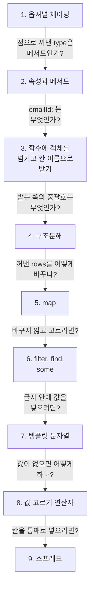

> **2026-11-07 목차**
>
> **[ONE Student](#one-student)**
> 1. [웹훅 요청과 서명 확인](#1-웹훅-요청과-서명-확인) — 진짜 Resend 요청이면 event에 넣음
> 2. [메일 중계 함수](#2-메일-중계-함수) — if를 통과하면 상대의 실제 주소로 전달
>
> **[JavaScript](#javascript)**
> 1. [옵셔널 체이닝](#1-옵셔널-체이닝) — 값이 없으면 에러 없이 멈춤
> 2. [속성과 메서드](#2-속성과-메서드) — 값이면 속성, 함수면 메서드
> 3. [함수에 객체를 넘기고 칸 이름으로 받기](#3-함수에-객체를-넘기고-칸-이름으로-받기) — `emailId:`는 객체의 칸 이름
> 4. [구조분해](#4-구조분해) — 구조에서 값을 분해해 변수에 담기
> 5. [map](#5-map) — 요소마다 바꿔 새 배열 만들기
> 6. [filter, find, some](#6-filter-find-some) — 배열, 값 하나, 참·거짓
> 7. [템플릿 문자열](#7-템플릿-문자열) — 글자 안에 값 넣기
> 8. [값 고르기 연산자](#8-값-고르기-연산자) — `||`, `&&`, `??`의 차이
> 9. [스프레드](#9-스프레드) — 내용을 펼쳐서 넣기

# ONE Student

> **흐름**: 이 라우터는 요청을 보내는 쪽이 학생이 아니라 Resend라서 방향부터 잡고, 받은 값으로 메일을 전달할지 판단하는 순서로 읽었다.



## 1. 웹훅 요청과 서명 확인

> **지도에서 위치**: [ONE Student 지도](../../projects/one-student.md) › 메일 중계 › `routes/emailRelay.js` (`POST /inbound` 앞부분)
> **한 줄 결론**: 요청의 헤더와 바디를 넘겨 진짜 Resend 요청인지 확인하고, 유효하면 돌려받은 값을 `event`에 넣는다. 그래서 `event.type`, `event.data.to`를 꺼내 쓸 수 있다.

정식 표현: 웹훅(webhook), 서명 검증(signature verification)

### 누가 누구에게 보내나

학생 브라우저가 아니라 **Resend가 요청하는 쪽**이다. 그래서 로그인 확인이 없다.

```text
Resend → 서버   요청: 메일이 도착했어
                └ 확인한 뒤 내용을 event에 넣음
서버 → Resend   응답: 처리 결과 (상태 코드 + JSON)
                └ res.status(...).json(...)
```

### event에 담기는 값

Resend가 보낸 요청 바디를 객체로 바꾼 값이다. 주소는 예시다.

```js
event = {
  type: 'email.received',
  data: { email_id: 'abc123', to: ['student7@example.com'] },
};
```

- 메일 내용이 아니라 메일이 도착했다는 알림
- `event`라는 이름은 서버 코드가 정함. Resend는 이 변수를 모름
- 서명이 유효하지 않으면 에러 → `catch` → 400으로 끝남

### 없으면 무슨 일이 생기나

주소가 공개되어 있어 아무나 가짜 알림을 보낼 수 있다 → 서버가 믿고 중계를 시도함.

### 헷갈린 점

> [!WARNING]
> **`event`는 Resend에 대한 응답이 아니라 Resend가 보낸 요청의 내용이다.** 응답은 `res.status(...).json(...)`이다. `verifyWebhook`의 반환값은 서버 안의 함수 결과일 뿐이고 HTTP 응답과는 별개다.

이전 기록: [요청 횟수 제한](11-06.md#5-요청-횟수-제한)
다음 기록: [메일 중계 함수](#2-메일-중계-함수)

## 2. 메일 중계 함수

> **지도에서 위치**: [ONE Student 지도](../../projects/one-student.md) › 메일 중계 › `routes/emailRelay.js` (`POST /inbound`)
> **한 줄 결론**: 매칭된 학생끼리 실제 이메일을 숨기려고 메일을 중계한다. 걸러 내는 `if`를 모두 통과하면 정상적인 상황이라 상대의 실제 주소로 전달한다.

정식 표현: 라우트 핸들러(route handler), 이메일 프록시(email proxy)

### 왜 만들었나

실제 주소를 보여 주면 개인정보가 드러난다. 그래서 화면에는 매칭 전용 연결 주소만 보여 주고, 그 주소로 온 메일을 서버가 전달한다.

- Resend: 메일을 대신 보내고 받아 주는 외부 서비스
- 연결 주소로 온 메일은 누군가 전달해야 상대에게 도착함
- 메일이 항상 서버를 거치므로 차단 · 제재 때 전달을 멈출 수 있음

### 요청 하나의 길

| 순서 | 확인 | 결과 |
|---|---|---|
| 1 | 진짜 Resend 요청인가 | 아니면 400 |
| 2 | 메일 받음(`email.received`) 알림인가 | 아니면 200 `IGNORED` |
| 3 | 전달할 상대가 있는가 | 없으면 200 `PROXY_NOT_FOUND` |
| 4 | 전달해도 되는가 | 안 되면 200 + 차단 코드 |
| 5 | 메일 전달 | 200 `RELAYED` |

- 응답을 받는 쪽은 Resend. 화면에 띄우는 것이 아님
- `IGNORED`: 잘못된 요청이 아니라 처리할 일이 없을 뿐이라 200

### target에 담기는 값

`blocked`는 갑자기 나온 값이 아니라 `findEmailRelayTarget`이 돌려준 값 안의 칸이다.

```js
target = null;                            // 상대를 못 찾음
target = { blocked: 'CONTACT_BLOCKED' };  // 찾았지만 전달하면 안 됨
target = { recipientEmail, senderProxyEmail };  // 전달 가능
```

### 헷갈린 점

> [!WARNING]
> **`if`에 `return`이 있으면 `else`가 없어도 된다.** `email.received`가 아니면 거기서 끝나므로, 아래로 내려왔다면 `email.received`라는 뜻이다.

이전 기록: [웹훅 요청과 서명 확인](#1-웹훅-요청과-서명-확인)

<br>
<br>
<br>
<br>
<br>
<br>
<br>
<br>
<br>
<br>

# JavaScript

> **흐름**: `event`에서 값을 꺼내는 줄을 읽다가 `?.`와 객체의 모양을 정리했고, 이어서 서비스 코드에 자주 나오는 문법 6가지를 기본형부터 봤다.



## 1. 옵셔널 체이닝

> **한 줄 결론**: `?.`는 왼쪽 값이 있을 때만 다음으로 넘어간다. 값이 없을 때의 에러를 간단하게 막아 주는 문법이다.

정식 표현: 옵셔널 체이닝(optional chaining)
어디서 마주쳤나: ONE Student `routes/emailRelay.js`의 `event.data.to?.[0]`

### 어떻게 동작하나

| `to` 상태 | `to[0]` | `to?.[0]` |
|---|---|---|
| `['student7@example.com']` | 첫 번째 값 | 첫 번째 값 |
| 없음 | **에러** | `undefined` |

```js
const toAddress = event.data.to?.[0];
const target = toAddress ? await findEmailRelayTarget(toAddress) : null;
```

- `undefined`는 조건 자리에서 거짓 취급(falsy) → `: null`로 감
- `[0]`: 배열의 첫 번째 값. 번호는 0부터

### 헷갈린 점

> [!WARNING]
> **`?.`는 삼항 연산자가 아니고, `try/catch`와도 다르다.** 뒤에 `:`가 없다. 이미 발생한 에러를 잡는 것이 아니라 에러가 나기 전에 멈춘다. DB 오류 같은 다른 에러는 막지 않는다.

다음 기록: [속성과 메서드](#2-속성과-메서드)

## 2. 속성과 메서드

> **한 줄 결론**: 속성은 객체 안에 있는 값이고, 메서드는 객체 안에 있는 함수다. 차이는 크기가 아니라 값의 종류다.

정식 표현: 속성(property), 메서드(method)
어디서 마주쳤나: ONE Student `routes/emailRelay.js`의 `event.type`, `res.status(200)`

| 코드 | 표현 |
|---|---|
| `event.type` | `type`은 `event`의 속성 |
| `A.getData()` | `getData`는 `A`의 메서드 |
| `res.status(200)` | `status`는 `res`의 메서드 |

- 괄호 없이 값을 읽으면 속성, 보통 괄호를 붙여 실행하면 메서드
- `event.data`처럼 큰 객체도 속성

### 헷갈린 점

> [!WARNING]
> **변수가 아니라 객체 안에 있다.** 변수는 객체를 담은 그릇이다. `event.type`은 값이 글자라서 메서드가 아니라 속성이다.

이전 기록: [옵셔널 체이닝](#1-옵셔널-체이닝)
다음 기록: [함수에 객체를 넘기고 칸 이름으로 받기](#3-함수에-객체를-넘기고-칸-이름으로-받기)

## 3. 함수에 객체를 넘기고 칸 이름으로 받기

> **한 줄 결론**: `emailId:`는 함수에 넘기는 객체의 칸 이름이다. 받는 함수는 칸 이름으로 풀어 쓴다.

정식 표현: 객체 리터럴(object literal), 구조분해 할당(destructuring assignment)
어디서 마주쳤나: ONE Student `routes/emailRelay.js`의 `relayInboundEmail({ ... })`

```js
// 넘기는 쪽
await relayInboundEmail({
  emailId: event.data.email_id,
  to: target.recipientEmail,
  from: target.senderProxyEmail,
});

// 받는 쪽
async function relayInboundEmail({ emailId, to, from }, ...) { ... }
```

- `{ status: 200 }`과 같은 문법. 함수에 넘기면서 바로 만들었을 뿐
- 칸 이름이 있어 값의 뜻이 보이고 순서를 헷갈리지 않음

이전 기록: [속성과 메서드](#2-속성과-메서드)
다음 기록: [구조분해](#4-구조분해)

## 4. 구조분해

> **한 줄 결론**: `=` 왼쪽의 `{ }`나 `[ ]`는 오른쪽 값의 구조에서 필요한 값을 분해해 변수에 담는다.

정식 표현: 구조분해 할당(destructuring assignment)
어디서 마주쳤나: ONE Student `routes/courses.js`, `services/inquiryService.js`

### 어떻게 동작하나

| 모양 | 꺼내는 대상 | 기준 |
|---|---|---|
| `const { keyword, year } = req.query` | 객체 | 칸 이름 |
| `const [first, second] = fruits` | 배열 | 순서 (이름은 왼쪽에 적은 대로) |

```js
const [rows] = await pool.query(...);
// pool.query가 돌려주는 배열에서 첫 번째 값을 rows에 넣음
```

- 값을 꺼내 올 뿐이고 원본은 그대로 남음

이전 기록: [함수에 객체를 넘기고 칸 이름으로 받기](#3-함수에-객체를-넘기고-칸-이름으로-받기)
다음 기록: [map](#5-map)

## 5. map

> **한 줄 결론**: 배열의 요소를 전부 한 번씩 함수에 넣어 바꾸고, 그 결과로 새 배열을 만든다.

정식 표현: 배열 내장 메서드 `Array.prototype.map`
어디서 마주쳤나: ONE Student `services/inquiryService.js`의 `rows.map`

### 어떻게 동작하나

```js
const students = [{ name: '철수', age: 20 }, { name: '영희', age: 21 }];
const names = students.map((s) => s.name);   // ['철수', '영희']
```

| 실행 순서 | `s` | 결과 |
|---:|---|---|
| 1 | 철수 객체 | `'철수'` |
| 2 | 영희 객체 | `'영희'` |

- 프로젝트에서는 DB 행을 `created_at` → `createdAt` 모양으로 바꿔 반환하는 데 씀
- `s` 이름은 자유. 왼쪽과 오른쪽 이름만 같으면 됨

### 헷갈린 점

> [!WARNING]
> **`map`은 한 번 부르면 안에서 요소 수만큼 함수를 자동으로 실행한다.** `name`을 꺼내는 건 `map`이 아니라 넘겨준 함수 `(s) => s.name`이다.

> [!NOTE]
> `(row) => ({ id: row.id })`의 소괄호는 "이 `{ }`는 함수 본문이 아니라 객체"라는 표시다.

이전 기록: [구조분해](#4-구조분해)
다음 기록: [filter, find, some](#6-filter-find-some)

## 6. filter, find, some

> **한 줄 결론**: 조건으로 고르는 건 같고 돌려주는 값이 다르다. `filter`는 배열, `find`는 첫 값 하나, `some`은 참·거짓이다.

정식 표현: 배열 내장 메서드(array methods)
어디서 마주쳤나: ONE Student `services/adminStatsService.js`, `services/aiClient.js`

### 어떻게 동작하나

`numbers = [1, 2, 3, 4]`, 조건 `n > 2`일 때:

| 메서드 | 묻는 것 | 결과 |
|---|---|---:|
| `filter` | 맞는 값이 전부 뭐야? | `[3, 4]` |
| `find` | 처음 맞는 값이 뭐야? | `3` |
| `some` | 맞는 값이 있어? | `true` |

- `find`는 맞는 값을 찾으면 거기서 멈춤. 없으면 `undefined`
- 요소의 모양은 코드에 안 적혀 있음 → 위로 따라가기, SQL `SELECT`, 테스트 파일, `console.log`로 확인

이전 기록: [map](#5-map)
다음 기록: [템플릿 문자열](#7-템플릿-문자열)

## 7. 템플릿 문자열

> **한 줄 결론**: 백틱으로 감싼 글자 안에서 `${ }` 자리에 값이 들어간다. C의 `printf`와 비슷하지만 값을 그 자리에 바로 쓴다.

정식 표현: 템플릿 리터럴(template literal)
어디서 마주쳤나: ONE Student `services/inquiryService.js`의 `` `user${id}` ``

| 코드 | 결과 |
|---|---|
| `` `안녕 ${name}` `` | `안녕 철수` |
| `'안녕 ${name}'` | 글자 그대로 |
| `` `합계 ${1 + 2}` `` | `합계 3` |

- 백틱 안에서만 동작. `const`, `let` 변수와 계산식 모두 가능
- C의 `&name`은 `printf`가 아니라 `scanf`에서 쓰는 메모리 주소

이전 기록: [filter, find, some](#6-filter-find-some)
다음 기록: [값 고르기 연산자](#8-값-고르기-연산자)

## 8. 값 고르기 연산자

> **한 줄 결론**: JS의 `||`, `&&`는 AND·OR이면서 참·거짓이 아니라 고른 값 자체를 돌려준다. `??`는 `null`과 `undefined`만 없는 값으로 본다.

정식 표현: 논리 연산자(logical operators), 널 병합 연산자(nullish coalescing operator)
어디서 마주쳤나: ONE Student `services/inquiryService.js`, `routes/chat.js`

### 어떻게 동작하나

| 연산자 | 왼쪽 값이 있으면 | 왼쪽 값이 없으면 |
|---|---|---|
| `\|\|` | 왼쪽 | 오른쪽 (기본값) |
| `&&` | 오른쪽 | 왼쪽 (에러 방지) |

| 왼쪽 값 | `\|\| 10` | `?? 10` |
|---:|---:|---:|
| `null`, `undefined` | 10 | 10 |
| `0` | 10 | `0` |
| `''` | 10 | `''` |

### 헷갈린 점

> [!WARNING]
> **`||`는 `0`과 `''`도 없는 값으로 본다.** 0점도 실제 점수이므로 `score || '미입력'`은 틀리고 `score ?? '미입력'`이 맞다. C에서 `5 || 3`은 1이지만 JS에서는 5다.

이전 기록: [템플릿 문자열](#7-템플릿-문자열)
다음 기록: [스프레드](#9-스프레드)

## 9. 스프레드

> **한 줄 결론**: `...`은 배열이나 객체의 내용을 펼쳐서 다른 곳에 넣는다. 원본은 그대로다.

정식 표현: 스프레드 문법(spread syntax)
어디서 마주쳤나: ONE Student `routes/me.js`의 `...serializeStudent(student)`

```js
[numbers, 3]      // [[1, 2], 3]
[...numbers, 3]   // [1, 2, 3]
```

```text
serializeStudent(student) = { id: 7, name: '철수' }
                              │ 펼침
                              ▼
data = { id: 7, name: '철수', suspension: null, pendingWarning: null }
```

- 콤마는 객체의 칸을 나누는 표시. 줄을 내려 쓴 건 읽기 쉽게 하려는 것뿐

이전 기록: [값 고르기 연산자](#8-값-고르기-연산자)
