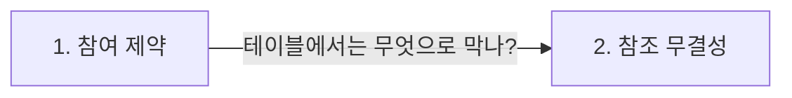

> **2026-11-09 목차**
>
> **[데이터베이스](#데이터베이스)**
> 1. [참여 제약](#1-참여-제약) — 필수 참여냐 선택 참여냐
> 2. [참조 무결성](#2-참조-무결성) — 외래키는 있는 기본키나 NULL만

# 데이터베이스

> **흐름**: 참여 제약에서 "학과 없는 학생"을 막는 방법을 보다가 외래키 규칙으로 넘어갔다.

## 1. 참여 제약

> **한 줄 결론**: 필참이냐 아니냐다. 관계상 필수 참여이면 전체 참여, 선택이면 부분 참여.

정식 표현: 참여 제약(participation constraint). 개체 집합의 모든 개체가 관계에 반드시 참여해야 하면 전체 참여(total), 참여하지 않는 개체가 있을 수 있으면 부분 참여(partial).

### 구분

| 구분 | 다른 이름 | ER 다이어그램 | 최소 카디날리티 |
|---|---|---|---|
| 전체 참여 | 필수 참여 (mandatory) | 이중선 | 1 이상 |
| 부분 참여 | 선택 참여 (optional) | 단일선 | 0 |

- 판단 기준: 관계 없이 DB에 존재하는 순간이 한 번이라도 있나 → 있으면 부분 참여
- 관계 양쪽을 **따로** 정함

| 관계 | 한쪽 | 다른 쪽 |
|---|---|---|
| 수강 | 학생: 부분 (수강 0건인 학생) | 과목: 부분 (신청자 0명인 과목) |
| 소속 | 학생: 전체 (학과 없는 학생 ✗) | 학과: 부분 (신설 학과는 0명) |

### 헷갈린 점

> [!WARNING]
> **"재학 중 언젠가 1과목은 듣는다" ≠ 전체 참여.** 참여 제약은 DB에 있는 동안 **매 순간**의 상태를 본다. 합격 → 학생 행 추가(수강 0건) → 수강신청 순서라서, 학생–수강을 전체 참여로 잡으면 수강신청 전 신입생·휴학생을 넣을 수 없다.

이전 기록: [2026-11-04 카디날리티](../../2026/November/11-04.md#7-카디날리티)

## 2. 참조 무결성

> **한 줄 결론**: 참조하는 값(외래키)은 참조되는 값(기본키) 밖으로 벗어날 수 없다. 단, NULL은 된다.

정식 표현: 참조 무결성 제약(referential integrity constraint). 외래키 값은 참조되는 릴레이션의 기본키 값 중 하나와 같거나 NULL이어야 한다.

### 어떻게 동작하나

학과(학과번호 PK: 10, 20)를 참조하는 학생 테이블:

| 학번 | 학과번호 (FK) | 판정 |
|---|---|---|
| 1001 | 10 | ○ 학과에 10 있음 |
| 1002 | NULL | ○ 미배정으로 허용 |
| 1003 | 99 | ✗ 없는 학과를 가리킴 |

### 참여 제약과 이어지는 곳

| 외래키 설정 | 학생의 참여 |
|---|---|
| `학과번호` (NULL 허용) | 선택 참여 |
| `학과번호 NOT NULL` | 필수 참여 |

### 헷갈린 점

> [!WARNING]
> **NULL은 위반이 아니다.** "있는 값만 가리킨다"에 "아무것도 안 가리키는 것도 된다"가 더해진다. NULL까지 막으려면 `NOT NULL`을 따로 붙인다.
