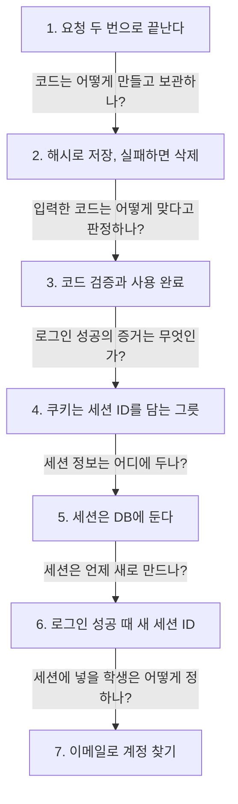

> **2026-11-10 목차**
>
> **[ONE Student](#one-student)**
> 1. [이메일 코드 로그인은 요청 두 번으로 끝난다](#1-이메일-코드-로그인은-요청-두-번으로-끝난다) — 코드 받기 → 코드 검증, 이어 주는 건 DB 한 줄
> 2. [코드는 해시로 저장하고 발송이 실패하면 지운다](#2-코드는-해시로-저장하고-발송이-실패하면-지운다) — DB에는 해시만, 발송 실패 시 코드 삭제
> 3. [코드 검증과 사용 완료](#3-코드-검증과-사용-완료) — 맞으면 코드를 무효 처리, 그다음 로그인
> 4. [쿠키는 세션 ID를 담는 그릇이다](#4-쿠키는-세션-id를-담는-그릇이다) — 정보는 서버가, 식별표는 브라우저가
> 5. [세션은 앱 메모리가 아니라 DB에 둔다](#5-세션은-앱-메모리가-아니라-db에-둔다) — 재시작해도 남기려고 DB, 24시간 구동은 호스팅
> 6. [로그인 성공 때 세션 ID를 새로 발급한다](#6-로그인-성공-때-세션-id를-새로-발급한다) — 공격자가 아는 ID는 껍데기로 남김
> 7. [이메일로 계정을 찾고 없으면 가입시킨다](#7-이메일로-계정을-찾고-없으면-가입시킨다) — 있으면 그 계정, 없으면 INSERT 한 번

# ONE Student

> **흐름**: 이메일 코드 로그인의 성공 경로를 요청 순서대로 따라가며 읽었다. 쿠키와 세션은 로그인 성공의 증거가 무엇인지 따라가다 따로 정리했다.



## 1. 이메일 코드 로그인은 요청 두 번으로 끝난다

> **지도에서 위치**: [ONE Student 지도](../../projects/one-student.md) › 로그인 · 약관 동의 › 이메일 코드 로그인 (`routes/auth.js`)
> **한 줄 결론**: 코드 받기 신청 → 코드 입력 후 검증, 이렇게 요청 두 번으로 끝난다. 두 요청을 이어 주는 건 DB에 적어 둔 한 줄이다.

정식 표현: 일회용 인증 코드(OTP) 로그인

### 두 요청

| 요청 | 주소 | 보내는 값 | 서버가 하는 일 |
|---|---|---|---|
| 1 | `POST /email/request` | 이메일, 약관 버전 | 코드 생성 → 저장 → 메일 발송 |
| 2 | `POST /email/verify` | 이메일, 6자리, 로그인 유지 | 코드 검증 → 학생 찾기 · 가입 → 세션 발급 |

### 두 요청을 이어 주는 것

서버는 요청 사이를 기억하지 못함 → 보낸 코드를 `email_login_tokens` 표에 적어 둠.

- 칸: 이메일, 코드 요약본(`code_hash`), 용도, 시도 횟수, 만료 시각, 사용 시각
- 요청 1에서 한 줄이 생기고, 요청 2에서 그 줄의 시도 횟수 · 사용 시각이 바뀜

### 코드라는 이름이 가리키는 것

| 이름 | 의미 |
|---|---|
| 요청 본문의 `code` | 메일로 받은 6자리 숫자 |
| `code_hash` | 6자리를 바꾼 요약본 (DB에 저장) |
| `token` (`email_login_tokens`) | 6자리 코드를 적어 둔 DB 한 줄 |
| 응답의 `"code"` | 결과 이름표 (`EMAIL_LOGIN_SUCCESS` 등) |

> [!WARNING]
> **응답의 `code`는 6자리 숫자가 아니라 결과 이름표다.** 6자리는 메일로만 가고 API 응답에는 담지 않는다. 응답에 담으면 메일함을 못 본 사람도 로그인할 수 있다.

다음 기록: [코드는 해시로 저장하고 발송이 실패하면 지운다](#2-코드는-해시로-저장하고-발송이-실패하면-지운다)

## 2. 코드는 해시로 저장하고 발송이 실패하면 지운다

> **지도에서 위치**: [ONE Student 지도](../../projects/one-student.md) › 로그인 · 약관 동의 › 이메일 코드 로그인 (`emailAuthService.createLoginToken`)
> **한 줄 결론**: 평문 6자리는 변수에서 메일로만 가고, DB에는 해시(요약본)만 저장한다. 메일 발송이 실패하면 저장한 코드를 지운다.

정식 표현: 해시(hash), 무차별 대입 공격(brute force attack)

### 값이 흐르는 길 (예시)

```text
generateCode()       → "483920"      평문. 변수에만 잠깐 존재
hashCode("483920")   → "9f2c…"       요약본 (64자리)
INSERT               → 이메일, 요약본, 용도, 지금 + 15분   DB에 저장
return "483920"      → 메일 발송      응답에는 담지 않음
```

- 6자리: `crypto.randomInt`로 0~999999 중 뽑고 `padStart`로 앞을 0으로 채움 (`42` → `000042`)
- 같은 입력 → 같은 해시, 해시 → 입력 되돌리기 ✗

### 해시만으로는 부족하다

6자리는 경우의 수가 100만 개 → 해시를 알면 하나씩 대입해 찾을 수 있음.

| 공격 | 막는 것 |
|---|---|
| 서버에 직접 대입 | 시도 5회 제한 |
| DB 유출 후 대입 | 15분 만료 · 1회용 |

### 발송이 실패하면

- 저장한 코드를 지움
- 안 지우면 받지도 못한 코드 때문에 재전송 쿨다운(5분)에 걸림

> [!WARNING]
> **해시는 코드를 바로 읽히지 않게 하는 한 겹일 뿐이다.** 진짜 방어는 만료 · 시도 제한 · 1회용이다.

이전 기록: [이메일 코드 로그인은 요청 두 번으로 끝난다](#1-이메일-코드-로그인은-요청-두-번으로-끝난다)
다음 기록: [코드 검증과 사용 완료](#3-코드-검증과-사용-완료)

## 3. 코드 검증과 사용 완료

> **지도에서 위치**: [ONE Student 지도](../../projects/one-student.md) › 로그인 · 약관 동의 › 이메일 코드 로그인 (`emailAuthService.verifyLoginToken`)
> **한 줄 결론**: 입력한 코드를 같은 해시로 바꿔 저장된 해시와 비교하고, 맞으면 그 코드를 무효 처리(사용 완료)한다. 그다음에 로그인 성공으로 간다.

정식 표현: 토큰 소비(consume), 1회용 코드

### 검증 네 칸

| 순서 | 하는 일 | 실패하면 |
|---|---|---|
| ① | 이 이메일의 미사용 · 만료 전 · 가장 최근 코드 1개 찾기 | `NOT_FOUND` |
| ② | 시도 횟수 +1 | `TOO_MANY_ATTEMPTS` |
| ③ | 입력값 해시와 저장된 해시 비교 | `INVALID_CODE` |
| ④ | 사용 시각을 채워 무효 처리 | – |

- 가장 최근 1개만 보므로 코드를 두 번 받으면 첫 메일의 코드는 못 씀
- 성공해도 시도 횟수는 1이 됨. 비교 전에 먼저 올리기 때문

### 사용 완료와 로그인 성공은 다르다

| | 사용 완료 | 로그인 성공 |
|---|---|---|
| 바뀌는 대상 | 6자리 코드의 DB 줄 | 사용자의 접속 상태 |
| 기록 | 사용 시각 칸 | 세션 표 + 쿠키 |
| 시점 | 코드가 맞다고 판정된 직후 | 학생 찾기 · 가입을 거친 마지막 |

> [!WARNING]
> **사용 완료는 사용자 상태가 아니라 코드의 상태다.** 코드가 맞으면 먼저 무효 처리하고, 그다음에 학생 찾기와 세션 발급으로 로그인 성공이 된다. 중간에 막히면(재가입 제한 등) 로그인은 실패했어도 코드는 이미 소모된 상태다.

이전 기록: [코드는 해시로 저장하고 발송이 실패하면 지운다](#2-코드는-해시로-저장하고-발송이-실패하면-지운다)
다음 기록: [쿠키는 세션 ID를 담는 그릇이다](#4-쿠키는-세션-id를-담는-그릇이다)

## 4. 쿠키는 세션 ID를 담는 그릇이다

> **지도에서 위치**: [ONE Student 지도](../../projects/one-student.md) › 요청 흐름 · 로그인 › 세션과 쿠키 (`app.js`, `routes/auth.js`)
> **한 줄 결론**: 세션 데이터는 서버가 저장하고, 클라이언트는 그걸 찾는 세션 ID만 쿠키에 담아 들고 있다. 요청마다 쿠키가 자동으로 붙고, 로그인 여부는 서버가 걸러 낸다.

정식 표현: 세션(session), 세션 ID, 쿠키(cookie)

### 누가 무엇을 들고 있나

| 대상 | 어디에 |
|---|---|
| 세션 데이터 (`{ userId }`) | 서버 DB의 `sessions` 표 |
| 세션 ID (식별자) | 브라우저 쿠키 안 |
| 쿠키 보관함 | 브라우저. 사이트별로 따로 보관 |

```text
로그인 성공  → 서버: sessions 표에 줄 저장 + Set-Cookie
            → 브라우저: 그 사이트용 쿠키로 보관함에 저장
이후 요청마다 → 브라우저: 쿠키를 자동으로 붙임
            → 서버: 세션 ID로 줄을 찾아 userId를 앎
```

- 쿠키 자체에는 로그인 정보가 없음. 세션 ID는 무작위 번호표
- 클라이언트는 쿠키를 항상 붙이기만 함. 로그인 필요 여부를 걸러 내는 건 서버(`requireAuth`)
- 로그아웃 = 서버의 세션 줄 삭제. 쿠키가 남아도 찾을 줄이 없어 무효
- 로그인 유지 = 쿠키 만료 시각이 있어 브라우저가 디스크에 저장. 해제하면 만료 시각이 없어 브라우저를 닫을 때 사라짐

> [!WARNING]
> **세션은 이메일로 찾지 않는다.** `sessions` 표에는 이메일 칸이 없고 세션 ID로만 찾는다. 쿠키가 없는 곳(다른 기기, 로그아웃, 만료)에서는 같은 이메일을 입력해도 코드를 다시 받아야 한다. 이메일로 찾는 건 계정(`students`)이다.

이전 기록: [로그인 확인을 거는 위치](11-06.md#3-로그인-확인을-거는-위치)
다음 기록: [세션은 앱 메모리가 아니라 DB에 둔다](#5-세션은-앱-메모리가-아니라-db에-둔다)

## 5. 세션은 앱 메모리가 아니라 DB에 둔다

> **지도에서 위치**: [ONE Student 지도](../../projects/one-student.md) › 요청 흐름 · 로그인 › 세션 저장소 (`app.js`)
> **한 줄 결론**: 앱 프로그램의 메모리에 두면 재시작(배포)될 때 모두 로그아웃되므로 앱 밖의 DB에 둔다. 서비스를 24시간 켜 두는 문제는 호스팅(Railway)이 푸는 별개의 문제다.

정식 표현: 휘발성(volatile) · 영속성(persistence), 세션 저장소(session store), 호스팅(hosting)

### 두 문제는 따로 푼다

| 문제 | 해결 |
|---|---|
| 재시작해도 세션이 남아야 함 | 데이터를 앱 밖에 보관: DB (또는 Redis) |
| 서비스가 24시간 켜져 있어야 함 | 프로그램을 대신 돌려 주는 호스팅: Railway, Vercel |

- 하나를 풀어도 다른 하나는 안 풀림
- Railway만 쓰고 메모리 세션이면 → 배포마다 재로그인
- DB 세션이어도 내 컴퓨터에서 돌리면 → 컴퓨터를 끄면 서비스 중단

### 기준은 어느 프로그램이 들고 있느냐

- 앱 프로세스가 끝나면 그 프로세스의 메모리는 사라짐
- 변수에 넣은 값 vs 파일에 적은 값을 스크립트로 두 번 실행해 확인: 재시작 뒤 변수는 비고 파일은 남음
- 이 프로젝트도 처음엔 메모리 저장소였다가 DB로 옮김

> [!WARNING]
> **Railway의 RAM이라고 안 사라지는 게 아니다.** 앱 프로세스의 메모리는 Railway에서도 앱이 재시작되면 사라진다. 세션이 남는 이유는 앱과 별개인 DB가 디스크에 적어 두기 때문이다.

이전 기록: [쿠키는 세션 ID를 담는 그릇이다](#4-쿠키는-세션-id를-담는-그릇이다)
다음 기록: [로그인 성공 때 세션 ID를 새로 발급한다](#6-로그인-성공-때-세션-id를-새로-발급한다)

## 6. 로그인 성공 때 세션 ID를 새로 발급한다

> **지도에서 위치**: [ONE Student 지도](../../projects/one-student.md) › 로그인 · 약관 동의 › 이메일 코드 로그인 (`routes/auth.js`, 세션 발급)
> **한 줄 결론**: 로그인 성공 순간 `regenerate`로 세션 ID를 새로 갈아 끼운다. 로그인 전에 공격자가 아는 ID(`abc`)는 정보 없는 껍데기로 남고, `userId`는 공격자가 모르는 새 ID(`xyz`)에만 붙는다.

정식 표현: 세션 고정 공격(session fixation), 세션 재발급(regenerate)

### 순서

```text
regenerate  → 옛 세션 줄 삭제, 새 세션 ID로 빈 줄 생성
userId 넣기  → 새 세션에 { userId: 42 } 기록
save        → DB 저장이 끝나면 응답 (쿠키가 같이 내려감)
```

- `regenerate`가 세션 객체를 통째로 교체 → `userId`는 그 뒤에 넣어야 함
- 각 단계는 "끝나면 이 함수를 실행해 줘" 콜백이라 코드가 안쪽으로 겹침

### 막는 공격

| 시점 | 세션 ID | 상태 |
|---|---|---|
| 로그인 전 | `abc` | 공격자가 알아낼 수 있는 값 |
| 로그인 후 | `xyz` | `userId`가 붙은 진짜 세션. 공격자는 모름 |

### 새 세션을 언제 만드나

- 새 세션은 로그인(코드 검증 · Google) 성공 순간에만 생김
- 재방문은 쿠키로 기존 세션을 그대로 씀 → 로그인 유지는 사라지지 않음
- 이메일 · Google 모두 같은 구조. 본인 증명 방식만 다름

> [!WARNING]
> **접속과 로그인은 다르다.** 접속은 쿠키로 기존 세션을 알아보는 것이고, 로그인은 본인을 새로 증명해 세션을 만드는 것이다. 그래서 로그인 때 새 세션을 만들어도 로그인 유지가 없어지지 않는다.

이전 기록: [세션은 앱 메모리가 아니라 DB에 둔다](#5-세션은-앱-메모리가-아니라-db에-둔다)
다음 기록: [이메일로 계정을 찾고 없으면 가입시킨다](#7-이메일로-계정을-찾고-없으면-가입시킨다)

## 7. 이메일로 계정을 찾고 없으면 가입시킨다

> **지도에서 위치**: [ONE Student 지도](../../projects/one-student.md) › 로그인 · 약관 동의 › 이메일 코드 로그인 (`studentService.findByEmail`, `createEmailStudent`)
> **한 줄 결론**: 코드 검증을 통과하면 이메일로 학생을 찾는다. 있으면 그 계정으로, 없으면(재가입 제한이 아니라면) `INSERT` 한 번으로 가입시킨 뒤 세션을 발급한다.

정식 표현: 계정 조회 후 신규 가입(find or create)

### 두 갈래

| | 기존 이메일 | 새 이메일 |
|---|---|---|
| ① | `findByEmail`로 찾음 | 못 찾음 |
| ② | – | 재가입 제한 확인: 막혔으면 403 |
| ③ | – | `createEmailStudent`로 가입 |
| ④ | 약관 버전이 다르면 기록 갱신 | 약관 동의 기록 |
| ⑤ | 세션 발급 → 200 | 세션 발급 → 200 |

- 가입은 `INSERT` 한 번. 닉네임은 자동 배정이라 별도 가입 화면이 없음
- 재가입 제한: 정지 중에 탈퇴한 이메일. 이미 삭제된 계정이라 새 이메일 갈래에서만 검사하고, 저장은 이메일 원문이 아니라 해시로 함
- Google로 먼저 가입한 이메일도 같은 계정으로 로그인됨 (계정을 정하는 키가 이메일)

> [!WARNING]
> **약관 버전 비교는 통과 여부를 정하는 게 아니라 기록을 갱신할지 정한다.** 로그인 폼에서 방금 현재 약관에 동의한 값을 이미 확인했으므로, 여기서는 다르면 기록하고 같으면 건너뛴 채 어느 쪽이든 세션 발급으로 진행한다.

이전 기록: [로그인 성공 때 세션 ID를 새로 발급한다](#6-로그인-성공-때-세션-id를-새로-발급한다)
