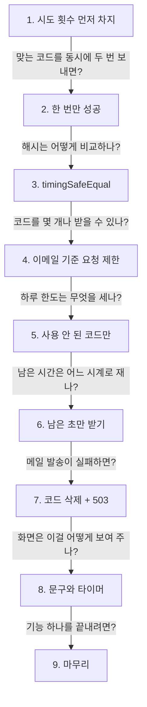
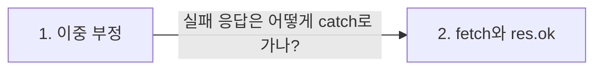
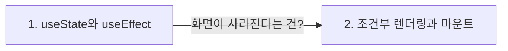

> **2026-11-11 목차**
>
> **[ONE Student](#one-student)**
> 1. [시도 횟수는 비교 전에 조건부 UPDATE로 차지한다](#1-시도-횟수는-비교-전에-조건부-update로-차지한다) — 옛 값 0을 읽고 다 통과하는 경쟁 상태 차단
> 2. [같은 코드를 동시에 두 번 보내도 한 번만 성공한다](#2-같은-코드를-동시에-두-번-보내도-한-번만-성공한다) — consumed_at IS NULL + affectedRows
> 3. [해시 비교는 timingSafeEqual로 하고 길이를 먼저 본다](#3-해시-비교는-timingsafeequal로-하고-길이를-먼저-본다) — 시간으로 정답이 새지 않게
> 4. [요청 제한은 IP가 아니라 이메일로 센다](#4-요청-제한은-ip가-아니라-이메일로-센다) — 서버가 보는 IP는 학생이 아님
> 5. [하루 한도는 사용 안 된 코드만 센다](#5-하루-한도는-사용-안-된-코드만-센다) — 정상 재로그인은 안 막힘
> 6. [DB에서는 시각이 아니라 남은 초만 받는다](#6-db에서는-시각이-아니라-남은-초만-받는다) — 시계가 달라도 남은 초는 같음
> 7. [메일 발송이 실패하면 코드를 지우고 503으로 알린다](#7-메일-발송이-실패하면-코드를-지우고-503으로-알린다) — 기다려도 안 풀리니 Google 권유
> 8. [서버 응답이 화면의 문구와 타이머로 바뀐다](#8-서버-응답이-화면의-문구와-타이머로-바뀐다) — 이름표는 문구, retryAt은 타이머
> 9. [이메일 코드 로그인 마무리](#9-이메일-코드-로그인-마무리) — 장치 두 분류와 이름 표
>
> **[JavaScript](#javascript)**
> 1. [이중 부정으로 참 거짓만 남긴다](#1-이중-부정으로-참-거짓만-남긴다) — `!!값` = `Boolean(값)`
> 2. [fetch는 실패 응답에도 에러를 던지지 않는다](#2-fetch는-실패-응답에도-에러를-던지지-않는다) — res.ok만 false
>
> **[React](#react)**
> 1. [useState와 useEffect](#1-usestate와-useeffect) — 기억하는 값, 값이 바뀌면 실행
> 2. [조건부 렌더링과 마운트](#2-조건부-렌더링과-마운트) — user가 생기면 Login이 빠짐

# ONE Student

> **흐름**: 이메일 코드 로그인의 안전장치를 "숫자 코드 하나를 지키는 장치 → 받을 수 있는 코드 수를 제한하는 장치" 순서로 봤고, 실패 처리와 화면까지 따라간 뒤 기능 하나를 마무리했다.



## 1. 시도 횟수는 비교 전에 조건부 UPDATE로 차지한다

> **지도에서 위치**: [ONE Student 지도](../../projects/one-student.md) › 로그인 · 약관 동의 › 이메일 코드 로그인 (`emailAuthService.verifyLoginToken`)
> **한 줄 결론**: 읽고 → 비교하고 → 올리면, 동시에 온 요청이 반영되지 않은 0을 기준으로 모두 통과해 5회 제한이 무너진다. 판단과 +1을 조건 붙은 UPDATE 한 문장에 넣고, 바뀐 줄 수로 차지했는지 확인한다.

정식 표현: 경쟁 상태(race condition), 원자적 갱신(atomic update)

### 문제: 예전 코드

```js
if (token.attempts >= 5) return TOO_MANY_ATTEMPTS;   // ①에서 읽어 둔 옛 사본으로 판단
if (틀림) { UPDATE attempts = attempts + 1 }          // 틀렸을 때만, 비교 뒤에 +1
```

| 시점 | 틀린 코드 40개를 동시에 보내면 |
|---|---|
| 거의 동시에 | 모두 `attempts = 0`을 읽음 |
| 그다음 | 모두 `0 >= 5` 거짓 → 통과 → 40번 비교 |

### 해결

```sql
UPDATE email_login_tokens SET attempts = attempts + 1
WHERE id = ? AND consumed_at IS NULL AND attempts < 5
```

- DB가 같은 줄의 UPDATE를 하나씩 처리하고, `attempts < 5`를 그 순간의 최신 값으로 검사함
- `affectedRows`: 이번 UPDATE가 조건에 맞아 바꾼 줄 수. 0이면 이미 5회 → 비교 없이 거절
- 시도 = 비교 기회 → 5회를 다 쓰면 맞는 코드도 거절

### 검토했지만 버린 방법과 이유

| 방법 | 버린 이유 |
|---|---|
| 트랜잭션 + `SELECT … FOR UPDATE` | 막을 수는 있지만 연결을 붙잡고 BEGIN · COMMIT을 관리해야 해 길어짐 |
| 앱 메모리 잠금 | 재시작 · 서버 여러 대면 깨짐 (세션을 DB에 둔 것과 같은 이유) |

> [!WARNING]
> **`affectedRows`는 DB에 저장되는 값이 아니다.** UPDATE를 실행할 때마다 요청별로 돌려받는 결과다. `git diff --stat`처럼 몇 줄 바뀌었는지 개수만 알려 준다.

이전 기록: [코드 검증과 사용 완료](11-10.md#3-코드-검증과-사용-완료)
다음 기록: [같은 코드를 동시에 두 번 보내도 한 번만 성공한다](#2-같은-코드를-동시에-두-번-보내도-한-번만-성공한다)

## 2. 같은 코드를 동시에 두 번 보내도 한 번만 성공한다

> **지도에서 위치**: [ONE Student 지도](../../projects/one-student.md) › 로그인 · 약관 동의 › 이메일 코드 로그인 (`emailAuthService.verifyLoginToken`)
> **한 줄 결론**: `consumed_at`이 NULL이 아니면 누군가 이미 쓴 것이라 나중에 다시 넣는 건 찾기 단계에서 막힌다. 동시에 두 번 넣으면 사용 완료 UPDATE의 `consumed_at IS NULL` 조건과 `affectedRows`로 하나만 받아 준다.

정식 표현: 1회용 코드, 조건부 갱신(conditional update)

### 막는 곳이 둘이다

| 상황 | 막는 곳 |
|---|---|
| 다 쓴 코드를 나중에 다시 넣음 | 찾기 SELECT의 `consumed_at IS NULL` |
| 같은 코드를 동시에 두 번 넣음 (더블클릭 등) | 사용 완료 UPDATE의 `consumed_at IS NULL` + `affectedRows` |

```text
요청 A  UPDATE consumed_at = NOW() WHERE … consumed_at IS NULL → 1줄 바꿈 → affectedRows 1 → 성공
요청 B  같은 UPDATE                                             → 이미 채워짐 → affectedRows 0 → NOT_FOUND
```

- 1번과 같은 방식: WHERE에 "아직 그 상태인가" 조건 + 바뀐 줄 수로 내가 이겼는지 확인

### NOT_FOUND로 묶는 이유

- 만료 · 이미 사용 · 발급 안 됨 → 사용자가 할 일은 셋 다 "코드 다시 요청"
- 할 일이 다르면 나누고(`INVALID_CODE` 다시 입력, `TOO_MANY_ATTEMPTS` 새 코드), 같으면 묶음
- 공격자에게 "방금 누가 썼다"는 정보도 안 줌 (코드에 적힌 이유는 아님)

> [!WARNING]
> **실제로 막는 건 WHERE 조건이고, `affectedRows`는 그 결과를 읽는 방법이다.** A가 `consumed_at`을 채워 버려서 B의 UPDATE가 조건에 맞는 줄을 못 찾는 것이다. B의 `affectedRows`가 0에서 1로 바뀌는 게 아니라 처음부터 0이다.

이전 기록: [시도 횟수는 비교 전에 조건부 UPDATE로 차지한다](#1-시도-횟수는-비교-전에-조건부-update로-차지한다)
다음 기록: [해시 비교는 timingSafeEqual로 하고 길이를 먼저 본다](#3-해시-비교는-timingsafeequal로-하고-길이를-먼저-본다)

## 3. 해시 비교는 timingSafeEqual로 하고 길이를 먼저 본다

> **지도에서 위치**: [ONE Student 지도](../../projects/one-student.md) › 로그인 · 약관 동의 › 이메일 코드 로그인 (`emailAuthService.verifyLoginToken`)
> **한 줄 결론**: `===`는 다른 글자에서 바로 멈춰 몇 글자까지 맞았는지가 시간 차이로 드러난다. Node 내장 `crypto`의 `timingSafeEqual`은 끝까지 비교한다. 길이가 다르면 에러를 던지므로 길이를 먼저 본다.

정식 표현: 타이밍 공격(timing attack)

### 길이 검사

```js
if (expected.length !== actual.length || !crypto.timingSafeEqual(expected, actual))
//   길이가 다르면 여기서 true → || 때문에 timingSafeEqual은 아예 안 부름 → INVALID_CODE
```

| 길이가 다를 때 | 결과 |
|---|---|
| 길이 검사 없이 `timingSafeEqual`만 | 에러 → 공통 처리기 → 500 |
| 지금 코드 | 401 `INVALID_CODE` |

- 비교 대상은 입력한 숫자의 자릿수가 아니라 **두 해시**(`expected` 저장된 해시, `actual` 입력의 해시)
- 3자리를 넣어도 해시는 32바이트 → 길이 같음 → 내용 비교에서 `INVALID_CODE`
- 정상이면 길이가 항상 같음 → 만일에 대비한 방어 코드

### 개선점 (내가 짚은 것)

- 두 값 모두 서버가 만든 해시 → 길이가 다르면 사용자 잘못이 아니라 서버 쪽 문제 (DB 값 손상, 해시 방식 변경)
- 401로 처리하면 서버 버그가 조용히 묻힘 → 500으로 던져 Sentry에 남기는 게 더 맞음
- 정상 상태에선 안 걸려서 우선순위는 낮음

> [!NOTE]
> 이 코드에서 타이밍 공격의 실제 위험은 낮다(비교 대상이 해시이고, 시도가 5회로 막힘). 비밀 값을 비교할 때 쓰는 관례로 보인다(추정).

이전 기록: [코드는 해시로 저장하고 발송이 실패하면 지운다](11-10.md#2-코드는-해시로-저장하고-발송이-실패하면-지운다)

## 4. 요청 제한은 IP가 아니라 이메일로 센다

> **지도에서 위치**: [ONE Student 지도](../../projects/one-student.md) › 로그인 · 약관 동의 › 이메일 코드 로그인 (`routes/auth.js`의 제한 장치)
> **한 줄 결론**: 요청이 학생 → Vercel → Railway로 와서 서버가 보는 IP는 학생이 아니라 Vercel 출구 IP다. IP로 세면 한 번도 신청하지 않은 정상 학생도 이미 꽉 차서 막힐 수 있어서, 이메일 기준 개인 한도로 센다.

정식 표현: 요청 횟수 제한(rate limiting)의 키 선택

### 제한 장치

| 장치 | 기준 · 한도 | 막는 것 |
|---|---|---|
| 코드 받기 제한 | 이메일, 10분 5회 | 한 이메일로 코드를 계속 받기 |
| 코드 확인 제한 | 이메일, 15분 20회 | 새 코드를 받아 시도 5회를 리셋하며 대입 |
| IP 상한 | IP, 10분 100회 | Railway 주소로 직접 스크립트를 보내며 이메일을 바꿔 가는 남용 |

- 코드 받기 요청 = 숫자 코드를 메일로 보내 달라는 요청(처음 · 재전송). 코드 확인 요청 = 입력한 숫자 코드가 맞는지 묻는 요청(확인 버튼)
- `trim().toLowerCase()`: 공백 · 대소문자만 바꿔 제한을 피하지 못하게 같은 칸으로 셈
- 확인 제한은 지금 5분 쿨다운 때문에 먼저 걸리기 어려움 → 쿨다운이 바뀌어도 막는 예비 울타리
- 하루에 맞혀 볼 수 있는 횟수: 코드 8개 × 5회 = 40번 (경우의 수 100만 개)

### 왜 IP 상한은 높게 두나

- 공격자는 화면을 거치지 않고 스크립트로 Railway에 바로 보냄 → 이때는 실제 IP가 보임
- Vercel을 거친 정상 요청은 출구 IP가 요청마다 바뀌어 거의 안 걸림 → 정상 가입이 몰려도 넘지 않을 값

> [!WARNING]
> **남은 구멍: Vercel을 거쳐 이메일을 바꿔 가며 보내면 막히지 않는다.** IP 상한은 있지만 출구 IP가 바뀌어 걸리지 않는다. 여러 이메일 주소로 코드 메일을 뿌려 발송 한도를 소진시키면, 무료 플랜은 서비스가 멈추고(서비스 거부) 운영자는 "멈추거나 돈을 내라"는 유료 전환 압박을 받는다. 막는 방향은 사람 확인(Turnstile 등), 학생 실제 IP 읽기, 전체 하루 상한.

이전 기록: [요청 횟수 제한](11-06.md#5-요청-횟수-제한)

## 5. 하루 한도는 사용 안 된 코드만 센다

> **지도에서 위치**: [ONE Student 지도](../../projects/one-student.md) › 로그인 · 약관 동의 › 이메일 코드 로그인 (`emailAuthService.checkResendAllowed`)
> **한 줄 결론**: 사용된 코드는 의미 있게 쓰인 것(로그인 성공)이라 세지 않는다. `consumed_at IS NULL`, 즉 사용 안 된 숫자 코드만 24시간 동안 세서 8개가 넘으면 막는다.

정식 표현: 재전송 쿨다운(cooldown), 일일 발송 한도

### 고친 이력

| | 처음 | 고친 뒤 |
|---|---|---|
| 세는 것 | 24시간 안의 모든 코드, 하루 4회 | 사용 안 된 코드만, 하루 8개 |
| 문제 | 로그인 유지를 끈 학생이 하루 몇 번 정상 로그인하면 하루 종일 잠김 | 해결 |

- 쿨다운 = 다시 요청할 수 있을 때까지 기다리는 시간(5분). 가장 최근 사용 안 된 코드 기준
- 공격자가 남의 이메일로 보낸 코드는 쓰일 수 없음 → 항상 미사용 → 계속 세어짐

> [!NOTE]
> 반대로 보면 공격자가 피해자 이메일로 코드를 8개 보내면 피해자도 그날은 코드를 못 받는다. 메일 폭탄을 하루 8통으로 막는 대가이고, 대안은 Google 로그인이다.

## 6. DB에서는 시각이 아니라 남은 초만 받는다

> **지도에서 위치**: [ONE Student 지도](../../projects/one-student.md) › 로그인 · 약관 동의 › 이메일 코드 로그인 (`emailAuthService.checkResendAllowed`)
> **한 줄 결론**: DB 시각이 앱 시각과 다를 수 있다. 몇 초 남았는지는 아무리 시계가 밀려 있어도 지장이 없으니, DB에서는 남은 초만 받고 시각(retryAt)은 앱 서버 시계로 만든다.

정식 표현: `TIMESTAMPDIFF`, 시계 차이(clock skew)

### 계산

```text
TIMESTAMPDIFF(SECOND, A, B) = B − A
  A = NOW()                            지금 시각        10:02:00
  B = created_at + INTERVAL 5 MINUTE   쿨다운 끝 시각   10:05:00
  → 180초 남음 → retryAt = 앱 서버의 Date.now() + 180초
```

### 시계 세 개

| 순서 | 시계 | 하는 일 |
|---|---|---|
| ① | DB | 남은 초 계산 (DB 시계끼리라 정확) |
| ② | 앱 서버 | 남은 초를 더해 retryAt 시각 생성 |
| ③ | 브라우저 | `retryAt − Date.now()`로 타이머 |

> [!WARNING]
> **같은 문제가 두 곳에 남아 있다.** `expires_at`은 앱 시계로 넣고 검증은 DB의 `NOW()`와 비교해서, 두 시계가 어긋나면 15분이 늘거나 줄어든다. 화면 타이머는 ②와 ③이 다르면(학생 컴퓨터 시계가 틀리면) 그만큼 틀린다.

## 7. 메일 발송이 실패하면 코드를 지우고 503으로 알린다

> **지도에서 위치**: [ONE Student 지도](../../projects/one-student.md) › 로그인 · 약관 동의 › 이메일 코드 로그인 (`routes/auth.js`의 `sendCodeOrFail`)
> **한 줄 결론**: 공통 처리 함수로 넘어가면 500만 떠서 화면이 "잠시 후 다시"라고 잘못 안내한다. 한도는 기다려도 풀리지 않으니 코드를 지우고 503과 전용 이름표로 직접 응답해 Google 로그인으로 유도한다.

정식 표현: 503 Service Unavailable

### 순서

```text
코드 생성(DB 저장) → 메일 발송 시도
                       └ 실패 (Resend 무료 플랜 하루 100통 초과 · 장애)
                           ① 로그 + Sentry      운영자가 알아야 대응
                           ② discardLoginToken  남은 코드가 쿨다운 · 하루 한도에 안 걸리게
                           ③ 503 EMAIL_SEND_FAILED
                           ④ return false
```

- 저장이 먼저인 이유: 메일에 넣을 코드가 있어야 보냄 → 그래서 실패하면 받지도 못한 코드가 남음
- `await mailer.sendLoginCode(…)`: 돌려받을 값은 필요 없고 끝날 때까지 기다리기만. 실패하면 에러를 던져 catch로

### 상태 코드 고르기

| 후보 | 이 상황(바깥 서비스가 발송 거절)과 맞나 |
|---|---|
| 500 | ✗ 서버 안 고장이 아님. 화면이 "잠시 후 다시"를 띄움 |
| 429 | ✗ 사용자 잘못이 아님 |
| **503** | ○ 서버가 의존하는 바깥 서비스를 지금 쓸 수 없음 |

> [!WARNING]
> **`false`를 만들어 돌려주는 건 `sendCodeOrFail`이고, 그걸 보고 멈추는 건 그 줄의 분기문이다.** `if (!(await sendCodeOrFail(…))) return;` — `!false`는 `true`라서 return. 응답은 한 번만 보낼 수 있어서 503 뒤에 200을 또 보내지 않게 멈춘다.

이전 기록: [코드는 해시로 저장하고 발송이 실패하면 지운다](11-10.md#2-코드는-해시로-저장하고-발송이-실패하면-지운다)

## 8. 서버 응답이 화면의 문구와 타이머로 바뀐다

> **지도에서 위치**: [ONE Student 지도](../../projects/one-student.md) › 로그인 · 약관 동의 › 이메일 코드 로그인 화면 (`Login.jsx`, `api/chatApi.js`)
> **한 줄 결론**: 서버의 JSON을 에러 객체로 옮겨 던지고, 화면은 결과 이름표(`err.code`)로 문구를 고른다. 쿨다운만 문구 대신 `retryAt`으로 1초마다 줄어드는 타이머를 보여 준다.

### 길

```text
503 · 429 응답 → apiRequest가 err.code · err.status · err.data를 담아 throw
             → 화면의 catch (err)
                 ├ RESEND_COOLDOWN && err.data?.retryAt → setRetryAt → 타이머 · 버튼 잠금
                 └ 그 밖의 실패 → describeEmailError가 문구를 고름 → setEmailError → 빨간 글씨
```

- `err.data?.retryAt`: data가 있으면 retryAt을 꺼내고, 없으면 에러 내지 말고 undefined (다른 값으로 대체하는 게 아님)
- 모르는 이름표 → 기본 문구 "요청에 실패했어요. 잠시 후 다시 시도해주세요." → 그래서 `EMAIL_SEND_FAILED` 같은 전용 이름표가 필요
- 남은 시간: `retryAt ? retryAt - now : 0` (retryAt이 있으면 계산, 없으면 0). 0 이하가 되면 별도 useEffect가 retryAt을 지워 버튼이 열림
- 1시간이 넘으면 `h:mm:ss`로 보여 줌 (하루 한도는 몇 시간씩 남을 수 있어서)

> [!NOTE]
> 계정 삭제 재인증 화면은 같은 발송 실패에도 "잠시 후 다시 시도해주세요"를 보여 준다. 로그인 화면과 문구가 다르다.

이전 기록: [응답 형식과 code 이름표](11-05.md#4-응답-형식과-code-이름표)

## 9. 이메일 코드 로그인 마무리

> **지도에서 위치**: [ONE Student 지도](../../projects/one-student.md) › 로그인 · 약관 동의 › 이메일 코드 로그인
> **한 줄 결론**: 요청 두 번(코드 받기 → 코드 확인)에 장치가 두 겹 얹혀 있다. 숫자 코드 하나를 지키는 장치와, 받을 수 있는 코드 수 · 확인 횟수를 제한하는 장치다.

### 면접에서 설명한다면 (1분)

이메일 코드 로그인은 요청 두 번으로 끝납니다. 코드 받기에서는 6자리 숫자 코드를 해시로만 저장하고 메일로 보내고, 코드 확인에서는 같은 해시로 비교한 뒤 사용 완료로 바꾸고 학생을 찾거나 가입시켜 세션 ID를 새로 발급합니다. 숫자 코드 하나는 15분 만료 · 시도 5회 · 1회용으로 지키는데, 시도 차지와 사용 완료를 조건부 UPDATE로 해서 동시 요청에도 뚫리지 않습니다. 받을 수 있는 코드 수는 5분 쿨다운 · 하루 사용 안 된 코드 8개 · 이메일 기준 요청 제한으로 막고, 발송이 실패하면 코드를 지우고 503으로 알려 Google 로그인을 권합니다.

### 이름 표 (무엇으로 막았나)

| 질문 | 이름 |
|---|---|
| 동시 요청으로 5회 제한을 넘기지 못하게 | `UPDATE … WHERE attempts < 5` + `affectedRows` |
| 같은 코드를 동시에 두 번 보내도 한 번만 성공 | `consumed_at` 칸 + `WHERE consumed_at IS NULL` + `affectedRows` |
| 하루 한도에서 성공한 코드는 안 셈 | `consumed_at IS NULL` |
| 프록시 뒤에서 학생별로 셈 | `keyGenerator`로 이메일 기준 |
| 시계가 달라도 남은 시간이 정확 | `TIMESTAMPDIFF`로 남은 초만 |
| 발송 실패 뒤 다시 요청할 수 있게 | `discardLoginToken` |
| 로그인 성공 때 세션 고정 공격 방지 | `req.session.regenerate` |

> [!WARNING]
> **처음 1분 설명은 장치를 나열만 해서 부족했다.** "숫자 코드 자체를 보호하는 장치 / 받을 수 있는 코드 수를 제한하는 장치" 두 분류로 나눠 말하고, 받기와 확인 둘 다 제한한다는 걸 넣어야 했다.

이전 기록: [이메일 코드 로그인은 요청 두 번으로 끝난다](11-10.md#1-이메일-코드-로그인은-요청-두-번으로-끝난다)

<br>
<br>
<br>
<br>
<br>
<br>
<br>
<br>
<br>
<br>

# JavaScript

> **흐름**: 로그인 화면의 버튼 잠금과 에러 처리를 읽다가 나온 두 가지를 정리했다.



## 1. 이중 부정으로 참 거짓만 남긴다

> **한 줄 결론**: `!`는 참 · 거짓을 뒤집고, 두 번 쓰면 원래 뜻 그대로 참 · 거짓만 남는다. 어떤 값을 true / false로 바꾸는 효과다.

정식 표현: 이중 부정(double negation), 불리언 변환. `Boolean(값)`과 같음
어디서 마주쳤나: ONE Student `Login.jsx`의 `disabled={submitting || !!retryAt}`

```js
!!null            // false   retryAt 없음 → 버튼 열림
!!1731300180000   // true    retryAt 있음 → 버튼 잠금
```

> [!WARNING]
> **"형변환 연산자"는 정식 이름이 아니다.** 따로 있는 연산자가 아니라 `!`를 두 번 쓴 것이다. "이중 부정으로 불리언 변환"이라고 말한다.

## 2. fetch는 실패 응답에도 에러를 던지지 않는다

> **한 줄 결론**: 503 · 429가 와도 응답은 도착했으니 fetch는 정상 처리하고 `res.ok`만 false가 된다. 그래서 직접 에러 객체를 만들어 던져야 화면 코드가 "성공이면 try 다음 줄, 실패면 catch" 두 갈래로 쓸 수 있다.

어디서 마주쳤나: ONE Student `api/chatApi.js`의 `apiRequest`

- `res.ok`: 상태 코드가 200~299면 true, 그 밖이면 false
- `body`는 이미 `res.json()`으로 객체가 된 상태 → 그 칸을 에러 객체에 옮겨 담음

```js
const err = new Error(body.code);
err.code = body.code; err.status = res.status; err.data = body.data;
throw err;
```

<br>
<br>
<br>
<br>
<br>
<br>
<br>
<br>
<br>
<br>

# React

> **흐름**: 프로젝트에서 처음 읽은 React 코드였다. 쿨다운 타이머에서 기본 문법 두 개를, 로그인 뒤 화면이 바뀌는 곳에서 조건부 렌더링을 봤다.



## 1. useState와 useEffect

> **한 줄 결론**: `useState`는 값 하나의 처음 값을 정하고 `[값, 바꾸는 함수]`를 돌려준다. `useEffect`는 처음 그릴 때와 대괄호 안 값이 바뀔 때마다 실행되고, 돌려준 정리 함수로 지난 작업을 끈다.

정식 표현: 상태(state) 훅, 이펙트 훅, 의존성 배열(dependency array), 정리 함수(cleanup)
어디서 마주쳤나: ONE Student `Login.jsx`의 쿨다운 타이머

```jsx
const [retryAt, setRetryAt] = useState(null);   // retryAt 처음 null, setRetryAt은 바꾸는 함수
const [now, setNow] = useState(Date.now());      // 값이 여러 개면 useState를 여러 번

useEffect(() => {
  if (!retryAt) return undefined;                          // 없으면 아무것도 안 하고 끝
  const id = setInterval(() => setNow(Date.now()), 1000);  // 1초마다 now 바꿈 → 다시 그림
  return () => clearInterval(id);                          // 정리 함수
}, [retryAt]);                                             // 의존성 배열
```

### retryAt이 null이 되면

```text
retryAt → null
  → 화면 다시 그림 (값이 바뀌어서. useEffect는 그린 뒤에 돔)
  → 지난번 정리 함수: clearInterval → 타이머 끔
  → useEffect 다시 실행: retryAt이 없으니 return → 새 타이머 안 만듦
```

> [!WARNING]
> **`setCount`는 0이 아니라 함수다.** `useState(0)`의 0은 값 하나(`count`)의 처음 값이다. 항상 두 개만 돌려줘서 `const [a, b, c] = useState(0)`의 c는 undefined. 그리고 `[ ]`는 중괄호가 아니라 대괄호다.

## 2. 조건부 렌더링과 마운트

> **한 줄 결론**: user 상태에 따라 조건부 렌더링을 한다. 로그인에 성공해 user가 생기면 Login 컴포넌트가 언마운트되고 홈 화면 컴포넌트가 마운트된다.

정식 표현: 조건부 렌더링(conditional rendering), 마운트(mount) · 언마운트(unmount)
어디서 마주쳤나: ONE Student `App.jsx`의 `!user ? <Login … /> : (홈 화면)`

| 용어 | 뜻 |
|---|---|
| 마운트 | 컴포넌트가 화면에 붙음 |
| 언마운트 | 컴포넌트가 화면에서 빠짐 |

- 페이지를 새로 여는 게 아니라 한 페이지 안에서 화면 조각을 갈아 끼움
- 코드는 무엇을 그릴지만 적고, 떼고 붙이는 일은 React가 함
- 삼항 연산자는 항상 `조건 ? 참일 때 : 거짓일 때`. `!user`의 `!` 때문에 "없을 때"가 먼저 나옴
- Login이 언마운트될 때 정리 함수가 1초 타이머를 끔 → 안 끄면 없는 화면의 시계를 계속 바꾸려는 작업이 뒤에서 돎

> [!WARNING]
> **"홈 화면으로 마운트"가 아니라 "홈 화면을 마운트"다.** 그리고 코드가 직접 언마운트 · 마운트를 명령하는 게 아니라, user 값이 바뀌면 React가 한다. 그래서 "~되고 ~된다"로 말한다.
