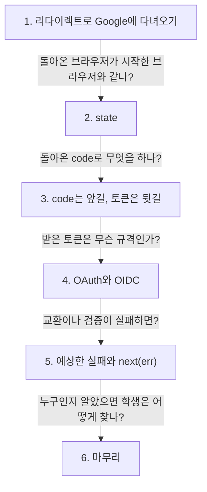
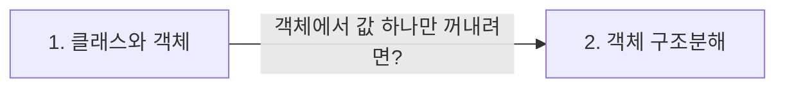

> **2026-11-12 목차**
>
> **[ONE Student](#one-student)**
> 1. [Google 로그인은 리다이렉트로 Google에 다녀온다](#1-google-로그인은-리다이렉트로-google에-다녀온다) — 비밀번호는 Google 화면에서만
> 2. [state로 시작한 브라우저와 돌아온 브라우저를 맞춰 본다](#2-state로-시작한-브라우저와-돌아온-브라우저를-맞춰-본다) — 로그인 CSRF 방어
> 3. [code는 앞길로 받고 토큰은 뒷길로 받는다](#3-code는-앞길로-받고-토큰은-뒷길로-받는다) — 결과가 주소에 남지 않게
> 4. [OAuth는 인가이고 OIDC는 그 위에 인증을 얹는다](#4-oauth는-인가이고-oidc는-그-위에-인증을-얹는다) — 권한 맡기기 vs 누구인지
> 5. [예상한 실패는 직접 응답하고 예상 못 한 에러는 넘긴다](#5-예상한-실패는-직접-응답하고-예상-못-한-에러는-넘긴다) — if로 거름 vs next(err)
> 6. [Google 로그인 마무리](#6-google-로그인-마무리) — sub로 먼저 찾기와 이름 표
>
> **[JavaScript](#javascript)**
> 1. [클래스는 틀이고 객체는 찍어 낸 붕어빵이다](#1-클래스는-틀이고-객체는-찍어-낸-붕어빵이다) — 속은 값, 할 일은 메서드
> 2. [객체 구조분해는 이름으로 꺼낸다](#2-객체-구조분해는-이름으로-꺼낸다) — 배열은 순서, 객체는 이름

# ONE Student

> **흐름**: Google 로그인을 "리다이렉트로 다녀오기 → 같은 브라우저인지 확인(state) → code를 토큰으로 바꾸기 → 계정 연결과 마무리" 네 덩어리로 나눠 따라갔다. 토큰을 다루다 OAuth와 OIDC를 구분했고, 실패 처리에서 에러가 흘러가는 길을 따로 봤다.



## 1. Google 로그인은 리다이렉트로 Google에 다녀온다

> **지도에서 위치**: [ONE Student 지도](../../projects/one-student.md) › 로그인 · 약관 동의 › Google 로그인 (`api/chatApi.js`, `routes/auth.js`의 `/google`)
> **한 줄 결론**: 리다이렉트는 "여기서 처리할 게 아니니 다른 곳으로 가 주세요"라는 안내다. 브라우저가 우리 서버 → Google → 콜백 주소로 옮겨 다니고, 비밀번호는 Google 화면에서만 입력하니 우리 서버가 그 리스크를 지지 않는다.

정식 표현: HTTP 리다이렉트(3xx 상태 코드 + Location 헤더), 콜백 주소(redirect URI)

### 브라우저가 지나가는 길

```text
화면: window.location.href = '/api/auth/google?remember=1&consent=…'    페이지 이동 (fetch 아님)
  → 서버 /google: res.redirect(Google 로그인 주소)                       302 + Location
  → Google 화면: 계정 고르고 로그인
  → Google이 콜백 주소로 돌려보냄: /api/auth/google/callback?code=…&state=…
  → 서버 콜백: 확인이 끝나면 redirectToApp() → 앱 화면
```

### 왜 fetch가 아니라 페이지 이동인가

- fetch로는 Google 화면을 보여 줄 수 없다
- Google은 다른 출처라 fetch 응답은 CORS에 막힌다
- 평소 fetch는 Vercel · Vite 프록시를 거쳐 같은 출처라 CORS 문제가 없다

### CORS

**CORS = Cross-Origin Resource Sharing = 다른 출처끼리 자원을 나눠 쓰는 규칙**

- 출처 = 프로토콜 + 도메인 + 포트. 셋이 모두 같아야 같은 출처

| 역할 | 누구 | 하는 일 |
|---|---|---|
| 요청하는 쪽 | 화면(React) | 다른 출처에 fetch |
| 지키는 쪽 | 브라우저 | 동일 출처 정책으로 다른 출처의 응답을 막음 |
| 허락하는 쪽 | 응답하는 서버 | `Access-Control-Allow-Origin` 헤더로 "이 출처는 읽어도 됨" |

> [!WARNING]
> **콜백 함수는 넘긴 함수 전체다.** `setTimeout(hello, 1000)`에서 hello를 인자로 넘기는 것이 "콜백으로 넘긴다", setTimeout이 나중에 hello를 부르는 것이 "콜백한다"다. 함수 안의 `console.log` 한 줄이 콜백인 게 아니다. 콜백 주소는 이와 별개로, Google이 일을 마친 뒤 브라우저를 돌려보내는 주소다.

> [!NOTE]
> URI(식별자)가 상위어이고, 위치로 가리키면 URL, 이름으로 가리키면 URN이다. `redirect_uri`라는 이름은 OAuth 규격의 용어에서 왔다.

## 2. state로 시작한 브라우저와 돌아온 브라우저를 맞춰 본다

> **지도에서 위치**: [ONE Student 지도](../../projects/one-student.md) › 로그인 · 약관 동의 › Google 로그인 (`routes/auth.js`의 `makeState`, `/google`, `/google/callback`)
> **한 줄 결론**: state는 로그인을 시작한 브라우저와 콜백으로 돌아온 브라우저가 같은지 확인하는 값이다. 세션과 Google로 보내는 주소 두 곳에 두고, 일회용이라 비교하기 전에 지운다.

정식 표현: state 매개변수로 막는 로그인 CSRF(login CSRF, cross-site request forgery)

### 막는 공격

| 순서 | 일 |
|---|---|
| 1 | 공격자가 **자기** Google 계정으로 로그인을 시작해, 자기 code가 붙은 콜백 주소를 손에 넣는다 |
| 2 | 그 콜백 주소를 피해자 브라우저가 열게 한다 (링크 등) |
| 3 | state 확인이 없으면 서버는 그 code로 공격자 계정의 세션을 피해자 브라우저에 만든다 |
| 4 | 피해자는 공격자 계정에 로그인된 줄 모르고 쓴다 |

### 코드

```js
function makeState(purpose, remember = true) {
  return `${purpose}:${remember ? '1' : '0'}:${crypto.randomBytes(16).toString('hex')}`;
  // 예: login:1:a3f9…(32글자)  용도 : 로그인 유지 여부 : 무작위
}

req.session.oauthState = state;          // /google: 한 곳은 세션(서버 DB)에
// generateAuthUrl({ state, … })         //          한 곳은 Google로 보내는 주소에

const expectedState = req.session.oauthState;
delete req.session.oauthState;           // 콜백: 일회용이라 비교 전에 지움
if (!state || !expectedState || state !== expectedState) {
  return redirectToApp('?authError=STATE_MISMATCH');
}
// !state · !expectedState: 둘 다 비어 있으면 undefined !== undefined가 false라 비교만으로는 통과해 버림
```

- state 맨 앞의 용도(`login` / `reauth`)로 콜백 하나에서 로그인과 재인증을 나눈다. 콜백 주소를 하나만 Google에 등록하면 된다
- 16바이트 → 16진수 32글자 (16진수 1글자 = 4비트, 2글자 = 1바이트). 16진수라 URL에 그대로 실어도 안전하다

> [!WARNING]
> **피해자의 Google 계정은 등장하지 않는다.** 피해자는 로그인을 하지 않았고, 공격자의 code로 공격자 계정에 로그인될 뿐이다. 그래서 state가 확인하는 것은 "같은 사용자"가 아니라 "같은 브라우저"다. 세션은 서버 DB에 있고 브라우저는 세션 ID 쿠키만 들고 있다.

## 3. code는 앞길로 받고 토큰은 뒷길로 받는다

> **지도에서 위치**: [ONE Student 지도](../../projects/one-student.md) › 로그인 · 약관 동의 › Google 로그인 (`routes/auth.js`의 `buildOauthClient`, `getToken`)
> **한 줄 결론**: code 대신 토큰을 리다이렉트 주소에 바로 붙이면, 뒷길에서 움직여야 할 결과가 앞길에 노출된다. 그래서 앞길로는 혼자서 쓸모없는 code만 오고, 우리 서버가 비밀값을 내고 뒷길에서 토큰을 받는다.

정식 표현: 인가 코드 방식(Authorization Code Grant)은 앞길(front channel)로 수명이 짧은 일회용 인가 코드만 전달하고, 클라이언트가 자신의 비밀값으로 인증한 뒤 뒷길(back channel)에서 토큰을 받는 방식이다.

### 등장인물

Google 입장에서 붙인 이름이라, Client는 브라우저가 아니라 우리 서버다.

| 등장인물 | OAuth 정식 이름 | 들고 있는 것 |
|---|---|---|
| 학생 | Resource Owner (자원 주인) | 자기 Google 계정과 비밀번호 |
| 브라우저 | User Agent (사용자 대리인) | 쿠키, 주소창으로 오가는 주소(`code`, `state`) |
| 우리 서버 | Client (Google을 이용하는 앱) | 클라이언트 ID(공개), 클라이언트 비밀값(비밀), 세션 |
| Google 로그인 서버 | Authorization Server (인가 서버) | 계정 정보, 발급한 code 목록, 토큰에 서명하는 키 |

### 두 길

| 길 | 누구 사이 | 특징 | 오가는 것 |
|---|---|---|---|
| 앞길 (front channel) | 브라우저를 거쳐서 | 주소창 · 리다이렉트라 기록 · 로그에 남을 수 있음 | `code`, `state` |
| 뒷길 (back channel) | 우리 서버 ↔ Google 직접 | 브라우저가 보지 못함 | code + 비밀값 → 토큰 |

### 아이디와 비밀번호

```js
new OAuth2Client({
  clientId,       // 우리 앱의 아이디: "저는 ONE Student예요"라는 주장. 로그인 주소에 실려 누구나 볼 수 있음
  clientSecret,   // 우리 앱의 비밀번호: "진짜 ONE Student 서버가 맞아요"라는 증명. 서버에만 있음
  redirectUri,    // 콜백 주소. 교환할 때도 처음과 같은 주소를 보내 확인받음
});

const { tokens } = await oauthClient.getToken(code);
// 뒷길로 보내는 것: code + 클라이언트 ID + 비밀값 + 콜백 주소
// 받는 것 tokens: code를 교환한 결과물. 이 학생이 누구인지 적힌 id_token을 쓴다
```

- code는 비밀값 없이는 쓸모없고, 짧은 시간 안에 한 번만 바꿀 수 있다
- 비밀값은 내는 것, 토큰은 받는 것. 둘 다 노출되면 안 되지만 다른 물건이다

### 검토했지만 버린 방법

| 방법 | 버린 이유 |
|---|---|
| 토큰을 리다이렉트 주소에 바로 붙이기 (암시적 방식, Implicit Grant, `#access_token=…`) | 결과가 앞길 주소에 남아 본 사람이 그대로 쓸 수 있다. 지금은 OAuth 보안 권고에서 쓰지 말라고 한다 |

> [!WARNING]
> **클라이언트 ID는 학생의 ID가 아니다.** ONE Student라는 앱의 번호이고, 학생이 몇 명이든 하나뿐이다. 학생의 Google ID는 토큰 안의 `sub`다. 그리고 state는 code를 확인하는 값이 아니라 브라우저를 확인하는 값이다.

## 4. OAuth는 인가이고 OIDC는 그 위에 인증을 얹는다

> **지도에서 위치**: [ONE Student 지도](../../projects/one-student.md) › 로그인 · 약관 동의 › Google 로그인 (`routes/auth.js`의 `verifyIdToken`, `email_verified`)
> **한 줄 결론**: OAuth는 비밀번호를 주지 않고 권한만 맡기는 규격이고, OIDC는 그 틀에 로그인에 필요한 증명서(ID 토큰)와 검사 규칙을 덧붙인 규격이다. ONE Student는 Google 자료에 접근하지 않고 로그인에만 쓰니 "OIDC로 로그인한다"가 정확하다.

정식 표현: **OAuth는 인가(authorization, 무엇을 해도 되나), OIDC는 그 위에 인증(authentication, 누구인가)을 얹는다.** OIDC = OpenID Connect, "오-아이-디-씨"로 읽는다.

### OAuth가 바꾼 것

```text
OAuth 전: 사진 인쇄 앱에 내 Google 비밀번호를 준다
          → 메일 · 드라이브까지 전부 볼 수 있고, 거두려면 비밀번호를 바꿔야 한다
OAuth 후: Google이 직접 "이 앱이 사진을 보게 할까요?"라고 묻는다
          → 앱은 비밀번호를 모르고 "사진 보기"만 되는 출입증을 받는다. 언제든 거둘 수 있다
```

### 교환해서 받는 것 둘

```js
// tokens (예시 값)
{
  access_token: 'ya29…',   // OAuth의 결과물 = 출입증. Google API에 내미는 용도. ONE Student는 쓰지 않음
  id_token: 'eyJhbGciOi…', // OIDC의 결과물 = 신분증. scope에 'openid'가 있어야 옴. 우리 서버가 열어 읽음
}
```

### ID 토큰과 검증

ID 토큰은 `머리.내용.서명`인 JWT다. 내용(예시 값)과 `verifyIdToken`이 확인하는 칸:

```js
{
  iss: 'https://accounts.google.com',  // 확인: Google이 발급했나
  aud: '우리 앱의 클라이언트 ID',       // 확인: audience와 같은가 (다른 앱에 준 토큰이 아닌가)
  sub: '1098…',                        // Google ID. 바뀌지 않음 → 학생 찾기에 씀
  email: 'student@example.com',
  email_verified: true,                // Google이 이 이메일의 주인임을 확인했나 → 우리 코드가 직접 확인
  exp: 1762934400,                     // 확인: 만료되지 않았나
}
// + 서명: Google 공개 키로 맞는가 (위조 · 변조 확인). 하나라도 틀리면 에러를 던짐
```

### email_verified를 확인하는 이유

| 순서 | 일 |
|---|---|
| 1 | 피해자가 이메일 코드 로그인으로 `피해자@…` 계정을 이미 만들어 두었다 |
| 2 | 공격자가 같은 주소로 Google 계정을 만든다. 메일함이 없으니 인증은 못 한 상태 |
| 3 | 그 Google 계정으로 로그인하면, 서버가 이메일로 피해자 행을 찾아 공격자 Google ID를 연결한다 |
| 4 | 공격자가 피해자 계정으로 로그인된다 |

그래서 `email_verified`가 아니면 에러를 던지지 않고, 사유(`EMAIL_NOT_VERIFIED`)를 붙여 로그인 화면으로 정상 응답한다.

> [!WARNING]
> **OIDC는 OAuth 안에 포함된 용어가 아니다.** OAuth 2.0 규격(IETF)에는 "누구인지"를 알려 주는 방법이 없고, OIDC(OpenID 재단)가 OAuth의 틀을 그대로 쓰면서 scope `openid` · ID 토큰 · 검사 규칙을 덧붙였다. 학생을 찾고 세션을 만드는 로그인 로직은 OIDC가 아니라 우리 코드다.

## 5. 예상한 실패는 직접 응답하고 예상 못 한 에러는 넘긴다

> **지도에서 위치**: [ONE Student 지도](../../projects/one-student.md) › 로그인 · 약관 동의 › Google 로그인 (`routes/auth.js`의 `/google/callback`, `app.js`의 공통 에러 처리기)
> **한 줄 결론**: 일반 처리기도 예상한 문제는 if로 걸러 직접 응답한다. 예상 못 한 에러만 `next(err)`로 넘기고, 그러면 일반 처리기는 쳐다보지 않고 아래쪽 첫 에러 처리기로 간다.

정식 표현: 에러 처리 미들웨어(error-handling middleware, 인자 4개), 에러 우선 콜백(error-first callback)

### 두 갈래

```text
예상한 문제     → if로 검사 → 일반 처리기가 직접 응답 → redirectToApp('?authError=…') → 로그인 화면 안내 문구
예상 못 한 문제 → 에러가 던져짐 → catch → next(err) → 에러 처리기 → 500 JSON
```

```js
(req, res, next) => { … }        // 일반 처리기: 인자 3개. 평소 요청을 처리함
(err, req, res, next) => { … }   // 에러 처리기: 인자 4개. next(err)로 넘어온 에러만 받음
```

### 요청이 도착할 때와 next(err) 뒤

```js
// app.js — 등록 순서 = 요청이 지나가는 순서
app.use('/api/auth', authRoutes);    // 도착할 때: 주소가 /api/auth로 시작하면 auth.js로 들어감
app.use('/api/chat', chatRoutes);    //   /api/auth 요청은 여기까지 오지 않음
…
app.use((err, req, res, next) => {   // next(err) 뒤: 주소를 보지 않고 일반 처리기를 건너뛰어 여기로
  res.status(500).json({ status: 500, code: 'INTERNAL_SERVER_ERROR', … });
});
```

- 주소로 들어갈 곳을 고르는 일은 요청이 **도착할 때**만 한다
- `next(err)`는 에러 내용으로 처리기를 고르지 않는다. 지금 자리보다 아래의 첫 에러 처리기로 간다 (이 프로젝트는 하나뿐)
- 공통 에러 처리기를 둔 이유: 여러 라우터에서 나올 수 있는 에러를 한곳에서 같은 모양으로 응답하려고

### 콜백 안에서 난 에러

```js
req.session.regenerate((err) => {   // 등록은 try 안이지만 실행은 try가 끝난 뒤 → catch가 못 잡음
  if (err) return next(err);        // 에러를 첫 번째 인자로 받으니 직접 확인해 넘김
  …
});
```

> [!WARNING]
> **`next(err)`는 에러 처리기가 아니라 넘기는 호출이다.** 일반 처리기는 에러를 받지 않고 넘긴다. 받는 쪽은 `app.js`의 에러 처리기다.

> [!NOTE]
> 코드를 읽으며 본 함정: 콜백에는 브라우저가 페이지 이동으로 와서, code 교환이나 토큰 검증이 실패하면 학생이 로그인 화면 대신 500 JSON 글자를 본다. 화면에는 `OAUTH_FAILED` 문구가 있지만 지금은 code가 없을 때만 쓰인다. (실행해서 확인하지는 않음)

이전 기록: [에러가 공통 처리기까지 가는 길](11-05.md#5-에러가-공통-처리기까지-가는-길)

## 6. Google 로그인 마무리

> **지도에서 위치**: [ONE Student 지도](../../projects/one-student.md) › 로그인 · 약관 동의 › Google 로그인 (`routes/auth.js`의 `/google/callback`, `/google/reauth`)
> **한 줄 결론**: Google ID(`sub`)로 학생을 먼저 찾고, 없으면 이메일로 찾아 연결하고, 그래도 없으면 새로 만든다. 이메일 로그인과 뼈대는 같고 찾는 칸 · 연결 단계 · 응답 방식만 다르다.

### 학생 찾기

```text
findByOauth('google', sub)      있으면 → 로그인
  ↓ 없으면
findByEmail(email)
  ├ 그 행에 이미 다른 Google ID가 붙어 있음 → INVALID_CREDENTIALS (덮어쓰지 않음)
  ├ 있음 → linkOauthToStudent: 그 행에 Google ID를 붙임 (UPDATE)
  └ 없음 → 재가입 차단 확인(isBlocked) → createOauthStudent (INSERT)
```

- `sub`로 먼저 찾는 이유: Google 계정의 이메일은 바뀔 수 있지만 `sub`는 바뀌지 않는다
- 이메일로 연결하는 줄은 "이메일이 같으면 같은 사람"이라고 믿으니, 그 앞의 `email_verified` 확인이 있어야 안전하다

### 계정 삭제 전 재인증

- 로그인한 채 자리를 비운 사이 남이 계정을 지우지 못하게, 삭제 직전에 Google로 본인임을 한 번 더 확인한다
- state 맨 앞이 `reauth`면 같은 콜백에서 다른 갈래로 간다: 지금 계정의 `oauth_id`와 방금 확인한 `sub`가 같으면 `deleteReauthAt`을 세션에 적고, 계정 삭제는 5분 안에만 허용한다

### 이메일 로그인과 다른 점

| | 이메일 코드 로그인 | Google 로그인 |
|---|---|---|
| 찾는 칸 | `email` | `oauth_id`(= `sub`) 먼저, 없으면 `email` |
| 연결 단계 | 없음 | 이메일로 찾은 행에 Google ID를 붙임 |
| 응답 | 화면이 fetch로 불러서 JSON | 페이지 이동으로 와서 앱 주소로 리다이렉트 |
| 같은 것 | 재가입 차단 · 동의 기록 · 세션 ID 새로 발급 · 로그인 유지 | (같음) |

### 면접에서 설명한다면

Google 로그인은 리다이렉트로 Google 화면에 다녀오는 방식이라 우리 서버는 비밀번호를 받지 않습니다. 시작할 때 무작위 state를 세션과 주소에 두고 돌아올 때 비교해 로그인 CSRF를 막고, 돌아온 code는 서버가 비밀값과 함께 뒷길로 Google에 내서 ID 토큰으로 바꾼 뒤 서명 · 발급자 · 대상 · 만료를 검증합니다. 이메일 인증 여부를 확인한 다음 Google ID로 학생을 찾거나 이메일로 연결하거나 새로 만들고, 세션 ID를 새로 발급합니다.

### 이름 표 (무엇으로 막았나)

| 질문 | 이름 |
|---|---|
| 비밀번호를 우리 서버가 받지 않으려면 | 페이지 이동 + `res.redirect` → Google 화면에서 입력 |
| 남이 자기 code로 피해자를 공격자 계정에 로그인시키면 (로그인 CSRF) | `state` · `req.session.oauthState` · `!expectedState` · 비교 전 `delete` |
| 결과가 주소창 · 로그에 남으면 | 앞길에는 `code`만, 결과는 `getToken`으로 뒷길에서 |
| code를 주운 사람이 교환하면 | `clientSecret` |
| 가짜 토큰이나 다른 앱의 토큰이 오면 | `verifyIdToken` + `audience` (서명 · iss · aud · exp) |
| 인증 안 된 이메일로 기존 계정을 빼앗으면 | `payload.email_verified` 확인 뒤에 `linkOauthToStudent` |
| 이메일이 바뀌면 다른 사람으로 보이지 않나 | `findByOauth(sub)`로 먼저 찾기 |
| 이미 다른 Google 계정이 붙은 행을 덮어쓰면 | `existingByEmail.oauth_id !== payload.sub` → `INVALID_CREDENTIALS` |
| 정지 중에 탈퇴하고 바로 다시 가입하면 | `signupBlockService.isBlocked` |
| 자리 비운 사이 남이 계정을 지우면 | `/google/reauth` · `oauth_id === sub` · `deleteReauthAt` 5분 |
| 로그인 전 세션 ID를 공격자가 심어 두면 (세션 고정) | `req.session.regenerate` |

이전 기록: [이메일 코드 로그인 마무리](11-11.md#9-이메일-코드-로그인-마무리)

<br>
<br>
<br>
<br>
<br>
<br>
<br>
<br>
<br>
<br>

# JavaScript

> **흐름**: Google 로그인 코드의 `new OAuth2Client(...)`와 `const { tokens } = ...`에서 나왔다.



## 1. 클래스는 틀이고 객체는 찍어 낸 붕어빵이다

> **한 줄 결론**: 클래스(틀)로 `new`를 써서 객체(붕어빵)를 찍어 낸다. 붕어빵의 속은 값(속성), 붕어빵이 할 수 있는 일은 함수(메서드)다. 객체가 없으면 부를 때마다 설정을 넘겨야 하니, 설정을 속에 넣어 두고 메서드가 꺼내 쓰게 한다.

정식 표현: 클래스(class), 객체 · 인스턴스(instance), 생성자(constructor)
어디서 마주쳤나: ONE Student `routes/auth.js`의 `new OAuth2Client({ clientId, clientSecret, redirectUri })`

### 기본형

```js
class Bungeoppang {                  // 틀(클래스)
  constructor(filling) {             // new로 찍을 때 한 번 실행: 속을 넣는 자리
    this.filling = filling;          // this = 지금 찍혀 나오는 그 붕어빵 자신
  }
  describe() {                       // 이 틀로 찍은 붕어빵이면 모두 할 수 있는 일(메서드)
    return `${this.filling} 붕어빵`; // 일을 할 때 자기 속을 꺼내 씀
  }
}

const a = new Bungeoppang('팥');      // a의 속: '팥'
const b = new Bungeoppang('슈크림');  // b의 속: '슈크림'
a.describe();                        // '팥 붕어빵'   같은 메서드인데 각자 자기 속을 보고 답함
```

### 프로젝트 코드

```js
// 객체가 없다면: 부를 때마다 설정 3개를 넘김
getToken(code, clientId, clientSecret, redirectUri);

// 객체로 만들면: 찍을 때 한 번 넣고, 부를 때는 code만 → 보내는 건 code + 설정 3개
const oauthClient = new OAuth2Client({ clientId, clientSecret, redirectUri });
oauthClient.getToken(code);
```

- 유지보수: 콜백 주소를 바꿀 때 `buildOauthClient` 한 곳만 고친다

> [!WARNING]
> **"속"은 소속이 아니라 붕어빵 안에 든 팥, 즉 객체가 가진 값이다.** 그리고 "객체로 찍어 내면 매번 넣어야 한다"가 아니라 반대다. 객체가 **없으면** 매번 넣고, 객체로 만들면 찍을 때 **한 번만** 넣는다.

## 2. 객체 구조분해는 이름으로 꺼낸다

> **한 줄 결론**: `const { tokens } = 결과`는 결과 전체를 담는 게 아니라, 결과 객체에서 `tokens` 칸만 같은 이름의 변수로 꺼낸다. 배열 구조분해는 순서로, 객체 구조분해는 이름으로 꺼낸다.

정식 표현: 객체 구조분해 할당(object destructuring)

```js
const student = { name: '홍길동', grade: 3 };
const { name } = student;                               // name = '홍길동'

const { tokens } = await oauthClient.getToken(code);
// getToken 결과 (예시 값): { tokens: { id_token, access_token, … }, res: { …HTTP 응답 정보 } }
// → tokens 칸만 꺼냄

const [purpose, rememberFlag] = expectedState.split(':'); // 배열은 순서로: 첫째, 둘째
```

이전 기록: [구조분해](11-07.md#4-구조분해), [속성과 메서드](11-07.md#2-속성과-메서드)
