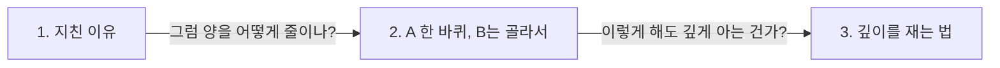

> **2026-11-16 목차**
>
> **[공부법](#공부법)**
> 1. [지친 건 양보다 끝이 안 보여서였다](#1-지친-건-양보다-끝이-안-보여서였다) — 로그인은 깊이, 졸업은 넓이
> 2. [흐름으로 한 바퀴, 줄 단위는 골라서](#2-흐름으로-한-바퀴-줄-단위는-골라서) — A 전부, B는 2~3곳
> 3. [깊이는 답할 수 있는 질문으로 잰다](#3-깊이는-답할-수-있는-질문으로-잰다) — 고칠 곳을 찾아가나

# 공부법

> **흐름**: 졸업 진단에서 막혀 왜 지쳤는지 짚었고, 공부를 두 층으로 나눈 뒤, 그렇게 해도 깊게 아는 건지 따져 봤다.

## 1. 지친 건 양보다 끝이 안 보여서였다

> **한 줄 결론**: "로직상 간단한 로그인에 이만큼 힘을 썼는데 졸업요건 진단은 언제 다 하지?"가 지친 이유다. 그런데 로그인과 졸업은 어려움의 종류가 달라서 이 예측은 맞지 않는다.

### 왜 지쳤나

- 멈추는 기준 없음: 꼬리 질문마다 끝까지 따라감 (서버 메모리 vs DB에만 메시지 약 15개)
- 진도가 안 보임: 로그인 세 세션에서 "몇 단계 남았어?"를 7번 물음
- 남은 기간 21~25일은 "모든 기능을 로그인만큼 깊게" 전제로 줄 수에 곱한 값
- 설명 한 답변의 길이 중간값 약 860자 → 2,430자 (11-10 → 11-12)

### 로그인과 졸업은 어려움이 다르다

| | 로그인 | 졸업 진단 |
|---|---|---|
| 어려움의 방향 | **깊이**: 줄마다 보안 · 동시성 | **넓이**: 학칙 예외가 옆으로 붙음 |
| 새 CS | 많음 | 거의 없음 (서비스에 SELECT만 3개, UPDATE · INSERT · 트랜잭션 없음) |
| 부담의 정체 | 개념이 어렵다 | 경우의 수가 많다 |

### 헷갈린 점

> [!WARNING]
> **로그인이 간단했던 게 아니다.** 흐름은 요청 두 번이지만, 쿠키 · 세션 · 해시 · 타이밍 공격 · 경쟁 상태 같은 웹 기초 CS를 한꺼번에 배운 이틀이었다. 이 비용은 다음 기능으로 가져간다(Google 로그인은 하루에 끝남).

## 2. 흐름으로 한 바퀴, 줄 단위는 골라서

> **한 줄 결론**: 내가 만들었으니 배경 → 메커니즘 → 결과(설계)는 꼭 알아야 하지만, 나는 코더가 아니니까 모든 코드를 볼 필요는 없다. 핵심 기능을 A로 한 바퀴 먼저 돌고, B는 골라서 본다.

정식 표현: 전체를 폭 넓게 먼저 보고 몇 곳만 깊게 파는 T자형 학습

### 두 층

| | A (핵심 기능 전부) | B (기능마다 2~3곳) |
|---|---|---|
| 무엇을 | 흐름(덩어리마다 입력 · 출력), 그 자리의 CS, 고를 수 있던 방법과 버린 이유 | 면접에서 말할 문장을 뒷받침하는 줄 |
| 끝 기준 | 코드 없이 1분 설명 | 그 줄을 코드 없이 재현 |

- 졸업 진단 예: 줄 단위로 볼 양 약 1,900줄 → 약 65줄 (재수강 정리 · 신뢰도 계산)

### 같이 정한 것

- 범위: A+B는 핵심 4개(졸업 · PDF · 챗봇 · 규정 반영)만, 나머지는 한 줄 설명 수준
- B 고르기: 면접 문장 2~3개를 먼저 쓰고, 그 문장을 지키는 줄만 본다
- 기록: TIL은 기능이 끝날 때 한 번, 문제 → 고른 방법 → 버린 방법
- 한 답변은 번호 3개 이내, 범위 밖 질문은 "나중에 볼 질문"으로 미룸

### 멘토 조언과 같은 방향

- 회고 질문 3개: 왜 이 방법을 시도했나 / 다른 방법은 무엇을 고민했나 / 버린 방법은 왜 버렸나
- 줄마다 이해하라는 말은 없음 → A층의 "설계와 선택"이 곧 이 질문들
- CS는 따로 떼어 공부하지 않고 선택지를 견주는 자리에서 들어온다 (세션을 DB에 둔 이유 → 휘발성 · 영속성)

### 검토했지만 버린 방법과 이유

| 방법 | 버린 이유 |
|---|---|
| 기능마다 A+B를 끝까지 | 학칙 예외가 대부분인 졸업에서는 파도 남는 게 적고, 끝이 안 보여 지침 |
| PDF를 먼저 하고 졸업은 나중에 | 포트폴리오 핵심인 졸업을 계속 미루면 부담이 더 커짐 |

## 3. 깊이는 답할 수 있는 질문으로 잰다

> **한 줄 결론**: 읽은 줄 수로 재면 얕지만, "왜 · 다른 방법 · 실패 · 핵심 줄 재현"에 답하고 고칠 곳을 찾아갈 수 있으면 깊게 안 것이다.

### 확인 방법

- 4질문: 왜 이렇게 만들었나 / 다른 방법과 안 고른 이유 / 실패하면 어떻게 되나 / 핵심 줄을 코드 없이 재현
- "바꿀 수 있나": 예) 재수강한 과목이 F면 졸업 판정을 바꾸려고 어디를 고치나 → 고칠 곳을 찾아가면 A가 된 것

### 쿠키 · 세션은 재밌고 줄 단위 코드는 재미없었던 이유

- 쿠키 · 세션: "사이트는 나를 어떻게 기억하지?"라는 질문이 먼저 있었음 → 풀리는 순간이 재미
- 줄 단위 코드: 이 줄이 막는 문제를 모른 채 읽음 → "목적 없는 공부" 느낌
- 그래서 덩어리마다 질문을 먼저 세운다 (예: "재수강해서 F면 예전 합격은 인정될까?")

### 헷갈린 점

> [!WARNING]
> **A만 하면 외워서 말할 수는 있지만 내 것은 아닌 설명이 된다.** "규정 엔진을 분리했다"는 코드 없이도 말할 수 있다. "분리한 경계가 어디예요?"에 답하려면 B를 면접에서 말할 지점에 맞춰 골라야 한다.
