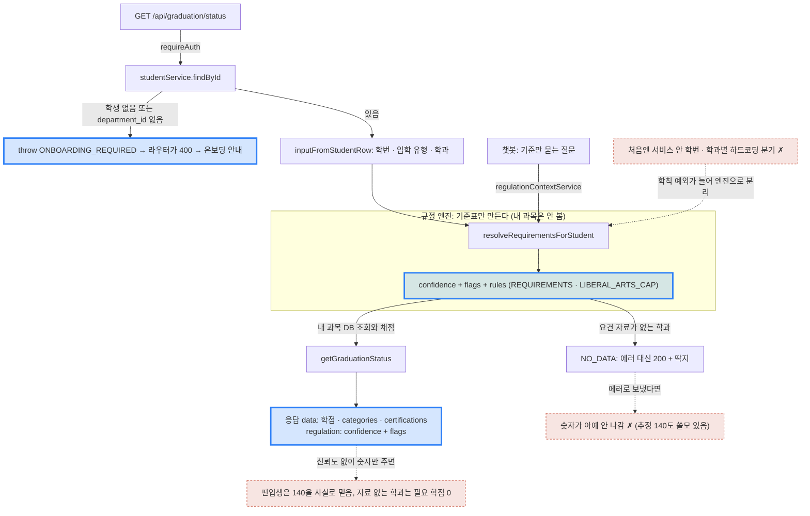

> **2026-11-17 목차**
>
> **[ONE Student](#one-student)**
> 1. [응답은 숫자와 그 숫자를 믿어도 되는지를 같이 준다](#1-응답은-숫자와-그-숫자를-믿어도-되는지를-같이-준다) — 학점 + 신뢰도 한 묶음
> 2. [학생이 고칠 문제는 막고 우리 쪽 문제는 딱지를 붙인다](#2-학생이-고칠-문제는-막고-우리-쪽-문제는-딱지를-붙인다) — 400 vs 200 + 딱지
> 3. [엔진은 기준표를 만들고 서비스는 채점한다](#3-엔진은-기준표를-만들고-서비스는-채점한다) — 기준만 물으면 엔진만

# ONE Student

> **졸업 현황 진단 7단계**: **상황과 값 → 학생 확인 → 요건표 받기 (이 날)** → 내 과목 정리 → 학점 비교 → 다른 요건 → 신뢰도 붙여 응답
> **그림 한 장으로 복습**: 아래 그림만 보고 설명할 수 있으면 이 날은 끝. 막히는 칸만 아래 항목을 읽는다.



## 1. 응답은 숫자와 그 숫자를 믿어도 되는지를 같이 준다

> **지도에서 위치**: [ONE Student 지도](../../projects/one-student.md) › 졸업요건 진단 › 상황과 값 (`GET /api/graduation/status`)
> **한 줄 결론**: 졸업요건 진단 페이지에 들어가면 학점 정보와 함께, 그 숫자를 얼마나 믿어도 되는지(신뢰도)를 `data` 한 묶음으로 돌려준다.

### 응답 모양

```js
data: {
  totalRequiredCredits: 140,  // 졸업에 필요한 총 학점
  totalEarnedCredits: 55,     // 지금까지 인정된 학점
  categories: [...],          // 이수구분별 "요건 학점 vs 내 학점"
  certifications: [],         // 학점 외 요건 (졸업인증 등)
  regulation: {               // 위 숫자를 얼마나 믿어도 되나
    confidence: 'CONFIRMED',  // 확정 / ESTIMATED(추정) / NO_DATA(자료없음)
    flags: [],                // 추정·자료없음이면 사유 코드
  },
}
```

- 필드 이름은 외우지 않는다. 테스트 파일(`GraduationStatus.test.jsx`)에서 찾아본다
- 말로 할 수 있어야 하는 것: "총 학점 · 이수구분별 학점 · 학점 외 요건 · 신뢰도와 사유"
- 신뢰도 세 값(확정 / 추정 / 자료없음)과 사유 코드가 같이 붙는다는 것은 설계 핵심이라 기억한다

### 신뢰도가 없으면

- 사용자는 그 숫자가 확실한지 불확실한지 알 방도가 없다
- 시스템도 그걸 표시하지 않고 계산한 숫자를 그대로 안내한다 → 편입생은 140을 사실로 믿고 수강 계획을 세움
- 자료가 없는 학과는 "필요 학점 0" → 졸업 요건을 다 채운 것처럼 보임

### 검토했지만 버린 방법과 이유

| 방법 | 버린 이유 |
|---|---|
| 불확실하면 에러로 응답 | 숫자가 아예 안 나감. "추정"이어도 140은 쓸모가 있어서, 성공 응답 안에 숫자와 딱지를 같이 담음 |

### 면접에서 설명한다면

불확실한 결과를 숨기지 않고, 신뢰도와 사유 코드를 함께 응답해서 학생이 판단할 수 있게 했습니다. 딱지는 숫자에 붙는 것이라 숫자와 같은 `data` 안에 둡니다.

이전 기록: [2026-11-05 응답 형식과 code 이름표](../../2026/November/11-05.md#4-응답-형식과-code-이름표)

## 2. 학생이 고칠 문제는 막고 우리 쪽 문제는 딱지를 붙인다

> **지도에서 위치**: [ONE Student 지도](../../projects/one-student.md) › 졸업요건 진단 › 학생 확인 (`graduationService.getGraduationStatus` 첫 줄)
> **한 줄 결론**: DB에 학생 정보가 없거나 학과 id가 없으면 `ONBOARDING_REQUIRED` 에러를 던진다. 서비스는 HTTP를 모르니 던지기만 하고, 라우터가 받아서 400 응답으로 포장한다.

### 흐름

```text
requireAuth (로그인 확인)
  → studentService.findById (학생 행 하나)
  → 학생이 없거나 department_id가 없음
      → 서비스: throw err (err.code = 'ONBOARDING_REQUIRED')
      → 라우터: 400 응답
      → 화면: 온보딩 화면으로 가는 안내
```

### 두 경우의 차이

| | `ONBOARDING_REQUIRED` | `NO_DATA` |
|---|---|---|
| 상황 | 학생이 온보딩을 아직 마치지 않음 | 학과는 있는데 우리 쪽에 요건 자료가 없음 |
| 누가 고치나 | 학생 (입력하면 해결) | 우리 쪽 |
| 응답 | 400 (클라이언트가 고칠 문제) | 200 + 딱지 (결과는 나옴) |

### 다음 단계로 넘기는 값

- 학생 행에서 졸업 기준을 정하는 값만 추린다(`inputFromStudentRow`): 학번, 입학 유형(일반 / 편입 / 전과), 학과
- `transfer`는 편입 여부가 아니라, 편입생일 때만 붙는 세부 정보(편입 학년, 인정학점)

> [!WARNING]
> **`NO_DATA`가 200"일 수밖에" 없는 건 아니다.** 에러로 보낼 수도 있었지만, "누가 고칠 문제인가"를 기준으로 성공 쪽을 골랐다. `ONBOARDING_REQUIRED`도 "스킵"이 아니라 "아직 마치지 않음"(막 가입, 중간에 나감)이다.

### 면접에서 설명한다면

학생이 고칠 수 있는 문제(온보딩 미완료)는 400으로 막고 입력 화면으로 안내합니다. 우리 쪽 자료가 없는 경우는 성공 응답에 신뢰도 딱지를 붙여 보여 줍니다.

이전 기록: [2026-11-03 HTTP 정보와 서비스 분리](../../2026/November/11-03.md#6-http-정보와-서비스-분리) · [2026-11-05 에러가 공통 처리기까지 가는 길](../../2026/November/11-05.md#5-에러가-공통-처리기까지-가는-길)

## 3. 엔진은 기준표를 만들고 서비스는 채점한다

> **지도에서 위치**: [ONE Student 지도](../../projects/one-student.md) › 졸업요건 진단 › 요건표 받기 (`regulationEngine.resolveRequirementsForStudent`)
> **한 줄 결론**: 엔진은 "너 상태면 이 정도는 들어야 돼"라는 기준표를 주는 데서 끝나고, `getGraduationStatus`는 그 기준표로 내 학점을 채점해서 남은 것을 알려 준다. 기준표만 묻는 질문도 있어서 엔진을 따로 뗐다.

정식 표현: 관심사 분리(Separation of Concerns)

### 입력 → 출력

```js
// 입력: 학생 확인에서 추린 값 (학번, 입학 유형, 학과 ...)
// 출력: 신뢰도 + 기준표
{
  confidence: 'CONFIRMED',
  flags: [],
  rules: [
    { id: 'REQUIREMENTS', value: { categories: [...], certifications: [...] } }, // 이수구분별 필요 학점
    { id: 'LIBERAL_ARTS_CAP', ... },                                              // 교양 인정 상한
  ],
}
```

- 응답의 필요 학점과 신뢰도가 여기서 정해진다
- "찾기"가 아니라 "판단": 원광대는 옛 학번도 최신 책자의 학번별 표를 따르고, 편입 · 전과 · 통폐합 예외를 따져서 정한다

### 기준표 vs 채점

```text
"나 몇 학점 남았어?"            → getGraduationStatus → 엔진(기준표) + 내 과목 DB 조회 → 채점
"편입생은 교양 몇 학점까지 돼?" → 엔진만 (챗봇이 regulationContextService로 호출)
```

- 엔진은 내 과목을 보지 않는다
- 숫자 판단은 엔진, 쉬운 설명은 AI → 챗봇도 직접 계산하지 않고 진단 결과를 받아 설명한다
- 판단이 한 곳에서만 나와 화면과 챗봇이 다른 숫자를 말하지 않는다

### 실제 이력

| 날짜 | 일 |
|---|---|
| 2026-08-15 | 졸업 진단 API 처음 구현: 서비스 안에서 학번 · 학과별로 직접 분기(하드코딩) |
| 2026-10-05 | 규정 판단 엔진 추가, 진단을 엔진 결과로 교체: "하드코딩 분기 제거, 신뢰도 추가" |

- 커밋 제목으로 보면, 뗀 계기는 학칙 예외가 늘어난 하드코딩 분기를 정리하는 쪽에 가깝다(추정). 기준만 부를 수 있게 된 건 떼어 낸 덕분이다

> [!WARNING]
> **판단을 통일하는 것만이 목적이면 `getGraduationStatus` 하나로도 된다.** 따로 뗀 이유는 둘이 묻는 질문이 달라서다(어떤 기준이 적용되나 vs 내 과목은 그 기준에 비해 어떤가). 정해진 "원래" 자리는 없고, 넣을지 뗄지 고를 수 있었다.

### 면접에서 설명한다면

처음엔 서비스에서 학번별로 분기했는데, 학칙 예외가 늘면서 기준 판단을 규정 엔진으로 분리했습니다. 그러면서 판단이 확실하지 않은 경우를 신뢰도로 표시하게 했습니다. 챗봇이 기준만 물을 때는 엔진만 부르고, 판단은 한 곳에서만 나옵니다.

다음 기록: 내 과목 정리(4단계)
