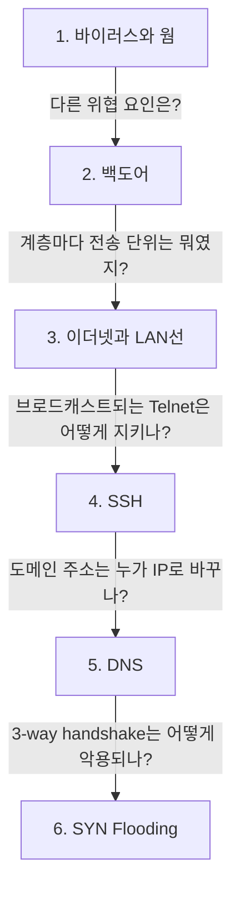
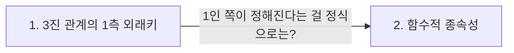

> **2026-11-18 목차**
>
> **[정보보안](#정보보안)**
> 1. [바이러스와 웜은 독자 실행 여부로 나뉜다](#1-바이러스와-웜은-독자-실행-여부로-나뉜다) — 숙주 필요 vs 혼자 실행·전파
> 2. [백도어는 공격이 아니라 위협 요인이다](#2-백도어는-공격이-아니라-위협-요인이다) — 인증 없는 비밀 통로 자체가 위험
> 3. [이더넷과 LAN선](#3-이더넷과-lan선) — 이더넷은 1·2계층, LAN선은 1계층
> 4. [SSH는 Telnet의 평문을 통째로 암호화한다](#4-ssh는-telnet의-평문을-통째로-암호화한다) — 스니핑해도 암호문
> 5. [DNS는 도메인을 IP로 바꾼다](#5-dns는-도메인을-ip로-바꾼다) — 접속 전에 IP를 먼저 묻는다
> 6. [SYN Flooding](#6-syn-flooding) — half-open으로 대기 큐를 채운다
>
> **[데이터베이스](#데이터베이스)**
> 1. [3진 관계에서 1인 쪽 외래키는 기본키에서 뺀다](#1-3진-관계에서-1인-쪽-외래키는-기본키에서-뺀다) — 넣으면 1 제약이 깨짐
> 2. [함수적 종속성](#2-함수적-종속성) — X 하나에 Y는 정확히 하나

# 정보보안

> **흐름**: 8주제 네트워크 보안의 네트워크 공격을 따라가다, 스니핑 슬라이드에서 계층·이더넷·SSH·DNS로 곁가지를 탔다가 SYN Flooding으로 돌아왔다.



## 1. 바이러스와 웜은 독자 실행 여부로 나뉜다

> **한 줄 결론**: 바이러스는 다른 프로그램에 붙어서만 실행되고, 웜은 혼자 실행되며 네트워크로 스스로 퍼진다.

정식 표현: 바이러스(virus) · 웜(worm) · 트로이 목마(Trojan horse)

### 어떻게 다른가

| | 독자 실행 | 자기복제 | 핵심 특징 |
|---|---|---|---|
| 바이러스 | ✗ (숙주 필요) | ○ | 다른 프로그램이 실행될 때 같이 실행 |
| 웜 | ○ | ○ | 전자메일 등 네트워크로 스스로 전파 |
| 트로이 목마 | ○ | ✗ | 정상 프로그램으로 위장 |

- 웜: 사람을 기다리지 않음 → 확산 속도↑, 복사본↑ → CPU · 메모리 · 네트워크 고갈
- 1988 Morris 웜: 전자메일로 퍼져 인터넷 전체 마비
- 트로이 목마: 바이러스 · 웜이 주로 쓰는 **침투 수단**(위장)

> [!NOTE]
> 시험용: "바이러스는 숙주 프로그램에 기생해 실행되고, 웜은 독자적으로 실행되며 네트워크를 통해 스스로 전파된다. 둘 다 자기복제 능력이 있다."

## 2. 백도어는 공격이 아니라 위협 요인이다

> **한 줄 결론**: 관리자가 편하려고 열어 둔 비밀 통로가 인증을 건너뛰기 때문에, 그 통로 자체가 위험 요소라는 정의다.

정식 표현: 백도어(back door) · 트랩 도어(trapdoor) — 슬라이드에서는 같은 뜻

### 정의

- 무엇: 설계자 · 관리자가 관리 작업용으로 **고의로** 열어 둔 비밀 통로
- 왜 위험: 정상 인증 절차 없이 접근 가능 → 공격자가 찾으면 바로 들어옴
- 슬라이드 밖: 실제로는 침입한 공격자가 재접속용으로 심기도 함(트로이 목마가 설치)

> [!WARNING]
> **암호기술의 "트랩도어 일방향 함수"와는 다르다.** 그쪽은 비밀값을 알면 역계산이 쉬운 함수이고, 이름만 같다.

## 3. 이더넷과 LAN선

> **한 줄 결론**: 이더넷은 유선 LAN의 1·2계층 규칙 전체(신호 + 프레임 · MAC 주소)이고, LAN선은 그 규칙대로 만든 1계층 케이블일 뿐이다.

정식 표현: 이더넷(Ethernet, IEEE 802.3) · PDU(Protocol Data Unit)

### OSI 계층별 전송 단위

| 계층 | 이름 | 전송 단위 |
|---|---|---|
| 7~5 | 응용 · 표현 · 세션 | 데이터(메시지) |
| 4 | 전송 | 세그먼트(TCP) / 데이터그램(UDP) |
| 3 | 네트워크 | 패킷 |
| 2 | 데이터 링크 | 프레임 |
| 1 | 물리 | 비트 |

- 아래부터 외우기: 비트 → 프레임 → 패킷 → 세그먼트 → 데이터
- 이름이 바뀌는 이유: 계층마다 헤더를 붙임(캡슐화)

### 범위 비교

```text
LAN (근거리 통신망, 범위 개념)
 ├─ 이더넷   유선 기술, 1·2계층 (프레임 · MAC 주소)
 │   └─ LAN선   UTP + RJ-45 케이블, 1계층
 └─ 와이파이  무선 기술 (IEEE 802.11), 이더넷 아님
```

- 이름: ether(빛을 실어 나른다고 믿은 가상의 물질) + net → 모두가 매체 하나를 공유
- MAC 주소 = 같은 LAN 안 상대 찾기(2계층) / IP 주소 = 네트워크 넘어 찾기(3계층)

## 4. SSH는 Telnet의 평문을 통째로 암호화한다

> **한 줄 결론**: 이더넷은 프레임을 브로드캐스트해서 스니핑이 가능하고, Telnet은 계정 · 비밀번호까지 평문이라 그대로 노출된다. SSH는 접속 전체를 7계층에서 암호화해 훔쳐봐도 암호문만 보이게 한다.

정식 표현: 스니핑(sniffing) · 스푸핑(spoofing) · promiscuous mode(무차별 모드)

### 스니핑과 스푸핑

| | 하는 일 | 예 |
|---|---|---|
| 스니핑 | 지나가는 패킷을 **훔쳐봄** | Telnet 계정 · 비밀번호 알아내기 |
| 스푸핑 | 다른 사람 · 시스템으로 **위장** | IP · DNS · 로그인 프로그램 스푸핑 |

- 브로드캐스트는 Telnet이 아니라 **이더넷**(옛 허브 · 버스 구조)의 특성
- 공격자 랜카드를 promiscuous mode로 → 남의 MAC으로 온 프레임도 받음

### SSH가 막는 위치

```text
7계층  SSH가 내용 전체를 암호화   ← 여기서 이미 암호문
4계층  TCP 세그먼트
3계층  IP 패킷
2계층  이더넷 프레임 브로드캐스트   ← 그대로 퍼지지만 읽을 수 없음
```

### 포트 22

- 0~1023 = 웰노운 포트(well-known port): IANA가 대표 서비스에 배정한 구간 (FTP 21, SSH 22, Telnet 23, HTTP 80, HTTPS 443)
- 22번 → 웰노운인 것(반대 아님). Telnet(23)을 대신하려고 옆 빈 번호를 받음
- 기본값일 뿐 변경 가능. 핵심 방어는 키 인증

> [!WARNING]
> **SSH는 이더넷의 일부가 아니고, 중요 정보만 고르지도 않는다.** 7계층 프로토콜이고, 계정 · 명령 · 출력까지 접속 전체를 암호화한다. 이더넷은 암호문을 나를 뿐이다.

## 5. DNS는 도메인을 IP로 바꾼다

> **한 줄 결론**: 주소창에 도메인을 치면 브라우저가 접속 전에 DNS 서버에 IP를 묻고, 받은 IP로 접속한다. 우리는 모르는 사이에 매번 쓰고 있다.

정식 표현: DNS(Domain Name System) · 정방향 조회(도메인 → IP)

### 흐름

```text
1. 주소창에 www.wku.ac.kr 입력
2. DNS 서버에 질의 → 응답: IP 주소
3. 그 IP로 접속 (TLS 핸드셰이크 → HTTP 요청)
```

- 답하는 건 **DNS 서버**(보통 통신사 · 공유기), DNS는 이름 체계 전체
- 받은 답은 캐시 → 다시 열 때는 안 물음
- 2번 응답을 가짜 IP로 바꾸면 → DNS 스푸핑

> [!WARNING]
> **방향이 "IP → 도메인"이 아니다.** 보통 DNS는 도메인 → IP다. 역방향 조회도 있지만 주된 용도가 아니다.

## 6. SYN Flooding

> **한 줄 결론**: SYN만 대량으로 보내고 마지막 ACK를 일부러 안 보내서, 서버의 연결 대기 큐를 half-open 연결로 가득 채운다. 정상 사용자의 SYN은 자리가 없어 버려진다.

정식 표현: SYN Flooding — 서비스 거부 공격(DoS)의 한 종류

### 어떻게 동작하나

```text
공격자 → 서버 : SYN          "연결하자"
서버 → 공격자 : SYN + ACK    → 서버는 대기 큐에 기록하고 기다림
공격자 → 서버 : (ACK 안 보냄) → half-open으로 남음
반복 → 대기 큐 가득 참(Queue full) → 정상 SYN 버려짐
```

- 출발지 IP 위조(IP 스푸핑) → SYN + ACK가 엉뚱한 곳으로 감 → ACK 영영 안 옴
- 공격자 1 : 피해자 1 = DoS / 공격자 N(좀비 PC) : 피해자 1 = **DDoS**
- 방어(슬라이드 밖): SYN 쿠키, 대기 시간↓, 큐 크기↑

> [!WARNING]
> **"메인메모리를 잡아먹는다"는 부정확하다.** 메모리 전체가 아니라 정해진 크기의 연결 대기 큐(backlog queue)가 바닥나는 것이다. "중간에 끊긴다"도 우연이 아니라 공격자가 ACK를 일부러 생략하는 것이다.

이전 기록: [2026-11-10 TCP와 UDP](../../2026/November/11-10.md#7-tcp와-udp)

<br>
<br>
<br>
<br>
<br>
<br>
<br>
<br>
<br>
<br>

# 데이터베이스

> **흐름**: ER → 릴레이션 사상 알고리즘의 3진 관계에서 "1인 쪽이 정해진다"는 말을 정식으로 부르는 이름이 함수적 종속성이라, 정규화 슬라이드로 넘어갔다.



## 1. 3진 관계에서 1인 쪽 외래키는 기본키에서 뺀다

> **한 줄 결론**: 3진 관계에 1이 있으면 나머지 둘이 정해질 때 1인 쪽이 고정된다. 그래서 1측 외래키는 외래키로는 남지만 기본키에서는 빠지고, 나머지 외래키 조합이 기본키다.

정식 표현: ER-릴레이션 사상 — 3진 이상 관계 타입, 카디날리티 1:N:N

### 어떻게 옮기나

- 3진 관계 → 관계 릴레이션을 새로 만듦, 세 엔티티의 기본키를 전부 외래키로
- 1:N:N이면 1측 외래키는 기본키에서 제외
- 빼는 건 외래키 전부가 아니라 **1인 쪽 하나**

```sql
-- SUPPLIES: 공급자 1 : 프로젝트 N : 부품 N
-- 읽는 법: 어떤 프로젝트의 어떤 부품은 공급자 한 곳에서만 받는다
공급(프로젝트번호 FK, 부품번호 FK, 공급자번호 FK, 수량)
-- PK = (프로젝트번호, 부품번호)

('P1', '볼트', 'S1', 100)   -- OK
('P1', '볼트', 'S2', 50)    -- PK가 겹쳐서 거부 → "공급자는 한 곳"이 지켜짐
```

### 왜 빼야 하나

- PK를 셋으로 잡으면 → 위 두 번째 행이 들어감 → 1 제약이 깨짐
- 고정된다 = 나머지 둘 → 1측 (함수적 종속성)

> [!WARNING]
> **1측 외래키를 PK에 넣어도 유일성은 만족한다.** 문제는 최소성이다. 슈퍼키일 뿐 후보키가 아니고, 카디날리티 제약도 DB가 보장하지 못한다.

이전 기록: [2026-11-04 차수](../../2026/November/11-04.md#9-차수)

## 2. 함수적 종속성

> **한 줄 결론**: 함수는 입력 하나에 결과가 여러 개 나와도, 안 나와도 안 된다. 함수적 종속성은 이 조건을 그대로 물려받아, X 값 하나에 Y 값이 정확히 하나 대응하는 것이다.

정식 표현: 함수적 종속성(FD, Functional Dependency) · X → Y (X는 결정자, Y는 종속자)

### 예시

```sql
학생(학번, 이름, 학과, 학과전화)
(2201, '권', '컴소공', '850-1')
(2202, '김', '컴소공', '850-1')  -- 학과가 같으면 학과전화도 같다 → 학과 → 학과전화 ○
(2203, '권', '경영',  '850-2')   -- 이름 '권'에 학과가 둘 → 이름 → 학과 ✗
```

- 서로 다른 X가 같은 Y인 것은 허용(2201 · 2202 둘 다 컴소공) → 금지는 X 하나에 Y 여럿뿐
- 판단은 지금 값이 아니라 **의미**로: 스키마(내포)에 대한 제약, 현재 상태(외연) 아님
- `K → 나머지 전부` = 슈퍼키, K 일부로는 안 되면 후보키
- 키가 아닌 결정자(학과 → 학과전화) → 값 반복 → 갱신 이상 → 정규화 대상

> [!WARNING]
> **지금 표에 동명이인이 없다고 이름 → 학과가 성립하는 게 아니다.** 내일 동명이인이 들어오면 깨진다. "현실에서 X 하나에 Y가 둘일 수 있나?"로 판단한다.
