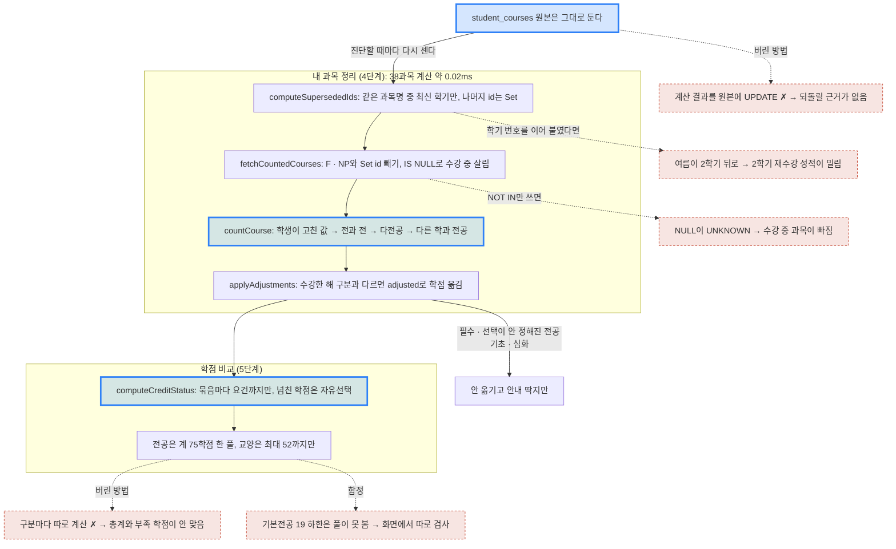
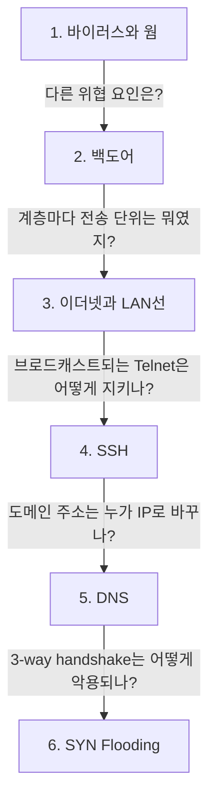
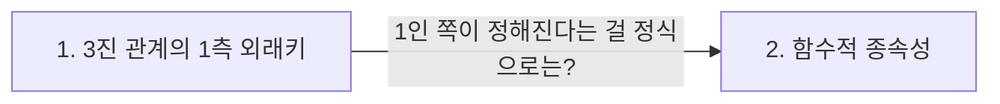

> **2026-11-18 목차**
>
> **[ONE Student](#one-student)**
> 1. [인정 학점은 원본에 덮어쓰지 않고 매번 다시 센다](#1-인정-학점은-원본에-덮어쓰지-않고-매번-다시-센다) — 원본·파생 분리, 계산은 0.02ms
> 2. [재수강 이전 기록과 F는 가져오지 않는다](#2-재수강-이전-기록과-f는-가져오지-않는다) — 최신 학기만, IS NULL로 수강 중 살림
> 3. [학기 번호를 학사력 시간순으로 다시 매겼다](#3-학기-번호를-학사력-시간순으로-다시-매겼다) — 여름 2, 2학기 3
> 4. [과목마다 어디로 셀지 학적에 따라 다시 정한다](#4-과목마다-어디로-셀지-학적에-따라-다시-정한다) — 학생이 고친 값이 먼저
> 5. [수강한 학년도 기준으로 학점을 옮긴다](#5-수강한-학년도-기준으로-학점을-옮긴다) — 모르면 옮기지 않고 알린다
> 6. [요건까지만 인정하고 넘친 학점은 자유선택으로 보낸다](#6-요건까지만-인정하고-넘친-학점은-자유선택으로-보낸다) — 전공은 75학점 한 풀
>
> **[정보보안](#정보보안)**
> 1. [바이러스와 웜은 독자 실행 여부로 나뉜다](#1-바이러스와-웜은-독자-실행-여부로-나뉜다) — 숙주 필요 vs 혼자 실행·전파
> 2. [백도어는 공격이 아니라 위협 요인이다](#2-백도어는-공격이-아니라-위협-요인이다) — 인증 없는 비밀 통로 자체가 위험
> 3. [이더넷과 LAN선](#3-이더넷과-lan선) — 이더넷은 1·2계층, LAN선은 1계층
> 4. [SSH는 Telnet의 평문을 통째로 암호화한다](#4-ssh는-telnet의-평문을-통째로-암호화한다) — 스니핑해도 암호문
> 5. [DNS는 도메인을 IP로 바꾼다](#5-dns는-도메인을-ip로-바꾼다) — 접속 전에 IP를 먼저 묻는다
> 6. [SYN Flooding](#6-syn-flooding) — half-open으로 대기 큐를 채운다
>
> **[데이터베이스](#데이터베이스)**
> 1. [3진 관계에서 1인 쪽 외래키는 기본키에서 뺀다](#1-3진-관계에서-1인-쪽-외래키는-기본키에서-뺀다) — 넣으면 1 제약이 깨짐
> 2. [함수적 종속성](#2-함수적-종속성) — X 하나에 Y는 정확히 하나

# ONE Student

> **졸업 현황 진단 7단계**: 상황과 값 → 학생 확인 → 요건표 받기 → **내 과목 정리 → 학점 비교 (이 날)** → 다른 요건 → 신뢰도 붙여 응답
> **그림 한 장으로 복습**: 아래 그림만 보고 설명할 수 있으면 이 날은 끝. 막히는 칸만 아래 항목을 읽는다.



## 1. 인정 학점은 원본에 덮어쓰지 않고 매번 다시 센다

> **지도에서 위치**: [ONE Student 지도](../../projects/one-student.md) › 졸업요건 진단 › 내 과목 정리 (`getGraduationStatus`)
> **한 줄 결론**: 저장된 값을 그대로 더하면 재수강 중복 · 학적에 따른 재분류 · 이수구분 변경 때문에 틀린다. 그래서 원본은 그대로 두고, 진단할 때마다 세 덩어리(빼기 → 다시 분류 → 보정 후 합산)를 거쳐 다시 센다.

정식 표현: 원본 데이터(source of truth)와 파생 데이터(derived data) 분리

### 원본에 덮어쓰면

```js
// 전과생의 과목을 일반선택으로 바꿔 저장했다면
UPDATE student_courses SET category = '일반선택' WHERE id = 7;  // 원래 '전공선택'이 사라진다
// 학생이 전과 학기를 잘못 넣었다며 고치면 → 되돌릴 근거가 없다
```

- 결과를 바꾸는 재료가 나중에 바뀜: 학생 정보(전과 · 다전공 · 학과), 편성표 · 변경 이력, 학칙 해석
- 덮어쓰면 원본 훼손 + 되돌리는 기능을 따로 만드는 오버헤드 → 이걸 피하려고 나눔

### 실제로 잰 비용

| 측정 | 값 |
|---|---|
| 내 과목 정리 계산(과목 분류 + 학년도 보정), 38과목 | 약 0.02ms |
| 진단 전체(로컬 복사본 DB) p50 | 약 7ms, 대부분 DB 쿼리 19~21번 |
| 운영 최근 7일 p50 | 23~42ms |

- 계산은 진단 시간의 약 0.3% → 느려지면 손볼 곳은 쿼리 수
- 그래도 필요하면 원본이 아니라 계산 결과를 캐시하고, 재료가 바뀌면 지운다

### 검토했지만 버린 방법과 이유

| 방법 | 버린 이유 |
|---|---|
| 한 번 계산해서 원본 칸에 저장 | 원본 훼손, 재료가 바뀔 때마다 다시 써야 할 행을 찾아야 함 |

> [!WARNING]
> **원본을 늘 같은 상태로 둔다는 뜻이면 "일관성"보다 "원본 보존"이라고 말한다.** 일관성은 보통 여러 곳의 값이 서로 맞는다는 뜻으로 들린다. 그건 과목 분류를 한 함수에서만 정해서 얻는 것이다.

### 면접에서 설명한다면

인정 학점은 학적 · 편성표 · 학칙 해석에 따라 바뀌는 파생값이라 원본 과목 기록에 덮어쓰지 않았습니다. 진단할 때마다 다시 계산해서 학과나 전과 정보를 고치면 결과가 바로 맞춰지고, 학교가 준 원래 값도 잃지 않습니다. 실제로 재 보니 이 계산은 0.02ms로 진단 시간의 0.3%였습니다.

이전 기록: [2026-11-17 엔진은 기준표를 만들고 서비스는 채점한다](../../2026/November/11-17.md#3-엔진은-기준표를-만들고-서비스는-채점한다)

## 2. 재수강 이전 기록과 F는 가져오지 않는다

> **지도에서 위치**: [ONE Student 지도](../../projects/one-student.md) › 졸업요건 진단 › 내 과목 정리 › 빼기 (`computeSupersededIds`, `fetchCountedCourses`)
> **한 줄 결론**: 같은 과목명 중 최신 학기 기록만 남기고, F · NP는 SQL에서 뺀다. DB에서 지우는 게 아니라 SELECT로 가져오지 않는 것이다.

정식 표현: Set, 3값 논리(three-valued logic)

### 흐름

```text
① 같은 과목명끼리 묶고, 두 번 이상 들은 과목만 학기 순으로 정렬
② 최신 하나만 남기고 나머지 id를 Set에 넣음   → supersededIds = Set {1}
③ SQL에서 F · NP와 Set 안의 id를 뺌          → id NOT IN (1)
④ 남은 과목 행을 다시 분류로 넘김
```

- 성적은 안 봄: "재수강하면 재수강 성적만 인정"(시행규칙 제28조 제5항)
- 재수강이 F → 이전 기록은 ②, 최신 F는 ③에서 빠짐 → 0학점, 미이수
- 안 지우는 이유: 과목 목록 화면이 이전 기록을 "재수강으로 대체됨"으로 보여 줌

### Set을 쓴 이유

```js
const box = new Set();
box.add(1);
box.add(1);   // 이미 있으면 안 들어감 → 그대로 {1}
box.has(1);   // true — 처음부터 훑지 않고 바로 찾는다
```

- 중복 막기보다 `has()`: 졸업인증 판정 · 과목 목록에서 "밀려난 기록인가?"를 계속 물음
- 상수에는 Set 그대로 담기고, SQL에 넘길 때만 `[...supersededIds]`로 배열

### 수강 중 과목을 살리는 IS NULL

```sql
letter_grade NOT IN ('F','NP')   -- NULL이면 UNKNOWN → WHERE가 버림 (수강 중 과목 빠짐)
letter_grade IS NULL             -- NULL이면 TRUE → 남음
```

> [!WARNING]
> **UNKNOWN은 우리가 만든 게 아니라 SQL 표준 규칙이다.** 활용한 게 아니라, UNKNOWN 때문에 수강 중 과목이 빠지는 걸 IS NULL로 막았다.

### 면접에서 설명한다면

재수강은 같은 과목명 중 최신 학기 기록만 남기고, F · NP는 SQL에서 뺍니다. 원본은 지우지 않고 가져오지만 않아서 과목 목록에서는 이전 기록을 "대체됨"으로 보여 줄 수 있습니다. 성적이 없는 수강 중 과목은 NULL 비교가 UNKNOWN이 되어 빠지므로 IS NULL을 따로 겁니다.

## 3. 학기 번호를 학사력 시간순으로 다시 매겼다

> **지도에서 위치**: [ONE Student 지도](../../projects/one-student.md) › 졸업요건 진단 › 내 과목 정리 › 빼기 (학기 정렬)
> **한 줄 결론**: 최신 기록을 고르는 정렬이 "번호가 작을수록 먼저 들은 학기"라는 전제에 기대서, 계절학기를 넣을 때 번호를 뒤에 붙이지 않고 학사력 시간순으로 다시 매겼다.

정식 표현: 멱등성(idempotency)

### 두 방법

| | 1 | 2 | 3 | 4 |
|---|---|---|---|---|
| 버린 방법(이어 붙이기) | 1학기 | 2학기 | 여름 | 겨울 |
| 고른 방법(시간순) | 1학기 | 여름 | 2학기 | 겨울 |

- 이어 붙이면 여름(3)이 2학기(2)보다 뒤로 정렬 → 2학기 재수강 성적이 여름 기록에 밀림

### 대가

- 기존 데이터의 학기 번호를 전부 바꿔야 했음 (2026-09)
- 배포 때마다 도는 코드라 두 번 실행해도 한 번만 바뀌게 가드를 둠 → 멱등성

### 면접에서 설명한다면

최신 학기를 고르는 정렬이 학기 번호에 기대고 있어서, 계절학기를 추가할 때 번호를 학사력 시간순으로 다시 매겼습니다. 기존 데이터를 옮기는 코드는 여러 번 실행돼도 한 번만 바뀌게 만들었습니다.

## 4. 과목마다 어디로 셀지 학적에 따라 다시 정한다

> **지도에서 위치**: [ONE Student 지도](../../projects/one-student.md) › 졸업요건 진단 › 내 과목 정리 › 다시 분류 (`courseCounting.countCourse`)
> **한 줄 결론**: 과목마다 어디로 셀지(주전공 / 제2전공 / 일반선택), 셀 때 쓸 구분, 바뀐 이유, 앱이 자동으로 정했는지를 붙인다. 학생이 고친 값이 먼저고, 해당 사항이 없는 일반 학생은 null로 저장된 구분 그대로 간다.

정식 표현: 사용자 수정 통로(override)

### 검사 순서

```text
① 학생이 직접 고친 값  → 그대로 (구분을 바꾼 과목은 ②·④를 건너뜀)
② 전과 전 과목         → 일반선택 (인정 신청이 되면 전공선택)
③ 다전공               → 제2전공 쪽
④ 다른 학과 전공 과목   → 일반선택 (개설과목에서 고른 과목만)
```

```js
{ counted: 'GENERAL', category: '일반선택', reason: 'DEMOTED', auto: true }
// 어디로 셀지 / 셀 때 쓸 구분 / 바뀐 이유 / 앱이 자동으로 정했나
```

### 왜 이 순서인가

- 학생 값 우선(2026-11-10, 내가 정함): 판정이 틀려도 학생이 바로잡을 통로를 연다. 대신 결과는 "미정"으로 표시
- 성적표 PDF 과목은 ④에서 안 건드림: 학교가 찍은 구분이라 신뢰
- 판정 결과도 저장 안 함 → 학적을 고치면 다음 진단에 바로 반영

### 면접에서 설명한다면

과목을 어디로 셀지는 학적에 따라 한 함수에서 정하고, 진단 화면과 과목 목록이 같은 결과를 씁니다. 자동 판정이 틀릴 수 있어서 학생이 직접 고친 값을 먼저 따르고, 학교 기록과 다를 수 있으니 결과를 미정으로 보여 줍니다.

## 5. 수강한 학년도 기준으로 학점을 옮긴다

> **지도에서 위치**: [ONE Student 지도](../../projects/one-student.md) › 졸업요건 진단 › 내 과목 정리 › 보정 후 합산 (`classifyByRegistration`, `applyAdjustments`)
> **한 줄 결론**: 저장된 구분대로 먼저 더하고, 과목마다 변경 이력을 찾아 입력된 구분과 수강한 해의 구분이 다르면 adjusted에 담아 그만큼 학점을 옮긴다(시행규칙 제13조④).

### 흐름

```js
{ 전공필수: 21, 전공선택: 18 }   // ① 저장된 구분대로 합계
adjusted = [{ name: '알고리즘', credits: 3, entered: '전공필수', applied: '전공선택' }]  // ② 이력이 있고 구분이 다르면 담기
{ 전공필수: 18, 전공선택: 21 }   // ③ entered에서 빼고 applied에 더함 (복사본을 고침)
```

### 모르면 옮기지 않고 알린다

| 경우 | 처리 |
|---|---|
| 학수번호 없는 기록이 많아 이름으로 찾음 | 옮기되 항상 추정 딱지 |
| 같은 이름이 학수번호 여럿 | 건너뜀 |
| 전공기초 · 심화(필수/선택이 안 정해짐) | 안 옮기고 안내 딱지만 |

- 앞 덩어리가 정한 과목(전과 전 과목 · 학생이 고친 과목)은 보정에서 뺌 → 뒤 덩어리가 앞 결과를 덮어쓰지 않게

### 면접에서 설명한다면

수강한 학년도의 이수구분을 따르라는 학칙대로, 변경 이력이 있는 과목은 학점을 수강 당시 구분으로 옮깁니다. 과목을 이름으로 찾기 때문에 옮긴 결과에는 항상 추정 표시를 붙이고, 필수인지 선택인지 정해지지 않은 구분은 옮기지 않고 알리기만 합니다.

## 6. 요건까지만 인정하고 넘친 학점은 자유선택으로 보낸다

> **지도에서 위치**: [ONE Student 지도](../../projects/one-student.md) › 졸업요건 진단 › 학점 비교 (`computeCreditStatus`)
> **한 줄 결론**: 요건표 · 내 학점 · 교양 인정 상한을 받아, 묶음마다 요건까지만 총계에 넣고 넘친 학점은 자유선택(일반선택)으로 보낸다.

정식 표현: 자유선택(졸업 요건 칸) · 일반선택(과목의 이수구분)

### 계산 (예시 값, 총 130학점)

```text
교양 14+26 = 40 (상한 52 이하) → 총계 +30, 넘침 +10
전공 30+40 = 70 (75학점 한 풀) → 총계 +70
자유  6+10 = 16 (요건 25)      → 총계 +16  → 116
```

- 교양 상한: 최소가 아니라 "최대 52까지만 인정"
- 화면의 구분별 표시는 상한 적용 전 실제로 들은 학점, 총계만 학칙대로

### 전공은 하나의 풀 (2026-08-16 고침)

| 방법 | 결과 |
|---|---|
| 버린 방법: 구분마다 따로 | 전공필수 초과분이 전공선택 부족을 못 채우고 자유선택으로 샘 → 총계와 부족 학점이 안 맞음 |
| 고른 방법: 계 75학점 한 풀 | 학칙 "기본전공 19학점 이상 + 선택전공, 계 75" 그대로 |

> [!WARNING]
> **19를 넘긴 뒤는 자유롭지만, 19 자체는 따로 지켜야 한다.** 전공필수 10 + 전공선택 65 = 75여도 졸업 불가. 서버 총계는 풀만 보므로 화면 쪽에서 기본전공 하한을 따로 검사한다.

### 면접에서 설명한다면

각 묶음은 요건까지만 총계에 넣고, 넘친 학점은 자유선택으로 보냅니다. 처음에는 전공필수와 전공선택을 따로 계산했는데, 학칙이 둘을 "계 75학점"인 하나의 풀로 정한다는 걸 다시 확인하고 합쳤습니다. 그 뒤로 총계와 구분별 부족 학점이 서로 맞게 됐습니다.

다음 기록: 다른 요건(6단계)

<br>
<br>
<br>
<br>
<br>
<br>
<br>
<br>
<br>
<br>

# 정보보안

> **흐름**: 8주제 네트워크 보안의 네트워크 공격을 따라가다, 스니핑 슬라이드에서 계층·이더넷·SSH·DNS로 곁가지를 탔다가 SYN Flooding으로 돌아왔다.



## 1. 바이러스와 웜은 독자 실행 여부로 나뉜다

> **한 줄 결론**: 바이러스는 다른 프로그램에 붙어서만 실행되고, 웜은 혼자 실행되며 네트워크로 스스로 퍼진다.

정식 표현: 바이러스(virus) · 웜(worm) · 트로이 목마(Trojan horse)

### 어떻게 다른가

| | 독자 실행 | 자기복제 | 핵심 특징 |
|---|---|---|---|
| 바이러스 | ✗ (숙주 필요) | ○ | 다른 프로그램이 실행될 때 같이 실행 |
| 웜 | ○ | ○ | 전자메일 등 네트워크로 스스로 전파 |
| 트로이 목마 | ○ | ✗ | 정상 프로그램으로 위장 |

- 웜: 사람을 기다리지 않음 → 확산 속도↑, 복사본↑ → CPU · 메모리 · 네트워크 고갈
- 1988 Morris 웜: 전자메일로 퍼져 인터넷 전체 마비
- 트로이 목마: 바이러스 · 웜이 주로 쓰는 **침투 수단**(위장)

> [!NOTE]
> 시험용: "바이러스는 숙주 프로그램에 기생해 실행되고, 웜은 독자적으로 실행되며 네트워크를 통해 스스로 전파된다. 둘 다 자기복제 능력이 있다."

## 2. 백도어는 공격이 아니라 위협 요인이다

> **한 줄 결론**: 관리자가 편하려고 열어 둔 비밀 통로가 인증을 건너뛰기 때문에, 그 통로 자체가 위험 요소라는 정의다.

정식 표현: 백도어(back door) · 트랩 도어(trapdoor) — 슬라이드에서는 같은 뜻

### 정의

- 무엇: 설계자 · 관리자가 관리 작업용으로 **고의로** 열어 둔 비밀 통로
- 왜 위험: 정상 인증 절차 없이 접근 가능 → 공격자가 찾으면 바로 들어옴
- 슬라이드 밖: 실제로는 침입한 공격자가 재접속용으로 심기도 함(트로이 목마가 설치)

> [!WARNING]
> **암호기술의 "트랩도어 일방향 함수"와는 다르다.** 그쪽은 비밀값을 알면 역계산이 쉬운 함수이고, 이름만 같다.

## 3. 이더넷과 LAN선

> **한 줄 결론**: 이더넷은 유선 LAN의 1·2계층 규칙 전체(신호 + 프레임 · MAC 주소)이고, LAN선은 그 규칙대로 만든 1계층 케이블일 뿐이다.

정식 표현: 이더넷(Ethernet, IEEE 802.3) · PDU(Protocol Data Unit)

### OSI 계층별 전송 단위

| 계층 | 이름 | 전송 단위 |
|---|---|---|
| 7~5 | 응용 · 표현 · 세션 | 데이터(메시지) |
| 4 | 전송 | 세그먼트(TCP) / 데이터그램(UDP) |
| 3 | 네트워크 | 패킷 |
| 2 | 데이터 링크 | 프레임 |
| 1 | 물리 | 비트 |

- 아래부터 외우기: 비트 → 프레임 → 패킷 → 세그먼트 → 데이터
- 이름이 바뀌는 이유: 계층마다 헤더를 붙임(캡슐화)

### 범위 비교

```text
LAN (근거리 통신망, 범위 개념)
 ├─ 이더넷   유선 기술, 1·2계층 (프레임 · MAC 주소)
 │   └─ LAN선   UTP + RJ-45 케이블, 1계층
 └─ 와이파이  무선 기술 (IEEE 802.11), 이더넷 아님
```

- 이름: ether(빛을 실어 나른다고 믿은 가상의 물질) + net → 모두가 매체 하나를 공유
- MAC 주소 = 같은 LAN 안 상대 찾기(2계층) / IP 주소 = 네트워크 넘어 찾기(3계층)

## 4. SSH는 Telnet의 평문을 통째로 암호화한다

> **한 줄 결론**: 이더넷은 프레임을 브로드캐스트해서 스니핑이 가능하고, Telnet은 계정 · 비밀번호까지 평문이라 그대로 노출된다. SSH는 접속 전체를 7계층에서 암호화해 훔쳐봐도 암호문만 보이게 한다.

정식 표현: 스니핑(sniffing) · 스푸핑(spoofing) · promiscuous mode(무차별 모드)

### 스니핑과 스푸핑

| | 하는 일 | 예 |
|---|---|---|
| 스니핑 | 지나가는 패킷을 **훔쳐봄** | Telnet 계정 · 비밀번호 알아내기 |
| 스푸핑 | 다른 사람 · 시스템으로 **위장** | IP · DNS · 로그인 프로그램 스푸핑 |

- 브로드캐스트는 Telnet이 아니라 **이더넷**(옛 허브 · 버스 구조)의 특성
- 공격자 랜카드를 promiscuous mode로 → 남의 MAC으로 온 프레임도 받음

### SSH가 막는 위치

```text
7계층  SSH가 내용 전체를 암호화   ← 여기서 이미 암호문
4계층  TCP 세그먼트
3계층  IP 패킷
2계층  이더넷 프레임 브로드캐스트   ← 그대로 퍼지지만 읽을 수 없음
```

### 포트 22

- 0~1023 = 웰노운 포트(well-known port): IANA가 대표 서비스에 배정한 구간 (FTP 21, SSH 22, Telnet 23, HTTP 80, HTTPS 443)
- 22번 → 웰노운인 것(반대 아님). Telnet(23)을 대신하려고 옆 빈 번호를 받음
- 기본값일 뿐 변경 가능. 핵심 방어는 키 인증

> [!WARNING]
> **SSH는 이더넷의 일부가 아니고, 중요 정보만 고르지도 않는다.** 7계층 프로토콜이고, 계정 · 명령 · 출력까지 접속 전체를 암호화한다. 이더넷은 암호문을 나를 뿐이다.

## 5. DNS는 도메인을 IP로 바꾼다

> **한 줄 결론**: 주소창에 도메인을 치면 브라우저가 접속 전에 DNS 서버에 IP를 묻고, 받은 IP로 접속한다. 우리는 모르는 사이에 매번 쓰고 있다.

정식 표현: DNS(Domain Name System) · 정방향 조회(도메인 → IP)

### 흐름

```text
1. 주소창에 www.wku.ac.kr 입력
2. DNS 서버에 질의 → 응답: IP 주소
3. 그 IP로 접속 (TLS 핸드셰이크 → HTTP 요청)
```

- 답하는 건 **DNS 서버**(보통 통신사 · 공유기), DNS는 이름 체계 전체
- 받은 답은 캐시 → 다시 열 때는 안 물음
- 2번 응답을 가짜 IP로 바꾸면 → DNS 스푸핑

> [!WARNING]
> **방향이 "IP → 도메인"이 아니다.** 보통 DNS는 도메인 → IP다. 역방향 조회도 있지만 주된 용도가 아니다.

## 6. SYN Flooding

> **한 줄 결론**: SYN만 대량으로 보내고 마지막 ACK를 일부러 안 보내서, 서버의 연결 대기 큐를 half-open 연결로 가득 채운다. 정상 사용자의 SYN은 자리가 없어 버려진다.

정식 표현: SYN Flooding — 서비스 거부 공격(DoS)의 한 종류

### 어떻게 동작하나

```text
공격자 → 서버 : SYN          "연결하자"
서버 → 공격자 : SYN + ACK    → 서버는 대기 큐에 기록하고 기다림
공격자 → 서버 : (ACK 안 보냄) → half-open으로 남음
반복 → 대기 큐 가득 참(Queue full) → 정상 SYN 버려짐
```

- 출발지 IP 위조(IP 스푸핑) → SYN + ACK가 엉뚱한 곳으로 감 → ACK 영영 안 옴
- 공격자 1 : 피해자 1 = DoS / 공격자 N(좀비 PC) : 피해자 1 = **DDoS**
- 방어(슬라이드 밖): SYN 쿠키, 대기 시간↓, 큐 크기↑

> [!WARNING]
> **"메인메모리를 잡아먹는다"는 부정확하다.** 메모리 전체가 아니라 정해진 크기의 연결 대기 큐(backlog queue)가 바닥나는 것이다. "중간에 끊긴다"도 우연이 아니라 공격자가 ACK를 일부러 생략하는 것이다.

이전 기록: [2026-11-10 TCP와 UDP](../../2026/November/11-10.md#7-tcp와-udp)

<br>
<br>
<br>
<br>
<br>
<br>
<br>
<br>
<br>
<br>

# 데이터베이스

> **흐름**: ER → 릴레이션 사상 알고리즘의 3진 관계에서 "1인 쪽이 정해진다"는 말을 정식으로 부르는 이름이 함수적 종속성이라, 정규화 슬라이드로 넘어갔다.



## 1. 3진 관계에서 1인 쪽 외래키는 기본키에서 뺀다

> **한 줄 결론**: 3진 관계에 1이 있으면 나머지 둘이 정해질 때 1인 쪽이 고정된다. 그래서 1측 외래키는 외래키로는 남지만 기본키에서는 빠지고, 나머지 외래키 조합이 기본키다.

정식 표현: ER-릴레이션 사상 — 3진 이상 관계 타입, 카디날리티 1:N:N

### 어떻게 옮기나

- 3진 관계 → 관계 릴레이션을 새로 만듦, 세 엔티티의 기본키를 전부 외래키로
- 1:N:N이면 1측 외래키는 기본키에서 제외
- 빼는 건 외래키 전부가 아니라 **1인 쪽 하나**

```sql
-- SUPPLIES: 공급자 1 : 프로젝트 N : 부품 N
-- 읽는 법: 어떤 프로젝트의 어떤 부품은 공급자 한 곳에서만 받는다
공급(프로젝트번호 FK, 부품번호 FK, 공급자번호 FK, 수량)
-- PK = (프로젝트번호, 부품번호)

('P1', '볼트', 'S1', 100)   -- OK
('P1', '볼트', 'S2', 50)    -- PK가 겹쳐서 거부 → "공급자는 한 곳"이 지켜짐
```

### 왜 빼야 하나

- PK를 셋으로 잡으면 → 위 두 번째 행이 들어감 → 1 제약이 깨짐
- 고정된다 = 나머지 둘 → 1측 (함수적 종속성)

> [!WARNING]
> **1측 외래키를 PK에 넣어도 유일성은 만족한다.** 문제는 최소성이다. 슈퍼키일 뿐 후보키가 아니고, 카디날리티 제약도 DB가 보장하지 못한다.

이전 기록: [2026-11-04 차수](../../2026/November/11-04.md#9-차수)

## 2. 함수적 종속성

> **한 줄 결론**: 함수는 입력 하나에 결과가 여러 개 나와도, 안 나와도 안 된다. 함수적 종속성은 이 조건을 그대로 물려받아, X 값 하나에 Y 값이 정확히 하나 대응하는 것이다.

정식 표현: 함수적 종속성(FD, Functional Dependency) · X → Y (X는 결정자, Y는 종속자)

### 예시

```sql
학생(학번, 이름, 학과, 학과전화)
(2201, '권', '컴소공', '850-1')
(2202, '김', '컴소공', '850-1')  -- 학과가 같으면 학과전화도 같다 → 학과 → 학과전화 ○
(2203, '권', '경영',  '850-2')   -- 이름 '권'에 학과가 둘 → 이름 → 학과 ✗
```

- 서로 다른 X가 같은 Y인 것은 허용(2201 · 2202 둘 다 컴소공) → 금지는 X 하나에 Y 여럿뿐
- 판단은 지금 값이 아니라 **의미**로: 스키마(내포)에 대한 제약, 현재 상태(외연) 아님
- `K → 나머지 전부` = 슈퍼키, K 일부로는 안 되면 후보키
- 키가 아닌 결정자(학과 → 학과전화) → 값 반복 → 갱신 이상 → 정규화 대상

> [!WARNING]
> **지금 표에 동명이인이 없다고 이름 → 학과가 성립하는 게 아니다.** 내일 동명이인이 들어오면 깨진다. "현실에서 X 하나에 Y가 둘일 수 있나?"로 판단한다.
