> **2026-11-19 목차**
>
> **[ONE Student](#one-student)**
> 1. [졸업논문 · 졸업인증제는 과목 이름으로 판정한다](#1-졸업논문--졸업인증제는-과목-이름으로-판정한다) — 학점 행과 따로, 요건마다 비교 방식이 다름
> 2. [교양은 학점 합계 말고 영역까지 본다](#2-교양은-학점-합계-말고-영역까지-본다) — 모르는 과목은 영역 모름으로
> 3. [확신 정도에 따라 판정 · 추정 · 안내로 나눈다](#3-확신-정도에-따라-판정--추정--안내로-나눈다) — 학교 확인 전이면 추정 표시
> 4. [신뢰도는 손으로 쓰지 않고 사유 코드에서 정한다](#4-신뢰도는-손으로-쓰지-않고-사유-코드에서-정한다) — 가장 나쁜 단계가 신뢰도
> 5. [재수강 이전 기록은 판정할 때만 뺀다](#5-재수강-이전-기록은-판정할-때만-뺀다) — DB는 그대로, 판정용 새 배열
> 6. [입력 해시로 학생이 바꾼 것과 학교가 바꾼 것을 가른다](#6-입력-해시로-학생이-바꾼-것과-학교가-바꾼-것을-가른다) — 해시 같고 결과 다르면 알림
> 7. [졸업 현황 진단 한 바퀴 정리](#7-졸업-현황-진단-한-바퀴-정리) — 1분 설명과 이름 표

# ONE Student

> **졸업 현황 진단 7단계**: 상황과 값 → 학생 확인 → 요건표 받기 → 내 과목 정리 → 학점 비교 → **다른 요건 → 신뢰도 붙여 응답 (이 날)**
> **그림 한 장으로 복습**: 아래 그림만 보고 설명할 수 있으면 이 날은 끝. 막히는 칸만 아래 항목을 읽는다.

```mermaid
%%{init: {"flowchart": {"wrappingWidth": 600}, "themeCSS": ".edgeLabel div { display: table-cell !important; width: auto !important; max-width: none !important; white-space: nowrap !important; } .edgeLabel p { padding: 5px 12px !important; margin: 0 !important; background: #55555599; } .edgeLabel, .edgeLabel span, .edgeLabel .labelBkg { background: transparent !important; }"}}%%
flowchart TD
  subgraph S6["다른 요건 (6단계)"]
    RR["requirementRows: min_course_count가 null이면 학점 비교, 있으면 P/F"]
    RR -->|"P/F 행"| EC["evaluateCertifications: 요구 과목 중 서로 다른 몇 개 이수"]
    SUP["supersededIds로 판정용 목록에서 이전 기록 뺌 (DB는 그대로)"] --> EC
    EC -->|"이름 비교"| NM["졸업인증제만 포함 비교, 졸업논문은 완전일치 + requireGrade"]
    EC -->|"교직 답 안 함"| TJ["optional: true → 부족 요건에 안 넣음"]
    RR -->|"교양 행은 영역까지"| LA["areaOf: 들은 해 책자 먼저, 못 찾으면 unknownCredits"]
    TR["확실하면 판정, 학교 확인 전이면 추정, 알 수 없으면 안내만"]
  end
  subgraph S7["신뢰도 붙여 응답 (7단계)"]
    FL["makeFlag: FLAG_CATALOG에 있는 사유 코드만"] --> CF["confidenceFromFlags: 가장 나쁜 단계, INFO는 안 낮춤"]
    CF -->|"진단 결과와 함께"| CN["inputHash 같은데 결과가 다르면 changeNotice"]
  end
  NM -->|"너무 넓게 잡혔을 수 있으면"| FL
  TR -->|"추정 · 안내"| FL
  NM -.->|"버린 방법"| B1["모든 요건 포함 비교 ✗ → 국어사가 국어사회언어학까지 잡힘"]
  EC -.->|"이전 기록을 안 빼면"| B2["재수강 F인데 예전 B+ 기록으로 충족 (버그)"]
  FL -.->|"버린 방법"| B3["규칙이 confidence를 직접 적기 ✗ → 에러 없이 틀린 확정"]
  CN -.->|"함정"| B4["언어까지 해시에 넣으면 → 진짜 알림이 안 뜸"]
  classDef seen fill:#2f81f733,stroke:#2f81f7,stroke-width:3px
  classDef bad fill:#c2402a22,stroke:#c2402a,stroke-dasharray:4 3
  class EC,CF,CN seen
  class B1,B2,B3,B4 bad
```



## 1. 졸업논문 · 졸업인증제는 과목 이름으로 판정한다

> **지도에서 위치**: [ONE Student 지도](../../projects/one-student.md) › 졸업요건 진단 › 다른 요건 (`evaluateCertifications`)
> **한 줄 결론**: 졸업인증제는 듣는 것부터 판정해야 해서 학점 비교에 넣지 않는다. 요건표 행 중 `min_course_count`가 있는 행만 떼어, 요구 과목 중 서로 다른 몇 개를 이수했는지로 본다.

정식 표현: P/F 요건 판정(과목 매칭)

### 행 나누기

```js
// 엔진이 준 두 묶음을 한 배열로 합칠 때 표시를 남긴다
...categories.map((c) => ({ ..., min_course_count: null })),               // 학점 요건 → 개수 칸 없음
...certifications.map((c) => ({ ..., min_course_count: c.minCourseCount })), // P/F 요건 → 몇 과목 들어야 하나

requirementRows.filter((r) => r.min_course_count === null); // → 학점 비교(5단계)로
requirementRows.filter((r) => r.min_course_count !== null); // → P/F 판정으로
```

- `minCourseCount` = 몇 개 들어야 하는지 **기준 개수**(요건표 값). 센 개수가 아님
- `satisfied` = 이수한 분류 수(`completedCourses.length`) ≥ 기준 개수. 전부 이수가 아님

### 요건마다 다른 판단

| 판단 | 방법 | 이유 |
|---|---|---|
| 이름 비교 | 졸업인증제 포함 / 졸업논문 · 교직 완전일치 / 교직 대체 앞부분 | 요구 과목이 분류 이름('캡스톤디자인'), 실제는 '캡스톤디자인1' → 완전일치면 64개 학과 영원히 미충족 |
| 성적 없음 | 졸업논문만 불합격, 그 외는 수강 중으로 인정 | 졸업논문은 심사 전이면 아직 합격 아님 |
| 교직 여부 | 이수 중 → 기본영역을 교직 과목으로 교체 / 안 함 → 교직기본이수 뺌 / 답 안 함 → `optional` | 교직기본이수는 졸업요건이 아니라 교원자격 요건 |

| 교직 답 | 결과 배열에 교직기본이수 | 부족 요건 목록에 |
|---|---|---|
| 이수 중 | 있다 | 들어간다 |
| 이수 안 함 | 없다 | 안 들어간다 |
| 답 안 함 | 있다(`optional: true`) | **안 들어간다** |

### 검토했지만 버린 방법과 이유

| 방법 | 버린 이유 |
|---|---|
| 모든 요건을 포함 비교 | '국어사'가 '국어사회언어학', '교육실습'이 '평생교육실습'까지 잡힘 |
| 교직 답 안 하면 부족 요건에 넣기 | 교직을 안 하는 대부분 학생에게 "졸업 못 함"으로 잘못 안내 |

> [!WARNING]
> **포함 비교의 대가는 추정 표시로 막는다.** 졸업인증제 안에서 너무 넓게 잡혔을 수 있으면(일반선택 '융합캡스톤디자인1'로 충족 등) 판정은 그대로 두고 추정 사유 코드를 붙인다.

### 면접에서 설명한다면

졸업인증제는 학점이 아니라 정해진 과목을 들었는지로 판정해서 학점 요건과 행을 나눴습니다. 학교 안내의 분류 이름과 실제 과목명이 달라 졸업인증제만 포함 비교를 쓰고, 졸업논문은 다른 과목과 섞이지 않게 완전일치로 봅니다.

이전 기록: [2026-11-18 요건까지만 인정하고 넘친 학점은 자유선택으로 보낸다](../../2026/November/11-18.md#6-요건까지만-인정하고-넘친-학점은-자유선택으로-보낸다)

## 2. 교양은 학점 합계 말고 영역까지 본다

> **지도에서 위치**: [ONE Student 지도](../../projects/one-student.md) › 졸업요건 진단 › 다른 요건 (`liberalRequiredAreas.js`, `liberalElectiveAreas.js`)
> **한 줄 결론**: 교양 행을 숫자 하나로만 보면 틀린 판정을 줄 수밖에 없어서, 건학이념 · 대학생활 같은 교양필수 영역과 2025학번부터의 교양기초 · 교양선택 영역별로 따로 판정한다.

### 문제

| 판정 | 숫자 하나로 보면 |
|---|---|
| 교양필수 영역 | 종교와원불교를 안 들어도 다른 과목으로 학점만 채우면 충족 |
| 교양기초 · 교양선택 | 교양선택 행 = 교양기초 16 + 교양선택 합계 → 16학점을 전부 AI와디지털로 들어도 충족 |

### 과목이 어느 영역인지 찾기

- 교양필수: 과목 몇 개뿐 → 코드에 표로 둠
- 교양기초 · 교양선택: 성적표엔 "교기"만 → 책자 개설현황 문서 표에서 과목명으로 찾음
- **들은 해의 책자 먼저**(최신 먼저 아님): 화학과생활 = 2025 교양기초, 2026 교양선택
- 못 찾으면 `unknownCredits`: 교양 학점으로는 인정, 어느 영역인지만 "모름"

```js
const own = Math.min(Math.max(Number(year) || years[0], years[years.length - 1]), years[0]); // 들은 해를 2025~2026 안으로
const order = [own, ...years.filter((y) => y !== own)];                                       // [들은 해, ...나머지]
```

### 검토했지만 버린 방법과 이유

| 방법 | 버린 이유 |
|---|---|
| 최신 책자만 보기 | 해마다 영역이 바뀐 과목이 틀린 영역에 들어감 |
| 모르는 과목을 아무 영역에 넣기 | 들은 적 없는 영역이 채워져 "충족"을 잘못 알림 |

> [!WARNING]
> **채우는 건 이수구분이 아니라 영역이다.** 이수구분 = 교양선택 · 전공필수 같은 칸, 영역 = 교양선택 안의 AI와디지털 · 인문과사회 같은 칸. 이 함수는 이미 교양선택인 과목만 받는다.

## 3. 확신 정도에 따라 판정 · 추정 · 안내로 나눈다

> **지도에서 위치**: [ONE Student 지도](../../projects/one-student.md) › 졸업요건 진단 › 다른 요건
> **한 줄 결론**: 근거가 확실하면 판정, 학교 확인 전이면 판정하되 추정 표시, 서비스가 알 수 없으면 안내만 한다. 학적 세부 규칙은 옮겨 가는 지식이 아니라 이 패턴만 가져간다.

| 묶음 | 판정 | 이유 |
|---|---|---|
| 계열전공 기초 · 심화 · 응용 | 판정 | 학칙에 구분별 최소 학점이 있음 |
| 다전공 | 판정 + 항상 추정 | 공통 과목 나누기 · 기준 학번이 학교 확인 중 |
| 마이크로디그리 | 안 함(학점만) | 졸업요건 아님 |
| 자기계발심층상담 | 안내만 | 기록이 로그인 필요한 학교 시스템에만, 자동 접근 불허 |
| 지정 전공 과목 | 안내만 | 어느 과목이 지정인지 학과 내규 |
| 등록 학기 수 | 안내만 | 학생이 답한 휴학 정보로만 센 값 |
| 학사경고 · 유급 | "대상일 수 있어요"만 | 실제 결정은 학기 말 성적사정 · 학교 통보 |

## 4. 신뢰도는 손으로 쓰지 않고 사유 코드에서 정한다

> **지도에서 위치**: [ONE Student 지도](../../projects/one-student.md) › 졸업요건 진단 › 신뢰도 붙여 응답 (`regulationEngine/flags.js`)
> **한 줄 결론**: 여러 단계에서 붙은 사유 코드(플래그)를 합쳐 가장 나쁜 단계로 신뢰도를 정한다. 개발할 때 가정을 추가하며 신뢰도 줄 고치는 걸 잊는 일이 없게 하려는 유지보수성 설계다.

정식 표현: 신뢰도 도출(derived confidence)

### 버린 방법과 지금 방법

```js
// 버린 방법: 규칙이 신뢰도를 직접 적는다
return { value: 51, confidence: 'CONFIRMED' };   // 가정 추가 뒤 이 줄을 안 고치면 → 에러 없이 틀린 '확정'

// 지금: 가정할 때 사유 코드만 남긴다
flags.push(makeFlag('TRANSFER_GRADE_ASSUMED'));  // 신뢰도는 요청마다 confidenceFromFlags가 다시 계산
```

| 단계(level) | 신뢰도에 주는 영향 |
|---|---|
| INFO | 안 낮춤(알리기만) |
| ESTIMATED | 추정 |
| INSUFFICIENT | 자료 불충분 |
| NO_DATA | 자료없음 |

- `CONFIDENCE_RANK`는 나쁠수록 큰 숫자(확정 0 → 자료없음 3) → 더 큰 쪽을 고름
- 응답의 `flags`에는 INFO까지 전부 실림. 신뢰도 정할 때만 INFO를 무시
- `FLAG_CATALOG` = 사유 코드 명부(코드 → [단계, 문구]). 명부에 없는 코드(오타)면 `makeFlag`가 그 자리에서 에러 → 조용히 틀린 확정 대신 개발 중에 들킴

> [!WARNING]
> **이 catalog는 과목 검색의 catalog가 아니다.** 같은 이름이 세 곳: 과목 검색(`/api/courses/catalog`), 교양 개설현황(`loadLiberalAreaCatalog`), 사유 코드 명부(`FLAG_CATALOG`). 서로 이어져 있지 않다.

### 면접에서 설명한다면

규칙마다 신뢰도를 직접 쓰지 않고, 가정을 할 때마다 사유 코드만 남기게 했습니다. 신뢰도는 그 코드 중 가장 나쁜 단계로 자동으로 정해져서, 가정을 추가하고 신뢰도 고치는 걸 잊어도 추정이 확정으로 나가지 않습니다. 코드는 명부에 등록된 것만 만들 수 있어 오타는 바로 에러가 납니다.

이전 기록: [2026-11-17 응답은 숫자와 그 숫자를 믿어도 되는지를 같이 준다](../../2026/November/11-17.md#1-응답은-숫자와-그-숫자를-믿어도-되는지를-같이-준다)

## 5. 재수강 이전 기록은 판정할 때만 뺀다

> **지도에서 위치**: [ONE Student 지도](../../projects/one-student.md) › 졸업요건 진단 › 다른 요건 (`getGraduationStatus`)
> **한 줄 결론**: P/F 판정은 하나라도 합격한 기록이 있으면 인정하는 구조라, 이전 합격 기록이 섞여 있으면 재수강 F인데도 충족이 떴다. 판정용 목록에서만 이전 기록을 뺀다. DB에서 지우지 않는다.

### 문제

```js
[
  { id: 1, name: '캡스톤디자인1', letter_grade: 'B+' }, // 처음 수강(재수강으로 대체됨)
  { id: 2, name: '캡스톤디자인1', letter_grade: 'F'  }, // 재수강
]
// 안 빼면: B+가 합격으로 잡힘 → 충족(버그) / 빼면: F만 남음 → 미충족
```

### 해결

```js
const allCourseRows = allCourseRowsRaw.filter((c) => !supersededIds.has(c.id)); // 판정용 새 배열, DB는 그대로
```

- 고치기 전엔 `id`를 아예 안 읽어서 가를 방법도 없었음
- 학점 계산(내 과목 정리)과 같은 `supersededIds` → 두 판정의 재수강 기준이 맞음

### 검토했지만 버린 방법과 이유

| 방법 | 버린 이유 |
|---|---|
| DB에서 이전 기록 삭제 | 원본이 사라짐 |
| 판정 함수마다 재수강 처리 | 한 곳만 빠뜨려도 버그 재발 |

### 면접에서 설명한다면

졸업인증제를 하나라도 합격하면 충족으로 판정하다 보니, 재수강 전 합격 기록 때문에 재수강 F인 학생도 충족으로 나왔습니다. 학점 계산에서 쓰던 재수강 대체 목록을 P/F 판정에도 똑같이 적용해 판정할 때만 이전 기록을 빼도록 고쳤고, DB 원본은 그대로 둡니다.

이전 기록: [2026-11-18 재수강 이전 기록과 F는 가져오지 않는다](../../2026/November/11-18.md#2-재수강-이전-기록과-f는-가져오지-않는다)

## 6. 입력 해시로 학생이 바꾼 것과 학교가 바꾼 것을 가른다

> **지도에서 위치**: [ONE Student 지도](../../projects/one-student.md) › 졸업요건 진단 › 신뢰도 붙여 응답 (`changeNoticeService.js`)
> **한 줄 결론**: 학생이 넣은 정보의 해시값이 이전과 같은데 결과가 다르면 학교 자료가 바뀐 것이니 알림을 띄우고, 해시가 다르면 학생이 수정한 것이니 띄우지 않는다.

정식 표현: 입력 해시(sha256)로 변경 원인 구분

### 경우마다

| 경우 | `changeNotice` |
|---|---|
| 처음 진단 · 학생이 입력을 고침 · 바뀐 게 없음 | `null` |
| 입력은 그대로인데 결과가 다름 | 알림 `{ since, items, updates }` |
| 비교 중 에러(DB 오류 등) | `null`, 진단 응답은 그대로 |

### 해시에 넣는 것

- 진단 결과를 바꿀 수 있는 입력만: 학과 · 학번 · 교직 여부 · 과목 …
- 과목은 id 순 정렬 → 순서만 달라도 해시가 달라지는 걸 막음
- 언어를 넣으면: 학교 자료가 바뀐 날 언어도 바꾼 학생 → 해시 다름 → 학생이 바꾼 걸로 착각 → **진짜 알림이 안 뜸**

### 검토했지만 버린 방법과 이유

| 방법 | 버린 이유 |
|---|---|
| 지난 입력 전체를 저장해 칸마다 비교 | 저장 · 비교가 무거움. 해시는 64글자 하나만 비교 |

> [!WARNING]
> **"지문"은 해시값의 별명이다.** 코드 주석이 그렇게 불렀다. 해시는 충돌이 아예 없는 게 아니라 같은 값이 나오는 입력 쌍을 찾기가 사실상 불가능하다(충돌 저항성).

### 면접에서 설명한다면

학교 자료가 바뀌어 결과가 달라진 학생에게만 알리고 싶었는데, 결과는 학생이 과목을 고쳐도 바뀝니다. 그래서 진단에 쓰인 입력을 sha256 해시로 같이 저장하고, 해시가 같은데 결과가 다를 때만 학교 자료가 바뀐 것으로 보고 알립니다.

## 7. 졸업 현황 진단 한 바퀴 정리

> **지도에서 위치**: [ONE Student 지도](../../projects/one-student.md) › 졸업요건 진단
> **한 줄 결론**: 학적에 맞는 요건표를 먼저 찾고, 들은 과목을 정리해 요건표와 비교한다. 학교 확인 전인 부분은 표시를 붙여 확정인지 추정인지도 함께 돌려준다.

### 1분 설명

학생 정보로 규정 엔진이 그 학생에게 맞는 요건표를 고른다(학번 · 학과 · 편입 · 전과마다 다름). 들은 과목은 재수강 이전 기록과 F를 빼고 수강한 해 기준으로 이수구분을 다시 본다. 요건표와 비교해 요건까지만 인정하고 넘친 학점은 자유선택으로 보낸다. 졸업논문 · 졸업인증제는 과목 이름으로 따로 판정한다. 모르는 부분에는 사유 코드를 붙이고 가장 나쁜 것으로 신뢰도를 정해 함께 응답한다.

### 이름 표 (다른 요건 · 신뢰도 붙여 응답)

| 질문 | 무엇으로 막았나 |
|---|---|
| 졸업인증제는 학점이 아닌데? | `min_course_count`로 행 분리 → `evaluateCertifications` |
| 분류 이름과 실제 과목명이 다르면? | `CONTAINS_MATCH_CATEGORIES`(졸업인증제만 포함 비교) |
| 졸업논문 성적이 아직 없으면? | `isPassingRow`의 `requireGrade` |
| 교직 여부에 답하지 않았으면? | `optional: true`, 화면은 `!cert.optional`일 때만 부족 요건 |
| 재수강 F인데 예전 합격 기록으로 충족되면? | `supersededIds`로 판정용 목록에서 빼기 |
| 교양 과목의 영역을 모르면? | `unknownCredits` |
| 해마다 영역이 바뀐 과목은? | `areaOf`(들은 해 책자 먼저) |
| 가정 추가하고 신뢰도 고치는 걸 잊으면? | `makeFlag` + `confidenceFromFlags` |
| 안내까지 추정이 되면? | INFO 단계는 신뢰도를 안 낮춤 |
| 학생이 바꾼 것과 학교가 바꾼 것은? | `inputHash`(`STUDENT_INPUT_FIELDS`만) |

이전 기록: [2026-11-17 응답은 숫자와 그 숫자를 믿어도 되는지를 같이 준다](../../2026/November/11-17.md#1-응답은-숫자와-그-숫자를-믿어도-되는지를-같이-준다)
