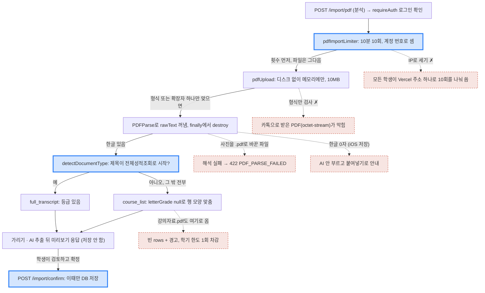

> **2026-11-20 목차**
>
> **[ONE Student](#one-student)**
> 1. [분석과 확정을 나눠 학생이 본 값만 저장한다](#1-분석과-확정을-나눠-학생이-본-값만-저장한다) — 분석은 미리보기, 확정만 DB
> 2. [횟수를 먼저 세고 파일은 그다음에 받는다](#2-횟수를-먼저-세고-파일은-그다음에-받는다) — 등록 순서 = 실행 순서
> 3. [PDF는 형식이나 확장자 하나만 맞으면 받는다](#3-pdf는-형식이나-확장자-하나만-맞으면-받는다) — 가짜는 파서가 422로 막음
> 4. [해석기는 finally에서 닫고 나머지는 GC가 회수한다](#4-해석기는-finally에서-닫고-나머지는-gc가-회수한다) — 원문은 서버에 안 남음
> 5. [한글이 한 글자도 없으면 붙여넣기로 안내한다](#5-한글이-한-글자도-없으면-붙여넣기로-안내한다) — 깨진 문서, AI 안 부름
> 6. [제목이 전체성적조회가 아니면 이수과목확인리스트로 본다](#6-제목이-전체성적조회가-아니면-이수과목확인리스트로-본다) — 회귀 방지, 대가는 한도

# ONE Student

> **성적 PDF 가져오기 7단계**: **상황과 값 → 문 앞 검사 → 글자 꺼내기와 문서 판별 (이 날)** → 개인정보 가리기와 학기 한도 → AI 추출과 붙여넣기 경로 → 소계 대조와 경고 → 확정 저장
> **그림 한 장으로 복습**: 아래 그림만 보고 설명할 수 있으면 이 날은 끝. 막히는 칸만 아래 항목을 읽는다.



## 1. 분석과 확정을 나눠 학생이 본 값만 저장한다

> **지도에서 위치**: [ONE Student 지도](../../projects/one-student.md) › 성적 PDF 가져오기 › 상황과 값 (`routes/myCourses.js`)
> **한 줄 결론**: API는 분석 2개와 확정 1개다. 분석은 미리보기만 돌려주고, 학생이 검토해 확정해야 DB에 들어간다.

정식 표현: 미리보기(preview) 후 확정(confirm)

### 주소 3개

```js
POST /api/my-courses/import/pdf      // 분석: 파일 첨부 (이수과목확인리스트 · 전체성적조회)
POST /api/my-courses/import/text     // 분석: 텍스트 붙여넣기 (전체성적조회만)
POST /api/my-courses/import/confirm  // 확정: 학생이 고친 rows를 받아 저장
```

- 두 문서는 서버가 맨 앞 제목으로 구별 → 학생이 고르지 않음
- 차이: 전체성적조회에만 등급(`letterGrade`)이 있음
- confirm은 값 검사도 하지만 본래 일은 저장 → "검증"이 아니라 **확정**

### 응답 모양 (예시 값)

```js
data: {
  docType: 'course_list',          // 또는 'full_transcript'
  rows: [{ name: '자료구조', credits: 3, category: '전공필수', year: 2024, semester: 1, letterGrade: null }],
  declaredTotalCredits: 72,        // 문서에 적힌 합계
  extractedTotalCredits: 72,       // 뽑은 과목 합계. 다르면 경고
  warnings: [],
}
```

### 왜 나눴나

- AI 추출은 틀릴 수 있음 → 학생 눈을 한 번 거친 값만 저장

> [!NOTE]
> **개인정보 가리기(4단계 미리 봄)**: 문서의 특정 위치가 아니라, 어디에 있든 7자리 이상 숫자(학번)와 `성명`·`이름` 뒤 한글을 **정규식**으로 찾아 가린다. 붙여넣기는 페이지 전체가 올 수 있어 위치를 믿을 수 없다.

### 면접에서 설명한다면

성적 가져오기는 분석과 확정을 나눴습니다. 분석은 AI가 뽑은 과목을 미리보기로만 돌려주고, 학생이 검토해 확정을 눌러야 저장됩니다. AI가 틀려도 잘못된 값이 바로 졸업 진단에 들어가지 않습니다.

## 2. 횟수를 먼저 세고 파일은 그다음에 받는다

> **지도에서 위치**: [ONE Student 지도](../../projects/one-student.md) › 성적 PDF 가져오기 › 문 앞 검사 (`pdfImportLimiter`, `perUserLimiter`)
> **한 줄 결론**: Express는 미들웨어를 등록된 순서대로 실행한다. 그래서 횟수 제한을 파일 받기 앞에 둬, 어차피 거절될 요청이 10MB를 메모리에 올리는 낭비를 막는다.

정식 표현: 미들웨어 체인(middleware chain), 등록 순서대로 실행

### 실행 순서

```js
router.use(requireAuth);   // 파일 위쪽에 먼저 등록 → 모든 요청에서 가장 먼저 (로그인 확인)

router.post('/import/pdf', pdfImportLimiter, pdfUpload.single('file'), async (req, res) => { ... });
//                          ① 횟수 제한       ② 파일 받기               ③ 처리
```

- 로그인 확인 → 횟수 제한 → 파일 받기 → 처리
- 한 줄 안이면 인자 순서, 파일 전체면 위쪽부터. 같은 규칙
- 순서를 바꾸면 → 제한에 걸릴 요청도 파일을 다 받은 뒤 거절

### 계정 단위로 센다

```js
keyGenerator: (req) => req.session && req.session.userId
  ? `u${req.session.userId}`    // 로그인했으면 계정 번호
  : ipKeyGenerator(req.ip),     // 세션이 없을 때만 IP
```

- 원래 IP 기준 → 운영에서 서버가 보는 IP가 학생이 아니라 앞단(Vercel) 주소
- → 모든 학생이 "10분에 10회"를 나눠 씀 → 안 써 본 학생도 막힘
- 로그인 확인이 앞에 있어서 세션의 계정 번호로 셀 수 있음

### 두 제한은 지키는 대상이 다르다

| 제한 | 지키는 것 | 세는 요청 |
|---|---|---|
| 10분에 10회 (문 앞 검사, 2단계) | 서버 메모리 | 모든 요청 |
| 학기당 5회 (학기 한도, 4단계) | AI 비용 | AI를 실제로 쓴 요청 |

### 면접에서 설명한다면

PDF 업로드는 파일을 메모리에 올리는 무거운 요청이라 횟수 제한을 파일 받기보다 앞에 뒀습니다. 처음에는 IP로 셌는데 운영에서는 모든 요청이 같은 앞단 주소로 보여, 로그인한 계정 단위로 바꿨습니다.

이전 기록: [2026-11-11 요청 제한은 IP가 아니라 이메일로 센다](../../2026/November/11-11.md#4-요청-제한은-ip가-아니라-이메일로-센다)

## 3. PDF는 형식이나 확장자 하나만 맞으면 받는다

> **지도에서 위치**: [ONE Student 지도](../../projects/one-student.md) › 성적 PDF 가져오기 › 문 앞 검사 (`pdfUpload`)
> **한 줄 결론**: 디스크에 저장하지 않고 메모리에만 둔다. 형식과 확장자 중 하나만 맞으면 일단 받고, 가짜 PDF는 뒤에서 해석 라이브러리가 걸러 낸다.

정식 표현: `multer.memoryStorage()`, `fileFilter`(MIME 타입 · 확장자 검사)

### 해결

```js
const pdfUpload = multer({
  storage: multer.memoryStorage(),        // 학사정보라 디스크에 남기지 않음
  limits: { fileSize: 10 * 1024 * 1024 }, // 10MB
  fileFilter: (req, file, cb) => {
    const isPdfMimeType = file.mimetype === 'application/pdf';
    const isPdfExtension = /\.pdf$/i.test(file.originalname || '');
    cb(null, isPdfMimeType || isPdfExtension);   // 둘 중 하나만 맞아도 받음
  },
});
```

### 경우마다

| 올린 파일 | 결과 |
|---|---|
| 카카오톡으로 받은 진짜 PDF (형식이 `octet-stream`으로 옴) | 확장자로 통과 → 정상 처리 |
| `사진.jpg`를 `사진.pdf`로 바꾼 파일 | 확장자로 통과 → 해석 실패 → **422** `PDF_PARSE_FAILED` |
| 진짜 PDF지만 성적 문서가 아님 (강의자료.pdf) | 해석 성공 → **200**, 빈 목록 + 경고 (6번) |
| 형식도 확장자도 아님 | `req.file`이 빔 → **400** `REQUIRED_PDF_FILE` |

### 검토했지만 버린 방법과 이유

| 방법 | 버린 이유 |
|---|---|
| 형식(`mimetype`)만 검사 | 앱을 거친 파일은 브라우저가 형식을 잘못 알려 줘서 모바일 학생 다수가 막힘 |

## 4. 해석기는 finally에서 닫고 나머지는 GC가 회수한다

> **지도에서 위치**: [ONE Student 지도](../../projects/one-student.md) › 성적 PDF 가져오기 › 글자 꺼내기 (`parseCourseListPdf`)
> **한 줄 결론**: 분석 단계에서 메모리에 있는 것 셋 중 해석용 문서만 `finally`에서 직접 닫는다. 파일 내용과 꺼낸 글자는 아무도 안 쓰게 되면 GC가 회수한다. DB에 남는 건 확정한 과목 행뿐이다.

정식 표현: `try … finally`로 자원 해제, 가비지 컬렉션(garbage collection)

### 해결

```js
const parser = new PDFParse({ data: buffer });
try {
  const rawText = (await parser.getText()).text;  // PDF 안 글자를 문자열로 꺼냄
  // ...
} finally {
  await parser.destroy();   // 성공하든 실패하든 해석기가 연 자원을 닫음
}
```

### 셋의 사라지는 시점

| 값 | 무엇 | 사라지는 시점 |
|---|---|---|
| `req.file.buffer` | 올린 파일 내용 | 아무도 안 쓰게 된 뒤 GC가 회수 (시점은 엔진이 정함) |
| `parser.doc` | 해석하려고 펼쳐 둔 문서 (작업자 · 통신 통로를 엶) | `finally`의 `destroy()`에서 닫힘 |
| `rawText` | 꺼낸 글자 (결과 문자열) | 함수 안 변수일 뿐 → 버퍼처럼 GC가 회수 |

- `doc`만 직접 닫는 이유: 연 자원(작업자 등)은 직접 닫아야 확실히 풀림
- `finally`가 없으면 → 실패할 때마다 해석기 자원이 남음 (2단계에서 막은 메모리 낭비를 다시 만듦)
- 계정 삭제까지 남는 것: 확정한 `student_courses` 행 → `ON DELETE CASCADE`로 계정과 같이 지워짐

> [!WARNING]
> **`destroy()`는 결과를 지우지 않는다.** 지우는 것은 결과를 만들려고 쓴 작업 공간(`doc`)이다. `rawText`는 이미 꺼내 둔 문자열이라 그대로 남아 다음 단계에서 쓴다.

## 5. 한글이 한 글자도 없으면 붙여넣기로 안내한다

> **지도에서 위치**: [ONE Student 지도](../../projects/one-student.md) › 성적 PDF 가져오기 › 글자 꺼내기 (`hasNoHangulText`)
> **한 줄 결론**: iOS에서 저장한 전체성적조회 PDF는 한글만 통째로 빠진다. 복구할 방법이 없으니 AI를 부르지 않고 바로 붙여넣기 경로로 안내한다.

정식 표현: 조기 반환(early return)

### 문제

```js
// 정상:   '전체성적조회\t전체성적조회\n2024 년 1 학기\n자료구조\t3\tA+ ...'
// iOS:    '\t\n\n2024  1 \niOS\t3\tA+\nAI\t3\tB+ ...'   ← 한글만 빠지고 영어 · 숫자만 남음
```

### 해결

```js
if (!/[가-힣]/.test(rawText)) {            // 한글이 한 글자도 없으면
  return { docType: null, rows: [], warnings: ['... 텍스트 붙여넣기로 다시 시도해주세요.'], aiSucceeded: false };
}
```

- AI로 안 보내는 이유: 과목명 · 이수구분이 파일 안에 없어 AI도 복구 못 함 → 한도만 씀
- 기준이 "전혀 없음"인 이유: 정상 문서는 제목만으로도 한글 여러 글자 → 정상 문서를 잘못 거를 위험 없음
- 이 문제 때문에 붙여넣기 경로(`/import/text`)가 생김

> [!WARNING]
> **"기대한 문서가 아니라서"가 아니다.** 기대한 문서가 맞는데 글자가 깨진 것이다. 그래서 안내도 "다른 파일을 올리세요"가 아니라 "붙여넣기로 다시 시도하세요"다.

## 6. 제목이 전체성적조회가 아니면 이수과목확인리스트로 본다

> **지도에서 위치**: [ONE Student 지도](../../projects/one-student.md) › 성적 PDF 가져오기 › 문서 판별 (`detectDocumentType`)
> **한 줄 결론**: 제목이 `전체성적조회`로 시작하는지만 본다. 아니면 원래 경로로 보내서, 나중에 기능을 추가해도 잘 되던 업로드가 깨지지 않게 했다.

정식 표현: 회귀 방지(regression)를 위한 기본 경로 유지

### 해결

```js
function detectDocumentType(rawText) {
  return /^전체성적조회/.test(rawText.trim()) ? 'full_transcript' : 'course_list';
}
// course_list 결과는 rows마다 letterGrade: null을 붙여 두 문서의 행 모양을 맞춤
```

### 대가

- "성적 문서가 아니다"를 가려내는 단계가 따로 없음
- 강의자료.pdf → 이수과목확인리스트로 취급 → AI 추출까지 감
- AI가 과목을 못 찾음 → **200** + `rows: []` + "과목을 하나도 못 찾았어요" 경고
- AI 호출은 오류 없이 끝났음 → **학기 한도 1회 차감** (한도는 AI가 실패했을 때만 되돌려 줌)

> [!NOTE]
> **나중에 볼 질문**: 붙여넣기 경로는 AI 전에 학기 헤더가 있는지 먼저 확인하는데(`looksLikeFullTranscriptText`), PDF 경로에는 그런 사전 확인이 없다. 잘못된 파일로 한도를 쓰는 게 의도한 설계인지는 아직 확인하지 않았다.
