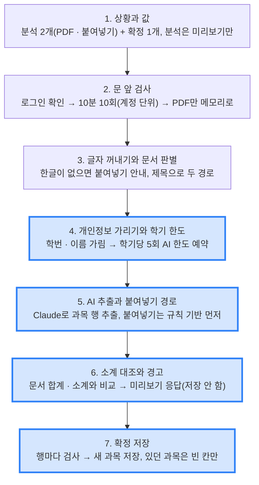

> **2026-11-22 목차**
>
> **[ONE Student](#one-student)**
> 1. [이름과 학번은 위치로 자르고 정규식으로 한 번 더 가린다](#1-이름과-학번은-위치로-자르고-정규식으로-한-번-더-가린다) — 개인정보 두 겹 방어
> 2. [학기 한도는 학생 행을 잠그고 세서 1회를 예약한다](#2-학기-한도는-학생-행을-잠그고-세서-1회를-예약한다) — FOR UPDATE로 경쟁 상태 차단
> 3. [AI를 부르기 직전에만 예약하고 실패하면 돌려준다](#3-ai를-부르기-직전에만-예약하고-실패하면-돌려준다) — AI 결과를 받은 시도만 셈
> 4. [AI에게 우리 칸 모양의 JSON을 시키고 배열만 꺼낸다](#4-ai에게-우리-칸-모양의-json을-시키고-배열만-꺼낸다) — 정규식 대신 AI, `[` `]`만 잘라 읽음
> 5. [붙여넣기는 규칙으로 먼저 읽고 소계가 다 맞을 때만 믿는다](#5-붙여넣기는-규칙으로-먼저-읽고-소계가-다-맞을-때만-믿는다) — 비용 0인 길 먼저
> 6. [AI 결과는 문서에 찍힌 소계로 검산하고 막지 않고 경고한다](#6-ai-결과는-문서에-찍힌-소계로-검산하고-막지-않고-경고한다) — 기준은 AI와 따로
> 7. [확정 때는 브라우저가 보낸 값을 다시 검사한다](#7-확정-때는-브라우저가-보낸-값을-다시-검사한다) — 하나라도 틀리면 전부 거절
> 8. [있는 과목은 건너뛰고 빈 칸만 채워 다시 해도 안전하다](#8-있는-과목은-건너뛰고-빈-칸만-채워-다시-해도-안전하다) — 원자성 없이 재시도 안전
> 9. [성적 PDF 가져오기 한 바퀴 정리](#9-성적-pdf-가져오기-한-바퀴-정리) — 1분 설명 · 이름 표 · B 3곳

# ONE Student

> **기능 전체 흐름**: 성적 PDF 가져오기. 색칠한 칸이 이 날 본 범위다.



## 1. 이름과 학번은 위치로 자르고 정규식으로 한 번 더 가린다

> **지도에서 위치**: [ONE Student 지도](../../projects/one-student.md) › 성적 PDF 가져오기 › 개인정보 가리기 (`redactStudentIdentifiers`)
> **한 줄 결론**: AI는 외부 서비스라 보내기 전에 개인정보를 지운다. 학생정보가 있는 첫 학기 헤더 앞을 잘라내고, 위치가 어긋나는 경우를 대비해 학번 · 이름 패턴을 정규식으로 한 번 더 가린다.

정식 표현: 개인정보 최소 제공, 다중 방어(defense in depth)

### 해결

```text
전체성적조회
컴퓨터소프트웨어공학과        ← 1겹: 첫 학기 헤더 앞은 통째로 잘림
학번 20231234
성 명 홍길동
2024 년 1 학기               ← 여기부터 AI 사본
기전 003308 자료구조 3 A+     ← 학수번호 6자리는 안 가려짐
```

```js
const STUDENT_ID_RE = /\d{7,}/g;                                 // 2겹: 7자리 이상 숫자 = 학번
const STUDENT_NAME_RE = /((?:성\s*명|이\s*름)[\s:：]*)[가-힣]{2,}/g; // "성 명" · "이름" 라벨 뒤 한글 = 이름
```

### 한 겹만 있으면

| 남긴 것 | 생기는 일 |
|---|---|
| 자르기만 | 붙여넣기는 페이지 전체가 올 수 있음 → 학생정보가 표 아래면 그대로 AI로 감 |
| 정규식만 | 학번 · 이름만 잡음 → 학과명 같은 나머지 학생정보는 AI로 감 |

### 면접에서 설명한다면

AI는 외부 서비스라 이름과 학번을 지운 뒤 보냅니다. 학생정보가 있는 문서 앞부분을 잘라내고, 붙여넣기처럼 위치를 믿을 수 없는 경우를 대비해 학번 · 이름 패턴을 정규식으로 한 번 더 가리는 두 겹으로 막았습니다.

이전 기록: [2026-11-20 분석과 확정을 나눠 학생이 본 값만 저장한다](../../2026/November/11-20.md#1-분석과-확정을-나눠-학생이-본-값만-저장한다)

## 2. 학기 한도는 학생 행을 잠그고 세서 1회를 예약한다

> **지도에서 위치**: [ONE Student 지도](../../projects/one-student.md) › 성적 PDF 가져오기 › 학기 한도 예약 (`courseService.reservePdfImport`)
> **한 줄 결론**: "세기"와 "기록"이 따로 일어나면 탭 두 개가 같은 남은 횟수를 보고 둘 다 통과한다. 트랜잭션 안에서 학생 행을 `FOR UPDATE`로 잠가 같은 학생의 요청이 줄을 서게 했다.

정식 표현: 경쟁 상태(race condition), 비관적 잠금(`SELECT … FOR UPDATE`)

### 문제

| 순서 | 탭 1 | 탭 2 |
|---|---|---|
| ① | 개수 세기 → 4 | |
| ② | | 개수 세기 → 4 (탭 1이 아직 기록 전) |
| ③ | 4 < 5라 통과, 기록 | |
| ④ | | 4 < 5라 통과, 기록 → **6번째 사용** |

### 해결

```js
await conn.beginTransaction();
await conn.query('SELECT id FROM students WHERE id = ? FOR UPDATE', [studentId]); // 잠금만 (횟수는 그대로)
const [rows] = await conn.query('SELECT COUNT(*) AS count FROM pdf_import_logs ...'); // 세기
if (rows[0].count >= 5) { await conn.rollback(); return null; }                     // 다 썼으면 null → 429
const [result] = await conn.query('INSERT INTO pdf_import_logs ...');                 // 차감(예약)은 여기
await conn.commit();                                                                  // 잠금 풀림 → 기다리던 탭이 세기 시작
return result.insertId;                                                               // 예약 번호
```

- `pdf_import_logs`의 아직 없는 "6번째 행"은 잠글 수 없음 → 학생마다 하나 있는 `students` 행을 번호표로
- 다른 학생은 다른 행을 잠가서 서로 안 막음
- 트랜잭션은 SQL 문 종류가 아니라 여러 문장을 묶는 포장지 → 이 안에 UPDATE는 없음

### 검토했지만 버린 방법과 이유

| 방법 | 버린 이유 |
|---|---|
| 트랜잭션만, 잠금 없이 | 묶음 안의 "다 되거나 다 안 되거나"일 뿐 → 두 요청 사이 끼어들기는 못 막음 (그냥 `SELECT`는 안 잠그고 읽음) |
| AI 호출까지 트랜잭션 안에 | 잠금과 DB 연결을 수십 초 쥠 → 연결 풀(20개)이 바닥나 다른 학생의 다른 기능까지 멈춤 |

> [!NOTE]
> **트랜잭션을 코드에서 알아보는 법**: `pool.getConnection()` → `conn.beginTransaction()` → `conn.query(...)` 여러 개 → `commit` / `catch`에서 `rollback` → `finally`에서 `release`. `pool.query`는 아무 연결로 한 문장만 보냄 → 트랜잭션 아님. 이메일 로그인의 조건부 UPDATE는 **한 문장**이라 트랜잭션 없이도 한 번에 처리됨.

### 면접에서 설명한다면

AI 비용 때문에 학기당 5회 한도를 뒀는데, 횟수를 세고 기록하는 사이에 탭 두 개가 끼어들면 한도를 넘깁니다. 그래서 트랜잭션 안에서 학생 행을 FOR UPDATE로 잠가 같은 학생의 예약이 줄을 서게 했고, AI 호출은 트랜잭션 밖에서 해 연결을 오래 쥐지 않게 했습니다.

이전 기록: [2026-11-11 시도 횟수는 비교 전에 조건부 UPDATE로 차지한다](../../2026/November/11-11.md#1-시도-횟수는-비교-전에-조건부-update로-차지한다)

## 3. AI를 부르기 직전에만 예약하고 실패하면 돌려준다

> **지도에서 위치**: [ONE Student 지도](../../projects/one-student.md) › 성적 PDF 가져오기 › 학기 한도 되돌리기 (`runWithPdfImportQuota`, `callAiWithHook`)
> **한 줄 결론**: 파싱이 먼저 시작되고, AI를 진짜 부르는 순간에만 예약한다. AI가 실패하면 예약 행을 지워서 AI 결과를 실제로 받은 시도만 센다.

정식 표현: 콜백(callback)으로 실행 시점 넘기기, 보상 처리(compensation)

### 해결

```js
// courseService: 한도 규칙을 가진 쪽
const beforeAiCall = async () => {                    // "AI 직전에 실행해 줘"라고 넘기는 함수
  reservationId = await reservePdfImport(studentId);  // 학생 행 잠그고 세서 1회 기록
  if (reservationId === null) throw new PdfImportLimitExceededError(); // 다 씀 → 던짐 → 429
};
const result = await parse(beforeAiCall);             // 파싱 시작 (AI까지 가야 beforeAiCall이 실행됨)
if (reservationId !== null && !result.aiSucceeded) await releaseReservation(); // AI 실패 → 예약 행 DELETE

// pdfImportService: AI를 부르는 쪽
if (beforeAiCall) await beforeAiCall();   // true를 돌려주는 게 아님 → 던지지 않고 끝나면 다음 줄로
try { return { extracted: await extract(content), aiSucceeded: true }; }
catch { return { extracted: [], aiSucceeded: false }; }  // AI 실패는 던지지 않고 표시만
```

| 경우 | 한도 | 학생이 받는 것 |
|---|---|---|
| AI 안 씀 (한글 없음, 규칙 성공) | 그대로 (예약 안 함) | 안내 또는 결과 |
| 이미 5회 | 그대로 (예약 못 함) | 429 |
| AI 성공 | 1회 차감 | 미리보기 |
| AI 실패 · 도중 에러 | 되돌림 | 경고 또는 422 |

- 순서: 성공한 뒤에 세면 → AI가 답하는 수십 초 동안 다른 요청이 다 통과 → 먼저 자리를 잡고 실패하면 돌려줌
- 되돌리기(DELETE)도 실패할 수 있음 → `.catch`로 로그만 남김 → 학생에게는 원래 응답("잠시 후 다시")을 그대로 보냄

> [!WARNING]
> **되돌리기 실패를 잡는 이유는 "안내를 못 해서"가 아니라 "제대로 된 안내를 하려고"다.** 잡지 않으면 우리 쪽 장부 문제(DELETE 실패)가 학생 응답을 422 "분석 실패"로 바꿔 버린다. 최악이어도 그 학생이 1회 손해.

### 면접에서 설명한다면

한도 예약은 AI를 부르기 직전에만 하도록 파싱 함수에 예약 함수를 넘겼습니다. AI가 실패하면 예약을 지워 결과를 실제로 받은 시도만 세고, 되돌리기 자체가 실패해도 학생 응답은 망치지 않게 로그만 남깁니다.

## 4. AI에게 우리 칸 모양의 JSON을 시키고 배열만 꺼낸다

> **지도에서 위치**: [ONE Student 지도](../../projects/one-student.md) › 성적 PDF 가져오기 › AI 추출 (`aiClient.extractFullTranscriptRows`, `parseJsonArray`)
> **한 줄 결론**: 기기마다 인쇄 간격이 달라 정규식이 계속 깨져서 AI로 바꿨다. 프롬프트로 우리 칸(이수구분 · 과목명 · 연도 · 학기 · 학점 · 등급) 모양의 JSON만 내게 하고, 답에서 `[` ~ `]`만 잘라 읽는다.

정식 표현: 구조화된 출력(structured output) 요청, 방어적 파싱

### 해결

```js
// 프롬프트가 시키는 네 가지
// 뺄 것: 학생정보 · 헤더 · 소계 · 인쇄 정보 / 그대로 옮길 것: 이수구분 코드(뒤에서 소계 비교에 씀)
// 바꿀 것: 2학기 → 내부 코드 3 (학사력 시간순) / 출력: 설명 없이 JSON 배열만

function parseJsonArray(text) {
  const start = text.indexOf('[');      // 글자가 아니라 자리 번호. 없으면 -1
  const end = text.lastIndexOf(']');
  if (start === -1 || end === -1) throw new Error('AI_RESPONSE_NOT_JSON_ARRAY'); // 둘 중 하나라도 없으면 실패
  return JSON.parse(text.slice(start, end + 1)); // "다음은 결과입니다: [...]"여도 배열만 읽음
}
```

- 여기서 던진 에러 → AI 호출을 감싼 쪽이 `aiSucceeded: false`로 바꿈 → 한도 되돌림
- 배경: PDF도 처음엔 정규식 → 인쇄 레이아웃 때문에 계속 수정 → AI 추출 + 소계 대조로 전환 (git 기록)

> [!WARNING]
> **`-1`은 "못 찾음" 표시다.** 0은 "맨 앞에 있음"이라는 정상 결과라서, 자리 번호로 나올 수 없는 -1을 쓴다. `'abc'.indexOf('z') // -1`

## 5. 붙여넣기는 규칙으로 먼저 읽고 소계가 다 맞을 때만 믿는다

> **지도에서 위치**: [ONE Student 지도](../../projects/one-student.md) › 성적 PDF 가져오기 › 붙여넣기 경로 (`/import/text`, `parseFullTranscriptTextRuleBased`)
> **한 줄 결론**: iOS PDF의 한글 누락을 피하려고 만든 붙여넣기 경로는 텍스트가 탭으로 깔끔해 규칙으로 먼저 읽는다. 소계까지 다 맞으면 AI 없이 끝내고, 아니면 학기 헤더를 확인한 뒤에만 AI로 넘긴다.

정식 표현: 규칙 기반 우선, AI 폴백(fallback)

### 해결

```js
if (typeof text !== 'string' || !text.trim()) return 400;  // 문자열이 아니거나 비었거나 공백뿐
if (text.length > 50000) return 400;
const ruleResult = parseFullTranscriptTextRuleBased(text);  // AI 안 씀
if (ruleResult) { parseMethod = 'rule'; }                   // 믿을 수 있으면 끝 → 한도 안 씀
else {
  if (!looksLikeFullTranscriptText(text)) return 400;       // 학기 헤더가 하나도 없으면 AI도 못 읽음 → 거절
  result = await runWithPdfImportQuota(...);                // 그때만 AI (한도 포함)
  parseMethod = result.aiSucceeded ? 'ai' : null;
}
```

- 믿는 기준 `isClean`: 과목 1줄 이상 · 버린 행 0 · 학기 소계 전부 일치
- 아는 모양이 아닌 줄이 나오면 추측하지 않고 바로 포기 → AI에 맡김
- `parseMethod`는 화면 안내용: `rule` "한도에 포함 안 됨" / `ai` "포함됨" / `null`(AI 실패로 돌려줌) 안내 숨김

### 검토했지만 버린 방법과 이유

| 방법 | 버린 이유 |
|---|---|
| 붙여넣기도 처음부터 AI | 읽을 수 있는 텍스트에도 매번 비용과 한도를 씀 |
| 규칙 결과를 검사 없이 믿기 | 형식이 조금만 달라도 틀린 과목 목록이 미리보기로 나감 |

## 6. AI 결과는 문서에 찍힌 소계로 검산하고 막지 않고 경고한다

> **지도에서 위치**: [ONE Student 지도](../../projects/one-student.md) › 성적 PDF 가져오기 › 소계 대조 (`finalizeFullTranscriptRows`, `computeSemesterSubtotals`)
> **한 줄 결론**: AI는 과목을 빠뜨리거나 두 번 읽을 수 있다. 비교 기준(소계)은 AI가 아니라 원문에서 정규식으로 읽어 두고, 다르면 저장을 막지 않고 경고를 붙여 미리보기로 보낸다.

정식 표현: 독립된 기준으로 교차 검증(cross-check)

### 행 정리

- 필수 값이 빠진 행 · 상담 기록 → 건너뜀 (안 셈)
- 이름 50자 초과 → 버리고 개수를 셈(`droppedRows`) → "N건 뺐어요" 경고
- 50자 검사 배경: 정규식 시절 요약 표의 코드 글자를 행 시작으로 잘못 알아 뒤 내용을 통째로 과목명에 삼킴(212자) → DB 칸 100자 초과로 등록 실패 → 근본 해결은 표 머리글 기준 자르기, 50자 검사는 안전망으로 남김

### 검산

```js
for (const [key, declaredValue] of declaredBySemester) {     // Map: '2024-3' → 18 (문서에 찍힌 소계)
  const extractedValue = rows
    .filter((r) => `${r.year}-${r.semester}` === key && !r.isFail) // 같은 학기, F · NP 빼고
    .reduce((sum, r) => sum + r.credits, 0);
  if (Math.abs(declaredValue - extractedValue) > 0.01) {     // 소수 학점 계산 오차를 감안
    hasSubtotalMismatch = true;   // ① 붙여넣기 규칙 결과일 때 → 못 믿고 AI로
    warnings.push('...');         // ② 모든 경로 → 학생에게 경고
  }
}
```

| 문서 | 비교 단위 | 못 잡는 것 |
|---|---|---|
| 전체성적조회 | 학기 소계 (전체 합계 없음) | 같은 학기 안 이수구분 오분류 |
| 이수과목확인리스트 | 총 취득학점 + 이수구분별 소계 | 같은 이수구분 안 학기 오류 |

- 학기 코드를 소계 쪽도 내부 코드로 바꿔야 함 → 안 바꾸면 `'2024-2'` vs `'2024-3'`로 모든 2학기가 어긋남
- F는 합계에서만 뺌(소계는 **취득**학점). 행으로는 남아 미리보기 · 저장에 들어감

### 막지 않는 이유

| 방법 | 결과 |
|---|---|
| 합계가 다르면 확정 차단 | 문서 사정으로 합계가 다른 정상 학생도 못 씀 |
| 경고 없이 통과 | 빠진 과목을 모르고 저장 → 졸업 진단이 틀어짐 |
| **경고만, 판단은 학생 (고름)** | 어디가 의심스러운지 짚고, 원본을 가진 학생이 고침 |

- 경고 문구도 누구 탓을 안 함: "문서와 인식 결과가 달라요" → "2024년 2학기에서 취득학점은 18학점인데 리스트에는 15학점이 있어요"

## 7. 확정 때는 브라우저가 보낸 값을 다시 검사한다

> **지도에서 위치**: [ONE Student 지도](../../projects/one-student.md) › 성적 PDF 가져오기 › 확정 저장 (`/import/confirm`)
> **한 줄 결론**: 서버 → 브라우저 → 서버 → DB 구조라 서버는 아까 자기가 준 값도 믿지 않는다. 학생이 고친 값이든 꾸며 보낸 요청이든 모든 행을 다시 검사하고, 하나라도 틀리면 아무것도 저장하지 않는다.

정식 표현: 서버 측 입력 검증(server-side validation)

### 해결

```js
if (rows.length > 500) return 400;   // 행마다 INSERT → 상한이 없으면 DB를 오래 붙잡음
for (const row of rows) {
  const hasCredits = row.credits !== undefined && row.credits !== null && row.credits !== '';
  // 학점 0(졸업논문 P/F)을 통과시키려고 !row.credits 대신 "비었나"만 따로 봄 (!0 은 true)
  if (!VALID_CATEGORIES.includes(row.category)) return 400;  // 허용 목록
  if (row.name.length > 100) return 400;                     // DB 칸 VARCHAR(100)
  if (!isValidCredits(row.credits)) return 400;              // DB 칸 DECIMAL(2,1): 0.5 단위, 0~9.5
}
await bulkAddMyCourses(...);   // 다 통과해야 저장 시작 → 반만 저장된 채 400이 나는 일은 없음
```

- 이수구분 미선택은 화면이 먼저 막음("이수구분을 선택하지 않은 과목이 있어요") → 서버 검사는 화면을 거치지 않은 요청 대비
- 분석 50자 = 오인식 안전망 / 확정 100자 = DB 칸 한계 (없을 때는 원인 모를 500)

## 8. 있는 과목은 건너뛰고 빈 칸만 채워 다시 해도 안전하다

> **지도에서 위치**: [ONE Student 지도](../../projects/one-student.md) › 성적 PDF 가져오기 › 확정 저장 (`courseService.bulkAddMyCourses`)
> **한 줄 결론**: 기존 과목을 한 번에 읽어 이름 · 연도 · 학기 열쇠로 대조한다. 없으면 INSERT, 있으면 빈 칸만 채운다. 트랜잭션이 없어 원자성은 없지만, 건너뛰기와 UNIQUE 덕분에 다시 시도해도 중복이 안 생긴다.

정식 표현: N+1 문제 회피, 원자성(atomicity)과 멱등성(idempotency)의 구분

### 해결

```js
const [existingRows] = await pool.query('SELECT ... FROM student_courses WHERE student_id = ?'); // 한 번만 읽음
const existingMap = new Map(existingRows.map((r) => [`${r.name}__${r.year}__${r.semester}`, r]));
for (const row of rows) {
  const existing = existingMap.get(key);
  if (existing) { /* 빈 칸만 채움 */ continue; }
  await pool.query('INSERT INTO student_courses ...');
  existingMap.set(key, ...);   // 한 요청 안에 같은 과목이 두 번 있어도 두 번째는 "있음"으로
}
```

- 행마다 SELECT → 60과목이면 쿼리 60번(**N+1 문제**) → 한 번 읽어 메모리 Map에서 찾음
- 열쇠 = DB의 `UNIQUE (student_id, name, year, semester)`와 같은 세 칸
- 있던 과목: 등급 · 학수번호는 비어 있을 때만 채움 (학생이 직접 넣은 값일 수 있어 덮어쓰지 않음)
- 이수구분: `category`(지금 값)는 절대 안 바꿈 → `category_original`(바꾸기 전 값)만 새 학교 값에 맞춤

### 원자성과 멱등성

| 성질 | 여기서는 |
|---|---|
| 원자성 (트랜잭션이 주는 것) | **없음**: `pool.query`만 씀 → 30번째에서 실패하면 29개는 남음 |
| 멱등성 (다시 해도 같은 결과) | **순서대로 다시 할 때는 있음**: 있는 건 건너뛰고 나머지만 들어감 |

- 다시 해도 성공하는 건 **건너뛰기** 덕분, UNIQUE는 뒤의 안전망 (UNIQUE만 있으면 중복은 막지만 재시도가 계속 실패)
- 탭 두 개로 동시에 확정 → 둘 다 "없음"으로 보고 INSERT → 늦은 쪽이 UNIQUE에 걸려 500 "등록에 실패했어요" (DB에 중복은 없음, 같은 탭에서 다시 누르면 남은 과목만 들어감)

### 면접에서 설명한다면

확정 저장은 트랜잭션으로 묶지 않아서 원자성은 없습니다. 대신 기존 과목을 이름 · 연도 · 학기로 대조해 있으면 건너뛰게 해서, 중간에 끊겨도 다시 시도하면 남은 과목만 들어가고, DB의 UNIQUE 제약이 중복을 한 번 더 막습니다.

## 9. 성적 PDF 가져오기 한 바퀴 정리

> **지도에서 위치**: [ONE Student 지도](../../projects/one-student.md) › 성적 PDF 가져오기
> **한 줄 결론**: 분석과 확정을 나눠 학생이 본 값만 저장한다. AI에 보내기 전에 개인정보를 가리고 한도를 예약하며, AI 결과는 문서 소계로 검산해 경고로 알리고, 확정 때는 다시 검사하고 재시도해도 안전하게 저장한다.

### 1분 설명

성적 PDF 가져오기는 분석과 확정을 나눠서 학생이 본 값만 저장한다. 분석은 요청 횟수와 파일을 문 앞에서 거르고, 글자를 꺼내 문서 종류를 판별한 뒤, 이름 · 학번을 가리고 학기 한도를 예약한 다음에만 AI로 과목을 뽑는다. 붙여넣기는 규칙으로 먼저 읽어 비용을 아낀다. AI 결과는 문서에 찍힌 소계로 검산해서, 다르면 막지 않고 경고를 붙여 미리보기로 보낸다. 확정할 때는 브라우저가 보낸 값을 다시 검사하고, 있는 과목은 건너뛰고 빈 칸만 채워서 다시 시도해도 중복이 생기지 않게 했다.

### 이름 표

| 질문 | 무엇으로 막았나 |
|---|---|
| 학생이 확인 안 한 값이 저장되면? | 분석(`/import/pdf`, `/import/text`)과 확정(`/import/confirm`) 분리 |
| 이름 · 학번이 외부 AI로 가면? | 위치로 자르기 + `redactStudentIdentifiers` |
| 탭 두 개로 한도를 넘기면? | `reservePdfImport`: 트랜잭션 + `students` 행 `FOR UPDATE` |
| AI가 실패했는데 횟수가 줄면? | `beforeAiCall`(AI 직전에만 예약) + `aiSucceeded: false`면 `releasePdfImport` |
| AI 비용을 줄이려면? | 붙여넣기는 `parseFullTranscriptTextRuleBased` 먼저, `isClean`일 때만 |
| AI가 과목을 빠뜨리면? | 원문 소계(`declaredBySemester`)와 비교 → `warnings` + 미리보기 |
| 저장 중 끊기면? | `existingMap` 건너뛰기 + `UNIQUE (student_id, name, year, semester)` |

### B (줄 단위로 볼 곳)

1. **학기 한도 예약**: `FOR UPDATE`, AI 호출은 트랜잭션 밖, 실패하면 되돌리기 (동시성 · 한도 fix 커밋이 있는 곳)
2. **소계 검산**: AI와 따로 원문에서 기준을 읽는 설계 (정규식 → AI 전환 때 같이 들어옴)
3. **확정 저장의 재시도 안전**: 원자성 대신 건너뛰기와 UNIQUE

### 나중에 볼 질문

- PDF 경로에는 학기 헤더 사전 확인이 없어 잘못된 파일로 한도를 쓸 수 있다
- PDF 경로는 이번 시도가 한도에 포함됐는지 알려 주지 않는다 (붙여넣기만 `parseMethod`) → 맞추려면 서버가 `aiSucceeded`로 `parseMethod`를 보내야 함
- 확정 저장에서 동시 요청이 UNIQUE에 걸리면 500 "등록에 실패했어요" (일부 저장됐을 수 있음) → `ER_DUP_ENTRY`를 잡아 건너뜀으로 세는 방법 (과목 직접 추가는 이미 409로 바꿈)

이전 기록: [2026-11-20 제목이 전체성적조회가 아니면 이수과목확인리스트로 본다](../../2026/November/11-20.md#6-제목이-전체성적조회가-아니면-이수과목확인리스트로-본다)
