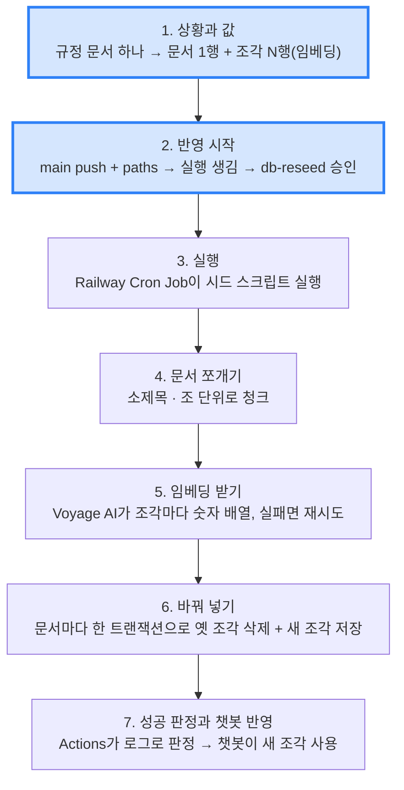

> **2026-11-23 목차**
>
> **[ONE Student](#one-student)**
> 1. [규정 문서는 검색할 조각과 숫자 배열로 DB에 남는다](#1-규정-문서는-검색할-조각과-숫자-배열로-db에-남는다) — 챗봇이 찾을 수 있게 넣는 쪽
> 2. [재시딩은 main push로 실행이 생기고 승인해야 돈다](#2-재시딩은-main-push로-실행이-생기고-승인해야-돈다) — 요청과 승인은 다른 행동

# ONE Student

> **기능 전체 흐름**: 규정 문서 반영. 색칠한 칸이 이 날 본 범위다.



## 1. 규정 문서는 검색할 조각과 숫자 배열로 DB에 남는다

> **지도에서 위치**: [ONE Student 지도](../../projects/one-student.md) › 규정 문서 반영 › 상황과 값 (`scripts/seedRegulations.js`)
> **한 줄 결론**: 학교 규정 문서를 고치면 그 문서를 조각내고 조각마다 임베딩을 받아 기존 조각과 교체한다. 그래야 챗봇이 새 문서를 근거로 답한다.

정식 표현: RAG를 위한 인덱싱(indexing), 임베딩(embedding), 청크(chunk)

### 값

```js
// 입력: db/regulations/졸업/조기졸업.md (### 소제목으로 나뉜 마크다운)
// 출력 ①: regulation_documents 1행
{ id: 12, title: '조기졸업', category: '졸업', source_type: 'CURATED' }   // CURATED = 정리 문서, VERBATIM = 학칙 원문 txt
// 출력 ②: regulation_chunks N행 (예시 값)
{ document_id: 12, chunk_index: 2, content: '### 2. 조기졸업 신청 성적기준 ...', embedding: [0.008, -0.029, ...] }
```

- **임베딩**: 글의 뜻을 숫자 배열로 바꾼 것. 뜻이 비슷하면 숫자도 비슷 → 질문과 **코사인 유사도**가 가장 가까운 조각을 찾음
- 임베딩은 우리가 정하는 게 아니라 **받는** 것: 조각을 Voyage AI에 보내면 계산해서 돌려줌
- 청크 단위: 이 프로젝트는 소제목 · 조 단위. 한 단어는 뜻이 너무 작아 거의 안 씀

### RAG와 인덱싱

| | 하는 일 | 이 프로젝트 |
|---|---|---|
| 인덱싱 (준비) | 문서를 조각내고 임베딩을 받아 저장 | 규정 문서 반영 (이 기능) |
| RAG | 질문과 가까운 조각을 찾아 → 그 자료로 AI가 답을 만듦 | 챗봇 |

### 없으면

- 문서를 고쳐도 DB에는 옛 조각 → 챗봇이 옛 규정으로 답함
- 그래서 코드 배포와 따로 도는 길이 있음

> [!WARNING]
> **바뀐 문서만 갈아끼우지 않는다.** 문서 하나만 고쳐도 규정 문서 **전체**를 다시 임베딩한다(`--force`, 비용 · 시간). 대신 트랜잭션은 전체가 아니라 **문서 하나** 단위다. 이유는 바꿔 넣기에서 본다.

## 2. 재시딩은 main push로 실행이 생기고 승인해야 돈다

> **지도에서 위치**: [ONE Student 지도](../../projects/one-student.md) › 규정 문서 반영 › 반영 시작 (`.github/workflows/db-reseed.yml`)
> **한 줄 결론**: `main`에 push되고 `paths`의 파일이 바뀌면 실행이 자동으로 생긴다. 생긴 실행은 승인 대기로 멈춰 있다가 `db-reseed` 승인자가 승인해야 실제 작업이 돈다.

정식 표현: 경로 필터(paths filter) 트리거, 환경 승인 게이트(environment required reviewers)

### 해결

```yaml
on:
  push:
    branches: [main]          # main에 push됐고
    paths:                    # 이 경로 파일이 하나라도 바뀌면 → 실행이 자동으로 생김
      - 'db/regulations/**'
      - 'db/regulation-engine/applicability.json'
  workflow_dispatch:          # 수동: Actions 탭에서 [Run workflow] 클릭 → 실행이 생김
concurrency:
  cancel-in-progress: false   # 겹치지 않게 동시에 하나씩, 도는 건 안 끊음
jobs:
  reseed:
    environment: db-reseed    # 승인자가 승인해야 step 시작 (main 브랜치만 허용)
```

```text
① 요청: push(자동) 또는 Run workflow 클릭(수동) → 실행 1개 생성, "Waiting"
② 승인: db-reseed 승인자가 Approve → step 실행 (Railway 배포 → 재시딩 → 결과 확인)
```

- develop 머지, 코드만 바꾼 push → 실행이 아예 안 생김 → 운영 반영 시점은 `main`
- 수동 버튼은 비상용: 문서는 그대로인데 재시딩만 다시 돌릴 때(실패 재시도, 워크플로 검증)
- concurrency: 여러 번 올려도 차례로 돎. 기다리는 건 가장 최신 하나만 남음(GitHub 규칙)

> [!WARNING]
> **승인은 한 번뿐이다.** ①은 승인이 아니라 요청(실행을 만듦), ②만 승인(실행을 허락함). 주문서를 넣는 것과 출고 도장을 찍는 것의 차이.

### 막는 방향이 반대인 두 장치

| 장치 | 막는 것 |
|---|---|
| `db-reseed` 승인 | **하면 안 되는** 재시딩 (실수로 올린 문서, 임베딩 비용) |
| DB Reseed Guard (PR마다) | **해야 하는** 재시딩이 안 도는 것 (`paths` 누락) |

- 실제로 있었던 일: 규정 적용범위 파일이 `paths`에 없어 그 파일만 고치면 재시딩이 시작조차 안 됨 → 에러도 없어 아무도 모름 → 경로 추가 + Guard

### 검토했지만 버린 방법과 이유

| 방법 | 버린 이유 |
|---|---|
| 문서가 바뀌면 승인 없이 바로 재시딩 | 실수로 올린 문서도 바로 운영 챗봇에 반영, 비용도 바로 나감 |
| 운영 서버에서 seed 명령 직접 실행 | 기록이 안 남고, 잘못된 명령(가짜 학생 계정이 들어가는 전체 seed)을 칠 위험 |

> [!NOTE]
> **YAML(`.yml`)**: JSON과 같은 내용을 괄호 대신 들여쓰기로 적는 설정 형식. `이름: 값`, 들여쓰기 = "이 안에 들어 있다", `- 항목` = 목록. GitHub Actions는 `.github/workflows/`의 yml을 실행 지시서로 읽는다.

### 면접에서 설명한다면

규정 문서를 운영 챗봇에 반영하는 재시딩은 코드 배포와 따로 돕니다. main에 규정 경로 파일이 올라오면 실행이 자동으로 생기지만, 전체를 다시 임베딩하는 작업이라 GitHub 환경 승인을 거쳐야 실제로 돌게 했습니다. 경로를 빠뜨려 재시딩이 조용히 안 돈 일이 있어서 PR마다 경로 누락을 경고하는 검사도 붙였습니다.

이전 기록: [2026-11-22 학기 한도는 학생 행을 잠그고 세서 1회를 예약한다](../../2026/November/11-22.md#2-학기-한도는-학생-행을-잠그고-세서-1회를-예약한다)
