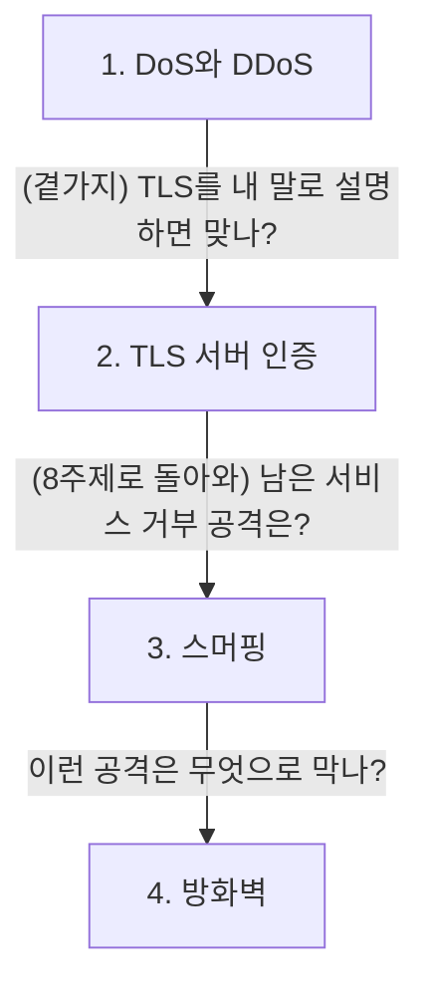

> **2026-11-24 목차**
>
> **[정보보안](#정보보안)**
> 1. [DoS와 DDoS는 공격하는 쪽의 수로 나뉜다](#1-dos와-ddos는-공격하는-쪽의-수로-나뉜다) — 한 대 vs 좀비 PC 여러 대
> 2. [TLS 서버 인증은 사이퍼 스윗이 아니라 인증서로 한다](#2-tls-서버-인증은-사이퍼-스윗이-아니라-인증서로-한다) — 스윗은 알고리즘 조합
> 3. [스머핑은 응답 n개를 피해자에게 몰아준다](#3-스머핑은-응답-n개를-피해자에게-몰아준다) — IP 스푸핑 + 브로드캐스트
> 4. [방화벽은 침입을 차단한다](#4-방화벽은-침입을-차단한다) — 차단 · 탐지 · 대응 중 차단

# 정보보안

> **흐름**: 8주제 네트워크 보안의 서비스 거부 공격을 마치고 9주제 방화벽으로 넘어갔다. 중간에 TLS를 다시 짚었다.



## 1. DoS와 DDoS는 공격하는 쪽의 수로 나뉜다

> **한 줄 결론**: 공격하는 쪽이 한 대면 DoS, 좀비 PC 여러 대가 떼거지로 공격하면 DDoS다.

정식 표현: 서비스 거부 공격(DoS, Denial of Service) · 분산 서비스 거부 공격(DDoS, Distributed Denial of Service)

### 어떻게 다른가

```text
DoS    공격자 PC ───────────────→ 피해자

DDoS   공격자 ─명령→ 좀비 PC 1 ──→ 피해자
              ─명령→ 좀비 PC 2 ──→ 피해자
              ─명령→ 좀비 PC N ──→ 피해자
```

- "떼거지" = 해커 여러 명 ✗ / 공격자가 명령을 내리는 **좀비 PC**(감염된 PC) 여러 대 ○
- 좀비 PC 묶음 = 봇넷(botnet) (슬라이드 밖)
- SYN Flooding은 세 번째 종류가 아님: SYN Flooding = 방법, DoS · DDoS = 규모

### IRC 서버는 명령 통로로 악용된다

- **IRC 서버**: 채팅방(채널) 안 사람들에게 메시지를 전달하는 채팅 서버. 원래 정상 서비스
- 공격자가 채널에 한 번 말함 → 들어와 있던 좀비 PC 전체가 동시에 받음
- 이런 명령 통로 = C&C(Command & Control) 서버

> [!WARNING]
> **"단일 공격"이 아니라 "공격자(출발지)가 한 대"다.** 단일 공격이라고 하면 한 번만 공격한다는 뜻으로 들린다. DoS도 SYN을 대량으로 보낸다.

이전 기록: [2026-11-18 SYN Flooding](../../2026/November/11-18.md#6-syn-flooding)

## 2. TLS 서버 인증은 사이퍼 스윗이 아니라 인증서로 한다

> **한 줄 결론**: TLS는 기밀성 · 무결성 · 서버 인증을 제공한다. 사이퍼 스윗은 키 교환 · 암호화 · 해시 알고리즘을 정하고, 서버 인증은 전자인증서를 검증해서 한다.

정식 표현: 사이퍼 스윗(cipher suite) · 서버 인증(server authentication)

### 무엇이 무엇을 맡나

```text
SSL_RSA_WITH_AES_256_CBC_SHA
  RSA          공개키 암호 → 대칭키 교환
  AES_256_CBC  대칭키 암호 → 기밀성
  SHA          해시(MAC)   → 무결성

전자인증서(X.509) → 서버 인증 (핸드셰이크에서 따로 받아 검증)
```

- 핸드셰이크가 사이퍼 스윗 결정 · 서버 인증 · 키 생성을 모두 맡음 → 섞이기 쉬움

> [!WARNING]
> **"서버 인증을 사이퍼 스윗으로 결정한다"는 틀렸다.** `TLS_ECDHE_RSA_…`처럼 이름에 서명 알고리즘(RSA)이 들어가기도 하지만, 서명 방식을 정할 뿐이다. 진짜 서버인지는 인증서 검증과 개인키 증명으로 확인한다.

이전 기록: [2026-11-10 TLS를 이루는 요소와 cipher suite](../../2026/November/11-10.md#1-tls를-이루는-요소와-cipher-suite)

## 3. 스머핑은 응답 n개를 피해자에게 몰아준다

> **한 줄 결론**: 출발지를 피해자 IP로 속인 요청을 브로드캐스트 주소로 보내면, 컴퓨터 n대가 피해자가 물어본 줄 알고 Reply n개를 피해자에게 보낸다. 그래서 피해자의 대역폭이 꽉 차 정상적으로 사용할 수 없다.

정식 표현: 스머핑(smurfing) — 증폭형 서비스 거부 공격

### 먼저 알 것

| | 뜻 | 원래 쓰임 |
|---|---|---|
| ICMP Echo | "거기 있어?"(Request) → "응, 있어"(Reply) | `ping`으로 상대 확인 |
| 브로드캐스트 주소 | 네트워크 모두에게 보내는 주소 (10.0.0.0이면 10.255.255.255) | 한 번에 알림 |

- ICMP(Internet Control Message Protocol): 3계층. Reply는 요청의 **출발지 IP**로 간다

### 어떻게 동작하나

```text
① 공격자 → 10.255.255.255 : ICMP Echo Request 1개 (출발지를 피해자 IP로 위장)
② 네트워크의 컴퓨터 n대가 모두 받음
③ 컴퓨터 n대 → 피해자 : ICMP Echo Reply n개
①~③ 반복 → 피해자 대역폭 고갈
```

| 장치 | 정하는 것 | 없으면 |
|---|---|---|
| IP 스푸핑 | 응답이 **누구에게** 가나 | 응답 n개가 공격자에게 돌아옴 |
| 브로드캐스트 주소 | 응답이 **몇 개** 되나 | 1개 → 1개, 증폭 ✗ |

### 증폭기(Amplifier)

- 요청 1개를 응답 n개로 불려 주는 **네트워크 전체**. 별도 장비가 아님 (amplify + -er, 기타 앰프와 같은 단어)
- 절대적으로 나쁜 것 ✗ / 기존에 있던 정상 기능(ICMP · 브로드캐스트)을 **악용** ○
- 외부에서 온 브로드캐스트 요청에 응답하게 열어 둔 설정은 취약점 → 라우터에서 막는 것이 방어 (슬라이드 밖)

### SYN Flooding과 비교

| | SYN Flooding | 스머핑 |
|---|---|---|
| 악용하는 것 | TCP 3-way handshake | ICMP + 브로드캐스트 |
| 바닥나는 것 | 연결 대기 큐 | 주로 네트워크 대역폭 |
| IP 위장 | 엉뚱한 IP (ACK가 안 오게) | 피해자 IP (응답이 몰리게) |

> [!WARNING]
> **증폭 네트워크의 컴퓨터는 좀비 PC가 아니다.** 감염된 것이 아니라 정상 컴퓨터가 규칙대로 응답했을 뿐이고, 속은 쪽도 이 컴퓨터들이다.

이전 기록: [2026-11-18 SYN Flooding](../../2026/November/11-18.md#6-syn-flooding)

## 4. 방화벽은 침입을 차단한다

> **한 줄 결론**: 정보보호 방법인 차단 · 탐지 · 대응(복구) 중 방화벽은 차단이다. 다 막는 게 아니라 보안 정책에 따라 통과시키거나 막는다.

정식 표현: 방화벽(firewall) · 침입 차단(intrusion blocking)

### 어디에 속하나

| 단계 | 예 |
|---|---|
| **차단** | 암호 기술, 방화벽 |
| 탐지 | 침입탐지시스템(IDS) |
| 대응 · 복구 | 침입 피해에 대한 대응 또는 복구 |

- 정의: 신뢰도가 서로 다른 네트워크 사이에서 데이터 전송의 보안 정책을 **집행(enforcement)** 하는 장치(HW 또는 SW)
- 슬라이드는 "접근통제(인가)"를 별도 칸으로 둠 → 방화벽은 "침입 차단"으로 쓴다

### 보안 정책 두 종류

| | 뜻 | 목록에 없는 것은 |
|---|---|---|
| whitelist | deny anything that is not explicitly allowed | 차단 |
| blacklist | allow anything which is not explicitly denied | 허용 |

- 처음 보는 공격: whitelist 차단 / blacklist 통과 → 보통 whitelist가 더 안전 (슬라이드 밖)
