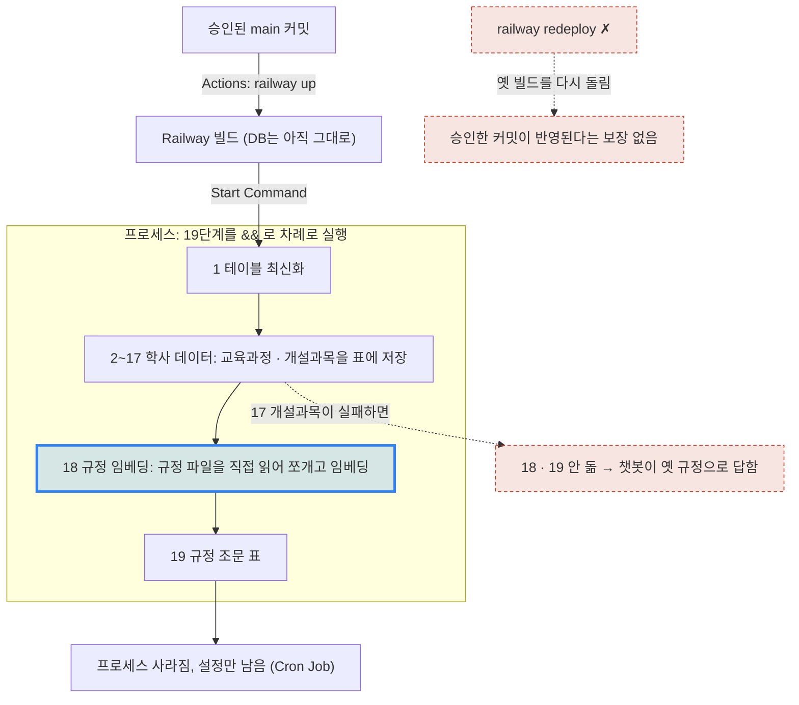
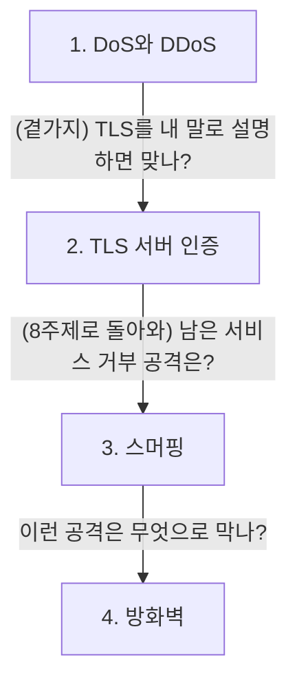

> **2026-11-24 목차**
>
> **[ONE Student](#one-student)**
> 1. [승인된 커밋은 railway up으로 올려 새로 빌드한다](#1-승인된-커밋은-railway-up으로-올려-새로-빌드한다) — Actions는 올리고 Railway가 작업
> 2. [재시딩 19단계는 순서로만 묶여 있다](#2-재시딩-19단계는-순서로만-묶여-있다) — 학사 데이터와 규정 임베딩은 별개
>
> **[정보보안](#정보보안)**
> 1. [DoS와 DDoS는 공격하는 쪽의 수로 나뉜다](#1-dos와-ddos는-공격하는-쪽의-수로-나뉜다) — 한 대 vs 좀비 PC 여러 대
> 2. [TLS 서버 인증은 사이퍼 스윗이 아니라 인증서로 한다](#2-tls-서버-인증은-사이퍼-스윗이-아니라-인증서로-한다) — 스윗은 알고리즘 조합
> 3. [스머핑은 응답 n개를 피해자에게 몰아준다](#3-스머핑은-응답-n개를-피해자에게-몰아준다) — IP 스푸핑 + 브로드캐스트
> 4. [방화벽은 침입을 차단한다](#4-방화벽은-침입을-차단한다) — 차단 · 탐지 · 대응 중 차단

# ONE Student

> **규정 문서 반영 7단계**: 상황과 값 → 반영 시작 → **실행 (이 날)** → 문서 쪼개기 → 임베딩 받기 → 바꿔 넣기 → 성공 판정과 챗봇 반영
> **그림 한 장으로 복습**: 아래 그림만 보고 설명할 수 있으면 이 날은 끝. 막히는 칸만 아래 항목을 연다. 값이 움직이는 모습은 [단계별 재생 페이지](https://childrenaon.github.io/TIL/replay/regulation-reseed.html#step-3)에서 본다.



## 1. 승인된 커밋은 railway up으로 올려 새로 빌드한다

> **지도에서 위치**: [ONE Student 지도](../../projects/one-student.md) › 규정 문서 반영 › 실행 (`.github/workflows/db-reseed.yml`)
> **한 줄 결론**: Actions는 승인된 커밋을 Railway에 올려 주고, 실질적인 작업은 Railway가 한다. `redeploy`는 최신 문서가 반영된다는 보장이 없어서, 그 커밋을 확실하게 직접 올려 빌드하는 `up`으로 바꿨다.

정식 표현: 빌드(build) · 배포(deploy) · Cron Job

### 누가 무엇을 하나

```text
Actions   railway up      승인된 main 커밋을 Railway로 올림
Railway   빌드            코드를 실행할 수 있게 준비 (DB는 아직 그대로)
Railway   설정을 읽음      Start Command로 프로세스를 띄움
프로세스   작업            19단계를 돌려 DB를 바꾸고, 끝나면 사라짐
```

> [!WARNING]
> **빌드는 작업이 아니다.** 올리자마자 시작하는 게 아니라 빌드를 하고 나서 Start Command를 실행한다. 빌드도 Actions가 아니라 Railway에서 한다.

### 떠올려 본 뒤 펼치기

<details>
<summary><b>Cron Job은 무엇이 남고 무엇이 사라지나?</b></summary>

- **Cron Job**: 정해진 시각에 등장해서 일하고, 끝나면 사라지는 작업 ↔ 계속 켜져 있는 웹 서버
- 남는 것 = 설정(이름 · Start Command · 스케줄) / 사라지는 것 = 실행(프로세스)
- 여기는 스케줄이 비어 있음 → 저절로 안 돌고, 새로 배포될 때 한 번 돎

| 비유 | 실제 |
|---|---|
| 벽에 붙은 업무 지시서 | 설정 |
| 지시서를 읽고 직원을 부르는 관리자 | Railway |
| 와서 일하고 퇴근하는 직원 | 프로세스 |

</details>

<details>
<summary><b>처음엔 다른 명령을 썼다. 무엇을 버렸고 왜?</b></summary>

| 방법 | 버린 이유 |
|---|---|
| `railway redeploy` | 이미 빌드된 것을 다시 실행 → 체크아웃한 커밋이 안 쓰이고 옛 빌드가 다시 돎 (실제로 있었음) |
| `railway up --detach` | 배포가 끝나기 전에 다음 줄로 넘어감 → 아직 안 돈 실행의 로그를 읽음 |
| `up` 뒤에 `redeploy`를 한 번 더 | 같은 재시딩이 두 번 돌고 로그가 섞임 |

- 처음에 `redeploy`를 쓴 이유는 기록에 없음. 추정: Railway가 GitHub과 연동돼 최신 빌드를 만들어 둔다고 기대

</details>

<details>
<summary><b>면접에서 설명한다면?</b></summary>

GitHub Actions는 승인된 커밋을 Railway에 올리기만 하고, 빌드와 재시딩 실행은 Railway가 합니다. 처음에는 `redeploy`를 썼는데 기존 빌드를 다시 돌릴 뿐이라 승인한 커밋이 반영된다는 보장이 없었습니다. 그래서 그 커밋을 직접 올려 새로 빌드하는 `up`으로 바꿨습니다.

</details>

이전 기록: [2026-11-23 재시딩은 main push로 실행이 생기고 승인해야 돈다](../../2026/November/11-23.md#2-재시딩은-main-push로-실행이-생기고-승인해야-돈다)

## 2. 재시딩 19단계는 순서로만 묶여 있다

> **지도에서 위치**: [ONE Student 지도](../../projects/one-student.md) › 규정 문서 반영 › 실행 (재시딩 Start Command)
> **한 줄 결론**: 2~17단계는 여러 기능이 쓰는 학사 데이터를 표에 저장하고, 18단계는 챗봇이 찾을 규정 글을 쪼개 임베딩한다. 완전히 별개이고, 한 번의 재시딩에서 `&&`로 차례로 돌 뿐이다.

정식 표현: 순차 실행(`&&`, 앞 명령의 종료 코드가 0일 때만 다음 실행) · 파이프라인(pipeline)

- 규정만 고쳐도 19단계 전체가 돎. 어느 단계도 무엇이 바뀌었는지 모르고 대체로 전부 다시 저장 → 파일이 그대로면 결과도 같음

> [!WARNING]
> **18단계는 2~17단계가 저장한 것을 쪼개는 게 아니다.** 규정 파일을 직접 읽는다. 차례로 돈다고 해서 앞 단계가 뒤 단계의 빌드업인 것은 아니다.

### 떠올려 본 뒤 펼치기

<details>
<summary><b>왜 18단계만 임베딩하나? 학사 데이터와 무엇이 다른가?</b></summary>

| | 학사 데이터 | 규정 |
|---|---|---|
| 생김새 | 과목명 · 학점 같은 **칸** | 문장으로 된 **글** |
| 찾는 법 | 조건으로 찾음 (`WHERE`) | 뜻이 가까운 조각을 찾음 |
| 저장 | 표에 그대로 | 청크 + 임베딩 |

- 챗봇과 학사 데이터를 무조건 연결지으면 안 됨: 표에 저장만 해서 쓰는 기능(졸업요건)과 임베딩해 가져오는 기능(챗봇)을 구분

</details>

<details>
<summary><b><code>&&</code>로 잇는 것과 파이프라인은 무엇이 다른가?</b></summary>

```text
명령A && 명령B           순서만: A가 성공하면 B 실행. A의 결과를 B에 넘기지 않음
쪼개기 → 임베딩 → 저장    파이프라인: 앞의 출력이 다음의 입력
```

- 인덱싱 파이프라인은 전부 18단계 안에 있음
- CI/CD 파이프라인(승인 → 배포 → 결과 확인)이 인덱싱 파이프라인을 돌리는 구조

</details>

<details>
<summary><b>앞 단계가 실패하면 18단계는 돌면 안 되나?</b></summary>

| 실패한 곳 | 18단계가 돌면 안 되나 |
|---|---|
| 테이블 최신화(1단계) | 안 됨. 저장할 테이블이 안 맞을 수 있음 |
| 개설과목(17단계) | 데이터로는 돌아도 됨. `&&`로 묶여 같이 막힌 것 |

- 실제로 있었던 일: 개설과목(17단계) 실패 → 문제없는 규정까지 반영 ✗ → 챗봇이 옛 규정으로 답함
- 하나라도 실패하면 멈추는 장점은 있지만, `&&`를 고른 이유는 기록에 없음

</details>

<details>
<summary><b>면접에서 설명한다면?</b></summary>

재시딩은 19단계를 `&&`로 이어 차례로 돌립니다. 칸으로 된 학사 데이터는 표에 저장하고, 문장으로 된 규정만 쪼개 임베딩합니다. 서로 의존하지 않는 단계도 한 줄로 묶여 있어, 개설과목 단계의 실패로 규정 반영까지 막힌 일이 있었습니다.

</details>

이전 기록: [2026-11-23 규정 문서는 검색할 조각과 숫자 배열로 DB에 남는다](../../2026/November/11-23.md#1-규정-문서는-검색할-조각과-숫자-배열로-db에-남는다)

<br>
<br>
<br>
<br>
<br>
<br>
<br>
<br>
<br>
<br>

# 정보보안

> **흐름**: 8주제 네트워크 보안의 서비스 거부 공격을 마치고 9주제 방화벽으로 넘어갔다. 중간에 TLS를 다시 짚었다.



## 1. DoS와 DDoS는 공격하는 쪽의 수로 나뉜다

> **한 줄 결론**: 공격하는 쪽이 한 대면 DoS, 좀비 PC 여러 대가 떼거지로 공격하면 DDoS다.

정식 표현: 서비스 거부 공격(DoS, Denial of Service) · 분산 서비스 거부 공격(DDoS, Distributed Denial of Service)

### 어떻게 다른가

```text
DoS    공격자 PC ───────────────→ 피해자

DDoS   공격자 ─명령→ 좀비 PC 1 ──→ 피해자
              ─명령→ 좀비 PC 2 ──→ 피해자
              ─명령→ 좀비 PC N ──→ 피해자
```

- "떼거지" = 해커 여러 명 ✗ / 공격자가 명령을 내리는 **좀비 PC**(감염된 PC) 여러 대 ○
- 좀비 PC 묶음 = 봇넷(botnet) (슬라이드 밖)
- SYN Flooding은 세 번째 종류가 아님: SYN Flooding = 방법, DoS · DDoS = 규모

### IRC 서버는 명령 통로로 악용된다

- **IRC 서버**: 채팅방(채널) 안 사람들에게 메시지를 전달하는 채팅 서버. 원래 정상 서비스
- 공격자가 채널에 한 번 말함 → 들어와 있던 좀비 PC 전체가 동시에 받음
- 이런 명령 통로 = C&C(Command & Control) 서버

> [!WARNING]
> **"단일 공격"이 아니라 "공격자(출발지)가 한 대"다.** 단일 공격이라고 하면 한 번만 공격한다는 뜻으로 들린다. DoS도 SYN을 대량으로 보낸다.

이전 기록: [2026-11-18 SYN Flooding](../../2026/November/11-18.md#6-syn-flooding)

## 2. TLS 서버 인증은 사이퍼 스윗이 아니라 인증서로 한다

> **한 줄 결론**: TLS는 기밀성 · 무결성 · 서버 인증을 제공한다. 사이퍼 스윗은 키 교환 · 암호화 · 해시 알고리즘을 정하고, 서버 인증은 전자인증서를 검증해서 한다.

정식 표현: 사이퍼 스윗(cipher suite) · 서버 인증(server authentication)

### 무엇이 무엇을 맡나

```text
SSL_RSA_WITH_AES_256_CBC_SHA
  RSA          공개키 암호 → 대칭키 교환
  AES_256_CBC  대칭키 암호 → 기밀성
  SHA          해시(MAC)   → 무결성

전자인증서(X.509) → 서버 인증 (핸드셰이크에서 따로 받아 검증)
```

- 핸드셰이크가 사이퍼 스윗 결정 · 서버 인증 · 키 생성을 모두 맡음 → 섞이기 쉬움

> [!WARNING]
> **"서버 인증을 사이퍼 스윗으로 결정한다"는 틀렸다.** `TLS_ECDHE_RSA_…`처럼 이름에 서명 알고리즘(RSA)이 들어가기도 하지만, 서명 방식을 정할 뿐이다. 진짜 서버인지는 인증서 검증과 개인키 증명으로 확인한다.

이전 기록: [2026-11-10 TLS를 이루는 요소와 cipher suite](../../2026/November/11-10.md#1-tls를-이루는-요소와-cipher-suite)

## 3. 스머핑은 응답 n개를 피해자에게 몰아준다

> **한 줄 결론**: 출발지를 피해자 IP로 속인 요청을 브로드캐스트 주소로 보내면, 컴퓨터 n대가 피해자가 물어본 줄 알고 Reply n개를 피해자에게 보낸다. 그래서 피해자의 대역폭이 꽉 차 정상적으로 사용할 수 없다.

정식 표현: 스머핑(smurfing) — 증폭형 서비스 거부 공격

### 먼저 알 것

| | 뜻 | 원래 쓰임 |
|---|---|---|
| ICMP Echo | "거기 있어?"(Request) → "응, 있어"(Reply) | `ping`으로 상대 확인 |
| 브로드캐스트 주소 | 네트워크 모두에게 보내는 주소 (10.0.0.0이면 10.255.255.255) | 한 번에 알림 |

- ICMP(Internet Control Message Protocol): 3계층. Reply는 요청의 **출발지 IP**로 간다

### 어떻게 동작하나

```text
① 공격자 → 10.255.255.255 : ICMP Echo Request 1개 (출발지를 피해자 IP로 위장)
② 네트워크의 컴퓨터 n대가 모두 받음
③ 컴퓨터 n대 → 피해자 : ICMP Echo Reply n개
①~③ 반복 → 피해자 대역폭 고갈
```

| 장치 | 정하는 것 | 없으면 |
|---|---|---|
| IP 스푸핑 | 응답이 **누구에게** 가나 | 응답 n개가 공격자에게 돌아옴 |
| 브로드캐스트 주소 | 응답이 **몇 개** 되나 | 1개 → 1개, 증폭 ✗ |

### 증폭기(Amplifier)

- 요청 1개를 응답 n개로 불려 주는 **네트워크 전체**. 별도 장비가 아님 (amplify + -er, 기타 앰프와 같은 단어)
- 절대적으로 나쁜 것 ✗ / 기존에 있던 정상 기능(ICMP · 브로드캐스트)을 **악용** ○
- 외부에서 온 브로드캐스트 요청에 응답하게 열어 둔 설정은 취약점 → 라우터에서 막는 것이 방어 (슬라이드 밖)

### SYN Flooding과 비교

| | SYN Flooding | 스머핑 |
|---|---|---|
| 악용하는 것 | TCP 3-way handshake | ICMP + 브로드캐스트 |
| 바닥나는 것 | 연결 대기 큐 | 주로 네트워크 대역폭 |
| IP 위장 | 엉뚱한 IP (ACK가 안 오게) | 피해자 IP (응답이 몰리게) |

> [!WARNING]
> **증폭 네트워크의 컴퓨터는 좀비 PC가 아니다.** 감염된 것이 아니라 정상 컴퓨터가 규칙대로 응답했을 뿐이고, 속은 쪽도 이 컴퓨터들이다.

이전 기록: [2026-11-18 SYN Flooding](../../2026/November/11-18.md#6-syn-flooding)

## 4. 방화벽은 침입을 차단한다

> **한 줄 결론**: 정보보호 방법인 차단 · 탐지 · 대응(복구) 중 방화벽은 차단이다. 다 막는 게 아니라 보안 정책에 따라 통과시키거나 막는다.

정식 표현: 방화벽(firewall) · 침입 차단(intrusion blocking)

### 어디에 속하나

| 단계 | 예 |
|---|---|
| **차단** | 암호 기술, 방화벽 |
| 탐지 | 침입탐지시스템(IDS) |
| 대응 · 복구 | 침입 피해에 대한 대응 또는 복구 |

- 정의: 신뢰도가 서로 다른 네트워크 사이에서 데이터 전송의 보안 정책을 **집행(enforcement)** 하는 장치(HW 또는 SW)
- 슬라이드는 "접근통제(인가)"를 별도 칸으로 둠 → 방화벽은 "침입 차단"으로 쓴다

### 보안 정책 두 종류

| | 뜻 | 목록에 없는 것은 |
|---|---|---|
| whitelist | deny anything that is not explicitly allowed | 차단 |
| blacklist | allow anything which is not explicitly denied | 허용 |

- 처음 보는 공격: whitelist 차단 / blacklist 통과 → 보통 whitelist가 더 안전 (슬라이드 밖)
