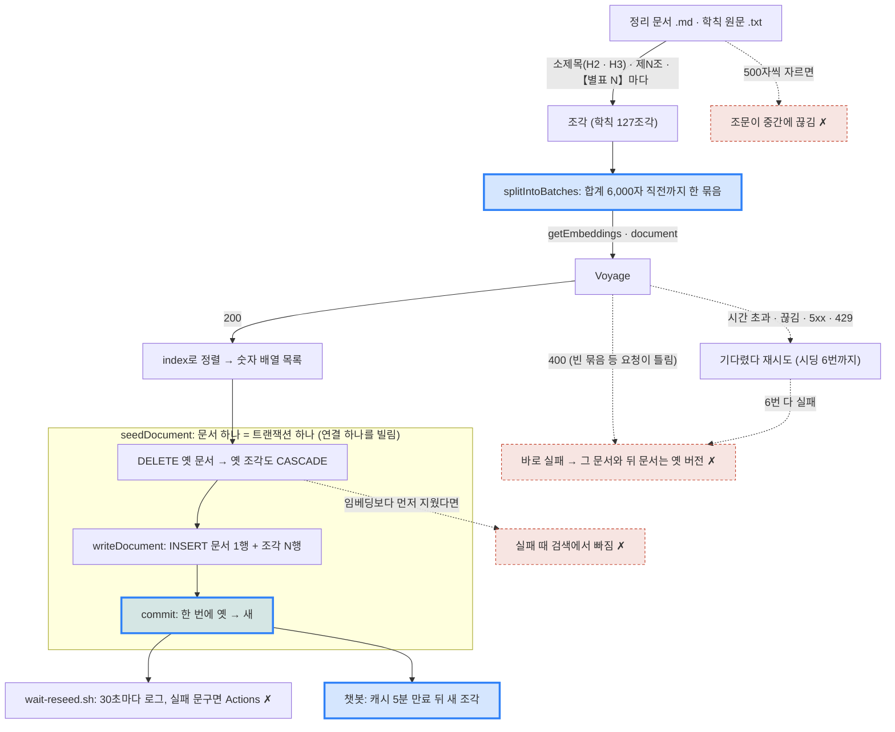

> **2026-11-27 목차**
>
> **[ONE Student](#one-student)**
> 1. [문서는 소제목과 조 단위로 자른다](#1-문서는-소제목과-조-단위로-자른다) — 뜻이 끊기는 곳에서 자름
> 2. [조각은 6,000자 직전까지 한 묶음으로 보낸다](#2-조각은-6000자-직전까지-한-묶음으로-보낸다) — 요청 수 · 토큰 한도 둘 다 피함
> 3. [임베딩 실패는 종류에 따라 재시도하거나 바로 멈춘다](#3-임베딩-실패는-종류에-따라-재시도하거나-바로-멈춘다) — 기다리면 풀리는 것만 재시도
> 4. [임베딩을 다 받은 뒤 한 트랜잭션으로 바꿔 넣는다](#4-임베딩을-다-받은-뒤-한-트랜잭션으로-바꿔-넣는다) — 실패해도 옛 문서가 남음
> 5. [성공은 로그로 판정하고 챗봇은 5분 안에 반영된다](#5-성공은-로그로-판정하고-챗봇은-5분-안에-반영된다) — 로그를 끝까지 읽고, 캐시는 5분
> 6. [규정 문서 반영 한 바퀴 정리](#6-규정-문서-반영-한-바퀴-정리) — 1분 설명 · 면접 질문 · 이름 표
> 7. [삭제를 임베딩 뒤로 옮기고 한 트랜잭션으로 묶었다](#7-삭제를-임베딩-뒤로-옮기고-한-트랜잭션으로-묶었다) — B: 실패해도 옛 문서가 남게
> 8. [일시적인 실패만 재시도하고 챗봇에서는 끈다](#8-일시적인-실패만-재시도하고-챗봇에서는-끈다) — B: fetch를 감싸고 스위치로 나눔
> 9. [로그 내용을 끝까지 보고 마지막 단계 완료로만 성공을 인정한다](#9-로그-내용을-끝까지-보고-마지막-단계-완료로만-성공을-인정한다) — B: 실패가 성공으로 가려지던 것

# ONE Student

> **규정 문서 반영 7단계**: 상황과 값 → 반영 시작 → 실행 → **문서 쪼개기 → 임베딩 받기 → 바꿔 넣기 → 성공 판정과 챗봇 반영 (이 날)**
> **그림 한 장으로 복습**: 아래 그림만 보고 설명할 수 있으면 이 날은 끝. 막히는 칸만 아래 항목을 읽는다. 값이 움직이는 모습은 [단계별 재생 페이지](https://childrenaon.github.io/TIL/replay/regulation-reseed.html#step-4)에서 본다.



## 1. 문서는 소제목과 조 단위로 자른다

> **지도에서 위치**: [ONE Student 지도](../../projects/one-student.md) › 규정 문서 반영 › 문서 쪼개기 (`scripts/seedRegulations.js`)
> **한 줄 결론**: 정리 문서는 `##` · `###` 소제목마다, 학칙 원문은 "제N조"와 "【별표 N】"마다 자른다. 글의 뜻이 끊기는 곳에서 자르는 것이다.

정식 표현: 청킹(chunking) · 구조 기반 분할 · 결정론적(deterministic) 분할

### 어떻게 자르나

```js
// 기본형: 경계가 몇 번째 글자에 있는지 찾고, 경계부터 다음 경계 직전까지 자른다
const text = '머리말제1조 가나제2조 다라';
[...text.matchAll(/제\d+조/g)];   // [{ 0: '제1조', index: 3 }, { 0: '제2조', index: 9 }]
text.slice(0, 3);                 // '머리말'      첫 경계 앞 = 머리말 조각
text.slice(3, 9);                 // '제1조 가나'  경계 ~ 다음 경계 직전
```

| 문서 | 함수 | 경계 | 실측 (LF 기준) |
|---|---|---|---|
| 정리 문서 (`db/regulations/<분류>/*.md`) | `chunkCuratedMarkdown` | `##` · `###` 소제목 | 77개 → 1,194조각, 보통 500자쯤 |
| 학칙 원문 (`_source/*.txt`) | `chunkVerbatimText` | `제N조` · `【별표 N】` | 학칙 127 · 시행규칙 144 · 수업관리규정 22조각 |

- `# 제목` 줄은 조각에서 빼고 문서 제목으로만 씀
- 첫 경계 앞 글(머리말)도 조각 하나

### 다른 방법으로 자를 수도 있었다. 왜 이 방법인가?

| 방법 | 판단 |
|---|---|
| 글자 수로 자르기 (500자씩) | 조문이 중간에 끊김: "평균평점이" ✂ "4.3이상" |
| AI에게 자르게 하기 | 돌릴 때마다 결과가 다를 수 있고 비용 |
| 소제목 · 조 단위 (채택) | 문서에 있는 구조 그대로, 같은 파일이면 늘 같은 조각. 대신 길이가 들쭉날쭉 |

### 【별표 N】은 왜 따로 경계로 잡나?

- 없으면 부칙 마지막 조(시행일) 뒤에 붙은 별표 표 전체가 그 조 하나에 통째로 붙음 → 조각 하나가 수만 자

> [!WARNING]
> **제목 줄은 운영에서만 확실히 빠진다.** 제목을 지우는 정규식 `/^#\s+.+\n/`은 줄바꿈이 LF일 때만 맞음. 저장소 · 운영(Linux)은 LF라 빠지지만, Windows에서 체크아웃한 파일(CRLF)로 로컬 시드를 돌리면 첫 조각에 `# 조기졸업`이 남음.

이전 기록: [2026-11-24 재시딩 19단계는 순서로만 묶여 있다](../../2026/November/11-24.md#2-재시딩-19단계는-순서로만-묶여-있다)

## 2. 조각은 6,000자 직전까지 한 묶음으로 보낸다

> **지도에서 위치**: [ONE Student 지도](../../projects/one-student.md) › 규정 문서 반영 › 문서 쪼개기 (`splitIntoBatches`)
> **한 줄 결론**: 묶음 하나의 최대를 6,000자로 정하고, 다음 조각을 넣으면 넘는 순간 지금 묶음을 닫는다. 묶음 하나가 Voyage 요청 한 번이다.

정식 표현: 배치 처리(batch processing) · 레이트 리밋(rate limit, RPM · TPM) · 가드 조건(guard)

### 어떻게 묶나

```js
// server/scripts/seedRegulations.js
for (const chunk of chunks) {
  // 지금 묶음에 조각이 있고, 이 조각을 넣으면 6,000자를 넘는다 → 지금 묶음을 닫고 새로 시작
  if (current.length > 0 && currentLen + chunk.length > MAX_CHARS_PER_BATCH) { batches.push(current); current = []; currentLen = 0; }
  current.push(chunk);
  currentLen += chunk.length;
}
// 실측: 조기졸업 6조각 753자 → 1묶음 / 학칙 127조각 → 10묶음
```

### 왜 묶나? 잘게 보내거나 통째로 보내면?

Voyage 무료 한도 두 가지 때문.

| 방법 | 걸리는 한도 | 결과 |
|---|---|---|
| 조각마다 요청 1번 | 분당 요청 3번 (RPM) | 1분에 3개씩만 → 느림 |
| 문서 통째로 요청 1번 | 분당 토큰 1만 개 (TPM) | 요청 하나가 이미 한도 초과 → 기다려도 영원히 실패 |
| 6,000자씩 묶기 (채택) | 둘 다 피함 | 한글은 토큰 하나에 대략 1.5~2자라 6,000자면 1만 토큰 아래 |

- 레이트 리밋 = 일정 시간 동안 허용하는 양. 요청 수(RPM)도 토큰 수(TPM)도 레이트 리밋
- RPM은 요청이 걸린 시간이 아니라 1분 동안 보낸 **횟수**를 셈. 0.1초 만에 끝난 요청도 1번

### `current.length > 0`은 왜 있나?

```js
// 조건이 있을 때 (지금): 첫 조각이 16,892자면
//   묶음이 비어 있음 → 조건 false → 그냥 담음       → [[16,892], [다음 조각…]]
// 조건이 없었다면: 0 + 16,892 > 6,000 → 비어 있는 묶음을 닫아 버림 → [[], [16,892], …]
```

- 큰 조각은 둘 다 혼자 한 묶음으로 처리됨. 조건이 막는 건 **빈 묶음 `[]`**
- 빈 입력은 Voyage가 400으로 거절함(11-27 실제로 1번 보내 확인). 400은 재시도 안 함 → 그 문서 재시딩 실패
- 빈 묶음이 생기는 건 문서의 **첫 조각**이 6,000자를 넘을 때뿐

> [!WARNING]
> **6,000자보다 큰 조각은 쪼개지 않고 혼자 보낸다.** 학칙에 7,237 · 9,619 · 16,892자 조각이 있다. 16,892자가 1만 토큰을 넘는지는 아직 확인 안 함(추정 약 8,400~11,300토큰). 넘으면 그 요청은 기다려도 실패.

### 면접에서 설명한다면

임베딩 서비스의 무료 한도가 분당 요청 3번, 분당 토큰 1만 개라서 조각을 6,000자씩 묶어 보냅니다. 조각마다 보내면 요청 한도에 막혀 느리고, 문서를 통째로 보내면 요청 하나가 토큰 한도를 넘어 아무리 기다려도 성공하지 못하기 때문입니다. 빈 묶음은 서비스가 오류로 거절해서 만들지 않게 막았습니다.

이전 기록: [2026-11-27 문서는 소제목과 조 단위로 자른다](#1-문서는-소제목과-조-단위로-자른다)

## 3. 임베딩 실패는 종류에 따라 재시도하거나 바로 멈춘다

> **지도에서 위치**: [ONE Student 지도](../../projects/one-student.md) › 규정 문서 반영 › 임베딩 받기 (`services/embeddingClient.js`)
> **한 줄 결론**: 묶음마다 Voyage에 보내 숫자 배열을 받는다. 기다리면 풀리는 실패(시간 초과 · 5xx · 429)만 재시도하고, 요청이 틀린 400은 바로 멈춘다.

정식 표현: 재시도(retry) · 백오프(backoff) · 비대칭 임베딩(`document` / `query`)

### 받는 값

```js
// 보내는 것 (묶음 하나)
{ model: 'voyage-3-lite', input: ['### 1. 조기졸업 정의 …', '### 2. 신청 성적기준 …'], input_type: 'document' }
// 받는 것 (모양만, 예시)
{ data: [{ index: 1, embedding: [0.012, …] }, { index: 0, embedding: [0.008, …] }] }

// getEmbeddings 마지막 줄: index 오름차순으로 정렬하고 embedding만 꺼냄 → 보낸 조각 순서와 같게
data.data.sort((a, b) => a.index - b.index).map((d) => d.embedding);  // → [[0.008, …], [0.012, …]]
//   앞 data = 응답 JSON 전체, .data = 그 안의 결과 목록
//   sort: a - b가 음수면 a를 앞에 → 오름차순 / map: 원소마다 바꾼 값으로 새 배열
```

- `getEmbeddings` = get + Embeddings(여러 개). Voyage 요청 → 결과를 보낸 순서로 정리해 돌려줌

### 시딩과 챗봇이 왜 같이 나오나?

`embeddingClient.js`는 Voyage를 부르는 **공용 도구**. 부르는 곳마다 설정이 다름.

| 부르는 곳 | 보내는 것 | 타입 | 재시도 |
|---|---|---|---|
| 시딩 (`seedRegulations.js`) | 규정 조각 묶음 | `document` | 6번 · 한 번에 60초 |
| 챗봇 (`routes/chat.js`) | 학생 질문 1개 | `query` | 2번 · 20초 (학생이 기다림) |

- 문서의 숫자 배열은 시딩 때 DB에 저장해 둠. 챗봇은 질문만 임베딩해서 저장된 배열과 비교(코사인)
- 질문의 숫자 배열은 저장 안 함. 질문 글은 대화 기록에 저장됨

### 어떤 실패를 재시도하나?

| 실패 | 시딩 | 챗봇 |
|---|---|---|
| 시간 초과 · 연결 끊김 · 5xx | 재시도 (5초 → 10초 → 15초) | 바로 실패 |
| 429 (분당 한도) | 재시도 (`Retry-After`, 없으면 21초) | 재시도 |
| 400 등 (요청이 잘못됨) | 바로 실패 | 바로 실패 |

- 429 · 5xx · 시간 초과 = Voyage 쪽 사정, 기다리면 풀릴 수 있음
- 400 = 우리 코드가 만든 요청이 틀림(빈 입력 등) → 그대로 다시 보내도 또 400

> [!WARNING]
> **"계속" 재시도하지 않는다.** 시딩도 6번까지. 다 실패하면 오류를 던짐 → `run()`의 catch가 "규정 시딩 실패"를 찍고 실행 종료 → 그 문서와 뒤 문서는 옛 버전으로 남음(앞 문서는 이미 새 버전, 버전이 섞일 수 있음).

이전 기록: [2026-11-27 조각은 6,000자 직전까지 한 묶음으로 보낸다](#2-조각은-6000자-직전까지-한-묶음으로-보낸다)

## 4. 임베딩을 다 받은 뒤 한 트랜잭션으로 바꿔 넣는다

> **지도에서 위치**: [ONE Student 지도](../../projects/one-student.md) › 규정 문서 반영 › 바꿔 넣기 (`seedDocument` · `writeDocument`)
> **한 줄 결론**: 임베딩을 받는 동안은 DB를 안 건드리고, 다 받은 뒤 문서마다 한 트랜잭션으로 옛 문서 삭제와 새 문서 저장을 한 번에 한다. 실패하면 옛 문서가 그대로 남는다.

정식 표현: 원자성(atomicity, all or nothing) · 격리성(isolation) · ON DELETE CASCADE

### 두 함수가 맡는 일 (같은 파일 `seedRegulations.js`)

```js
seedDocument(문서)        // 관리자: 건너뛸지 판단 → 임베딩 받기 → 연결 빌림 → 트랜잭션 → 옛 문서 DELETE
                          //        → writeDocument 호출 → commit / 실패하면 rollback / 끝나면 연결 반납
writeDocument(conn, …)    // 쓰는 손: 받은 연결로 INSERT만 (문서 1행 → insertId로 조각 N행)
```

- 옛 문서 1행만 지우면 조각들은 `ON DELETE CASCADE`로 같이 지워짐
- commit · rollback · 연결 반납은 전부 `seedDocument`가 함

### 왜 `pool.query`가 아니라 연결 하나를 빌리나?

```js
// pool.query: 한 줄씩 바로 확정
await pool.query('DELETE … 옛 B');   // 끝나는 순간 확정 → 챗봇에서 B가 사라짐
await pool.query('INSERT … 새 B');   // 실패하면 위 DELETE를 되돌릴 수 없음 → B 없음

// getConnection + 트랜잭션: commit 전까지 보류
await conn.beginTransaction();       // 트랜잭션은 연결 하나에 붙는 상태
await conn.query('DELETE … 옛 B');   // 보류 (챗봇은 여전히 옛 B를 봄)
await conn.query('INSERT … 새 B');   // 실패하면 rollback → DELETE도 취소
```

### 순서를 바꾸면 무슨 일이 생기나?

| 다른 순서 | 실패하면 |
|---|---|
| 문서 행을 먼저 넣고 임베딩 | 조각 없는 빈 문서만 남음 → 다음 실행 때 "이미 있음"으로 건너뜀 → 영영 다시 안 넣어짐 |
| 옛 문서를 먼저 지우고 임베딩 | 문서 · 조각이 다 지워진 채 → 검색에서 빠짐 → 챗봇이 근거 조각을 못 찾음 |
| 임베딩 전부 → 삭제 · 저장을 한 트랜잭션 (채택) | 어디서 실패해도 옛 문서가 그대로 |

- 격리성 덕분에 학생은 commit 전엔 옛 B, 후엔 새 B만 봄. "옛 B는 지워졌는데 새 B는 아직" 같은 중간 상태는 안 보임
- 원자성은 **문서 단위**로 지킴. 실행 전체 단위는 아님(뒤 문서가 옛 버전으로 남을 수 있음)

> [!WARNING]
> **`--force` 없이 돌리면 고친 규정이 반영되지 않는다.** 이미 있는 문서는 내용이 바뀌었어도 `[SKIP]`으로 건너뜀. 운영 재시딩은 `--force`.

### 면접에서 설명한다면

규정 문서를 다시 넣을 때 임베딩을 먼저 전부 받고, 그다음 문서마다 한 트랜잭션으로 옛 문서 삭제와 새 문서 저장을 합니다. 옛 문서를 먼저 지우면 임베딩이 실패했을 때 그 문서가 검색에서 빠지기 때문입니다. 커밋 전 변경은 다른 연결에 보이지 않아서, 재시딩 중에도 챗봇은 옛 문서로 답합니다.

관련: [ONE-Student-WKU/web#465](https://github.com/ONE-Student-WKU/web/issues/465)

## 5. 성공은 로그로 판정하고 챗봇은 5분 안에 반영된다

> **지도에서 위치**: [ONE Student 지도](../../projects/one-student.md) › 규정 문서 반영 › 성공 판정과 챗봇 반영 (`scripts/ci/wait-reseed.sh` · `services/regulationService.js`)
> **한 줄 결론**: Actions는 재시딩이 끝날 때까지 30초마다 로그를 다시 읽어 성공 · 실패를 정한다. 챗봇은 조각을 5분 동안 메모리에 두므로, commit 뒤 최대 5분 안에 새 조각을 쓴다.

정식 표현: 폴링(polling) · 캐시 TTL(Time To Live) · 캐시 무효화(invalidation)

### Actions는 어떻게 판정하나

```bash
# scripts/ci/wait-reseed.sh (줄여 씀) ← db-reseed.yml이 마지막에 실행
반복: railway logs로 그 순간까지의 로그를 받음
      "실패:" 또는 "npm error"가 있으면 → exit 1 (Actions ✗)
      마지막 19단계 완료 문구가 있으면 → 4번 더 확인 후 exit 0
      55분이 지나도 둘 다 없으면 → exit 1
      30초 기다림
```

- 반복하는 이유: 읽는 시점에 재시딩이 아직 도는 중이라 결과 문구가 없음 → 끝날 때까지 기다리며 다시 읽음
- 실제로 있었던 일: 예전엔 로그를 한 번만 받아 늘 성공 → 개설과목 단계 실패로 규정 반영이 멈춘 게 세 번 연속 가려짐([#376](https://github.com/ONE-Student-WKU/web/issues/376), [#378](https://github.com/ONE-Student-WKU/web/issues/378))

### 챗봇에는 언제 반영되나

```js
// server/services/regulationService.js
const CHUNK_CACHE_TTL_MS = 5 * 60 * 1000;   // 5분
if (chunkCache.rows && Date.now() < chunkCache.expiresAt) return chunkCache.rows;  // 5분 안이면 DB 안 감
// 만료됐으면 DB에서 조각 전체를 다시 읽고 5분 뒤 만료로 저장
```

```text
10:00  질문 → DB에서 읽어 캐시 채움 (옛 조각, 10:05 만료)        ← 시각은 예시
10:03  재시딩 commit → DB에는 새 조각
10:03~05  캐시의 옛 조각으로 답함                                ← 늦는 구간
10:05  만료 → 다음 질문부터 DB를 다시 읽어 새 조각
```

- 최악: 캐시가 commit 직전에 채워져도 5분이면 무조건 버려짐 → commit부터 **최대 5분**
- 캐시를 두는 이유: 질문마다 조각 전체(수천 행)를 DB에서 읽지 않으려고

### 끝 신호를 받으면 안 되나?

재시딩(Cron Job 프로세스)과 챗봇(웹 서버 프로세스)은 메모리를 같이 쓰지 않음 → 알리려면 통로가 필요.

| 방법 | 드는 것 |
|---|---|
| TTL 5분 (지금) | 없음. 대신 최대 5분 늦음 |
| 재시딩 끝에 서버의 "캐시 비우기" 주소 호출 | 인증, 서버가 여러 대면 전부 불러야 함 |
| DB에 "규정 갱신 시각" 한 칸, 질문마다 그것만 확인 | 질문마다 가벼운 조회 1번 |

- 고르지 않은 이유는 기록에 없음. 추정: 재시딩은 가끔이고 5분 늦어도 손해가 작아 가장 단순한 TTL
- 더 빨리 반영하려면 세 번째(DB 버전 칸)가 무난

> [!WARNING]
> **판정이 로그 문구에 기대고 있다.** 시딩 스크립트의 완료 · 실패 문구를 바꾸면 Actions 판정이 조용히 틀어질 수 있음.

## 6. 규정 문서 반영 한 바퀴 정리

> **지도에서 위치**: [ONE Student 지도](../../projects/one-student.md) › 규정 문서 반영
> **한 줄 결론**: 규정 문서가 main에 들어가면 재시딩 실행이 생기고, 승인해야 돈다. Railway가 문서를 소제목 · 조 단위로 잘라 6,000자씩 묶어 Voyage에서 임베딩을 받고, 다 받은 뒤에야 문서마다 한 트랜잭션으로 옛 문서를 새 문서로 바꾼다. Actions가 로그를 끝까지 읽어 성공 · 실패를 판정하고, 챗봇은 캐시가 만료되는 5분 안에 새 조각을 쓴다.

### 1분 설명 네 마디

```text
① 요청과 승인    main push + 규정 경로 → 실행 생김 → db-reseed 승인 (PR 리뷰 승인과 다름)
② 쪼개서 임베딩   소제목 · 조 단위로 자름 → 6,000자씩 묶어 Voyage에서 숫자 배열
③ 한 번에 교체    임베딩을 다 받은 뒤 → 문서마다 한 트랜잭션으로 삭제 · 저장
④ 판정과 반영    Actions가 로그를 끝까지 읽어 판정 → 챗봇은 5분 안에 새 조각
```

### 면접 질문 네 개

| 질문 | 답의 뼈대 |
|---|---|
| 규정 문서 반영을 왜 코드 배포와 따로, 승인을 거치게 만들었나요? | 문서를 고쳐도 DB 조각이 그대로면 옛 규정으로 답함. 전체를 다시 임베딩해 비용이 들고 실수 문서도 바로 나가니 **승인**을 둠 |
| 임베딩을 왜 DB 작업보다 먼저 받나요? | 옛 문서를 먼저 지우면 실패 때 검색에서 빠짐 → **다 받은 뒤 한 트랜잭션**으로 바꿈 |
| 재시딩 중 Voyage가 계속 실패하면? | 일시적 오류는 6번까지 재시도, 끝내 실패하면 멈춤 → **그 문서와 뒤 문서는 옛 버전**으로 남고 Actions에 실패 |
| 실제로 문제가 된 적 있나요? | 로그를 한 번만 읽어 늘 성공 → 개설과목 실패로 **규정 반영이 실제로 멈춰 있었는데** 몰랐음 → 끝까지 반복해서 읽게 고침 |

- 말하는 순서: 문제 → 결과 → 고친 방법

### 이름 표 (질문 → 무엇으로 막았나)

| 질문 | 무엇으로 막았나 |
|---|---|
| 실수로 올린 문서가 바로 운영에 나가면? | `db-reseed` 환경 승인 |
| 경로를 빠뜨려 재시딩이 안 돌면? | DB Reseed Guard (PR마다 경고) |
| 승인한 커밋이 아니라 옛 빌드가 돌면? | `railway up` (`redeploy`를 버림) |
| 조문이 중간에 끊기면? | `chunkCuratedMarkdown` · `chunkVerbatimText` |
| 한 요청이 한도를 넘으면? | `splitIntoBatches` 6,000자 + 429 재시도 |
| 빈 묶음이 생기면? | `current.length > 0` |
| 임베딩이 실패해 문서가 검색에서 빠지면? | 임베딩 먼저 → 한 트랜잭션 (`seedDocument`) |
| 실패가 success로 가려지면? | `wait-reseed.sh` (로그를 끝까지 반복해서 읽음) |
| 챗봇에는 언제 반영되나? | `CHUNK_CACHE_TTL_MS` 5분 |

이전 기록: [2026-11-23 규정 문서는 검색할 조각과 숫자 배열로 DB에 남는다](../../2026/November/11-23.md#1-규정-문서는-검색할-조각과-숫자-배열로-db에-남는다)

## 7. 삭제를 임베딩 뒤로 옮기고 한 트랜잭션으로 묶었다

> **지도에서 위치**: [ONE Student 지도](../../projects/one-student.md) › 규정 문서 반영 › B 트랜잭션 순서 (`seedDocument`)
> **한 줄 결론**: `--force` 재시딩에서 옛 문서를 먼저 지우고 임베딩하던 것을, 임베딩을 다 받은 뒤 삭제 · 저장을 한 트랜잭션으로 하게 고쳤다. 임베딩이 실패해도 옛 문서가 검색에 남는다.

정식 표현: 원자성(atomicity) · 테스트 더블(test double)

### 고치기 전과 후

```js
// server/scripts/seedRegulations.js — 고치기 전 (줄여 씀)
if (existing && FORCE) await pool.query('DELETE … 옛 문서');   // ① 먼저 지움, 바로 확정
await insertDocumentWithChunks(…);                            // ② 그 안에서 임베딩 → 시간 초과면 옛 문서만 사라진 채 끝

// 고친 뒤 (5a53b91)
const embeddings = await embedChunks(chunks);                 // ① 임베딩부터 전부 (DB는 그대로)
await conn.beginTransaction();
if (existing) await conn.query('DELETE …');                   // ② 보류
await writeDocument(conn, …, embeddings);                     // ③ 보류
await conn.commit();                                          // ④ 한 번에 확정
```

| 바뀐 것 | 내용 |
|---|---|
| 순서 | 삭제를 임베딩 **뒤로** → 임베딩이 실패하면 지우기 전이라 챗봇이 옛 문서로라도 답함 |
| 묶음 | `pool.query`(한 줄씩 확정) → `conn` + 트랜잭션(한 번에 확정) → 원자성 보장 |

- 운영 재시딩이 늘 `--force`라서 실제로 문제가 됨
- "문서 행을 먼저 넣으면 빈 문서가 남는다"는 그 전에 이미 고쳐져 있었음. 이 커밋은 **삭제가 너무 이른** 문제를 고침

### 전용 테스트는 무엇을 확인하나?

```text
장면 1  옛 문서를 넣는다                      → DB: 옛 내용 1, 옛 내용 2
장면 2  임베딩이 시간 초과로 실패하게 만든다     → DB: 옛 내용 1, 옛 내용 2  (그대로여야 통과)
장면 3  임베딩이 성공하게 되돌린다              → DB: 새 내용 하나만        (한 번에 바뀌어야 통과)
```

- 고치기 전 코드면 장면 2에서 DB가 비어 테스트 실패 → 누가 삭제를 다시 앞으로 옮기면 잡아 줌
- 테스트 코드를 줄마다 읽을 필요는 없음. 장면만 말할 수 있으면 됨

### 가짜 함수로 흉내 내는 테스트는 언제 쓰나?

진짜를 부르기 어렵거나, 일부러 실패시키기 어려울 때 대역(테스트 더블)을 세움.

| 상황 | 진짜를 부르면 | 이 프로젝트 예 |
|---|---|---|
| 외부 서비스 | 돈 · 한도 · 네트워크에 따라 테스트가 흔들림 | Voyage, Claude API |
| 실패를 재현해야 함 | 시간 초과 · 429 · 500을 원할 때 못 일으킴 | `getEmbeddings`를 시간 초과 내는 가짜로 바꿈 |
| 운영 환경을 건드림 | 테스트가 실제 Railway를 건드림 | 가짜 `railway` 명령(`RAILWAY_BIN`) |

- **확인하려는 것은 진짜로 둔다**: 이 테스트도 Voyage만 가짜, DB는 진짜(로컬 테스트 DB)
- 가짜는 진짜가 실제로 내는 모양(오류 이름 · 응답 코드)을 흉내 내야 함
- 한 줄로: 바깥 것은 가짜로, 확인하려는 것은 진짜로

### 면접에서 설명한다면

재시딩할 때 옛 문서를 먼저 지우고 임베딩을 받아서, 임베딩이 실패하면 그 문서가 검색에서 빠지는 문제가 있었습니다. 임베딩을 먼저 다 받고 삭제와 저장을 한 트랜잭션으로 묶어 실패해도 옛 문서가 남게 고쳤습니다. 임베딩 실패를 가짜 함수로 흉내 내는 테스트로, 실패하면 옛 문서가 남고 성공하면 한 번에 바뀌는지 확인합니다.

관련: [5a53b91](https://github.com/ONE-Student-WKU/web/commit/5a53b91) · [ONE-Student-WKU/web#465](https://github.com/ONE-Student-WKU/web/issues/465)
이전 기록: [4. 임베딩을 다 받은 뒤 한 트랜잭션으로 바꿔 넣는다](#4-임베딩을-다-받은-뒤-한-트랜잭션으로-바꿔-넣는다)

## 8. 일시적인 실패만 재시도하고 챗봇에서는 끈다

> **지도에서 위치**: [ONE Student 지도](../../projects/one-student.md) › 규정 문서 반영 › B 실패별 재시도 (`requestEmbeddings`)
> **한 줄 결론**: fetch를 try로 감싸서 일시적인 문제만 재시도할 수 있게 고쳤고, 학생이 기다리는 챗봇에서는 이 재시도를 끄도록 스위치(`retryTransient`)로 나눴다.

정식 표현: 일시적 오류(transient error) 재시도 · 백오프(backoff)

### 고치기 전과 후

```js
// server/services/embeddingClient.js — 고치기 전 (줄여 씀)
const res = await fetch(…, { signal: AbortSignal.timeout(20000) });  // try 없음 → 시간 초과면 여기서 바로 오류로 튀어나감
if (res.status === 429 && attempt < maxRetries) { … continue; }     // 재시도는 429만

// 고친 뒤 (5a53b91)
try { res = await fetch(…, { signal: AbortSignal.timeout(timeoutMs) }); }   // 상한을 밖에서 받음 (시딩 60초)
catch (err) { if (retryTransient && … && isTransientFetchError(err)) { 기다림; continue; } throw err; }
if (retryTransient && res.status >= 500 && …) { 기다림; continue; }   // 5xx도 (시딩만)
if (res.status === 429 && …) { 기다림; continue; }                   // 429는 둘 다
throw new Error(…);                                                  // 나머지는 바로 실패
```

- 시간 초과 · 연결 끊김은 응답이 아니라 **오류로 던져져서**, 예전엔 분기문까지 가지도 못하고 바로 실패
- 실제로 Voyage가 23.7초 만에 답해 20초 상한에 3번 연속 걸려 재시딩이 실패함(#412)

### 실패 종류 × 부르는 곳

| 실패 종류 | 시딩 (`retryTransient` 켬) | 챗봇 (기본값) |
|---|---|---|
| 응답 전에 끊김 (시간 초과 · 연결 끊김) | 재시도 | 바로 실패 |
| 5xx (503 포함) | 재시도 | 바로 실패 |
| 429 (분당 한도) | 재시도 | 재시도 (2번까지) |
| 400 등 (요청이 틀림) | 바로 실패 | 바로 실패 |

- 재시도는 언제나 정한 횟수까지만(시딩 6번, 챗봇 2번). 넘기면 마지막 오류로 실패
- 같은 함수인데 다르게 움직이는 이유: 부를 때 넘기는 **옵션**. 시딩은 `{ maxRetries: 6, timeoutMs: 60000, retryTransient: true }`, 챗봇은 안 넘겨서 기본값(2번, 20초, 끔)

> [!WARNING]
> **테스트 장면과 실패 종류를 섞지 않는다.** "5xx는 바로 실패"는 챗봇일 때 이야기. 503도 5xx라 시딩에서는 재시도함.

### 전용 테스트 5개 (장면)

| 장면 | 확인 |
|---|---|
| 시딩: 시간 초과 2번 → 성공 | 결과를 돌려줌 |
| 시딩: 503 · 연결 끊김 → 성공 | 5xx · 끊김도 재시도 |
| 시딩: 계속 시간 초과 | 횟수를 넘기면 마지막 오류로 실패 |
| 챗봇 기본값: 시간 초과 · 5xx | 재시도 없이 바로 실패 |
| 시딩: 400 | 시딩에서도 재시도 안 함 |

- 가짜 `fetch`가 정해 둔 순서대로 응답, 대기는 1ms라 테스트가 오래 안 걸림

### 면접에서 설명한다면

시간 초과가 오류로 던져져 재시도 조건까지 가지 못하던 것을, fetch를 감싸 일시적인 실패만 다시 보내게 고쳤습니다. 같은 함수를 챗봇도 쓰기 때문에, 학생이 기다리는 챗봇에서는 이 재시도를 끄도록 스위치로 나눴습니다.

관련: [5a53b91](https://github.com/ONE-Student-WKU/web/commit/5a53b91)
이전 기록: [3. 임베딩 실패는 종류에 따라 재시도하거나 바로 멈춘다](#3-임베딩-실패는-종류에-따라-재시도하거나-바로-멈춘다)

## 9. 로그 내용을 끝까지 보고 마지막 단계 완료로만 성공을 인정한다

> **지도에서 위치**: [ONE Student 지도](../../projects/one-student.md) › 규정 문서 반영 › B 로그 판정 (`scripts/ci/wait-reseed.sh`)
> **한 줄 결론**: 로그를 받기만 하고 내용을 안 봐서 실패가 일어난 줄도 몰랐다. 끝날 때까지 30초마다 다시 받아 실패 문구를 찾고, 성공은 마지막 19단계 완료 문구로만 인정하게 같은 날 두 번 고쳤다.

정식 표현: 폴링(polling) · 성공 기준(success criterion)

### 고치기 전

```yaml
# .github/workflows/db-reseed.yml — 고치기 전 (줄여 씀)
run: railway logs --service … | tee reseed.log   # 로그를 한 번 받아 저장만 함
                                                 # → 받는 명령은 늘 성공 → 이 단계도 늘 ✓, 실패 문구는 아무도 안 봄
```

### 두 번 고침 (2026-10-15)

| 고침 | 바꾼 것 | 왜 |
|---|---|---|
| ① `dfdbed6` | 한 번 받기 → 끝날 때까지 30초마다 다시 받고, 실패 문구가 보이면 ✗ | 10-13부터 개설과목 실패로 규정 반영이 멈춘 게 세 번 연속 ✓로 가려짐 |
| ② `57824ef` | 성공 기준을 18단계(규정 임베딩) 완료 → **마지막 19단계** 완료 문구로 | 18단계 뒤 19단계가 실패해도 성공으로 끝나던 빈틈 |

| 로그에 보이는 것 | 결과 |
|---|---|
| "실패:" 또는 "npm error" | 바로 ✗ |
| 19단계 완료 문구, 실패 없음 | 4번 더 확인해 늦게 찍힌 실패가 없으면 ✓ |
| 둘 다 아직 없음 | 30초 뒤 다시 받기 |
| 55분이 지나도 완료 문구 없음 | ✗ (시간 초과) |

> [!WARNING]
> **19단계를 새로 추가한 게 아니다.** 19단계는 원래 있었고, 바꾼 건 성공으로 인정하는 **문구**다.

### 전용 테스트 6개는 왜 있나?

진짜 재시딩은 운영을 건드리고, 수십 분 걸리고, "19단계만 늦게 실패" 같은 상황을 원할 때 못 만듦 → 가짜 `railway`가 정해 둔 로그를 내보내 판정 규칙을 몇 초 만에 확인.

| 장면 | 결과 |
|---|---|
| 진행 중 → 19단계 완료, 실패 없음 | ✓ |
| 10-13~15의 실제 증상: 개설과목 실패 | ✗ |
| 18단계는 끝, 19단계가 늦게 실패 | ✗ |
| 완료 문구가 끝내 안 나옴 | ✗ (시간 초과) |
| `npm warn` 같은 경고 | 실패로 안 봄 |
| 성공 기준 문구가 19단계 스크립트의 실제 출력과 맞는지 | 누가 출력 문구를 바꾸면 이 테스트가 먼저 깨짐 |

- 이 환경의 쓸모: 나중에 판정 규칙이나 출력 문구를 고쳤을 때 테스트만 돌리면 잘못된 게 바로 보임

### 면접에서 설명한다면

재시딩 확인 단계가 로그를 받기만 하고 내용을 안 봐서, 규정 반영이 멈춘 걸 세 번 연속 성공으로 보고 몰랐습니다. 끝날 때까지 로그를 다시 받아 실패 문구를 찾고, 성공은 마지막 단계의 완료 문구로만 인정하게 고쳤습니다. 가짜 명령으로 실패 상황을 흉내 내는 테스트로 판정 규칙을 확인합니다.

관련: [ONE-Student-WKU/web#376](https://github.com/ONE-Student-WKU/web/issues/376) · [#378](https://github.com/ONE-Student-WKU/web/issues/378)
이전 기록: [5. 성공은 로그로 판정하고 챗봇은 5분 안에 반영된다](#5-성공은-로그로-판정하고-챗봇은-5분-안에-반영된다)
