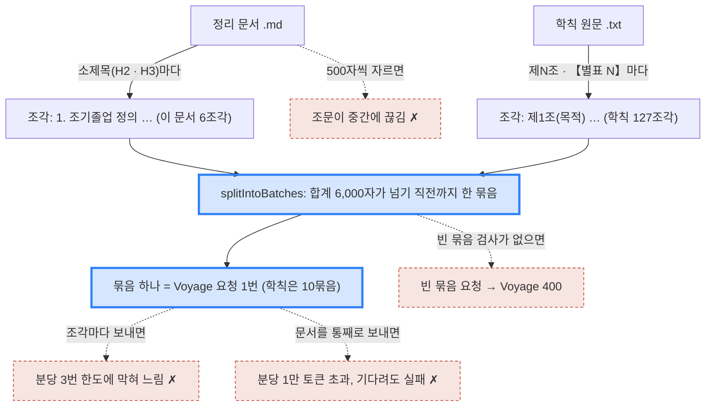

> **2026-11-27 목차**
>
> **[ONE Student](#one-student)**
> 1. [문서는 소제목과 조 단위로 자른다](#1-문서는-소제목과-조-단위로-자른다) — 뜻이 끊기는 곳에서 자름
> 2. [조각은 6,000자 직전까지 한 묶음으로 보낸다](#2-조각은-6000자-직전까지-한-묶음으로-보낸다) — 요청 수 · 토큰 한도 둘 다 피함

# ONE Student

> **규정 문서 반영 7단계**: 상황과 값 → 반영 시작 → 실행 → **문서 쪼개기 (이 날)** → 임베딩 받기 → 바꿔 넣기 → 성공 판정과 챗봇 반영
> **그림 한 장으로 복습**: 아래 그림만 보고 설명할 수 있으면 이 날은 끝. 막히는 칸만 아래 항목을 읽는다. 값이 움직이는 모습은 [단계별 재생 페이지](https://childrenaon.github.io/TIL/replay/regulation-reseed.html#step-4)에서 본다.



## 1. 문서는 소제목과 조 단위로 자른다

> **지도에서 위치**: [ONE Student 지도](../../projects/one-student.md) › 규정 문서 반영 › 문서 쪼개기 (`scripts/seedRegulations.js`)
> **한 줄 결론**: 정리 문서는 `##` · `###` 소제목마다, 학칙 원문은 "제N조"와 "【별표 N】"마다 자른다. 글의 뜻이 끊기는 곳에서 자르는 것이다.

정식 표현: 청킹(chunking) · 구조 기반 분할 · 결정론적(deterministic) 분할

### 어떻게 자르나

```js
// 기본형: 경계가 몇 번째 글자에 있는지 찾고, 경계부터 다음 경계 직전까지 자른다
const text = '머리말제1조 가나제2조 다라';
[...text.matchAll(/제\d+조/g)];   // [{ 0: '제1조', index: 3 }, { 0: '제2조', index: 9 }]
text.slice(0, 3);                 // '머리말'      첫 경계 앞 = 머리말 조각
text.slice(3, 9);                 // '제1조 가나'  경계 ~ 다음 경계 직전
```

| 문서 | 함수 | 경계 | 실측 (LF 기준) |
|---|---|---|---|
| 정리 문서 (`db/regulations/<분류>/*.md`) | `chunkCuratedMarkdown` | `##` · `###` 소제목 | 77개 → 1,194조각, 보통 500자쯤 |
| 학칙 원문 (`_source/*.txt`) | `chunkVerbatimText` | `제N조` · `【별표 N】` | 학칙 127 · 시행규칙 144 · 수업관리규정 22조각 |

- `# 제목` 줄은 조각에서 빼고 문서 제목으로만 씀
- 첫 경계 앞 글(머리말)도 조각 하나

### 다른 방법으로 자를 수도 있었다. 왜 이 방법인가?

| 방법 | 판단 |
|---|---|
| 글자 수로 자르기 (500자씩) | 조문이 중간에 끊김: "평균평점이" ✂ "4.3이상" |
| AI에게 자르게 하기 | 돌릴 때마다 결과가 다를 수 있고 비용 |
| 소제목 · 조 단위 (채택) | 문서에 있는 구조 그대로, 같은 파일이면 늘 같은 조각. 대신 길이가 들쭉날쭉 |

### 【별표 N】은 왜 따로 경계로 잡나?

- 없으면 부칙 마지막 조(시행일) 뒤에 붙은 별표 표 전체가 그 조 하나에 통째로 붙음 → 조각 하나가 수만 자

> [!WARNING]
> **제목 줄은 운영에서만 확실히 빠진다.** 제목을 지우는 정규식 `/^#\s+.+\n/`은 줄바꿈이 LF일 때만 맞음. 저장소 · 운영(Linux)은 LF라 빠지지만, Windows에서 체크아웃한 파일(CRLF)로 로컬 시드를 돌리면 첫 조각에 `# 조기졸업`이 남음.

이전 기록: [2026-11-24 재시딩 19단계는 순서로만 묶여 있다](../../2026/November/11-24.md#2-재시딩-19단계는-순서로만-묶여-있다)

## 2. 조각은 6,000자 직전까지 한 묶음으로 보낸다

> **지도에서 위치**: [ONE Student 지도](../../projects/one-student.md) › 규정 문서 반영 › 문서 쪼개기 (`splitIntoBatches`)
> **한 줄 결론**: 묶음 하나의 최대를 6,000자로 정하고, 다음 조각을 넣으면 넘는 순간 지금 묶음을 닫는다. 묶음 하나가 Voyage 요청 한 번이다.

정식 표현: 배치 처리(batch processing) · 레이트 리밋(rate limit, RPM · TPM) · 가드 조건(guard)

### 어떻게 묶나

```js
// server/scripts/seedRegulations.js
for (const chunk of chunks) {
  // 지금 묶음에 조각이 있고, 이 조각을 넣으면 6,000자를 넘는다 → 지금 묶음을 닫고 새로 시작
  if (current.length > 0 && currentLen + chunk.length > MAX_CHARS_PER_BATCH) { batches.push(current); current = []; currentLen = 0; }
  current.push(chunk);
  currentLen += chunk.length;
}
// 실측: 조기졸업 6조각 753자 → 1묶음 / 학칙 127조각 → 10묶음
```

### 왜 묶나? 잘게 보내거나 통째로 보내면?

Voyage 무료 한도 두 가지 때문.

| 방법 | 걸리는 한도 | 결과 |
|---|---|---|
| 조각마다 요청 1번 | 분당 요청 3번 (RPM) | 1분에 3개씩만 → 느림 |
| 문서 통째로 요청 1번 | 분당 토큰 1만 개 (TPM) | 요청 하나가 이미 한도 초과 → 기다려도 영원히 실패 |
| 6,000자씩 묶기 (채택) | 둘 다 피함 | 한글은 토큰 하나에 대략 1.5~2자라 6,000자면 1만 토큰 아래 |

- 레이트 리밋 = 일정 시간 동안 허용하는 양. 요청 수(RPM)도 토큰 수(TPM)도 레이트 리밋
- RPM은 요청이 걸린 시간이 아니라 1분 동안 보낸 **횟수**를 셈. 0.1초 만에 끝난 요청도 1번

### `current.length > 0`은 왜 있나?

```js
// 조건이 있을 때 (지금): 첫 조각이 16,892자면
//   묶음이 비어 있음 → 조건 false → 그냥 담음       → [[16,892], [다음 조각…]]
// 조건이 없었다면: 0 + 16,892 > 6,000 → 비어 있는 묶음을 닫아 버림 → [[], [16,892], …]
```

- 큰 조각은 둘 다 혼자 한 묶음으로 처리됨. 조건이 막는 건 **빈 묶음 `[]`**
- 빈 입력은 Voyage가 400으로 거절함(11-27 실제로 1번 보내 확인). 400은 재시도 안 함 → 그 문서 재시딩 실패
- 빈 묶음이 생기는 건 문서의 **첫 조각**이 6,000자를 넘을 때뿐

> [!WARNING]
> **6,000자보다 큰 조각은 쪼개지 않고 혼자 보낸다.** 학칙에 7,237 · 9,619 · 16,892자 조각이 있다. 16,892자가 1만 토큰을 넘는지는 아직 확인 안 함(추정 약 8,400~11,300토큰). 넘으면 그 요청은 기다려도 실패.

### 면접에서 설명한다면

임베딩 서비스의 무료 한도가 분당 요청 3번, 분당 토큰 1만 개라서 조각을 6,000자씩 묶어 보냅니다. 조각마다 보내면 요청 한도에 막혀 느리고, 문서를 통째로 보내면 요청 하나가 토큰 한도를 넘어 아무리 기다려도 성공하지 못하기 때문입니다. 빈 묶음은 서비스가 오류로 거절해서 만들지 않게 막았습니다.

이전 기록: [2026-11-27 문서는 소제목과 조 단위로 자른다](#1-문서는-소제목과-조-단위로-자른다)
