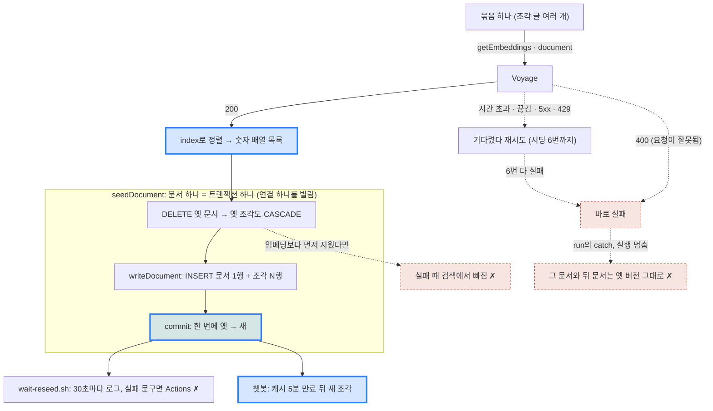

> **2026-11-28 목차**
>
> **[ONE Student](#one-student)**
> 1. [임베딩 실패는 종류에 따라 재시도하거나 바로 멈춘다](#1-임베딩-실패는-종류에-따라-재시도하거나-바로-멈춘다) — 기다리면 풀리는 것만 재시도
> 2. [임베딩을 다 받은 뒤 한 트랜잭션으로 바꿔 넣는다](#2-임베딩을-다-받은-뒤-한-트랜잭션으로-바꿔-넣는다) — 실패해도 옛 문서가 남음
> 3. [성공은 로그로 판정하고 챗봇은 5분 안에 반영된다](#3-성공은-로그로-판정하고-챗봇은-5분-안에-반영된다) — 로그를 끝까지 읽고, 캐시는 5분
> 4. [규정 문서 반영 한 바퀴 정리](#4-규정-문서-반영-한-바퀴-정리) — 1분 설명 · 면접 질문 · 이름 표

# ONE Student

> **규정 문서 반영 7단계**: 상황과 값 → 반영 시작 → 실행 → 문서 쪼개기 → **임베딩 받기 → 바꿔 넣기 → 성공 판정과 챗봇 반영 (이 날)**
> **그림 한 장으로 복습**: 아래 그림만 보고 설명할 수 있으면 이 날은 끝. 막히는 칸만 아래 항목을 읽는다. 값이 움직이는 모습은 [단계별 재생 페이지](https://childrenaon.github.io/TIL/replay/regulation-reseed.html#step-5)에서 본다.



## 1. 임베딩 실패는 종류에 따라 재시도하거나 바로 멈춘다

> **지도에서 위치**: [ONE Student 지도](../../projects/one-student.md) › 규정 문서 반영 › 임베딩 받기 (`services/embeddingClient.js`)
> **한 줄 결론**: 묶음마다 Voyage에 보내 숫자 배열을 받는다. 기다리면 풀리는 실패(시간 초과 · 5xx · 429)만 재시도하고, 요청이 틀린 400은 바로 멈춘다.

정식 표현: 재시도(retry) · 백오프(backoff) · 비대칭 임베딩(`document` / `query`)

### 받는 값

```js
// 보내는 것 (묶음 하나)
{ model: 'voyage-3-lite', input: ['### 1. 조기졸업 정의 …', '### 2. 신청 성적기준 …'], input_type: 'document' }
// 받는 것 (모양만, 예시)
{ data: [{ index: 1, embedding: [0.012, …] }, { index: 0, embedding: [0.008, …] }] }

// getEmbeddings 마지막 줄: index 오름차순으로 정렬하고 embedding만 꺼냄 → 보낸 조각 순서와 같게
data.data.sort((a, b) => a.index - b.index).map((d) => d.embedding);  // → [[0.008, …], [0.012, …]]
//   앞 data = 응답 JSON 전체, .data = 그 안의 결과 목록
//   sort: a - b가 음수면 a를 앞에 → 오름차순 / map: 원소마다 바꾼 값으로 새 배열
```

- `getEmbeddings` = get + Embeddings(여러 개). Voyage 요청 → 결과를 보낸 순서로 정리해 돌려줌

### 시딩과 챗봇이 왜 같이 나오나?

`embeddingClient.js`는 Voyage를 부르는 **공용 도구**. 부르는 곳마다 설정이 다름.

| 부르는 곳 | 보내는 것 | 타입 | 재시도 |
|---|---|---|---|
| 시딩 (`seedRegulations.js`) | 규정 조각 묶음 | `document` | 6번 · 한 번에 60초 |
| 챗봇 (`routes/chat.js`) | 학생 질문 1개 | `query` | 2번 · 20초 (학생이 기다림) |

- 문서의 숫자 배열은 시딩 때 DB에 저장해 둠. 챗봇은 질문만 임베딩해서 저장된 배열과 비교(코사인)
- 질문의 숫자 배열은 저장 안 함. 질문 글은 대화 기록에 저장됨

### 어떤 실패를 재시도하나?

| 실패 | 시딩 | 챗봇 |
|---|---|---|
| 시간 초과 · 연결 끊김 · 5xx | 재시도 (5초 → 10초 → 15초) | 바로 실패 |
| 429 (분당 한도) | 재시도 (`Retry-After`, 없으면 21초) | 재시도 |
| 400 등 (요청이 잘못됨) | 바로 실패 | 바로 실패 |

- 429 · 5xx · 시간 초과 = Voyage 쪽 사정, 기다리면 풀릴 수 있음
- 400 = 우리 코드가 만든 요청이 틀림(빈 입력 등) → 그대로 다시 보내도 또 400

> [!WARNING]
> **"계속" 재시도하지 않는다.** 시딩도 6번까지. 다 실패하면 오류를 던짐 → `run()`의 catch가 "규정 시딩 실패"를 찍고 실행 종료 → 그 문서와 뒤 문서는 옛 버전으로 남음(앞 문서는 이미 새 버전, 버전이 섞일 수 있음).

이전 기록: [2026-11-27 조각은 6,000자 직전까지 한 묶음으로 보낸다](../../2026/November/11-27.md#2-조각은-6000자-직전까지-한-묶음으로-보낸다)

## 2. 임베딩을 다 받은 뒤 한 트랜잭션으로 바꿔 넣는다

> **지도에서 위치**: [ONE Student 지도](../../projects/one-student.md) › 규정 문서 반영 › 바꿔 넣기 (`seedDocument` · `writeDocument`)
> **한 줄 결론**: 임베딩을 받는 동안은 DB를 안 건드리고, 다 받은 뒤 문서마다 한 트랜잭션으로 옛 문서 삭제와 새 문서 저장을 한 번에 한다. 실패하면 옛 문서가 그대로 남는다.

정식 표현: 원자성(atomicity, all or nothing) · 격리성(isolation) · ON DELETE CASCADE

### 두 함수가 맡는 일 (같은 파일 `seedRegulations.js`)

```js
seedDocument(문서)        // 관리자: 건너뛸지 판단 → 임베딩 받기 → 연결 빌림 → 트랜잭션 → 옛 문서 DELETE
                          //        → writeDocument 호출 → commit / 실패하면 rollback / 끝나면 연결 반납
writeDocument(conn, …)    // 쓰는 손: 받은 연결로 INSERT만 (문서 1행 → insertId로 조각 N행)
```

- 옛 문서 1행만 지우면 조각들은 `ON DELETE CASCADE`로 같이 지워짐
- commit · rollback · 연결 반납은 전부 `seedDocument`가 함

### 왜 `pool.query`가 아니라 연결 하나를 빌리나?

```js
// pool.query: 한 줄씩 바로 확정
await pool.query('DELETE … 옛 B');   // 끝나는 순간 확정 → 챗봇에서 B가 사라짐
await pool.query('INSERT … 새 B');   // 실패하면 위 DELETE를 되돌릴 수 없음 → B 없음

// getConnection + 트랜잭션: commit 전까지 보류
await conn.beginTransaction();       // 트랜잭션은 연결 하나에 붙는 상태
await conn.query('DELETE … 옛 B');   // 보류 (챗봇은 여전히 옛 B를 봄)
await conn.query('INSERT … 새 B');   // 실패하면 rollback → DELETE도 취소
```

### 순서를 바꾸면 무슨 일이 생기나?

| 다른 순서 | 실패하면 |
|---|---|
| 문서 행을 먼저 넣고 임베딩 | 조각 없는 빈 문서만 남음 → 다음 실행 때 "이미 있음"으로 건너뜀 → 영영 다시 안 넣어짐 |
| 옛 문서를 먼저 지우고 임베딩 | 문서 · 조각이 다 지워진 채 → 검색에서 빠짐 → 챗봇이 근거 조각을 못 찾음 |
| 임베딩 전부 → 삭제 · 저장을 한 트랜잭션 (채택) | 어디서 실패해도 옛 문서가 그대로 |

- 격리성 덕분에 학생은 commit 전엔 옛 B, 후엔 새 B만 봄. "옛 B는 지워졌는데 새 B는 아직" 같은 중간 상태는 안 보임
- 원자성은 **문서 단위**로 지킴. 실행 전체 단위는 아님(뒤 문서가 옛 버전으로 남을 수 있음)

> [!WARNING]
> **`--force` 없이 돌리면 고친 규정이 반영되지 않는다.** 이미 있는 문서는 내용이 바뀌었어도 `[SKIP]`으로 건너뜀. 운영 재시딩은 `--force`.

### 면접에서 설명한다면

규정 문서를 다시 넣을 때 임베딩을 먼저 전부 받고, 그다음 문서마다 한 트랜잭션으로 옛 문서 삭제와 새 문서 저장을 합니다. 옛 문서를 먼저 지우면 임베딩이 실패했을 때 그 문서가 검색에서 빠지기 때문입니다. 커밋 전 변경은 다른 연결에 보이지 않아서, 재시딩 중에도 챗봇은 옛 문서로 답합니다.

관련: [ONE-Student-WKU/web#465](https://github.com/ONE-Student-WKU/web/issues/465)

## 3. 성공은 로그로 판정하고 챗봇은 5분 안에 반영된다

> **지도에서 위치**: [ONE Student 지도](../../projects/one-student.md) › 규정 문서 반영 › 성공 판정과 챗봇 반영 (`scripts/ci/wait-reseed.sh` · `services/regulationService.js`)
> **한 줄 결론**: Actions는 재시딩이 끝날 때까지 30초마다 로그를 다시 읽어 성공 · 실패를 정한다. 챗봇은 조각을 5분 동안 메모리에 두므로, commit 뒤 최대 5분 안에 새 조각을 쓴다.

정식 표현: 폴링(polling) · 캐시 TTL(Time To Live) · 캐시 무효화(invalidation)

### Actions는 어떻게 판정하나

```bash
# scripts/ci/wait-reseed.sh (줄여 씀) ← db-reseed.yml이 마지막에 실행
반복: railway logs로 그 순간까지의 로그를 받음
      "실패:" 또는 "npm error"가 있으면 → exit 1 (Actions ✗)
      마지막 19단계 완료 문구가 있으면 → 4번 더 확인 후 exit 0
      55분이 지나도 둘 다 없으면 → exit 1
      30초 기다림
```

- 반복하는 이유: 읽는 시점에 재시딩이 아직 도는 중이라 결과 문구가 없음 → 끝날 때까지 기다리며 다시 읽음
- 실제로 있었던 일: 예전엔 로그를 한 번만 받아 늘 성공 → 개설과목 단계 실패로 규정 반영이 멈춘 게 세 번 연속 가려짐([#376](https://github.com/ONE-Student-WKU/web/issues/376), [#378](https://github.com/ONE-Student-WKU/web/issues/378))

### 챗봇에는 언제 반영되나

```js
// server/services/regulationService.js
const CHUNK_CACHE_TTL_MS = 5 * 60 * 1000;   // 5분
if (chunkCache.rows && Date.now() < chunkCache.expiresAt) return chunkCache.rows;  // 5분 안이면 DB 안 감
// 만료됐으면 DB에서 조각 전체를 다시 읽고 5분 뒤 만료로 저장
```

```text
10:00  질문 → DB에서 읽어 캐시 채움 (옛 조각, 10:05 만료)        ← 시각은 예시
10:03  재시딩 commit → DB에는 새 조각
10:03~05  캐시의 옛 조각으로 답함                                ← 늦는 구간
10:05  만료 → 다음 질문부터 DB를 다시 읽어 새 조각
```

- 최악: 캐시가 commit 직전에 채워져도 5분이면 무조건 버려짐 → commit부터 **최대 5분**
- 캐시를 두는 이유: 질문마다 조각 전체(수천 행)를 DB에서 읽지 않으려고

### 끝 신호를 받으면 안 되나?

재시딩(Cron Job 프로세스)과 챗봇(웹 서버 프로세스)은 메모리를 같이 쓰지 않음 → 알리려면 통로가 필요.

| 방법 | 드는 것 |
|---|---|
| TTL 5분 (지금) | 없음. 대신 최대 5분 늦음 |
| 재시딩 끝에 서버의 "캐시 비우기" 주소 호출 | 인증, 서버가 여러 대면 전부 불러야 함 |
| DB에 "규정 갱신 시각" 한 칸, 질문마다 그것만 확인 | 질문마다 가벼운 조회 1번 |

- 고르지 않은 이유는 기록에 없음. 추정: 재시딩은 가끔이고 5분 늦어도 손해가 작아 가장 단순한 TTL
- 더 빨리 반영하려면 세 번째(DB 버전 칸)가 무난

> [!WARNING]
> **판정이 로그 문구에 기대고 있다.** 시딩 스크립트의 완료 · 실패 문구를 바꾸면 Actions 판정이 조용히 틀어질 수 있음.

## 4. 규정 문서 반영 한 바퀴 정리

> **지도에서 위치**: [ONE Student 지도](../../projects/one-student.md) › 규정 문서 반영
> **한 줄 결론**: 규정 문서가 main에 들어가면 재시딩 실행이 생기고, 승인해야 돈다. Railway가 문서를 소제목 · 조 단위로 잘라 6,000자씩 묶어 Voyage에서 임베딩을 받고, 다 받은 뒤에야 문서마다 한 트랜잭션으로 옛 문서를 새 문서로 바꾼다. Actions가 로그를 끝까지 읽어 성공 · 실패를 판정하고, 챗봇은 캐시가 만료되는 5분 안에 새 조각을 쓴다.

### 1분 설명 네 마디

```text
① 요청과 승인    main push + 규정 경로 → 실행 생김 → db-reseed 승인 (PR 리뷰 승인과 다름)
② 쪼개서 임베딩   소제목 · 조 단위로 자름 → 6,000자씩 묶어 Voyage에서 숫자 배열
③ 한 번에 교체    임베딩을 다 받은 뒤 → 문서마다 한 트랜잭션으로 삭제 · 저장
④ 판정과 반영    Actions가 로그를 끝까지 읽어 판정 → 챗봇은 5분 안에 새 조각
```

### 면접 질문 네 개

| 질문 | 답의 뼈대 |
|---|---|
| 규정 문서 반영을 왜 코드 배포와 따로, 승인을 거치게 만들었나요? | 문서를 고쳐도 DB 조각이 그대로면 옛 규정으로 답함. 전체를 다시 임베딩해 비용이 들고 실수 문서도 바로 나가니 **승인**을 둠 |
| 임베딩을 왜 DB 작업보다 먼저 받나요? | 옛 문서를 먼저 지우면 실패 때 검색에서 빠짐 → **다 받은 뒤 한 트랜잭션**으로 바꿈 |
| 재시딩 중 Voyage가 계속 실패하면? | 일시적 오류는 6번까지 재시도, 끝내 실패하면 멈춤 → **그 문서와 뒤 문서는 옛 버전**으로 남고 Actions에 실패 |
| 실제로 문제가 된 적 있나요? | 로그를 한 번만 읽어 늘 성공 → 개설과목 실패로 **규정 반영이 실제로 멈춰 있었는데** 몰랐음 → 끝까지 반복해서 읽게 고침 |

- 말하는 순서: 문제 → 결과 → 고친 방법

### 이름 표 (질문 → 무엇으로 막았나)

| 질문 | 무엇으로 막았나 |
|---|---|
| 실수로 올린 문서가 바로 운영에 나가면? | `db-reseed` 환경 승인 |
| 경로를 빠뜨려 재시딩이 안 돌면? | DB Reseed Guard (PR마다 경고) |
| 승인한 커밋이 아니라 옛 빌드가 돌면? | `railway up` (`redeploy`를 버림) |
| 조문이 중간에 끊기면? | `chunkCuratedMarkdown` · `chunkVerbatimText` |
| 한 요청이 한도를 넘으면? | `splitIntoBatches` 6,000자 + 429 재시도 |
| 빈 묶음이 생기면? | `current.length > 0` |
| 임베딩이 실패해 문서가 검색에서 빠지면? | 임베딩 먼저 → 한 트랜잭션 (`seedDocument`) |
| 실패가 success로 가려지면? | `wait-reseed.sh` (로그를 끝까지 반복해서 읽음) |
| 챗봇에는 언제 반영되나? | `CHUNK_CACHE_TTL_MS` 5분 |

이전 기록: [2026-11-23 규정 문서는 검색할 조각과 숫자 배열로 DB에 남는다](../../2026/November/11-23.md#1-규정-문서는-검색할-조각과-숫자-배열로-db에-남는다)
