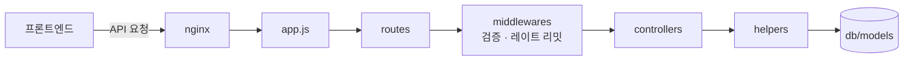

# 익산 스토어 지도

> **한 줄 소개**: 장바구니 · 주문 · 선물 · 리뷰를 갖춘 커머스 서비스의 팀 프로젝트. 이 지도는 **백엔드(BE)** 중심으로 시작한다.
> **이 페이지의 쓰임**: `# 익산 스토어` 대제목의 기록을 읽다가 "이게 구조의 어디쯤이지?" 싶을 때 돌아오는 곳. 공부하며 확인한 것만 채우고, 모르는 칸은 "아직"으로 둔다.

## 큰 구조

폴더 이름으로 본 **초안**이다. 요청 하나를 따라가 보며 확인하는 대로 고친다.

## 영역 표

영역은 `docs/BE/`의 설계 문서 이름에서 뽑은 **후보**다. 직접 맡은 비중이 큰 순서로 다시 정한다.

| 영역 | 위치 | 하는 일 | 공부 상태 | 관련 기록 |
|---|---|---|---|---|
| 데이터 설계 | `db/ERD.md`, `db/models` | 테이블 구조 | 아직 | – |
| 인증 · 세션 무효화 | `docs/BE/SESSION_INVALIDATION.md` | 로그인 세션 관리 | 아직 | – |
| 장바구니 · 주문 그룹 | `docs/BE/CART_ORDER_GROUPS.md` 외 | 장바구니 검증, 주문 묶음 | 아직 | – |
| 리뷰 · 신고 · 제재 | `docs/BE/REVIEWS.md`, `validators` | 후기, 신고, 제재 처리 | 아직 | – |
| 선물 알림 | `docs/BE/GIFT_NOTIFICATIONS.md` | 선물 알림 전달 | 아직 | – |
| API 레이트 리밋 | `middlewares/apiRateLimits.js` | 요청 횟수 제한 | 아직 | – |
| 배포 · 인프라 | `infra/`, `deploy.sh`, `docker-compose.yml` | nginx, 배포, CI | 아직 | – |

## 용어

공부하며 나온 용어는 [용어집](../glossary.md)에 쌓는다.

## 최근 기록

아직 없음. `# 익산 스토어` 대제목에 항목이 올라오면 여기와 영역 표의 "관련 기록"에 링크한다.
