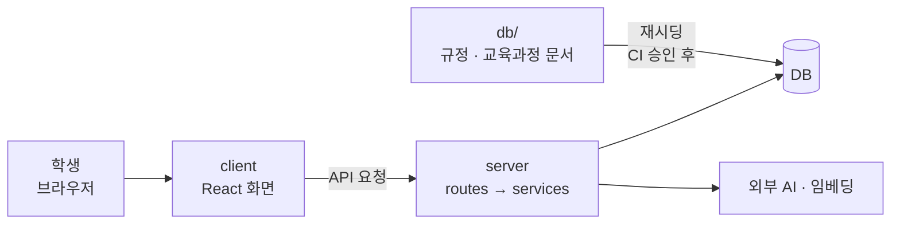

# ONE Student 지도

> **한 줄 소개**: 원광대 학생이 졸업요건 진단, AI 챗봇 상담, 진로 탐색을 한곳에서 쓰는 웹 서비스.
> **이 페이지의 쓰임**: `# ONE Student` 대제목의 기록을 읽다가 "이게 구조의 어디쯤이지?" 싶을 때 돌아오는 곳. 공부하며 확인한 것만 채우고, 모르는 칸은 "아직"으로 둔다.

## 큰 구조

공부 시작 전의 **초안**이다. 각 화살표는 코드를 따라가 보며 확인하는 대로 고친다.

## 영역 표

| 영역 | 위치 | 하는 일 | 공부 상태 | 관련 기록 |
|---|---|---|---|---|
| 요청 흐름 (공통 뼈대) | `app.js` → `routes` → `services` → `db.js` | 요청이 지나가는 길, 라우터 · 컨트롤러 · 서비스 역할, 연결 풀, server/ 폴더 구조, HTTP와 서비스 분리, 주소가 정해지는 방식, 미들웨어 | 뼈대 이해 (11-03), 주소 · 미들웨어 (11-06) | [1번](../2026/November/11-03.md#1-요청-하나가-지나가는-길), [2번](../2026/November/11-03.md#2-라우터-컨트롤러-서비스-구분), [3번](../2026/November/11-03.md#3-서비스와-연결-풀), [4번](../2026/November/11-03.md#4-server-폴더-구조와-흐름-매핑), [6번](../2026/November/11-03.md#6-http-정보와-서비스-분리), [11-06 1번](../2026/November/11-06.md#1-주소가-정해지는-방식), [11-06 2번](../2026/November/11-06.md#2-핸들러-전에-지나가는-미들웨어), [11-06 3번](../2026/November/11-06.md#3-로그인-확인을-거는-위치) |
| 로그인 · 약관 동의 | client 로그인 · 동의 화면, server 인증 라우트 | 로그인, 약관 버전 검사 | 아직 | – |
| 챗봇 | server 챗봇 라우트, AI 호출부 | 질문 → 관련 자료 검색 → 답변 | 아직 | – |
| 졸업요건 진단 | server 졸업 서비스, 규정 엔진 | 입력 → 판정 → 사유 코드 | `routes/graduation.js` 전체(라우터 만들기 · GET 조회 · 에러 처리 · POST 확인 · 내보내기) 이해, 서비스 내부(`getGraduationStatus` · `observe`)와 규정 엔진은 아직 (11-03, 11-05) | [5번](../2026/November/11-03.md#5-graduationjs-읽기), [11-05 1번](../2026/November/11-05.md#1-라우터-만들고-도구-가져오기), [11-05 2번](../2026/November/11-05.md#2-요청이-라우터를-지나는-순서), [11-05 3번](../2026/November/11-05.md#3-졸업-현황-조회-함수), [11-05 4번](../2026/November/11-05.md#4-응답-형식과-code-이름표), [11-05 5번](../2026/November/11-05.md#5-에러가-공통-처리기까지-가는-길), [11-05 6번](../2026/November/11-05.md#6-알림-확인-처리-함수) |
| 과목 검색 | `routes/courses.js` | 연도 · 학기 · 검색어로 개설 과목 찾기 | 라우터 전체 이해, 서비스는 아직 (11-06) | [11-06 4번](../2026/November/11-06.md#4-과목-검색-함수) |
| 기능 사용 횟수 | `routes/uiEvents.js` | 화면 · 버튼 사용 횟수의 합계 저장 | 라우터 전체 이해, 서비스는 아직 (11-06) | [11-06 5번](../2026/November/11-06.md#5-요청-횟수-제한), [11-06 6번](../2026/November/11-06.md#6-기능-사용-횟수-저장-함수) |
| 문의하기 | `routes/inquiries.js` | 문의 작성, 내 문의 보기 | 라우터 전체 이해, 서비스는 아직 (11-06) | [11-06 7번](../2026/November/11-06.md#7-문의-작성-함수), [11-06 8번](../2026/November/11-06.md#8-내-문의-보기-함수) |
| 메일 중계 | `routes/emailRelay.js` | 매칭된 학생끼리 실제 이메일을 숨기고 메일 전달 | 라우터 전체 이해, 서비스는 아직 (11-07) | – |
| 재시딩 · 배포 | `db/`, GitHub Actions 워크플로 | 규정 문서를 운영 DB에 반영 | 아직 | – |

## 공부 계획

2026-11-07부터 파일을 순서대로 읽지 않고, **기능 하나를 화면에서 DB까지 따라간다.** 기능별 실행 순서는 [기능별 실행 순서](one-student-flows.md)에 있다.

| 순서 | 기능 | 상태 |
|---|---|---|
| 준비 | 문법 4가지: `map`·`filter`, 구조분해, 스프레드, 템플릿 문자열 | **다음** |
| 1 | 이메일 코드 로그인 | 아직 |
| 2 | Google 로그인 | 아직 |
| 3 | 졸업 현황 진단 | 라우터만 봄 |
| 4 | 성적 PDF 가져오기 | 아직 |
| 5 | 챗봇 질문 → 답변 | 아직 |
| 6 | 규정 문서 반영 | 아직 |
| 7 | 매칭 → 메일 중계 | 라우터(`emailRelay`)만 봄 |

나머지 기능은 시간이 남을 때 흐름만 본다.

**기능 하나를 공부하는 순서**

1. **상황:** 한 문장으로 정한다.
2. **값:** 요청, 응답, DB 행을 예시 값으로 본다.
3. **길:** 화면 → 라우터 → 서비스 → DB의 핵심 줄만 따라간다.
4. **내 말로 설명:** 면접처럼 말해 보고 고칠 곳을 듣는다.
5. **이유:** 왜 이렇게 만들었는지, 어떤 함정이 있는지 본다.

**기준**

- 줄 해석은 처음 보는 문법이나 막힌 곳만 한다.
- 주석은 파일 설명, 함수 요약, 새로 배운 부분에만 단다.
- 규정 엔진 같은 깊은 부분은 입력, 출력, 나눈 이유까지만 먼저 본다.
- 코드 없이 말로 설명할 수 있으면 그 기능을 끝낸다.

## 라우터 순회 (중단)

파일 13개를 차례로 읽다가 2026-11-07에 멈췄다. 구조가 반복되어 줄 해석의 효과가 작다고 판단했다.

- 끝낸 파일: `graduation`, `courses`, `uiEvents`, `inquiries`, `emailRelay`
- 남은 파일: `community`, `admin`, `onboarding`, `career`, `me`, `myCourses`, `chat`, `auth` (기능을 따라가며 필요한 곳만 읽는다)

## 용어

공부하며 나온 용어는 [용어집](../glossary.md)에 쌓는다.

## 최근 기록

- 2026-11-03 [요청 하나가 지나가는 길](../2026/November/11-03.md#1-요청-하나가-지나가는-길)
- 2026-11-03 [라우터, 컨트롤러, 서비스 구분](../2026/November/11-03.md#2-라우터-컨트롤러-서비스-구분)
- 2026-11-03 [서비스와 연결 풀](../2026/November/11-03.md#3-서비스와-연결-풀)
- 2026-11-03 [server/ 폴더 구조와 흐름 매핑](../2026/November/11-03.md#4-server-폴더-구조와-흐름-매핑)
- 2026-11-03 [graduation.js 읽기](../2026/November/11-03.md#5-graduationjs-읽기)
- 2026-11-03 [HTTP 정보와 서비스 분리](../2026/November/11-03.md#6-http-정보와-서비스-분리)
- 2026-11-05 [라우터 만들고 도구 가져오기](../2026/November/11-05.md#1-라우터-만들고-도구-가져오기)
- 2026-11-05 [요청이 라우터를 지나는 순서](../2026/November/11-05.md#2-요청이-라우터를-지나는-순서)
- 2026-11-05 [졸업 현황 조회 함수](../2026/November/11-05.md#3-졸업-현황-조회-함수)
- 2026-11-05 [응답 형식과 code 이름표](../2026/November/11-05.md#4-응답-형식과-code-이름표)
- 2026-11-05 [에러가 공통 처리기까지 가는 길](../2026/November/11-05.md#5-에러가-공통-처리기까지-가는-길)
- 2026-11-05 [알림 확인 처리 함수](../2026/November/11-05.md#6-알림-확인-처리-함수)
- 2026-11-06 [주소가 정해지는 방식](../2026/November/11-06.md#1-주소가-정해지는-방식)
- 2026-11-06 [핸들러 전에 지나가는 미들웨어](../2026/November/11-06.md#2-핸들러-전에-지나가는-미들웨어)
- 2026-11-06 [로그인 확인을 거는 위치](../2026/November/11-06.md#3-로그인-확인을-거는-위치)
- 2026-11-06 [과목 검색 함수](../2026/November/11-06.md#4-과목-검색-함수)
- 2026-11-06 [요청 횟수 제한](../2026/November/11-06.md#5-요청-횟수-제한)
- 2026-11-06 [기능 사용 횟수 저장 함수](../2026/November/11-06.md#6-기능-사용-횟수-저장-함수)
- 2026-11-06 [문의 작성 함수](../2026/November/11-06.md#7-문의-작성-함수)
- 2026-11-06 [내 문의 보기 함수](../2026/November/11-06.md#8-내-문의-보기-함수)

`# ONE Student` 대제목에 항목이 올라오면 여기와 영역 표의 "관련 기록"에 링크한다.
