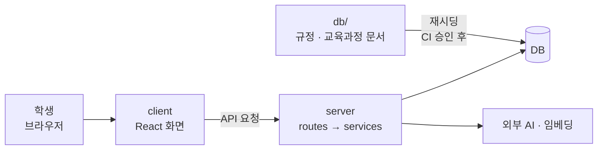

# ONE Student 지도

> **한 줄 소개**: 원광대 학생이 졸업요건 진단, AI 챗봇 상담, 진로 탐색을 한곳에서 쓰는 웹 서비스.
> **이 페이지의 쓰임**: `# ONE Student` 대제목의 기록을 읽다가 "이게 구조의 어디쯤이지?" 싶을 때 돌아오는 곳. 공부하며 확인한 것만 채우고, 모르는 칸은 "아직"으로 둔다.

## 큰 구조

공부 시작 전의 **초안**이다. 각 화살표는 코드를 따라가 보며 확인하는 대로 고친다.

## 영역 표

| 영역 | 위치 | 하는 일 | 공부 상태 | 관련 기록 |
|---|---|---|---|---|
| 요청 흐름 (공통 뼈대) | `app.js` → `routes` → `services` → `db.js` | 요청이 지나가는 길, 라우터 · 컨트롤러 · 서비스 역할, 연결 풀, server/ 폴더 구조, HTTP와 서비스 분리, 주소가 정해지는 방식, 미들웨어 | 뼈대 이해 (11-03), 주소 · 미들웨어 (11-06) | [1번](../2026/November/11-03.md#1-요청-하나가-지나가는-길), [2번](../2026/November/11-03.md#2-라우터-컨트롤러-서비스-구분), [3번](../2026/November/11-03.md#3-서비스와-연결-풀), [4번](../2026/November/11-03.md#4-server-폴더-구조와-흐름-매핑), [6번](../2026/November/11-03.md#6-http-정보와-서비스-분리), [11-06 1번](../2026/November/11-06.md#1-주소가-정해지는-방식), [11-06 2번](../2026/November/11-06.md#2-핸들러-전에-지나가는-미들웨어), [11-06 3번](../2026/November/11-06.md#3-로그인-확인을-거는-위치) |
| 로그인 · 약관 동의 | client 로그인 · 동의 화면, server 인증 라우트 | 로그인, 약관 버전 검사 | 이메일 코드 로그인 끝: 성공 경로(11-10), 안전장치 · 실패 처리 · 화면(`Login.jsx` 타이머 · 에러 문구)과 마무리(11-11). Google 로그인 끝: 리다이렉트 · state · code 교환 · OIDC · 계정 연결 · 재인증(11-12) | [11-10 1번](../2026/November/11-10.md#1-이메일-코드-로그인은-요청-두-번으로-끝난다), [2번](../2026/November/11-10.md#2-코드는-해시로-저장하고-발송이-실패하면-지운다), [3번](../2026/November/11-10.md#3-코드-검증과-사용-완료), [4번](../2026/November/11-10.md#4-쿠키는-세션-id를-담는-그릇이다), [5번](../2026/November/11-10.md#5-세션은-앱-메모리가-아니라-db에-둔다), [6번](../2026/November/11-10.md#6-로그인-성공-때-세션-id를-새로-발급한다), [7번](../2026/November/11-10.md#7-이메일로-계정을-찾고-없으면-가입시킨다), [11-11 1번](../2026/November/11-11.md#1-시도-횟수는-비교-전에-조건부-update로-차지한다), [2번](../2026/November/11-11.md#2-같은-코드를-동시에-두-번-보내도-한-번만-성공한다), [3번](../2026/November/11-11.md#3-해시-비교는-timingsafeequal로-하고-길이를-먼저-본다), [4번](../2026/November/11-11.md#4-요청-제한은-ip가-아니라-이메일로-센다), [5번](../2026/November/11-11.md#5-하루-한도는-사용-안-된-코드만-센다), [6번](../2026/November/11-11.md#6-db에서는-시각이-아니라-남은-초만-받는다), [7번](../2026/November/11-11.md#7-메일-발송이-실패하면-코드를-지우고-503으로-알린다), [8번](../2026/November/11-11.md#8-서버-응답이-화면의-문구와-타이머로-바뀐다), [9번](../2026/November/11-11.md#9-이메일-코드-로그인-마무리), [11-12 1번](../2026/November/11-12.md#1-google-로그인은-리다이렉트로-google에-다녀온다), [2번](../2026/November/11-12.md#2-state로-시작한-브라우저와-돌아온-브라우저를-맞춰-본다), [3번](../2026/November/11-12.md#3-code는-앞길로-받고-토큰은-뒷길로-받는다), [4번](../2026/November/11-12.md#4-oauth는-인가이고-oidc는-그-위에-인증을-얹는다), [5번](../2026/November/11-12.md#5-예상한-실패는-직접-응답하고-예상-못-한-에러는-넘긴다), [6번](../2026/November/11-12.md#6-google-로그인-마무리) |
| 챗봇 | server 챗봇 라우트, AI 호출부 | 질문 → 관련 자료 검색 → 답변 | 아직 | – |
| 졸업요건 진단 | server 졸업 서비스, 규정 엔진 | 입력 → 판정 → 사유 코드 | `routes/graduation.js` 전체 이해(11-03, 11-05). 새 방식(A)으로 상황과 값 · 학생 확인 · 요건표 받기(규정 엔진 입력 · 출력 · 분리 이유)까지(11-17), 내 과목 정리(빼기 · 다시 분류 · 보정 후 합산) · 학점 비교(11-18), 다른 요건 · 신뢰도 붙여 응답으로 A 한 바퀴 끝, B 3곳(신뢰도 도출 · 재수강 이전 기록 빼기 · 입력 해시)(11-19) | [5번](../2026/November/11-03.md#5-graduationjs-읽기), [11-05 1번](../2026/November/11-05.md#1-라우터-만들고-도구-가져오기), [11-05 2번](../2026/November/11-05.md#2-요청이-라우터를-지나는-순서), [11-05 3번](../2026/November/11-05.md#3-졸업-현황-조회-함수), [11-05 4번](../2026/November/11-05.md#4-응답-형식과-code-이름표), [11-05 5번](../2026/November/11-05.md#5-에러가-공통-처리기까지-가는-길), [11-05 6번](../2026/November/11-05.md#6-알림-확인-처리-함수), [11-17 1번](../2026/November/11-17.md#1-응답은-숫자와-그-숫자를-믿어도-되는지를-같이-준다), [2번](../2026/November/11-17.md#2-학생이-고칠-문제는-막고-우리-쪽-문제는-딱지를-붙인다), [3번](../2026/November/11-17.md#3-엔진은-기준표를-만들고-서비스는-채점한다), [11-18 1번](../2026/November/11-18.md#1-인정-학점은-원본에-덮어쓰지-않고-매번-다시-센다), [2번](../2026/November/11-18.md#2-재수강-이전-기록과-f는-가져오지-않는다), [3번](../2026/November/11-18.md#3-학기-번호를-학사력-시간순으로-다시-매겼다), [4번](../2026/November/11-18.md#4-과목마다-어디로-셀지-학적에-따라-다시-정한다), [5번](../2026/November/11-18.md#5-수강한-학년도-기준으로-학점을-옮긴다), [6번](../2026/November/11-18.md#6-요건까지만-인정하고-넘친-학점은-자유선택으로-보낸다), [11-19 1번](../2026/November/11-19.md#1-졸업논문--졸업인증제는-과목-이름으로-판정한다), [2번](../2026/November/11-19.md#2-교양은-학점-합계-말고-영역까지-본다), [3번](../2026/November/11-19.md#3-확신-정도에-따라-판정--추정--안내로-나눈다), [4번](../2026/November/11-19.md#4-신뢰도는-손으로-쓰지-않고-사유-코드에서-정한다), [5번](../2026/November/11-19.md#5-재수강-이전-기록은-판정할-때만-뺀다), [6번](../2026/November/11-19.md#6-입력-해시로-학생이-바꾼-것과-학교가-바꾼-것을-가른다), [7번](../2026/November/11-19.md#7-졸업-현황-진단-한-바퀴-정리) |
| 성적 PDF 가져오기 | `routes/myCourses.js`(import), `services/pdfImportService.js` | 성적 PDF → 과목 미리보기 → 학생이 확정하면 저장 | 새 방식(A)으로 상황과 값 · 문 앞 검사 · 글자 꺼내기와 문서 판별까지(11-20) | [11-20 1번](../2026/November/11-20.md#1-분석과-확정을-나눠-학생이-본-값만-저장한다), [2번](../2026/November/11-20.md#2-횟수를-먼저-세고-파일은-그다음에-받는다), [3번](../2026/November/11-20.md#3-pdf는-형식이나-확장자-하나만-맞으면-받는다), [4번](../2026/November/11-20.md#4-해석기는-finally에서-닫고-나머지는-gc가-회수한다), [5번](../2026/November/11-20.md#5-한글이-한-글자도-없으면-붙여넣기로-안내한다), [6번](../2026/November/11-20.md#6-제목이-전체성적조회가-아니면-이수과목확인리스트로-본다) |
| 과목 검색 | `routes/courses.js` | 연도 · 학기 · 검색어로 개설 과목 찾기 | 라우터 전체 이해, 서비스는 아직 (11-06) | [11-06 4번](../2026/November/11-06.md#4-과목-검색-함수) |
| 기능 사용 횟수 | `routes/uiEvents.js` | 화면 · 버튼 사용 횟수의 합계 저장 | 라우터 전체 이해, 서비스는 아직 (11-06) | [11-06 5번](../2026/November/11-06.md#5-요청-횟수-제한), [11-06 6번](../2026/November/11-06.md#6-기능-사용-횟수-저장-함수) |
| 문의하기 | `routes/inquiries.js` | 문의 작성, 내 문의 보기 | 라우터 전체 이해, 서비스는 아직 (11-06) | [11-06 7번](../2026/November/11-06.md#7-문의-작성-함수), [11-06 8번](../2026/November/11-06.md#8-내-문의-보기-함수) |
| 메일 중계 | `routes/emailRelay.js` | 매칭된 학생끼리 실제 이메일을 숨기고 메일 전달 | 라우터 전체 이해, 서비스는 아직 (11-07) | [11-07 1번](../2026/November/11-07.md#1-웹훅-요청과-서명-확인), [11-07 2번](../2026/November/11-07.md#2-메일-중계-함수) |
| 재시딩 · 배포 | `db/`, GitHub Actions 워크플로 | 규정 문서를 운영 DB에 반영 | 아직 | – |

## 공부 계획

2026-11-07부터 파일을 순서대로 읽지 않고, **기능 하나를 화면에서 DB까지 따라간다.** 기능별 실행 순서는 [기능별 실행 순서](one-student-flows.md)에 있다.

2026-11-16부터는 공부를 두 층으로 나눈다. 이메일 로그인처럼 기능마다 줄 단위까지 끝까지 파면 지치고, 학칙 예외가 대부분인 졸업 진단에서는 그렇게 파도 남는 게 적기 때문이다.

- **A (모든 기능):** 배경 → 흐름(덩어리마다 입력 · 출력) → 결과, 그 자리에 나오는 CS 개념, 고를 수 있던 방법과 버린 이유.
- **B (골라서):** 기능마다 2~3곳만 줄 단위로 본다. fix 커밋이 있는 곳, 보안 · DB를 바꾸는 줄, 설계 판단이 들어간 곳이다.
- **순서:** 핵심 기능을 모두 A로 한 바퀴 먼저 돌고, B는 그 뒤에 채운다.
- **범위:** A와 B는 핵심 기능 4개(졸업 · PDF · 챗봇 · 규정 반영)에만 한다. 주요 · 보조 기능은 A를 한 줄로 설명할 수 있는 정도만 본다.
- **B 고르기:** 면접에서 그 기능에 대해 말할 문장 2~3개를 먼저 쓰고, 그 문장을 뒷받침하는 줄만 B로 본다.
- **기록:** 주석은 B 지점과 함수 요약에만 단다. TIL은 기능이 끝날 때 한 번, "문제 → 고른 방법 → 버린 방법" 형식으로 쓴다.
- **꼬리 질문:** 덩어리 범위 밖 질문은 "나중에 볼 질문"에 적고 넘어간다. 한 바퀴를 돈 뒤에 고른다.
- **점검:** 졸업 진단을 A로 한 바퀴 돈 뒤 확인한다. 로그인 때보다 덜 지쳤나? 왜 · 다른 방법 · 실패 · 핵심 줄 재현에 답하나? "재수강 F면 어디를 고치나"에서 고칠 곳을 찾아가나?
- **학적 세부:** 다전공 · 연계전공처럼 원광대 학칙에만 쓰이는 세부 규칙은 줄 단위로 보지 않고, 판정 · 추정 · 안내 중 어디에 드는지만 표 한 장으로 본다. 옮겨 가는 지식이 아니고 면접에서는 한 문장이면 충분하다(2026-11-19 결정).
- **점검 결과 (11-19):** 로그인 때보다 훨씬 덜 지쳤다. 1분 설명은 7단계를 다 외우기보다 "요건표 찾기 → 과목 정리 → 비교 → 신뢰도" 네 마디로 시작하고, 질문이 들어오는 곳만 내려간다.

| 순서 | 기능 | 상태 | 예상 (공부일) |
|---|---|---|---|
| 준비 | 문법 6가지: 구조분해, `map`, `filter`·`find`·`some`, 템플릿 문자열, `&&`·`||`·`??`로 값 고르기, 스프레드 | 끝냄 (11-07) | – |
| 1 | 이메일 코드 로그인 | 끝 (11-10 성공 경로, 11-11 안전장치 · 실패 처리 · 화면 · 마무리) | 실제 약 2일 (11-10, 11-11) |
| 2 | Google 로그인 | 끝 (11-12: 리다이렉트 → state와 CSRF → code를 토큰으로 바꾸기 → 계정 연결과 마무리, 네 덩어리로 나눠 봄) | 실제 약 1일 (11-12) |
| 3 | 졸업 현황 진단 | 끝 (A 7단계: 11-17 상황과 값 · 학생 확인 · 요건표 받기, 11-18 내 과목 정리 · 학점 비교, 11-19 다른 요건 · 신뢰도 붙여 응답 → 한 바퀴 점검. B 3곳: 신뢰도 도출 · 재수강 이전 기록 빼기 · 입력 해시) | 실제 약 3일 (11-17~11-19) |
| 4 | 성적 PDF 가져오기 | 진행 중 (A 7단계 중 11-20 상황과 값 · 문 앞 검사 · 글자 꺼내기와 문서 판별) | 2~3일 |
| 5 | 챗봇 질문 → 답변 | 아직 | 3~4일 |
| 6 | 규정 문서 반영 | 아직 | 2일 |
| 7 | 매칭 → 메일 중계 | 라우터(`emailRelay`)만 봄 | 1.5~2일 |

이후 주요 기능과 보조 기능까지 모두 본다(2026-11-16부터는 한 줄 설명 수준). 문법을 1개로 쳐서 총 19개이고, 하루 4시간 이상으로 하루 1개를 목표로 한다(2026-11-07 결정). 시간이 부족하면 보조 기능의 깊이를 줄인다.

**예상 기간 (2026-11-11 추정)**: 남은 기능의 실제 코드(핵심 파일 · 줄 수 · fix 커밋 · 새 개념)를 조사해 다시 잡았다. 공부일 하나는 3~4시간이다. 기능마다 A와 B를 끝까지 한다는 기준으로 잡은 값이라, A로 한 바퀴만 도는 2026-11-16 방식으로는 이보다 줄어든다(아직 다시 잡지 않았다).

- 하루 1개는 핵심 기능에서 지키기 어렵다. 이메일 코드 로그인(서버 약 250줄)이 이틀 걸렸고, 핵심 기능 4개(졸업 · PDF · 챗봇 · 규정 반영)를 합치면 그 20배 분량이다. 핵심 기능만 10~13일로 본다.
- 졸업 현황 진단은 서버 핵심만 약 1,900줄이고, 코드보다 학칙 예외가 장벽이다. 규정 엔진은 입력 · 출력 · 나눈 이유까지만 본다는 전제로 잡은 값이다.
- 챗봇은 뼈대(약 900줄)만 읽는 기준이다. 규정 문서 반영을 먼저 보면 임베딩을 이미 알고 들어가 하루쯤 줄어든다.
- 주요 · 보조 기능 11개(매칭 제외)는 합쳐 9~11일로 본다. 핵심 기능에서 트랜잭션 · AI 호출 · 정규식을 먼저 익히면 대부분 재사용이라 빨라진다.
  - 반나절: 약관 동의, 공지사항, 기능 사용 통계, 내 정보 수정 · 탈퇴
  - 1일: 온보딩, 내 수강 과목 관리, 문의하기, 과목 검색, 커뮤니티 글 작성, 신고 → 제재 → 이의 제기
  - 1.5일: 진로 탐색
- **남은 전체: 약 21~25일** (11-11 기준, Google 로그인 · 매칭 포함). 처음 목표 16일보다 길다.
- 순서 후보: 핵심 기능 안에서도 쉬운 것부터 보면 PDF → 규정 반영 → 챗봇 → 졸업이다. 새 도구를 쉬운 기능에서 먼저 익히는 대신, 면접에서 가장 많이 물을 졸업을 늦게 끝낸다. 아직 정하지 않았다.

**기능 하나를 공부하는 순서**

1. **상황:** 한 문장으로 정한다.
2. **값:** 요청, 응답, DB 행을 예시 값으로 본다.
3. **길:** 화면 → 라우터 → 서비스 → DB의 핵심 줄만 따라간다.
4. **내 말로 설명:** 면접처럼 말해 보고 고칠 곳을 듣는다.
5. **이유:** 왜 이렇게 만들었는지(고를 수 있던 방법과 버린 이유), 어떤 함정이 있는지 본다.

**기준**

- 줄 해석은 처음 보는 문법이나 막힌 곳만 한다.
- 줄 단위(B)는 기능마다 2~3곳만 고른다. 나머지 예외 처리는 "이런 게 있다"까지만 안다.
- 주석은 파일 설명, 함수 요약, 새로 배운 부분에만 단다.
- 규정 엔진 같은 깊은 부분은 입력, 출력, 나눈 이유까지만 먼저 본다.
- 코드 없이 말로 설명할 수 있으면 그 기능을 끝낸다.

## 라우터 순회 (중단)

파일 13개를 차례로 읽다가 2026-11-07에 멈췄다. 구조가 반복되어 줄 해석의 효과가 작다고 판단했다.

- 끝낸 파일: `graduation`, `courses`, `uiEvents`, `inquiries`, `emailRelay`
- 남은 파일: `community`, `admin`, `onboarding`, `career`, `me`, `myCourses`, `chat`, `auth` (기능을 따라가며 필요한 곳만 읽는다)

## 용어

공부하며 나온 용어는 [용어집](../glossary.md)에 쌓는다.

## 최근 기록

- 2026-11-03 [요청 하나가 지나가는 길](../2026/November/11-03.md#1-요청-하나가-지나가는-길)
- 2026-11-03 [라우터, 컨트롤러, 서비스 구분](../2026/November/11-03.md#2-라우터-컨트롤러-서비스-구분)
- 2026-11-03 [서비스와 연결 풀](../2026/November/11-03.md#3-서비스와-연결-풀)
- 2026-11-03 [server/ 폴더 구조와 흐름 매핑](../2026/November/11-03.md#4-server-폴더-구조와-흐름-매핑)
- 2026-11-03 [graduation.js 읽기](../2026/November/11-03.md#5-graduationjs-읽기)
- 2026-11-03 [HTTP 정보와 서비스 분리](../2026/November/11-03.md#6-http-정보와-서비스-분리)
- 2026-11-05 [라우터 만들고 도구 가져오기](../2026/November/11-05.md#1-라우터-만들고-도구-가져오기)
- 2026-11-05 [요청이 라우터를 지나는 순서](../2026/November/11-05.md#2-요청이-라우터를-지나는-순서)
- 2026-11-05 [졸업 현황 조회 함수](../2026/November/11-05.md#3-졸업-현황-조회-함수)
- 2026-11-05 [응답 형식과 code 이름표](../2026/November/11-05.md#4-응답-형식과-code-이름표)
- 2026-11-05 [에러가 공통 처리기까지 가는 길](../2026/November/11-05.md#5-에러가-공통-처리기까지-가는-길)
- 2026-11-05 [알림 확인 처리 함수](../2026/November/11-05.md#6-알림-확인-처리-함수)
- 2026-11-06 [주소가 정해지는 방식](../2026/November/11-06.md#1-주소가-정해지는-방식)
- 2026-11-06 [핸들러 전에 지나가는 미들웨어](../2026/November/11-06.md#2-핸들러-전에-지나가는-미들웨어)
- 2026-11-06 [로그인 확인을 거는 위치](../2026/November/11-06.md#3-로그인-확인을-거는-위치)
- 2026-11-06 [과목 검색 함수](../2026/November/11-06.md#4-과목-검색-함수)
- 2026-11-06 [요청 횟수 제한](../2026/November/11-06.md#5-요청-횟수-제한)
- 2026-11-06 [기능 사용 횟수 저장 함수](../2026/November/11-06.md#6-기능-사용-횟수-저장-함수)
- 2026-11-06 [문의 작성 함수](../2026/November/11-06.md#7-문의-작성-함수)
- 2026-11-06 [내 문의 보기 함수](../2026/November/11-06.md#8-내-문의-보기-함수)
- 2026-11-07 [웹훅 요청과 서명 확인](../2026/November/11-07.md#1-웹훅-요청과-서명-확인)
- 2026-11-07 [메일 중계 함수](../2026/November/11-07.md#2-메일-중계-함수)
- 2026-11-10 [이메일 코드 로그인은 요청 두 번으로 끝난다](../2026/November/11-10.md#1-이메일-코드-로그인은-요청-두-번으로-끝난다)
- 2026-11-10 [코드는 해시로 저장하고 발송이 실패하면 지운다](../2026/November/11-10.md#2-코드는-해시로-저장하고-발송이-실패하면-지운다)
- 2026-11-10 [코드 검증과 사용 완료](../2026/November/11-10.md#3-코드-검증과-사용-완료)
- 2026-11-10 [쿠키는 세션 ID를 담는 그릇이다](../2026/November/11-10.md#4-쿠키는-세션-id를-담는-그릇이다)
- 2026-11-10 [세션은 앱 메모리가 아니라 DB에 둔다](../2026/November/11-10.md#5-세션은-앱-메모리가-아니라-db에-둔다)
- 2026-11-10 [로그인 성공 때 세션 ID를 새로 발급한다](../2026/November/11-10.md#6-로그인-성공-때-세션-id를-새로-발급한다)
- 2026-11-10 [이메일로 계정을 찾고 없으면 가입시킨다](../2026/November/11-10.md#7-이메일로-계정을-찾고-없으면-가입시킨다)
- 2026-11-11 [시도 횟수는 비교 전에 조건부 UPDATE로 차지한다](../2026/November/11-11.md#1-시도-횟수는-비교-전에-조건부-update로-차지한다)
- 2026-11-11 [같은 코드를 동시에 두 번 보내도 한 번만 성공한다](../2026/November/11-11.md#2-같은-코드를-동시에-두-번-보내도-한-번만-성공한다)
- 2026-11-11 [해시 비교는 timingSafeEqual로 하고 길이를 먼저 본다](../2026/November/11-11.md#3-해시-비교는-timingsafeequal로-하고-길이를-먼저-본다)
- 2026-11-11 [요청 제한은 IP가 아니라 이메일로 센다](../2026/November/11-11.md#4-요청-제한은-ip가-아니라-이메일로-센다)
- 2026-11-11 [하루 한도는 사용 안 된 코드만 센다](../2026/November/11-11.md#5-하루-한도는-사용-안-된-코드만-센다)
- 2026-11-11 [DB에서는 시각이 아니라 남은 초만 받는다](../2026/November/11-11.md#6-db에서는-시각이-아니라-남은-초만-받는다)
- 2026-11-11 [메일 발송이 실패하면 코드를 지우고 503으로 알린다](../2026/November/11-11.md#7-메일-발송이-실패하면-코드를-지우고-503으로-알린다)
- 2026-11-11 [서버 응답이 화면의 문구와 타이머로 바뀐다](../2026/November/11-11.md#8-서버-응답이-화면의-문구와-타이머로-바뀐다)
- 2026-11-11 [이메일 코드 로그인 마무리](../2026/November/11-11.md#9-이메일-코드-로그인-마무리)
- 2026-11-12 [Google 로그인은 리다이렉트로 Google에 다녀온다](../2026/November/11-12.md#1-google-로그인은-리다이렉트로-google에-다녀온다)
- 2026-11-12 [state로 시작한 브라우저와 돌아온 브라우저를 맞춰 본다](../2026/November/11-12.md#2-state로-시작한-브라우저와-돌아온-브라우저를-맞춰-본다)
- 2026-11-12 [code는 앞길로 받고 토큰은 뒷길로 받는다](../2026/November/11-12.md#3-code는-앞길로-받고-토큰은-뒷길로-받는다)
- 2026-11-12 [OAuth는 인가이고 OIDC는 그 위에 인증을 얹는다](../2026/November/11-12.md#4-oauth는-인가이고-oidc는-그-위에-인증을-얹는다)
- 2026-11-12 [예상한 실패는 직접 응답하고 예상 못 한 에러는 넘긴다](../2026/November/11-12.md#5-예상한-실패는-직접-응답하고-예상-못-한-에러는-넘긴다)
- 2026-11-12 [Google 로그인 마무리](../2026/November/11-12.md#6-google-로그인-마무리)
- 2026-11-17 [응답은 숫자와 그 숫자를 믿어도 되는지를 같이 준다](../2026/November/11-17.md#1-응답은-숫자와-그-숫자를-믿어도-되는지를-같이-준다)
- 2026-11-17 [학생이 고칠 문제는 막고 우리 쪽 문제는 딱지를 붙인다](../2026/November/11-17.md#2-학생이-고칠-문제는-막고-우리-쪽-문제는-딱지를-붙인다)
- 2026-11-17 [엔진은 기준표를 만들고 서비스는 채점한다](../2026/November/11-17.md#3-엔진은-기준표를-만들고-서비스는-채점한다)
- 2026-11-20 [분석과 확정을 나눠 학생이 본 값만 저장한다](../2026/November/11-20.md#1-분석과-확정을-나눠-학생이-본-값만-저장한다)
- 2026-11-20 [횟수를 먼저 세고 파일은 그다음에 받는다](../2026/November/11-20.md#2-횟수를-먼저-세고-파일은-그다음에-받는다)
- 2026-11-20 [PDF는 형식이나 확장자 하나만 맞으면 받는다](../2026/November/11-20.md#3-pdf는-형식이나-확장자-하나만-맞으면-받는다)
- 2026-11-20 [해석기는 finally에서 닫고 나머지는 GC가 회수한다](../2026/November/11-20.md#4-해석기는-finally에서-닫고-나머지는-gc가-회수한다)
- 2026-11-20 [한글이 한 글자도 없으면 붙여넣기로 안내한다](../2026/November/11-20.md#5-한글이-한-글자도-없으면-붙여넣기로-안내한다)
- 2026-11-20 [제목이 전체성적조회가 아니면 이수과목확인리스트로 본다](../2026/November/11-20.md#6-제목이-전체성적조회가-아니면-이수과목확인리스트로-본다)

`# ONE Student` 대제목에 항목이 올라오면 여기와 영역 표의 "관련 기록"에 링크한다.
